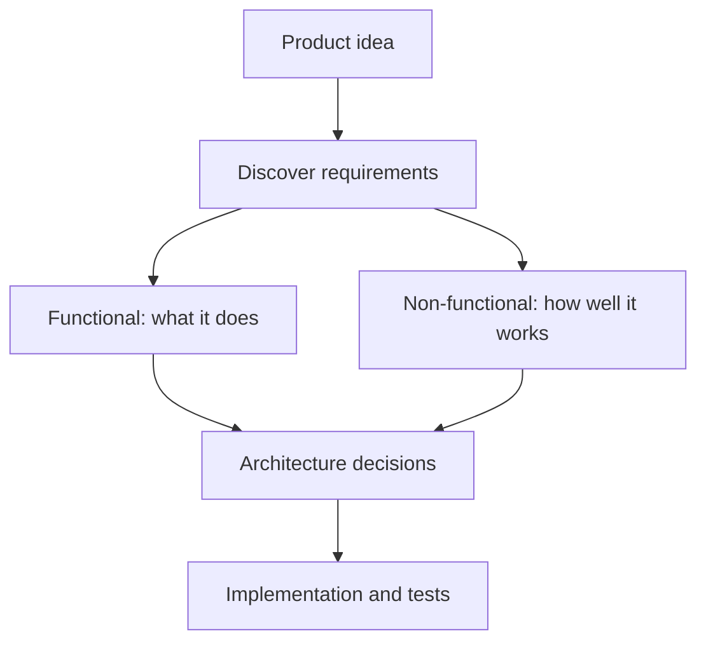
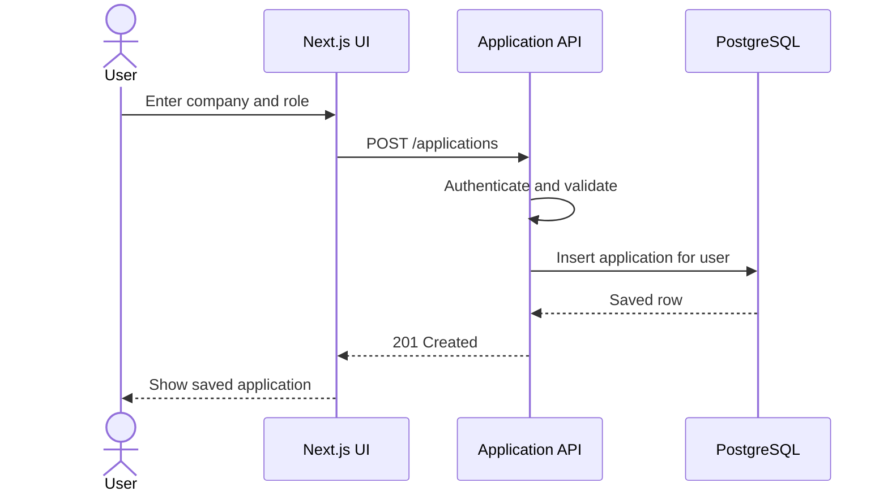
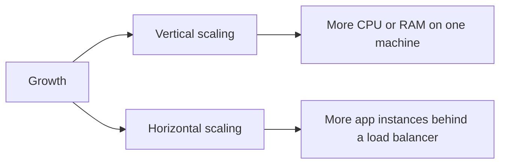
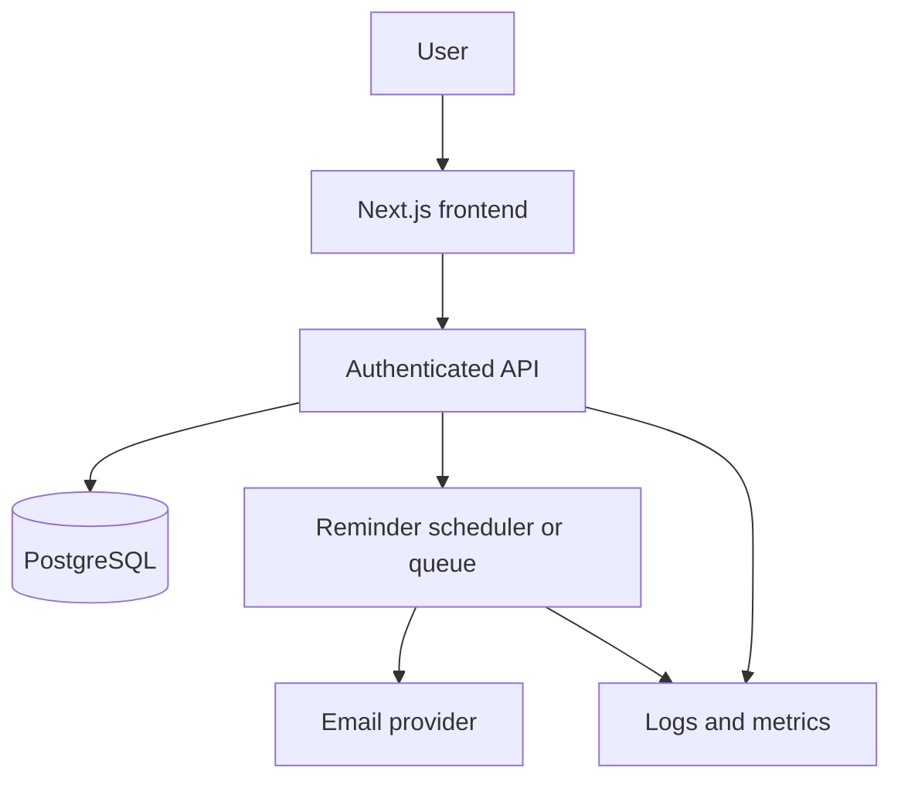
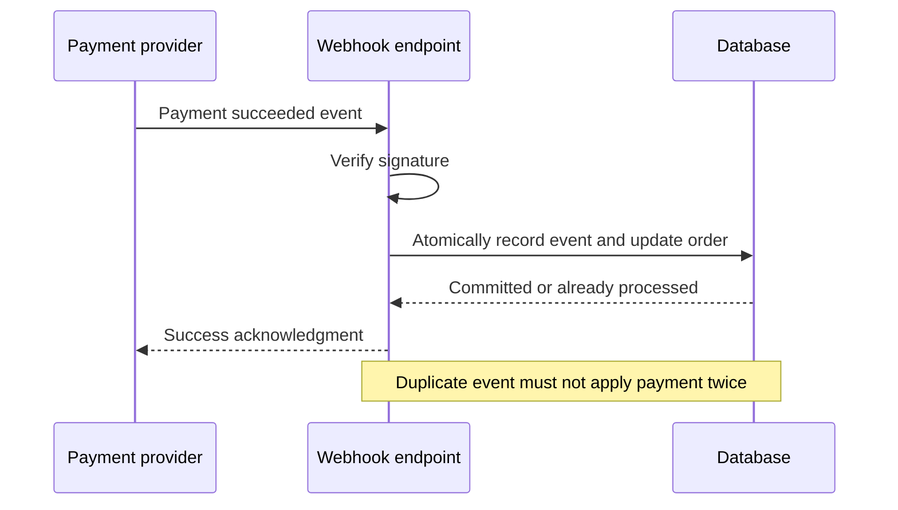

# Lesson 3 — Functional vs Non-Functional Requirements ⭐⭐⭐⭐⭐

> **Goal:** Learn how to convert a product idea into clear requirements before designing its architecture. We will use a job application tracker (CareerLoop) and a payment checkout as real examples.

## 1. Why do requirements come before architecture?

Imagine someone says: **"Build a job application tracker."**

You could immediately choose Next.js, Node.js and PostgreSQL. But you still do not know:

- Can users sign in?
- Can they save applications and update statuses?
- How many users are expected?
- How quickly should pages load?
- What happens if a reminder job fails?
- Should data remain private between users?

These questions are **requirements**. A design that ignores them may work in a demo but fail in production.

**Requirement:** A clear statement of what a system must do or how well it must operate.

Two major categories:

1. **Functional requirements (FR):** What the system does.
2. **Non-functional requirements (NFR):** How well the system does it and what constraints it must satisfy.



## 2. Functional requirements: WHAT the system must do

A functional requirement describes an observable behavior, operation, business rule or interaction.

For CareerLoop, examples include:

| ID | Functional requirement | Example acceptance check |
|---|---|---|
| FR-01 | A user can create an account and sign in | Valid credentials create an authenticated session |
| FR-02 | A user can add a job application | Saved application appears in their list |
| FR-03 | A user can update application status | Applied → Screening updates the record |
| FR-04 | A user can search and filter applications | Filter by company and status returns matching entries |
| FR-05 | A user can schedule a follow-up reminder | A reminder is stored for the selected date |
| FR-06 | A user can delete their own application | The application is no longer available in their active list |

Notice the difference between **a feature** and **an implementation choice**:

- Requirement: "Users can search their applications."
- Possible implementation: PostgreSQL indexes and a search endpoint.
- The index is *not* itself the user's functional requirement.

### Types of functional requirements

**User-facing:** sign up, login, upload a resume, create an application.

**Business rules:** an interview cannot be scheduled for an application that does not exist; an application belongs to one owner.

**System-to-system:** send an email through a provider, receive a payment webhook.

**Background behavior:** generate reminders or process queued notifications.

**Administration:** authorized staff can disable abusive accounts.

### Functional flows and edge cases

Consider "Add application":



Happy path is not enough. Ask:

- What if the company name is missing?
- What if the session has expired?
- What if the database is temporarily unavailable?
- Can one user edit another user's application?
- What happens if the user clicks Save twice?

Some answers are functional rules; others create non-functional needs such as security and resilience.

## 3. Non-functional requirements: HOW WELL it must work

NFRs describe quality attributes and operating constraints. They shape architecture even when the features stay the same.

| Quality attribute | Question | Example target (illustrative, not a universal standard) |
|---|---|---|
| Performance | How fast? | 95% of application-list requests finish within 300 ms under stated load |
| Availability | How often is it usable? | 99.9% monthly successful service availability |
| Scalability | Can it handle growth? | Handle 10× current traffic with a planned scaling strategy |
| Reliability | Does it behave correctly over time? | A committed application is not lost after a server restart |
| Durability | Does saved data survive failures? | Committed records survive a single app-instance crash |
| Security | Who can access what? | Users can only read and modify their own records |
| Privacy | How is personal data handled? | Minimize personal data and apply retention/deletion policies |
| Maintainability | How easy is change? | Modules have automated tests and clear boundaries |
| Observability | Can operators understand failures? | Logs, metrics, traces and alerting for critical paths |
| Accessibility | Can diverse users operate it? | Keyboard navigation and suitable accessible controls |
| Disaster recovery | Can we restore service/data? | Defined recovery time and recovery point objectives |
| Cost efficiency | What can we afford? | Stay within a documented monthly infrastructure budget |
| Interoperability | Can systems communicate? | External integrations follow documented API contracts |
| Compliance | Which rules apply? | Applicable legal/contractual obligations are identified |

**Important:** A vague statement like "The app must be fast" is hard to test. A measurable target needs a metric, a workload and a measurement window.

### Performance: latency vs throughput

- **Latency:** time for one operation to finish (for example, 180 ms).
- **Throughput:** number of operations completed per unit of time (for example, 500 requests/second).
- **Concurrency:** number of operations in progress at the same time.

These are related but not interchangeable.

For a list endpoint, you might specify: **p95 server-side latency under 300 ms at 100 requests/second, with a representative dataset of 100,000 applications.** This is a *proposed test target*, not a claim about CareerLoop's current performance.

**p95** means at least 95% of measured requests completed at or below that latency value.

### Availability vs reliability vs durability

- **Availability:** the service is accessible and can perform its intended function.
- **Reliability:** it keeps behaving correctly over a period, including when problems occur.
- **Durability:** once data is successfully committed, it is retained despite specified failures.

A service can be available but unreliable (it responds, but sends duplicate reminders). A database can provide durable storage while the application is temporarily unavailable.

#### Availability calculation

```text
Availability = (Total time - Unavailable time) / Total time × 100
```

For a **30-day month** (43,200 minutes):

| Monthly availability target | Approximate allowed downtime |
|---|---:|
| 99% | 7 hours 12 minutes |
| 99.9% | 43 minutes 12 seconds |
| 99.99% | 4 minutes 19 seconds |

These are simple time-based illustrations. Real SLAs may use request-based measurements, exclusions and different windows.

### Scalability vs performance

A query might be fast for 100 rows but slow for 10 million. **Performance** describes behavior at a workload; **scalability** describes how the system can maintain acceptable behavior as workload or data grows.

Two common strategies:



Horizontal scaling does not automatically solve database bottlenecks, shared state, or coordination.

## 4. Constraints are not the same as quality goals

A **constraint** limits design choices:

- "Use PostgreSQL because the team already operates it."
- "Use a provider's free tier."
- "Must deploy in a particular region."
- "The team has two developers and four weeks."

A **quality goal** describes a desired property:

- "The application should recover quickly after a crash."

A **functional requirement** describes behavior:

- "The user can create an application."

Some constraints are grouped under NFRs in real specifications. The important skill is recognizing their effect on design.

## 5. Real-world example: CareerLoop

### Step 1: Clarify scope

Assume **multi-user CareerLoop**, not just a personal local tracker. This assumption matters: authentication and per-user isolation become essential.

**In scope:** login, CRUD applications, filter by status, schedule reminders.

**Out of scope for v1:** automatic applications to job boards, AI matching and recruiter messaging.

### Step 2: Write the requirements

**Functional:**

1. Authenticated users can create, view, update and delete their own applications.
2. Users can filter by status and company.
3. Users can schedule a reminder linked to an application.
4. The system can send due reminders through an email provider.

**Non-functional (sample targets to validate):**

1. p95 application-list API latency below 300 ms at 100 requests/second.
2. No cross-user application access, including direct requests using another record ID.
3. A failed reminder attempt is retryable without uncontrolled duplicate sends.
4. Service and database errors are visible in monitoring.
5. Backups and a tested restore process protect important data.

### Step 3: Derive an initial architecture



**Why each component?**

- API: supports application CRUD and authorization.
- PostgreSQL: stores application records and reminder schedules.
- Reminder worker/scheduler: supports scheduled work outside an ordinary page request.
- Email provider: delivers reminder messages.
- Monitoring: helps detect errors and failures.

This is a **candidate design**, not the only correct architecture. At low traffic, a scheduled job and database table may be enough; a separate queue can be added when requirements justify it.

### Step 4: Map requirements to architecture and tests

| Requirement | Possible design choice | How to verify |
|---|---|---|
| Add application | POST endpoint + DB insert | Integration test |
| User isolation | Auth + owner-scoped DB queries | Cross-user authorization test |
| Fast filtering | Query plan and appropriate indexes | Load test on realistic data |
| Due reminders | Scheduler/worker | Simulated clock and retry tests |
| Failure visibility | Structured logs and metrics | Trigger controlled failure and inspect alert |
| Recoverable data | Backups and restore procedure | Restore drill |

## 6. Practical implementation: functional + non-functional in one endpoint

Example with Express 5-style asynchronous error propagation and a PostgreSQL-style repository:

```js
// Conceptual example: db and requireAuth are provided elsewhere.
app.post("/applications", requireAuth, async (req, res) => {
  const { company, role } = req.body;

  if (
    typeof company !== "string" ||
    !company.trim() ||
    typeof role !== "string" ||
    !role.trim()
  ) {
    return res.status(400).json({ error: "Invalid application data" });
  }

  const application = await db.applications.create({
    ownerId: req.user.id, // Never trust ownerId from the request body.
    company: company.trim(),
    role: role.trim(),
    status: "Applied",
  });

  return res.status(201).json({ data: application });
});
```

**Functional:** the user creates an application.

**Security NFR:** the server derives ownership from the authenticated session, not user input.

**Reliability NFR:** database errors should reach centralized error handling; don't silently claim success.

**Performance NFR:** the endpoint needs measurement before anyone can promise a latency target.

**Note:** This snippet illustrates responsibilities; `db.applications.create` is a placeholder repository method, not a built-in PostgreSQL API. Real code also needs schema validation, authorization checks on reads/updates, monitoring and tests.

## 7. Second example: payment checkout

A payment feature makes the distinction even clearer.

**Functional requirements:**

- Customer can initiate checkout.
- System can receive and verify provider payment events.
- Paid orders transition to a paid state.
- Customer can view payment status.

**Non-functional requirements:**

- Duplicate webhook deliveries must not create duplicate orders or credits.
- Secrets and sensitive payment data must be protected.
- Failures must be observable and recoverable.
- The system must handle expected peak checkout traffic.



**Important nuance:** "Mark an order paid" is a functional behavior; "processing the same event twice must not double-apply its effect" is a correctness/business rule and a reliability requirement. Categories can overlap. Clear, testable behavior matters more than forcing every statement into exactly one box.

## 8. How to discover requirements in a system design interview

Ask targeted questions **before drawing boxes**.

### Functional discovery

- Who are the users and what can each role do?
- What are the 3–5 most important actions?
- Which workflows must be supported?
- What is explicitly out of scope?
- What should happen for invalid inputs or failures?

### Non-functional discovery

- How many daily active users and requests per second?
- Read-heavy or write-heavy?
- How much data and how quickly will it grow?
- What latency and availability targets matter?
- Is strong consistency required anywhere?
- How sensitive is the data?
- What is the acceptable cost and deployment region?
- What recovery expectations exist?

Do not ask every question mechanically. Prioritize those that can change the architecture.

## 9. Capacity estimation: connecting requirements to numbers

Suppose (illustrative assumptions):

- 100,000 daily active users.
- Each creates 2 applications per day.
- Each reads the application list 10 times per day.

Then:

```text
Writes/day = 100,000 × 2 = 200,000
Reads/day  = 100,000 × 10 = 1,000,000

Average writes/sec ≈ 200,000 / 86,400 ≈ 2.3
Average reads/sec  ≈ 1,000,000 / 86,400 ≈ 11.6
```

These are **averages**, not peak rates. If peak traffic is 10× the daily average, estimated peak reads are about 116/sec. The 10× multiplier is an assumption to test, not a general rule.

Also estimate stored bytes, indexes, backups, retention and future growth before choosing infrastructure.

## 10. Common mistakes

1. **Choosing tools first:** "We need Kafka" before establishing a queue-related requirement.
2. **Vague NFRs:** "Fast, scalable, secure" without measurable meaning.
3. **Ignoring authorization:** Authentication alone does not stop cross-user data access.
4. **Ignoring edge cases:** Only designing the happy path.
5. **Overengineering:** Deploying many microservices for a small single-user MVP.
6. **Confusing metrics:** Throughput is not latency; uptime is not data durability.
7. **Treating assumptions as facts:** Mark uncertain traffic, cost and latency figures as estimates.
8. **Ignoring conflicting goals:** Higher availability, consistency, speed and low cost may require trade-offs.

## 11. Requirement prioritization and traceability

Not all requirements deserve equal investment on day one.

**MoSCoW** is a simple prioritization approach:

- **Must have:** login and owner-scoped application CRUD.
- **Should have:** reminder delivery and retries.
- **Could have:** analytics dashboard.
- **Won't have in v1:** automatic applications to job portals.

For each important requirement, track:

```text
Requirement → Architecture decision → Implementation → Test → Monitoring
```

This is **traceability**: you can explain why a component exists and how you know the requirement is satisfied.

### Acceptance criteria

Use observable, testable language.

Weak: "The API should be secure."

Better: "An authenticated user requesting another user's application by ID receives no application data; this is covered by automated authorization tests."

Weak: "The dashboard should load quickly."

Better: "Under the agreed load profile, 95% of dashboard API requests complete in under 300 ms, measured server-side over a 30-minute test."

## 12. Trade-offs and design decisions

Consider three situations:

| Situation | What matters most | Likely design direction |
|---|---|---|
| Personal tracker with one user | Simplicity and low cost | One application and managed DB |
| Growing SaaS with many users | Isolation, performance, observability | Strong auth boundaries, indexes, monitoring, scale app instances as needed |
| Payment processing | Correctness, security, recovery | Transactional state changes, idempotency, verified events |

A requirement is not just documentation. It is a reason behind a design decision.

## 13. Interview questions

1. What is the difference between a functional and non-functional requirement?
2. Is authentication functional or non-functional? Explain both the login feature and security goals.
3. How do you convert "fast application" into a measurable requirement?
4. What is the difference between availability, reliability and durability?
5. How do latency, throughput and concurrency differ?
6. What questions would you ask before designing a chat application?
7. How would you estimate peak traffic from daily active users?
8. Why is it dangerous to pick Redis, Kafka or microservices before defining requirements?
9. What does an acceptance criterion look like?
10. How do you handle conflicting requirements, such as low cost and very high availability?

## 14. Practice exercise

Design the requirements for a **URL shortener** (like a tiny-link service).

Write:

- At least 5 functional requirements.
- At least 6 measurable non-functional requirements or explicit constraints.
- Two edge cases.
- Three clarification questions.
- One simple architecture diagram.
- A short explanation of why you chose the storage and caching approach.

**Challenge:** Decide whether custom aliases, analytics and expiration are in scope for v1. Explain how the answer changes your architecture.

## 15. Quick revision

- **Functional = what the system must do.**
- **Non-functional = how well the system must operate.**
- **Constraints = boundaries within which the design must work.**
- Make important requirements measurable and testable.
- Ask about scope, scale, data, security, failure behavior and cost.
- Convert requirements into architecture choices, tests and monitoring.
- Do not overengineer; design for the actual requirements and explicit growth assumptions.

### Next lesson

**Lesson 4 — Scalability:** vertical vs horizontal scaling, stateless servers, bottlenecks, scaling databases, and practical trade-offs.
