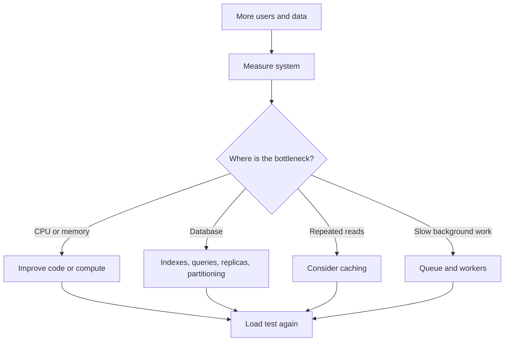
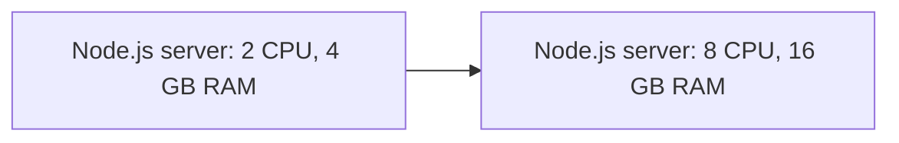
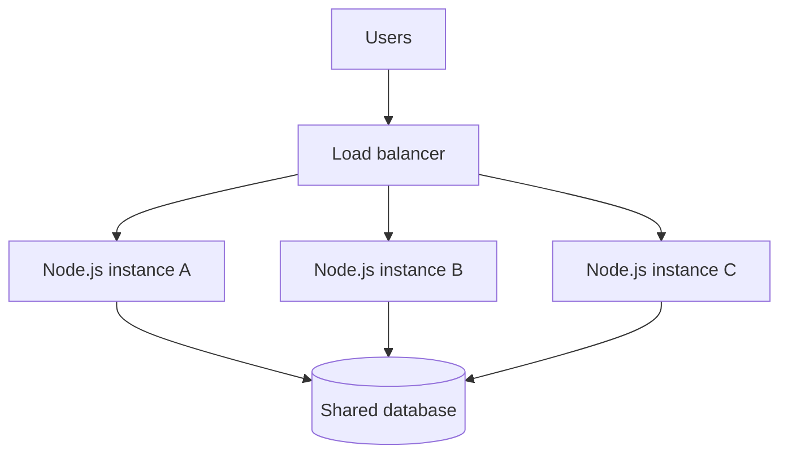
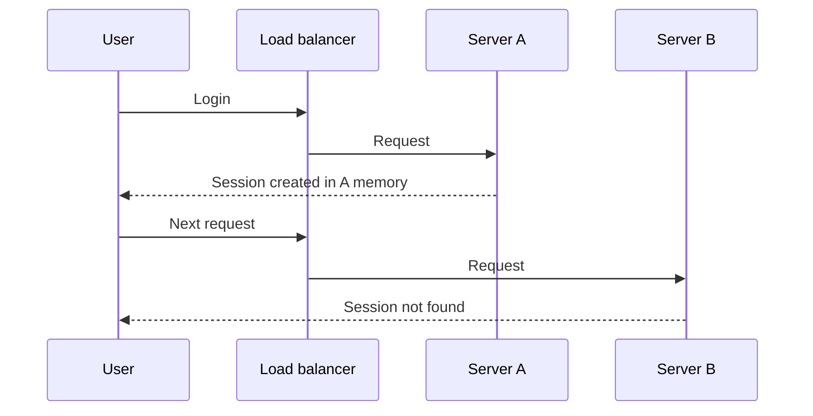
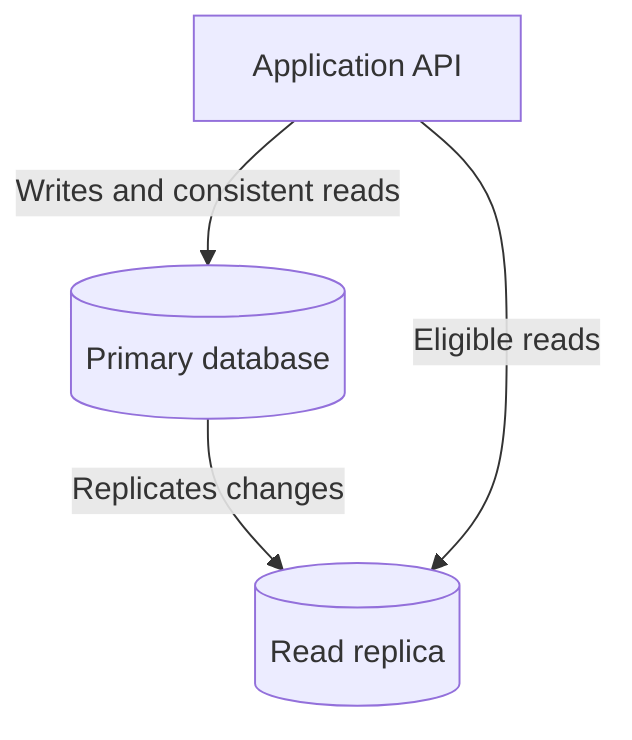
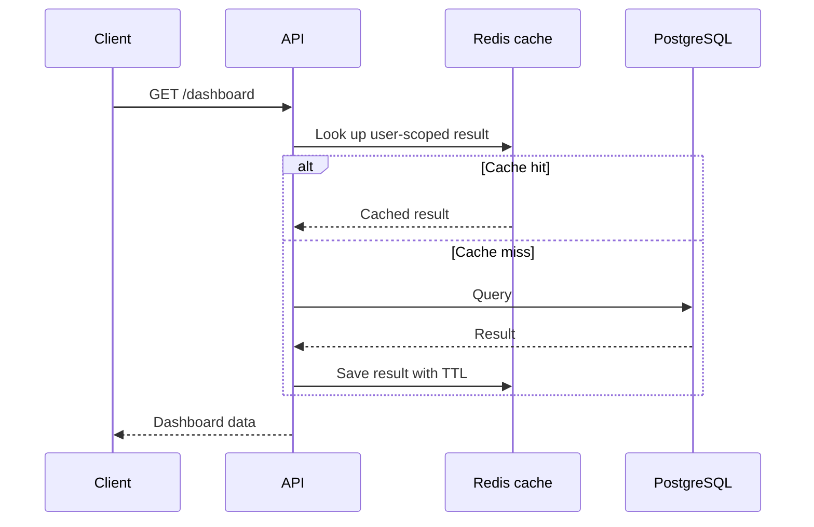
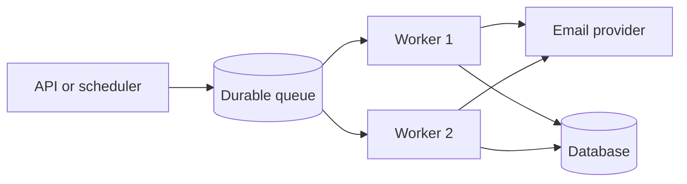
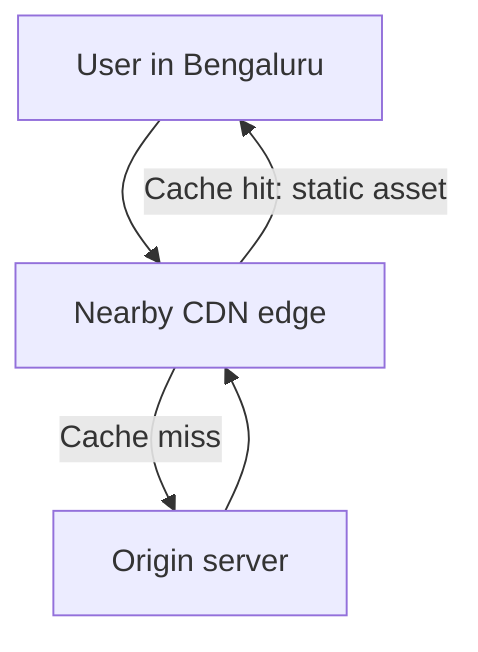
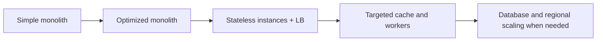

# Lesson 04 — Scalability ⭐⭐⭐⭐⭐

> **Goal:** Understand how real systems handle growth in users, requests, data, and background work without becoming too slow, too expensive, or unreliable. Examples use Next.js, Node.js, PostgreSQL, Redis, and a job tracker called CareerLoop.

## 1. What is scalability?

**Scalability** is a system's ability to handle an increasing workload by adding or changing resources while keeping acceptable performance, reliability, and cost.

Imagine CareerLoop starts with 100 users. One Node.js server and one PostgreSQL database work well. Later, 100,000 users sign in, search applications, and schedule reminders. If the system becomes slow or crashes, we must find the bottleneck and improve the architecture.

Growth can mean:
- **Traffic growth:** more requests per second.
- **Data growth:** more records, larger indexes, more storage.
- **Concurrency growth:** more active requests at the same time.
- **Workload complexity:** expensive reports, uploads, search, and background jobs.
- **Geographic growth:** users farther from the server.

**Key principle:** Scalability does not mean “always use microservices.” It means designing the right way to handle the *actual* growth.



## 2. Scalability vs performance vs availability

| Term | Meaning | Example |
|---|---|---|
| Performance | How quickly work completes at a given load | Application list takes 120 ms |
| Scalability | How well the system handles increasing load | It can serve 10× traffic with added capacity |
| Availability | How often the service can be used | The service meets a 99.9% availability target |
| Elasticity | How automatically and quickly capacity changes with demand | Add instances during peak traffic and remove them later |
| Efficiency | Useful work per unit of resources or money | More requests per CPU core |

A fast application is **not necessarily scalable**. A system may be fast with 10 users and unusable with 10,000.

## 3. First understand the workload

Before choosing architecture, ask:

1. How many daily active users (DAU)?
2. How many operations per user per day?
3. What is the read-to-write ratio?
4. What is peak requests per second (RPS)?
5. How large are requests and responses?
6. How much data is stored, and how fast does it grow?
7. What latency target matters (p50, p95, p99)?
8. What can fail without losing important data?
9. What is the budget?

### Example: estimating CareerLoop traffic

Assume 100,000 DAU, each user reads their application list 12 times and creates or edits 3 applications daily.

```text
Daily reads = 100,000 × 12 = 1,200,000
Daily writes = 100,000 × 3 = 300,000

Average read RPS = 1,200,000 / 86,400 ≈ 13.9
Average write RPS = 300,000 / 86,400 ≈ 3.5
```

If the busiest period reaches **10× average** (an assumption to verify), expect around 139 read RPS and 35 write RPS.

These are starting estimates, not guaranteed capacity needs. Traffic is bursty and one expensive request may cost more than 100 cheap requests.

### Little's Law (useful mental model)

For a stable system, approximately:

```text
Average concurrent requests = arrival rate × average time in system
L = λ × W
```

At 100 requests/sec with 0.2 sec average response time, roughly 20 requests are in progress on average. **Do not** use this alone for sizing; bursts, queueing, tail latency, and uneven request costs matter.

## 4. Vertical scaling (scale up)

**Vertical scaling** means giving a machine more CPU, RAM, disk capacity, or faster storage.



**Advantages:** simple operational model, few application changes, useful for databases and early-stage products.

**Limitations:** hardware limits, bigger-machine costs, possible restart/downtime, and a single machine can remain a single point of failure.

**Important Node.js nuance:** Increasing CPUs does not automatically make one JavaScript event loop execute JavaScript on all cores. Multiple processes, worker threads for CPU-heavy work, or additional server instances may be needed.

## 5. Horizontal scaling (scale out)

**Horizontal scaling** means adding more machines or application instances.



**Advantages:** capacity can increase in steps, failures can be isolated, and multiple instances improve resilience if the infrastructure is configured correctly.

**Costs:** load balancing, deployments, coordination, network calls, shared state, monitoring, and possibly database connection pressure.

**A load balancer distributes requests. It does not automatically solve database bottlenecks or make the application stateless.**

### Scale up vs scale out

| Question | Vertical | Horizontal |
|---|---|---|
| Add capacity by | Increasing machine resources | Adding instances |
| Operational complexity | Usually lower | Usually higher |
| Upper limit | One-machine ceiling | Broader, but dependencies still limit growth |
| Failure tolerance | One machine can fail | Can tolerate instance failures with correct design |
| Best starting point | Small app, DB tuning | Stateless web/API tier under growing traffic |

Real systems often combine both.

## 6. Stateless servers: the foundation of horizontal scaling

A **stateless API instance** does not depend on its own local memory for data needed by the user's next request.

### Problem: storing sessions in one server's memory



### Better choices

- Use secure signed session identifiers with a **shared session store** (such as Redis or a database).
- Or validate appropriately designed **stateless tokens** on each instance, with careful expiration, revocation strategy, and secure cookie handling.
- Keep user data in shared durable storage rather than process memory.
- Store uploaded files in suitable shared object storage, not only on one app instance.

**Sticky sessions** can route a user to the same server, but they reduce flexibility and do not replace a durable shared state strategy.

### Node.js example: do not keep production state in a local array

```js
// Bad for multi-instance deployments:
const applications = [];

app.post("/applications", (req, res) => {
  applications.push(req.body);
  res.sendStatus(201);
});
```

Server A's array differs from Server B's. Restarting either loses its data. Use a database and authenticated, owner-scoped operations instead.

## 7. Load balancers and health checks

A load balancer can distribute requests using algorithms such as:

- **Round robin:** rotate between healthy servers.
- **Least connections:** prefer the server with fewer active connections.
- **Weighted routing:** send more traffic to instances with greater assigned capacity.
- **Consistent hashing:** route related keys to a stable set of destinations, useful in some distributed systems.

### Health checks

- **Liveness:** is the process alive? Useful for restarting broken instances.
- **Readiness:** can it safely receive traffic now? Useful for removing an instance from routing during startup or dependency trouble.

Avoid an overly strict liveness check that restarts every server during a temporary shared-database outage.

```js
// Express example: lightweight liveness endpoint
app.get("/health/live", (_req, res) => {
  res.status(200).json({ status: "alive" });
});

// Readiness may verify required dependencies with bounded timeouts.
// Do not use expensive database queries on every health probe.
```

## 8. The database is often the real bottleneck

Adding ten API servers may make the database work **harder**.

### Query optimization and indexes

Suppose a user filters applications by owner and status, newest first:

```sql
SELECT id, company, role, status, created_at
FROM applications
WHERE owner_id = $1 AND status = $2
ORDER BY created_at DESC, id DESC
LIMIT 20;
```

A candidate index:

```sql
CREATE INDEX applications_owner_status_created_idx
ON applications (owner_id, status, created_at DESC, id DESC);
```

Use `EXPLAIN (ANALYZE, BUFFERS)` with representative data to inspect the real plan. Indexes improve some reads but consume storage and add write overhead. Do not add indexes blindly.

### Pagination

Avoid returning every application at once. Prefer bounded pages. Large `OFFSET` values can become expensive; **keyset/cursor pagination** is often useful for deep, stable ordering.

```sql
SELECT id, company, created_at
FROM applications
WHERE owner_id = $1
  AND (created_at, id) < ($2, $3)
ORDER BY created_at DESC, id DESC
LIMIT 20;
```

Here `$2` and `$3` are the last row's cursor values. For the first page, omit the cursor condition. A matching index on `(owner_id, created_at DESC, id DESC)` may help. Concurrent inserts/deletes and changing sort keys still require careful pagination semantics.

### Connection pooling

Each API instance may create a pool of database connections.

```text
10 app instances × 20 max connections = up to 200 connections
```

A database may not handle that many efficiently. Set pool sizes according to the database and workload; use an appropriate pooler when necessary. Connection count is not the same as useful throughput.

### Read replicas



Replicas can reduce read pressure, but replication lag means a new write may not immediately appear on the replica. **Read-your-writes** flows may need to read from the primary or use a consistency-aware strategy.

### Partitioning and sharding

- **Partitioning:** split a large table/dataset into manageable parts, often inside one database system.
- **Sharding:** distribute data across separate database nodes/shards by a chosen key.
- **Replication:** copy data for availability and/or read capacity; it does not divide the write dataset like sharding.

Sharding introduces routing, resharding, cross-shard queries, transactions, and hotspot challenges. Usually optimize schema, queries, indexes and capacity first.

## 9. Caching: reduce repeated expensive work

A cache stores a reusable result closer to where it is needed.



**Common patterns:**

- **Cache-aside:** app reads cache, falls back to DB, then populates cache.
- **Write-through:** updates cache and backing store through a coordinated path.
- **Write-behind:** writes are buffered and persisted later; faster writes but added durability risk.

### Cache challenges

- **Invalidation:** how to remove stale data after an update.
- **TTL:** how long cached data remains valid.
- **Cache stampede:** many requests recompute an expired popular key.
- **Hot keys:** one key gets disproportionate traffic.
- **Eviction:** what happens when memory fills.
- **Privacy:** never share user-private cache entries across users accidentally.

Example key: `dashboard:user:42:v2` rather than a global `dashboard` key. Redis is not automatically necessary for a small app; measure repeated expensive work first.

## 10. Background jobs and queues

Not every task should block an HTTP response.

For CareerLoop, sending an email reminder can be processed asynchronously:



### Why use a queue?

- Smooth sudden bursts of work.
- Scale workers separately from the API.
- Retry temporary failures.
- Protect the request path from slow external services.

### Important queue concepts

- **Producer:** creates jobs.
- **Consumer/worker:** processes jobs.
- **Acknowledgment:** records successful processing.
- **Retry with backoff:** repeats failed jobs after increasing delays.
- **Dead-letter queue:** stores jobs that repeatedly fail for inspection.
- **Idempotency:** repeated execution should not apply an unintended effect twice.
- **Backpressure:** slow producers or limit intake when consumers cannot keep up.

Many queues provide **at-least-once delivery**, so duplicate execution is possible. Do not assume exactly-once external email or payment effects.

### Reminder example

A reminder job could contain `{ reminderId: "r_123" }`. The worker loads the reminder from the database, checks current status, claims it safely, sends via the provider, and records the outcome. Production code needs a carefully designed claim/retry/idempotency strategy; simply setting `sent=true` before sending can lose emails, while setting it only after sending can duplicate them after a crash.

## 11. Scaling Node.js: event loop, processes, and workers

Node.js runs JavaScript callbacks on an event loop by default. It can handle many concurrent I/O operations, but CPU-heavy JavaScript can block that event loop.

```js
// CPU-heavy synchronous work blocks this event loop:
app.get("/bad-report", (_req, res) => {
  let total = 0;
  for (let i = 0; i < 500_000_000; i++) total += i;
  res.json({ total });
});
```

**Better approaches:**

- Optimize the algorithm.
- Move heavy CPU tasks to `worker_threads` or separate worker services.
- Run multiple Node.js processes/instances for available CPU cores.
- Use asynchronous I/O for database and network work.
- Avoid unbounded concurrency that overwhelms dependencies.

**Do not confuse:** `Promise.all()` overlaps asynchronous operations but does not make CPU-heavy JavaScript parallel on the same event loop.

### Example: bounded work matters

```js
// Dangerous with a huge array: starts all requests together.
await Promise.all(userIds.map((id) => fetchUser(id)));

// Better: process in bounded batches (simple illustration).
const batchSize = 10;
for (let i = 0; i < userIds.length; i += batchSize) {
  const batch = userIds.slice(i, i + batchSize);
  await Promise.all(batch.map((id) => fetchUser(id)));
}
```

Batching limits concurrent requests, although a production concurrency limiter offers smoother utilization.

## 12. CDN, geographic distribution, and network latency

A **Content Delivery Network (CDN)** caches eligible content at edge locations near users.

Useful for images, fonts, static JS/CSS, and cacheable public pages. It does **not** automatically make private personalized API responses safe to cache.



Geographic scaling may also involve multiple regions, but introduces data replication, consistency, deployment, failover and compliance complexity. Start with the regions users actually need.

## 13. Autoscaling and elasticity

**Autoscaling** changes capacity using signals such as CPU usage, request rate, queue depth or latency.

Example policy (illustrative):
- Add an API instance when sustained CPU utilization is high *and* request latency indicates pressure.
- Scale workers based on queue backlog and processing time.
- Scale down gradually to avoid constant oscillation.

Important details:
- **Warm-up time:** new instances take time to start.
- **Cooldown/hysteresis:** prevent rapid scale-up/scale-down loops.
- **Minimum instances:** avoid cold starts where latency matters.
- **Maximum instances:** protect budget and database connections.
- **Load shedding:** reject or defer excess work rather than causing complete failure.

Autoscaling cannot fix inefficient SQL or an exhausted shared database.

## 14. Bottlenecks, Amdahl's Law, and capacity limits

A system's throughput is often limited by its slowest shared dependency.

```text
Client → Load balancer → API → Database → External provider
```

If the database can handle 200 expensive queries/sec, adding API instances capable of 2,000 requests/sec will not make those queries complete 10× faster.

**Amdahl's Law:** If only part of a workload can be parallelized, speedup is limited by the remaining serial part.

```text
Speedup(N) = 1 / ((1 - P) + P / N)
P = fraction of work that can be parallelized
N = number of parallel workers
```

For P = 0.8 and N = 4, speedup is 1 / (0.2 + 0.2) = **2.5×**, not 4×. This is a simplified model; distributed overhead can reduce real speedup further.

**Practical lesson:** Measure bottlenecks before adding servers.

## 15. How to measure scalability

### Key metrics

| Layer | Metrics |
|---|---|
| API | RPS, p50/p95/p99 latency, error rate, in-flight requests |
| Compute | CPU, memory, event-loop delay, restarts |
| Database | Query latency, slow queries, locks, connections, cache hit ratio |
| Queue | Backlog, oldest job age, retries, failures, processing time |
| Cache | Hit rate, memory, evictions, hot keys |
| Business | Successful application creations, reminders delivered |

**p99 latency** is the value at or below which 99% of observed requests finish. Averages alone hide slow outliers.

### Types of tests

1. **Load test:** expected normal/peak traffic.
2. **Stress test:** increase load until limits or failure appear.
3. **Spike test:** sudden traffic surge.
4. **Soak/endurance test:** sustained load to detect leaks or gradual degradation.
5. **Capacity test:** find maximum workload meeting the agreed service-level objectives.

Use representative data, realistic read/write mixes, and a safe test environment. Avoid uncontrolled load against third-party services.

### Example with k6

```js
// load-test.js — run against a test deployment you control.
import http from "k6/http";
import { check, sleep } from "k6";

export const options = {
  stages: [
    { duration: "1m", target: 20 },
    { duration: "3m", target: 20 },
    { duration: "1m", target: 0 },
  ],
  thresholds: {
    http_req_failed: ["rate<0.01"],
    http_req_duration: ["p(95)<500"],
  },
};

export default function () {
  const res = http.get("http://localhost:3000/health/live");
  check(res, { "status is 200": (r) => r.status === 200 });
  sleep(1);
}
```

This is a **smoke/load-test example for a lightweight endpoint**, not proof that the full application meets its performance goals. Test real authenticated business flows separately.

## 16. A step-by-step scaling plan for CareerLoop

**Stage A — MVP (small traffic):**
- Next.js app + managed PostgreSQL.
- Proper indexes, pagination, validation, authorization.
- Basic metrics, backups, and error handling.
- A simple scheduler for reminders if sufficient.

**Stage B — Growing usage:**
- Measure p95 latency and database query cost.
- Tune slow SQL and connection pooling.
- Run multiple stateless API instances if compute/availability needs justify them.
- Add Redis only for measured caching/session needs.
- Introduce queue workers if reminder volume or reliability demands it.

**Stage C — Larger scale:**
- Consider read replicas for eligible read-heavy queries.
- Autoscale independently constrained services.
- Add resilience measures: rate limits, timeouts, retries with jitter, circuit breakers where useful.
- Plan regional delivery, recovery procedures, and data growth.
- Consider partitioning/sharding only after identifying a real bottleneck.



**Important:** This is a possible evolution, not a mandatory sequence. Scaling choices depend on actual constraints.

## 17. Trade-offs and common mistakes

| Mistake | Why it hurts | Better approach |
|---|---|---|
| Starting with microservices | Extra deployment/network complexity | Begin with clear modular boundaries |
| Adding Redis everywhere | Stale data and invalidation overhead | Cache measured hotspots |
| Increasing API instances endlessly | Database becomes overloaded | Profile the whole request path |
| Using local in-memory sessions | Requests fail on other instances | Shared session store or properly designed tokens |
| Unlimited retries | Retry storms amplify outages | Timeouts, exponential backoff, jitter, retry limits |
| No database indexes | Full scans as data grows | Examine query plans and access patterns |
| Unlimited `Promise.all` | Resource exhaustion | Bound concurrency |
| Measuring only average latency | Tail latency goes unnoticed | Monitor p95/p99 and errors |
| Sharding too early | Routing and consistency complexity | Tune single DB first |
| Scaling without cost limits | Unexpected bills | Budgets, alerts, capacity caps |

## 18. Interview questions (with answer direction)

1. **What is scalability?** Handling increased load while maintaining acceptable system qualities.
2. **Vertical vs horizontal scaling?** Bigger machine vs more machines; compare operational complexity and failure modes.
3. **Why are stateless APIs easier to scale?** Any healthy instance can serve a request without depending on local user state.
4. **Does a load balancer make a system scalable?** Not by itself; shared dependencies may bottleneck.
5. **How do you scale a read-heavy API?** Profile SQL, indexes, pagination, caching, eligible replicas.
6. **How do you scale a write-heavy service?** Optimize writes, batching where appropriate, partitioning/sharding only when needed.
7. **What is a cache stampede?** Many concurrent misses recompute the same expired key.
8. **What is the danger of read replicas?** Lag and stale reads.
9. **How can queues help?** Decouple bursts and independently scale background processing.
10. **How does Node.js use multiple CPU cores?** Multiple processes/instances or worker threads for suitable workloads.
11. **Why can autoscaling make an outage worse?** More instances may overload the same failing database.
12. **What is the difference between latency, throughput, and concurrency?** Time per operation, completed operations per time, and work in progress.

## 19. Practice exercises

### Exercise A — CareerLoop
Assume 500,000 DAU, 10 list reads and 2 writes per user per day. Estimate average RPS, then assume a 12× peak multiplier. State assumptions and identify the first metrics you would measure before adding infrastructure.

### Exercise B — Fix an architecture
Three Node.js instances behind a load balancer store login sessions in local memory. Users are randomly logged out. Draw the failure flow and propose two fixes, including their trade-offs.

### Exercise C — Slow dashboard
A dashboard performs five heavy SQL queries on every refresh. Describe how to determine whether indexes, caching, precomputation, or read replicas are appropriate.

### Exercise D — Design a scalable notification system
Draw API → queue → workers → provider. Explain retries, idempotency, dead-letter handling, rate limits, and what happens when the provider is down.

## 20. Quick revision

- Scalability = handling **growth**, not merely being fast.
- Measure workload, latency, throughput, errors, and bottlenecks first.
- Vertical = bigger machine; horizontal = more instances.
- Stateless APIs are easier to distribute.
- Databases, connection pools, and external APIs often limit overall capacity.
- Indexes, pagination, caching, queues, replicas, and sharding solve **different** problems.
- Node.js async I/O handles concurrency; CPU-heavy JavaScript still needs careful isolation.
- Load testing and production observability validate your scaling decisions.
- **Prefer the simplest architecture that meets measurable requirements.**

### Next lesson

**Lesson 05 — Availability, Reliability & Latency:** failure models, uptime, redundancy, recovery, SLIs/SLOs/SLAs, and latency budgets.
