# Lesson 05 — Availability, Reliability & Latency ⭐⭐⭐⭐⭐

> **Learning goal:** Understand what makes a production system available, reliable, and responsive. Learn how to measure these properties, survive failures, and make practical architecture decisions using Next.js, Node.js, PostgreSQL, Redis, and queues.

## 1. Why this lesson matters

Imagine CareerLoop, a job application tracker:

- At 9 AM, 10,000 users open their dashboard.
- A database connection fails for 30 seconds.
- An email provider takes 20 seconds to respond.
- A background reminder is accidentally delivered twice.
- Some users wait 8 seconds for a page.

These are **different kinds of failures**. We need different ways to measure and fix them.

Three important qualities:

| Quality | Main question | Example |
|---|---|---|
| **Availability** | Can users use the service when they need it? | The dashboard responds successfully |
| **Reliability** | Does the system keep producing correct results over time? | Reminders are processed correctly without unintended duplicates |
| **Latency** | How long does one operation take? | Application list returns in 180 ms |

They influence one another but are **not interchangeable**.

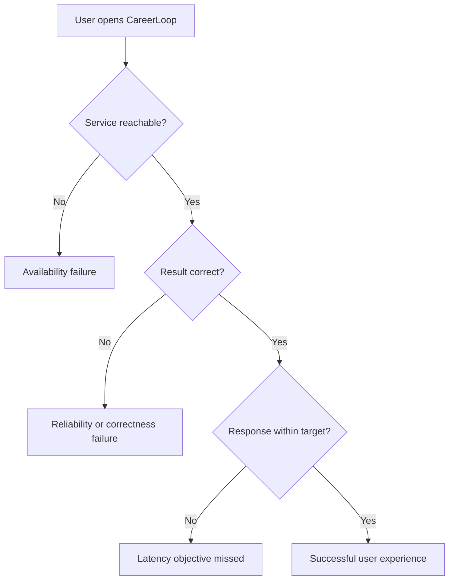

A system may be reachable but return wrong data. It may be correct but painfully slow. It may be fast most of the time but fail during peak traffic.

## 2. Availability: what does “up” actually mean?

**Availability** is the proportion of a defined time period or set of requests during which the service meets its availability criteria.

Two common measurement approaches:

### Time-based availability

```text
Availability = (Total measured time - Downtime) / Total measured time × 100
```

For a 30-day month:

```text
30 days × 24 hours × 60 minutes = 43,200 minutes
```

| Availability target | Maximum downtime in 30 days |
|---|---:|
| 99% | 432 min = 7 h 12 min |
| 99.9% | 43.2 min = 43 min 12 sec |
| 99.95% | 21.6 min = 21 min 36 sec |
| 99.99% | 4.32 min = 4 min 19.2 sec |
| 99.999% | 0.432 min = 25.92 sec |

These are **illustrations**. Real SLAs can have exclusions, rounding rules, request-based measurements, and different periods.

### Request-based availability

```text
Successful eligible requests / Total eligible requests × 100
```

Example: 999,000 successful eligible requests out of 1,000,000 means **99.9%** request success. Decide in advance which status codes and user-visible failures count. A 200 response containing an unusable error message is not necessarily a successful user interaction.

**Important:** “The server process is running” is not the same as “the product is available.”

## 3. Reliability: correct operation over time

**Reliability** is the ability of a system to perform its required function correctly over a specified period under specified conditions.

Examples:
- A saved application stays saved after an API instance restarts.
- A payment is not credited twice when a webhook is retried.
- A scheduled reminder eventually reaches its intended processing outcome.
- A database failover does not silently corrupt records.

### Reliability vs availability vs durability

- **Availability:** service is usable now or over a measured period.
- **Reliability:** service behaves correctly over time.
- **Durability:** committed data survives specified failures.

Example: A service responds to every request but sometimes saves the wrong application owner. It may have high availability but poor reliability and a serious security defect.

### Fault, error, and failure

- **Fault:** an underlying defect or problem, such as a broken network link.
- **Error:** an incorrect internal state caused by a fault.
- **Failure:** externally observable behavior differs from what was promised.

A fault does not always become a user-visible failure if the system has adequate fault tolerance.

## 4. Latency: how long does work take?

**Latency** is the elapsed time to complete an operation.

```text
Browser request → Network → API → Database → API → Network → Browser
```

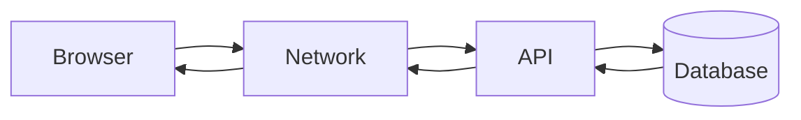

A simplified latency budget:

| Step | Example elapsed time |
|---|---:|
| Network to API | 40 ms |
| Authentication and application logic | 20 ms |
| Database query | 90 ms |
| Response transfer | 30 ms |
| **Total** | **180 ms** |

These numbers are hypothetical and omit some real-world browser and network costs. Sequential stages add latency; parallel stages can overlap.

### Percentiles: p50, p95, p99

If 100 requests are sorted from fastest to slowest:

- **p50** is the median response time.
- **p95** is a value at or below which about 95% of requests finish.
- **p99** is a value at or below which about 99% finish.

Percentiles depend on the precise calculation method, especially for small samples.

Example:

```text
p50 = 120 ms
p95 = 420 ms
p99 = 1,800 ms
```

The median user sees a fast response, but a significant tail experiences much slower requests. **Average latency alone hides tail problems.**

### Tail latency

Tail latency refers to unusually slow requests, often measured with high percentiles. Causes include slow database queries, garbage collection, network retransmission, contention, cold starts, and dependency timeouts.

**Do not add p95 values of independent stages and call the result end-to-end p95.** Percentiles do not generally add that way; measure end-to-end requests.

## 5. Latency vs throughput vs concurrency

| Term | Meaning | Unit |
|---|---|---|
| Latency | Time per operation | ms, seconds |
| Throughput | Completed operations per time | requests/sec |
| Concurrency | Operations currently in progress | count |

A system can have high throughput and still suffer high latency if requests spend time waiting in queues.

**Little's Law**, for a stable system over a suitable observation window:

```text
Average number in system = arrival rate × average time in system
L = λ × W
```

At 200 requests/sec and 0.25 seconds average response time, approximately 50 requests are in progress on average. This is a relationship, not a promise that 50 connections or workers are sufficient during bursts.

## 6. Why systems fail: failure models

Real systems can fail at many layers:

| Failure | Example | Typical mitigation |
|---|---|---|
| Process crash | Node.js instance exits | Restart and redundant instances |
| Host failure | VM goes offline | Multi-instance deployment |
| Network partition | App cannot reach DB | Timeouts, bounded retries, graceful failure |
| Dependency outage | Email provider unavailable | Queue, retry, fallback |
| Database overload | Slow queries and too many connections | Indexes, pooling, admission control |
| Bad deployment | New version crashes | Canary/rolling deployment, rollback |
| Resource exhaustion | CPU, memory, disk, file handles | Monitoring, limits, capacity planning |
| Logical/data error | Wrong update query | Tests, transactions, backups, review |
| Regional outage | Data-center region unavailable | Disaster recovery and multi-region where justified |

**A timeout is not proof that the remote operation failed.** The remote system may have completed work while the response was lost. This is why idempotency matters.

## 7. Single points of failure (SPOF)

A **single point of failure** is a component whose failure can stop the entire required service.

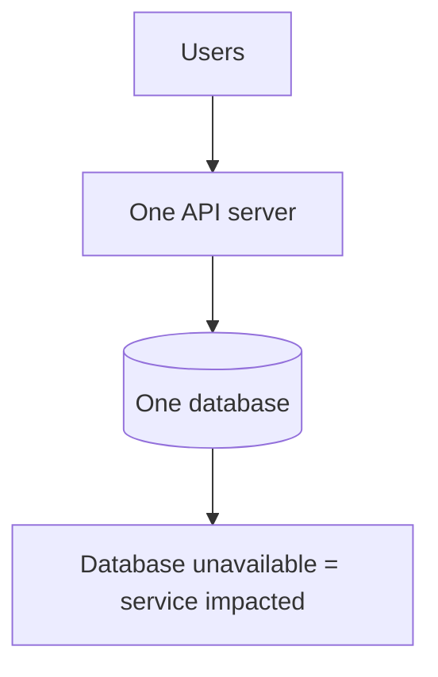

Adding a second API instance helps with one class of failure:

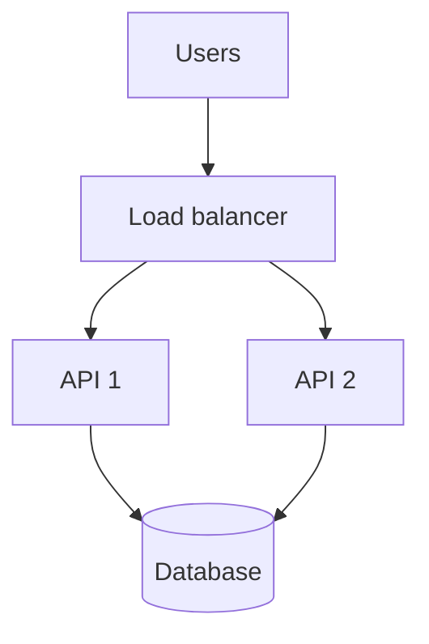

But the database and load balancer infrastructure can still be SPOFs. Managed services often hide redundant infrastructure, so inspect their actual availability architecture rather than assuming.

## 8. Redundancy and failover

**Redundancy** means keeping additional capacity or copies so one failure does not stop the system.

**Failover** means shifting work to a healthy component after a failure.

### Active-active vs active-passive

- **Active-active:** multiple instances serve traffic simultaneously.
- **Active-passive:** a standby takes over when the active instance fails.

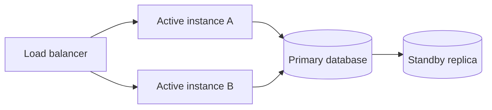

A standby database replica may require promotion; replication lag and failover time can cause temporary unavailability or data-loss risk depending on the replication guarantees.

**Redundancy is not the same as backup.** Replication can copy accidental deletes or corrupted records. Backups provide a separate recovery mechanism.

## 9. Availability math for dependencies

If a request **requires** two independent services in series, with availabilities 99.9% and 99.9%, approximate combined availability is:

```text
0.999 × 0.999 = 0.998001 = 99.8001%
```

This simple model assumes independence and both services are required for success. Real systems have correlated failures, retries, caches, degraded modes, and different definitions of availability.

For two **independent redundant components** where either one is sufficient:

```text
Availability = 1 - (1 - A1)(1 - A2)
```

Two independent 99% components yield 99.99% theoretical combined availability. **Independence is a strong assumption**: common power, configuration, credentials, or region failures can invalidate it.

## 10. MTTR, MTBF, and recovery objectives

- **MTTR (Mean Time To Repair/Restore):** average time to restore service after a failure; organizations must define exactly when the clock starts and ends.
- **MTBF (Mean Time Between Failures):** average operating time between failures for repairable systems.
- **RTO (Recovery Time Objective):** target maximum time to restore service after a disaster.
- **RPO (Recovery Point Objective):** target maximum acceptable data loss measured in time.

Example:

```text
RTO = 1 hour
RPO = 5 minutes
```

Interpretation: aim to restore service within one hour and limit lost committed data to at most the last five minutes, under the defined disaster scenario. **These are objectives, not guarantees.**

For a simple repairable-system model:

```text
Availability ≈ MTBF / (MTBF + MTTR)
```

This approximation assumes a particular failure/repair model and does not capture all software service realities.

## 11. SLI, SLO, and SLA

These are essential production engineering concepts.

### SLI — Service Level Indicator

A **measured indicator** of service behavior.

Examples:
- Percentage of valid dashboard requests succeeding.
- p95 latency for the application-list endpoint.
- Percentage of due reminder jobs processed within five minutes.

### SLO — Service Level Objective

An **internal or agreed target** for an SLI.

Example:

> At least 99.9% of eligible dashboard requests succeed during each rolling 30-day window.

### SLA — Service Level Agreement

A **contractual agreement** about service levels, potentially with remedies or consequences if commitments are missed.

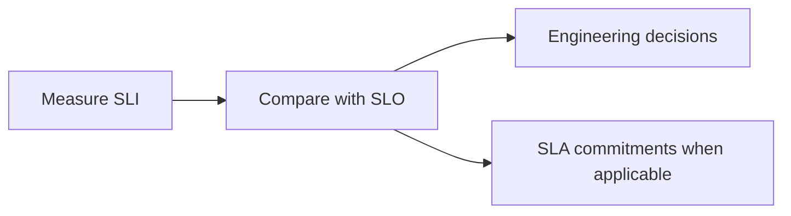

**Important:** A service can have SLOs without a customer-facing SLA. An SLA is not simply a more ambitious SLO.

## 12. Error budgets

An **error budget** represents how much unreliability is allowed while still meeting an SLO.

For a request-success SLO of 99.9%:

```text
Allowed unsuccessful eligible requests = 0.1% of eligible requests
```

If there are 2,000,000 eligible requests in the measurement window:

```text
Error budget = 2,000 requests
```

If errors consume the budget too quickly, a team may slow risky releases and prioritize reliability improvements.

**Time-based downtime budgets and request-based error budgets are different.** Do not equate them without defining the measurement method.

## 13. Timeouts: prevent requests from waiting forever

A **timeout** limits how long a caller waits for an operation.

Imagine CareerLoop calls an email service that becomes unresponsive. Without a timeout, requests can pile up and exhaust resources.

```js
// Node.js: AbortSignal.timeout supported in modern Node versions.
async function fetchProfile(userId) {
  const response = await fetch(
    `https://example.com/api/users/${encodeURIComponent(userId)}`,
    { signal: AbortSignal.timeout(2_000) }
  );

  if (!response.ok) {
    throw new Error(`Profile service returned ${response.status}`);
  }

  return response.json();
}
```

This is illustrative. A real application should use its configured service URL, appropriate credentials, and carefully chosen timeouts. A timeout does **not** guarantee the remote service stopped processing.

### Timeout budgets

If the entire API request has a 2-second deadline, each dependency should have a compatible budget. Multiple sequential 2-second dependency timeouts could violate the total deadline.

## 14. Retries, backoff, and jitter

Retries help with **transient failures** such as a short network interruption. They can make overload worse if every caller retries aggressively.

Use:
1. A bounded number of attempts.
2. Exponential backoff.
3. Random jitter to avoid synchronized retry storms.
4. Retry only appropriate errors.
5. Idempotency or another correctness mechanism when repeated work can have side effects.

```js
const sleep = (ms) => new Promise((resolve) => setTimeout(resolve, ms));

async function retryTransient(operation, maxAttempts = 3) {
  for (let attempt = 1; attempt <= maxAttempts; attempt++) {
    try {
      return await operation();
    } catch (error) {
      if (attempt === maxAttempts || !isTransient(error)) throw error;

      const maxDelay = Math.min(200 * 2 ** (attempt - 1), 2_000);
      await sleep(Math.random() * maxDelay); // Full jitter
    }
  }
}

// Define isTransient(error) based on your client and service contract.
// Do not blindly retry payment creation or other non-idempotent writes.
```

**Never retry everything.** Invalid input (400), authentication failures (401), and many authorization errors (403) will not become valid after a delay.

## 15. Circuit breakers and bulkheads

### Circuit breaker

A circuit breaker temporarily stops sending requests to a repeatedly failing dependency.

States:

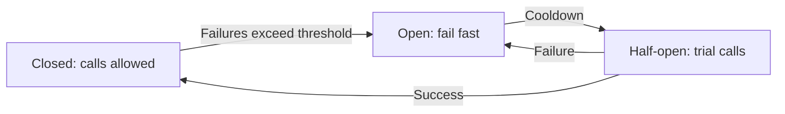

- **Closed:** calls flow normally.
- **Open:** reject or use a fallback quickly.
- **Half-open:** allow limited trial requests to see whether the dependency recovered.

A circuit breaker is not a replacement for timeouts or capacity planning.

### Bulkhead isolation

A **bulkhead** limits how much one failing workload can consume shared resources.

Example: reserve separate worker capacity for user-facing requests and large report generation so reports cannot exhaust every worker.

## 16. Graceful degradation and fallbacks

**Graceful degradation** means keeping essential functionality available when a nonessential dependency fails.

CareerLoop example:

- PostgreSQL is healthy, but the email provider is down.
- Users can still add and view applications.
- Reminder jobs wait in a durable queue for later retries.
- The UI shows an accurate reminder delivery state instead of claiming emails were sent.

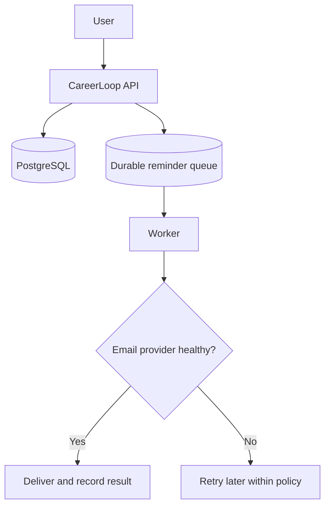

Avoid fallbacks that silently violate security, payment correctness, or data integrity.

## 17. Idempotency and duplicate operations

An operation is **idempotent** when repeating it has the same intended effect as applying it once.

- Setting an application status to `Interview` can be idempotent.
- Incrementing a payment balance is not inherently idempotent.
- A retry of a reminder may send duplicate email unless the workflow is designed carefully.

For critical operations, use a stable operation identifier and an atomic database constraint/transaction where appropriate.

```sql
CREATE TABLE processed_events (
  event_id TEXT PRIMARY KEY,
  processed_at TIMESTAMPTZ NOT NULL DEFAULT now()
);
```

A unique event ID can help detect repeated processing, but **deduplication and business state changes must be coordinated atomically** where possible. External side effects still require careful reconciliation. Exactly-once behavior across arbitrary external systems is difficult.

## 18. Data reliability: backups, replication, and transactions

Three tools solve different problems:

| Tool | Helps with | Does not automatically solve |
|---|---|---|
| Transaction | Atomicity of related DB changes | Disaster recovery |
| Replica | Failover/read capacity | Accidental deletion copied to replica |
| Backup | Restoring past data | Instant failover |

### Backup strategy questions

- How often are backups taken?
- Are they stored separately from the primary failure domain?
- Are backups encrypted and access-controlled?
- How long are they retained?
- Have restores been tested?
- Does the strategy meet RPO/RTO requirements?

A backup that has never been restored is an unverified recovery plan.

## 19. Observability: how to know the system is failing

You cannot improve reliability if you cannot detect and understand problems.

### The three common pillars

- **Metrics:** numerical trends (error rate, p95 latency, CPU).
- **Logs:** events and diagnostic context.
- **Traces:** how a request travels through services and dependencies.

### Golden signals

A practical starting point is:
1. **Latency**
2. **Traffic**
3. **Errors**
4. **Saturation** (resource pressure)

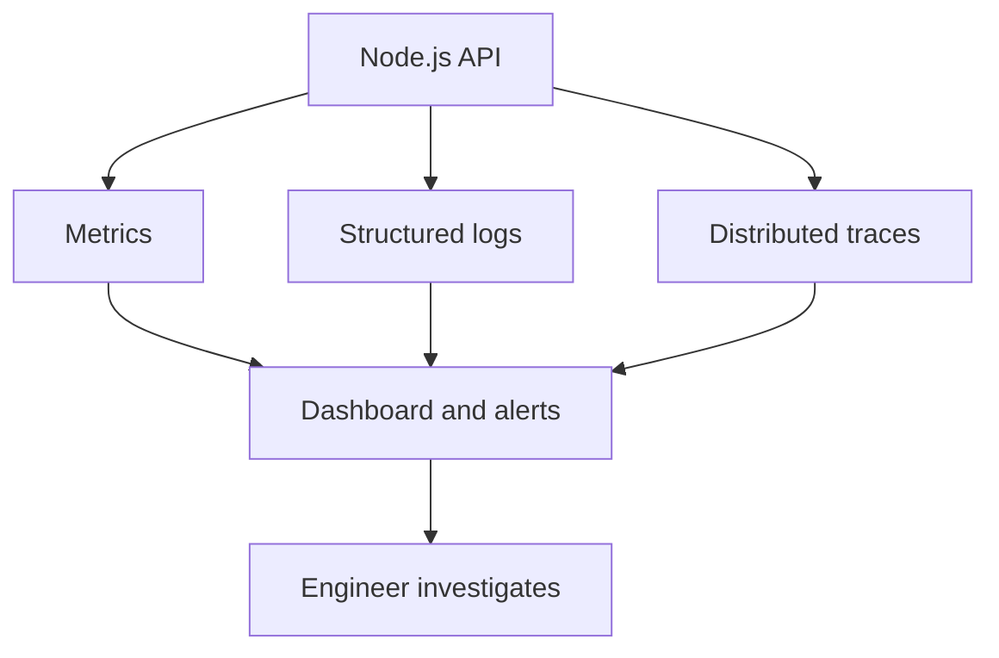

### Simple Express latency middleware

```js
import { performance } from "node:perf_hooks";

app.use((req, res, next) => {
  const start = performance.now();

  res.on("finish", () => {
    const durationMs = performance.now() - start;
    console.log({
      method: req.method,
      route: req.route?.path ?? req.path,
      statusCode: res.statusCode,
      durationMs: Number(durationMs.toFixed(1)),
    });
  });

  next();
});
```

**Production note:** Avoid logging sensitive query parameters or personal data. For metrics, use normalized route labels rather than raw user-specific paths to avoid high-cardinality labels. Prefer structured logging and a proper metrics/tracing library.

## 20. Load testing and failure testing

**Load test:** Does the system meet its latency/error targets at expected traffic?

**Stress test:** What happens beyond normal capacity?

**Soak test:** Does it degrade after running for hours?

**Failure/chaos test:** What happens if a dependency fails?

A safe CareerLoop test plan:

1. Run a representative workload against a test environment.
2. Record p50/p95/p99 latency, error rate, and DB metrics.
3. Stop one API instance.
4. Check whether healthy instances continue serving traffic.
5. Simulate email provider unavailability.
6. Confirm reminder jobs retry without falsely reporting delivery.
7. Restore dependencies and verify recovery.

Never run uncontrolled destructive or high-load experiments against production systems.

## 21. Worked case study: improve CareerLoop step by step

### Initial architecture

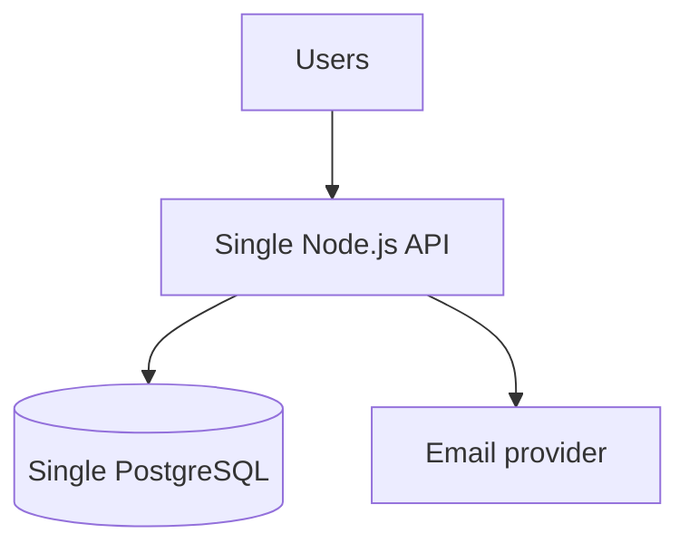

**Problems:**
- One API crash can make the service unavailable.
- Email provider delays can slow request paths.
- No clear visibility into errors or latency.
- Database remains a critical dependency.

### Improved candidate architecture

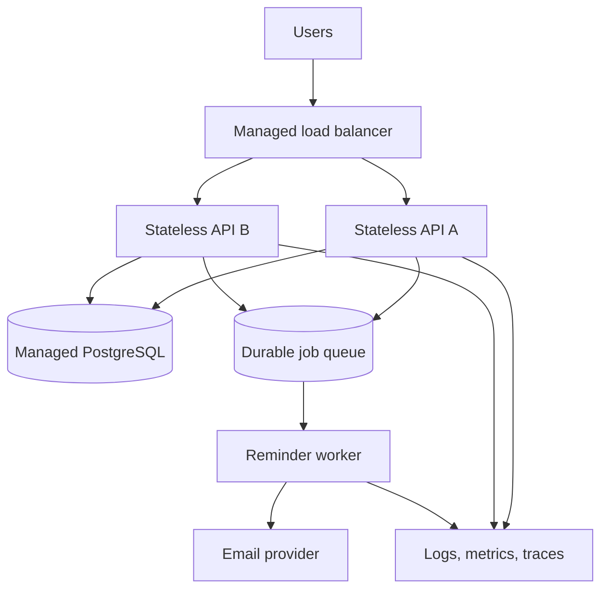

**What improved:**
- API instance redundancy can reduce downtime from a single process failure.
- Queued reminders decouple email delivery from the HTTP request path.
- Monitoring makes failures easier to detect and diagnose.
- Shared durable storage prevents loss of data from a single API process restart.

**What is still not guaranteed:**
- The database may remain a single failure domain depending on deployment.
- A load balancer or region may fail.
- Queue delivery may be duplicated.
- More instances can overload database connections.
- Availability targets still need real measurements and tested failover.

**Engineering lesson:** Draw the failure paths and state what each design change actually guarantees.

## 22. How to answer this in a system design interview

For “Design a highly available job tracker,” follow this order:

1. **Clarify critical user actions:** create, read, edit, reminders.
2. **Choose measurable goals:** request success rate, latency, RTO/RPO.
3. **Identify failure domains:** instance, database, region, provider.
4. **Design for essential-path redundancy:** stateless API instances, health-aware routing, appropriate DB failover.
5. **Decouple noncritical work:** durable queue for email.
6. **Protect correctness:** transactions, owner authorization, idempotent retries.
7. **Add observability:** metrics, logs, traces, alerting.
8. **Test the claims:** load tests, failure drills, restore tests.
9. **Discuss trade-offs:** complexity, cost, consistency, and operational burden.

## 23. Common misconceptions

| Misconception | Correct understanding |
|---|---|
| “99.9% means exactly 43 minutes of downtime every month” | Depends on measurement window and SLA rules |
| “More servers guarantee high availability” | Shared dependencies and correlated failures still exist |
| “Replication is backup” | Replication can copy unwanted changes |
| “A 200 response means the operation succeeded” | User-visible correctness matters |
| “Retries always improve reliability” | Unbounded retries can amplify outages and duplicate side effects |
| “A timeout means the remote operation never happened” | It may have completed despite a lost response |
| “Average latency is enough” | Tail latency can dominate user experience |
| “High availability means zero downtime” | All designs have limits and failure scenarios |
| “A queue guarantees exactly-once delivery” | Many queues use at-least-once delivery |
| “An SLA and SLO are the same” | SLA is contractual; SLO is a target |

## 24. Practice problems

### Exercise A — Availability math
A service was unavailable for 15 minutes during a 30-day month. Calculate time-based availability. Would it meet 99.9%? State assumptions.

### Exercise B — Latency budget
Your API takes 50 ms for networking, 40 ms for application logic, 250 ms for a database query, and 60 ms for serialization/transfer. Calculate total sequential latency. Suggest how to investigate the largest contributor.

### Exercise C — Dependency failure
The email provider is unavailable for two hours. Design a reminder workflow that preserves jobs, retries responsibly, and reports honest delivery status.

### Exercise D — Duplicate payment
A payment webhook arrives twice. Explain why simply retrying can be dangerous and outline a transaction + unique event ID approach.

### Exercise E — Failure domains
Draw an architecture with two API instances and one database. Identify remaining single points of failure. Propose changes and describe their cost/complexity.

## 25. Quick revision checklist

- [ ] I can explain availability, reliability, durability, and latency separately.
- [ ] I can calculate a simple uptime percentage and downtime budget.
- [ ] I know p50, p95, p99 and why tail latency matters.
- [ ] I can identify single points of failure and common failure domains.
- [ ] I understand redundancy, failover, active-active, and active-passive.
- [ ] I can explain MTTR, MTBF, RTO, and RPO.
- [ ] I know the difference between SLI, SLO, SLA, and error budget.
- [ ] I understand timeouts, bounded retries, backoff, jitter, circuit breakers, and bulkheads.
- [ ] I know why idempotency matters when requests are retried.
- [ ] I can distinguish backup, replication, and transactions.
- [ ] I can propose monitoring and realistic failure tests.

### Next lesson

**Lesson 06 — OOP for Low-Level Design:** classes, objects, encapsulation, abstraction, inheritance, polymorphism, and how to model a real system without overengineering.
