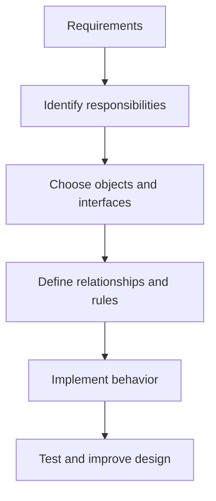
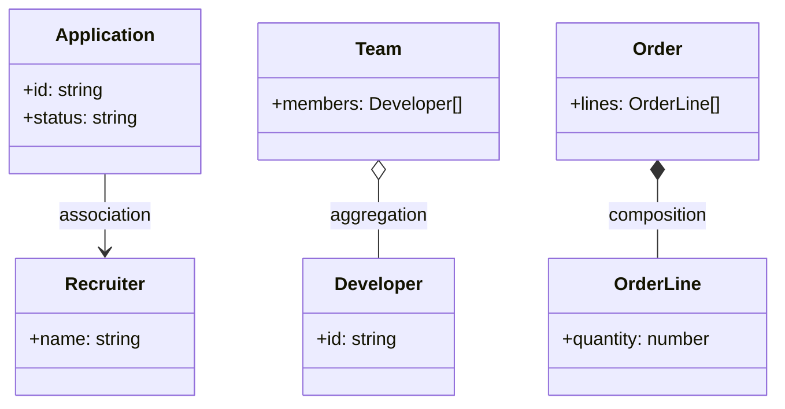
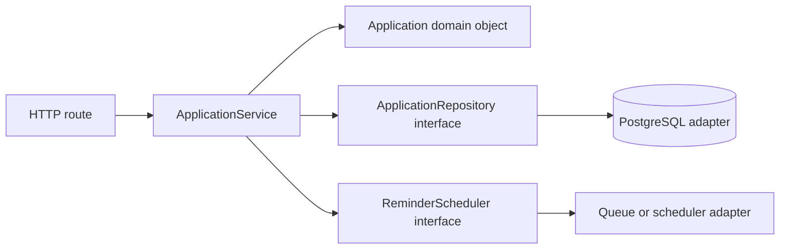
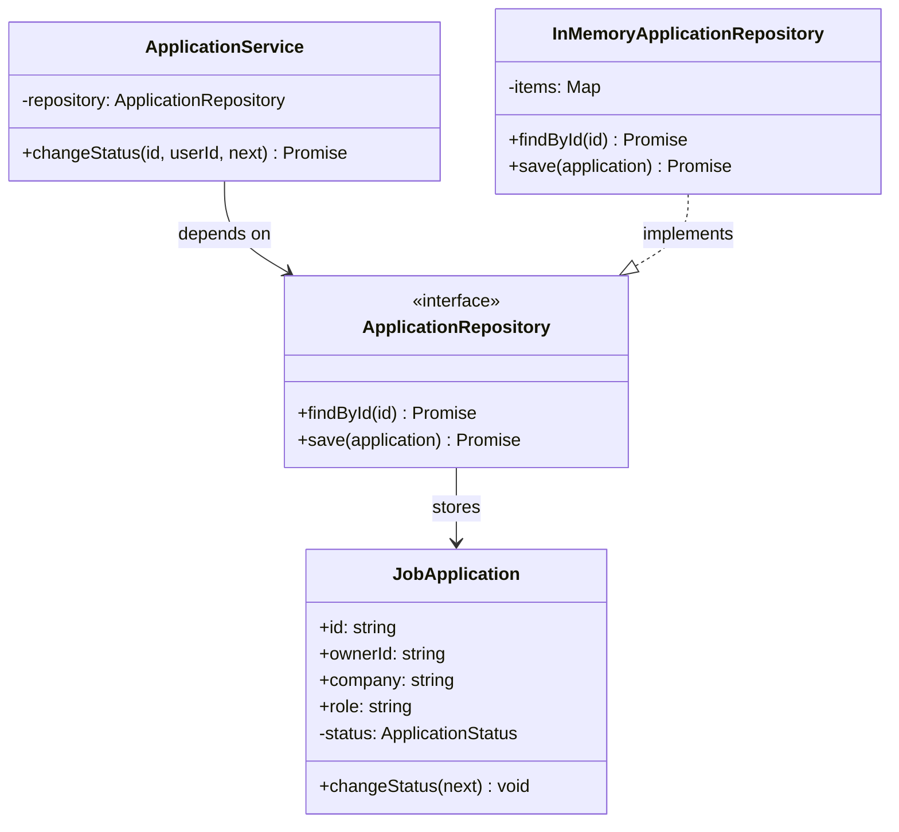
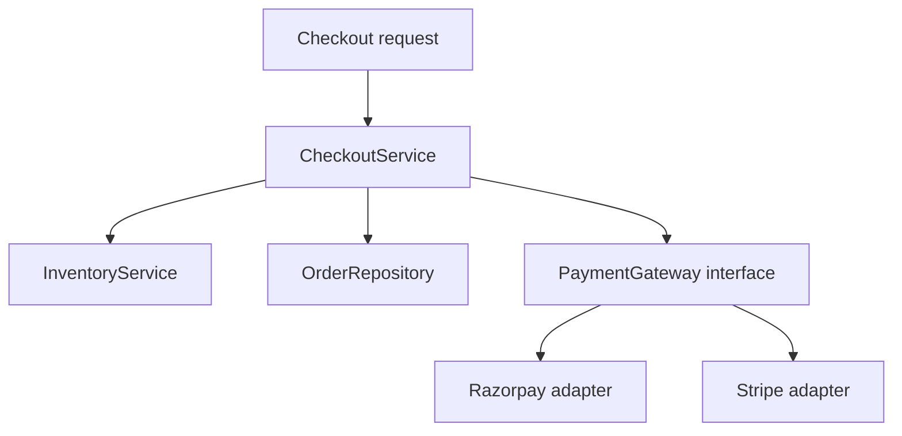

# Lesson 06 — Object-Oriented Programming for Low-Level Design (LLD) ⭐⭐⭐⭐⭐

> **Learning goal:** Learn how to turn real-world requirements into clean classes, objects, interfaces, relationships, and maintainable TypeScript code. We will model CareerLoop (job tracker) and an e-commerce checkout. No previous OOP expertise is assumed.

## 1. Why learn OOP for system design?

**High-Level Design (HLD)** decides major components such as APIs, databases, and queues.

**Low-Level Design (LLD)** decides what happens *inside* a component: classes, responsibilities, method contracts, state transitions, and collaborations.

Imagine CareerLoop must:
- Create a job application.
- Change its status.
- Schedule a reminder.
- Notify the user.

Writing everything in one route handler works initially but becomes difficult to test and change.



**OOP** is one way to organize code around objects that combine **state** (data) and **behavior** (operations). It is not the only valid design style: JavaScript/TypeScript also supports functional and procedural approaches. Use OOP when it makes responsibilities and evolving behavior clearer.

## 2. Class vs object vs instance

A **class** is a blueprint describing how objects are created and what they can do.

An **object** is a concrete value with properties and behavior.

An **instance** is an object created from a particular class.

```ts
class JobApplication {
  constructor(
    public readonly id: string,
    public company: string,
    public status: string = "Applied"
  ) {}

  markScreening(): void {
    this.status = "Screening";
  }
}

const application = new JobApplication("app-1", "Acme");
application.markScreening();
console.log(application.status); // "Screening"
```

Here:
- `JobApplication` is the class.
- `application` is an object and an instance of that class.
- `id`, `company`, and `status` are state.
- `markScreening()` is behavior.
- `new` creates an instance and invokes its constructor.

**JavaScript detail:** Classes are built on JavaScript's prototype-based object system. Class syntax provides a convenient abstraction; it does not replace prototypes.

## 3. Constructor, properties, methods, and `this`

A **constructor** initializes an object. A **method** is a function associated with an object/class. `this` usually refers to the object used to call an instance method.

```ts
class Recruiter {
  constructor(
    public readonly name: string,
    private email: string
  ) {}

  getContact(): string {
    return `${this.name} <${this.email}>`;
  }
}

const recruiter = new Recruiter("Riya", "riya@example.com");
console.log(recruiter.getContact());
```

**Common trap:** extracting a method can lose its `this` binding:

```ts
const fn = recruiter.getContact;
// fn(); // this may be undefined at runtime
const safeFn = recruiter.getContact.bind(recruiter);
console.log(safeFn());
```

Arrow-function properties and explicit `.bind()` are common solutions, each with trade-offs.

## 4. The four OOP pillars

### 4.1 Encapsulation — protect state and rules

**Encapsulation** keeps related data and behavior together and controls how internal state is changed.

Bad design:

```ts
class Wallet {
  balance = 100;
}

const wallet = new Wallet();
wallet.balance = -9999; // Invalid state allowed
```

Better:

```ts
class Wallet {
  #balance: number;

  constructor(initialBalance: number) {
    if (!Number.isFinite(initialBalance) || initialBalance < 0) {
      throw new Error("Invalid initial balance");
    }
    this.#balance = initialBalance;
  }

  deposit(amount: number): void {
    if (!Number.isFinite(amount) || amount <= 0) {
      throw new Error("Amount must be positive");
    }
    this.#balance += amount;
  }

  getBalance(): number {
    return this.#balance;
  }
}
```

`#balance` is a **JavaScript runtime-private field**. TypeScript's `private` is mainly a compile-time access restriction and does not by itself provide the same runtime privacy.

**Important:** For real money, use integer minor units (for example, paise) or a suitable decimal representation, database transactions, and an auditable ledger. This wallet is a learning example, not a payment system.

### 4.2 Abstraction — expose what matters, hide how

**Abstraction** exposes a useful contract without requiring callers to know internal implementation details.

```ts
interface NotificationSender {
  send(to: string, message: string): Promise<void>;
}

class EmailSender implements NotificationSender {
  async send(to: string, message: string): Promise<void> {
    console.log("Email to:", to, message);
  }
}

class ReminderService {
  constructor(private sender: NotificationSender) {}

  async remind(email: string): Promise<void> {
    await this.sender.send(email, "Follow up on your application");
  }
}
```

The reminder service needs the **capability to send**, not the details of SMTP or a specific email provider.

**Difference:** Encapsulation controls internal state/implementation boundaries; abstraction presents the essential interface. They often work together.

### 4.3 Inheritance — an “is-a” relationship

A subclass can reuse or specialize behavior from a base class.

```ts
class User {
  constructor(public readonly id: string) {}

  describe(): string {
    return `User ${this.id}`;
  }
}

class AdminUser extends User {
  override describe(): string {
    return `Admin ${this.id}`;
  }
}

const admin = new AdminUser("u1");
console.log(admin.describe()); // "Admin u1"
```

Use inheritance when the subtype genuinely satisfies the base type's contract. Avoid inheritance merely to share a few utility methods.

### 4.4 Polymorphism — one contract, different behavior

Different objects can be used through a common interface.

```ts
interface PaymentMethod {
  pay(amountPaise: number): Promise<string>;
}

class CardPayment implements PaymentMethod {
  async pay(amountPaise: number): Promise<string> {
    return `card-payment-${amountPaise}`;
  }
}

class UpiPayment implements PaymentMethod {
  async pay(amountPaise: number): Promise<string> {
    return `upi-payment-${amountPaise}`;
  }
}

async function checkout(method: PaymentMethod) {
  return method.pay(50000);
}
```

`checkout()` works with either implementation without an `if (type === "card")` branch.

**Note:** These implementations only demonstrate polymorphism. They do not contact a payment gateway or charge money.

## 5. TypeScript interfaces, abstract classes, and types

| Feature | Interface | Abstract class | Type alias |
|---|---|---|---|
| Describes a shape/contract | Yes | Yes | Yes |
| Runtime JavaScript value | No | Yes | No |
| Can contain implemented methods | No | Yes | No |
| Can define constructor implementation | No | Yes | No |
| Supports multiple contracts | A class can implement many | Class can extend one base class | Can combine types with intersections |
| Typical use | Service contract, object shape | Shared behavior plus required methods | Unions, intersections, aliases |

### Abstract class example

```ts
abstract class Report {
  constructor(protected title: string) {}

  abstract generate(): string;

  print(): void {
    console.log(this.title, this.generate());
  }
}

class ApplicationReport extends Report {
  generate(): string {
    return "Applications: 42";
  }
}

new ApplicationReport("CareerLoop report").print();
```

An abstract class cannot be directly instantiated through TypeScript's type system, but its emitted JavaScript base class exists at runtime.

**Important TypeScript nuance:** TypeScript is structurally typed in many common cases: a value can satisfy an interface by having the required shape, even without explicitly writing `implements`.

## 6. Access modifiers, readonly, static, getters, and setters

```ts
class Account {
  static readonly kind = "user-account";
  readonly id: string;
  private _displayName: string;

  constructor(id: string, displayName: string) {
    this.id = id;
    this._displayName = displayName;
  }

  get displayName(): string {
    return this._displayName;
  }

  set displayName(value: string) {
    if (!value.trim()) throw new Error("Name is required");
    this._displayName = value.trim();
  }
}
```

- `public`: accessible from outside (default in TypeScript).
- `private`: restricted by TypeScript type checking.
- `protected`: available in the class and subclasses through TypeScript checking.
- `readonly`: prevents assignment through the TypeScript type checker after initialization.
- `static`: belongs to the class rather than individual instances.
- `get` / `set`: property-style access with logic.

**Caution:** `readonly` is not deep immutability. A readonly property containing an array can still reference a mutable array unless further precautions are taken.

## 7. Object relationships: association, aggregation, composition

LLD is not only about classes; it is about **how objects relate**.

### Association — objects know or use each other

A `Recruiter` can be associated with an `Application`. Neither must own the other's lifetime.

### Aggregation — a weak whole–part relationship

A `Team` groups `Developer` objects that can exist independently of the team.

### Composition — a strong whole–part ownership relationship

An `Order` owns its `OrderLine` values as parts of the order model. If the order is removed from the domain, its owned lines usually do not make sense independently.



**UML symbols:** plain line/arrow = association; hollow diamond = aggregation; filled diamond = composition.

These are **domain modeling concepts**, not automatically enforced database foreign keys or JavaScript garbage-collection rules. The ownership and lifecycle decisions come from requirements.

## 8. Inheritance vs composition: which should you prefer?

Inheritance models **is-a**. Composition models **has-a / uses-a**.

### Fragile inheritance example

```ts
class EmailReminderService extends EmailSender {
  // ReminderService is not really a kind of EmailSender.
}
```

Better composition:

```ts
class FollowUpReminderService {
  constructor(private readonly sender: NotificationSender) {}

  sendReminder(email: string) {
    return this.sender.send(email, "Time to follow up");
  }
}
```

Advantages of composition:
- Dependencies can be replaced.
- Tests can inject fakes.
- Fewer deep class hierarchies.
- Responsibilities remain clearer.

**Rule of thumb:** Favor composition when behavior varies or services collaborate. Use inheritance when a true subtype relationship and stable contract exist.

## 9. From requirements to objects: a repeatable LLD process

Suppose the requirement is:

> “A user can create an application, change its status, and schedule a follow-up reminder.”

### Step 1 — Identify nouns (candidate entities)

User, Application, Company, Reminder.

### Step 2 — Identify verbs (candidate behaviors)

Create, change status, schedule, send.

### Step 3 — Assign responsibilities

- `Application`: maintain application status and enforce allowed transitions.
- `ApplicationRepository`: load and save applications.
- `ApplicationService`: coordinate use cases and authorization.
- `ReminderScheduler`: arrange future work.
- `NotificationSender`: deliver messages.

### Step 4 — Define boundaries



### Step 5 — Enforce invariants

An **invariant** is a rule that must remain true, such as:
- An application has a non-empty company name.
- Its status must be one of the allowed statuses.
- Only its owner can update it.
- A reminder must refer to a valid application.

Not every invariant belongs in one class: authorization often belongs in the application/service layer, while database constraints provide additional protection.

## 10. Full worked example: CareerLoop domain model

We will build a small, runnable in-memory version to learn the design. Replace the repository with a database adapter in production.

### 10.1 Define status and domain errors

```ts
type ApplicationStatus =
  | "Applied"
  | "Screening"
  | "Interview"
  | "Offer"
  | "Rejected";

const allowedTransitions: Record<ApplicationStatus, ApplicationStatus[]> = {
  Applied: ["Screening", "Rejected"],
  Screening: ["Interview", "Rejected"],
  Interview: ["Offer", "Rejected"],
  Offer: [],
  Rejected: [],
};

class DomainError extends Error {}
class NotFoundError extends Error {}
class ForbiddenError extends Error {}
```

These transitions are **illustrative business rules**. Real products may permit reopening a rejected application or moving backward. Always clarify requirements first.

### 10.2 Create the entity

```ts
class JobApplication {
  private _status: ApplicationStatus = "Applied";

  constructor(
    public readonly id: string,
    public readonly ownerId: string,
    public readonly company: string,
    public readonly role: string
  ) {
    if (!company.trim() || !role.trim()) {
      throw new DomainError("Company and role are required");
    }
  }

  get status(): ApplicationStatus {
    return this._status;
  }

  changeStatus(next: ApplicationStatus): void {
    if (!allowedTransitions[this._status].includes(next)) {
      throw new DomainError(
        `Cannot move from ${this._status} to ${next}`
      );
    }
    this._status = next;
  }
}
```

Why not expose a public mutable `status` field? Because callers could bypass the transition rules.

### 10.3 Repository abstraction

```ts
interface ApplicationRepository {
  findById(id: string): Promise<JobApplication | null>;
  save(application: JobApplication): Promise<void>;
}

class InMemoryApplicationRepository implements ApplicationRepository {
  private readonly items = new Map<string, JobApplication>();

  async findById(id: string): Promise<JobApplication | null> {
    return this.items.get(id) ?? null;
  }

  async save(application: JobApplication): Promise<void> {
    this.items.set(application.id, application);
  }
}
```

**Production nuance:** This repository stores object references, so callers could mutate shared in-memory state without an explicit save. A real database adapter should map persisted rows to domain objects and use transactions or optimistic locking for concurrent updates. The in-memory version is intentionally simplified.

### 10.4 Application service

```ts
class ApplicationService {
  constructor(private readonly repository: ApplicationRepository) {}

  async changeStatus(
    applicationId: string,
    authenticatedUserId: string,
    next: ApplicationStatus
  ): Promise<void> {
    const application = await this.repository.findById(applicationId);

    if (!application) throw new NotFoundError("Application not found");
    if (application.ownerId !== authenticatedUserId) {
      throw new ForbiddenError("Not allowed");
    }

    application.changeStatus(next);
    await this.repository.save(application);
  }
}
```

Here:
- The entity enforces **valid state transitions**.
- The service enforces **who is allowed** to perform the use case.
- The repository hides **how data is stored**.

### 10.5 Run the example

```ts
async function main() {
  const repo = new InMemoryApplicationRepository();
  const application = new JobApplication(
    "app-1",
    "user-1",
    "Acme",
    "Frontend Developer"
  );

  await repo.save(application);
  const service = new ApplicationService(repo);

  await service.changeStatus("app-1", "user-1", "Screening");
  console.log(application.status); // Screening

  // Throws ForbiddenError:
  // await service.changeStatus("app-1", "another-user", "Interview");
}

main().catch(console.error);
```

Save these snippets together in a `.ts` file in the shown order and run using a TypeScript runner such as `tsx`. The example focuses on modeling, not HTTP routing or persistence.

## 11. UML class diagram for CareerLoop



### How to read this diagram

- `+` means public.
- `-` means private.
- `<<interface>>` means a contract.
- Dashed arrow with triangle represents interface realization.
- A dependency arrow indicates that one component uses another.

UML is a communication tool. Do not draw every getter or private helper unless it helps explain a design decision.

## 12. Second real-world example: e-commerce checkout

A checkout may involve:
- `Cart`: selected products and quantities.
- `Order`: confirmed purchase and state.
- `PaymentGateway`: payment provider abstraction.
- `InventoryService`: inventory availability/reservation.
- `CheckoutService`: orchestrates the checkout workflow.



### Why interfaces help

```ts
interface PaymentGateway {
  createPayment(orderId: string, amountPaise: number): Promise<string>;
}

class CheckoutService {
  constructor(
    private readonly gateway: PaymentGateway
  ) {}

  async startPayment(orderId: string, amountPaise: number) {
    if (!Number.isSafeInteger(amountPaise) || amountPaise <= 0) {
      throw new Error("Invalid amount");
    }
    return this.gateway.createPayment(orderId, amountPaise);
  }
}
```

The checkout service is not coupled to one provider. However, a real payment integration also needs server-side price calculation, verified webhooks, idempotency, transactional order updates, and security. A clean class diagram does **not** replace correct distributed workflow design.

## 13. Dependency injection (DI) in simple words

**Dependency:** another component your class needs.

**Dependency injection:** provide that component from outside instead of creating it inside the class.

Bad:

```ts
class BadReminderService {
  private sender = new EmailSender(); // Hard-coded dependency
}
```

Better:

```ts
class GoodReminderService {
  constructor(private readonly sender: NotificationSender) {}
}

const reminderService = new GoodReminderService(new EmailSender());
```

Benefits: easier testing, swapping providers, and separating responsibilities.

**DI does not require a framework or DI container.** Constructor injection is enough for many projects. We will explore this more deeply in Lesson 08.

## 14. Testing object behavior

LLD should make business rules testable without a running web server.

```ts
import { describe, expect, it } from "vitest";

describe("JobApplication", () => {
  it("allows Applied to Screening", () => {
    const app = new JobApplication("1", "u1", "Acme", "Developer");
    app.changeStatus("Screening");
    expect(app.status).toBe("Screening");
  });

  it("rejects invalid transitions", () => {
    const app = new JobApplication("1", "u1", "Acme", "Developer");
    expect(() => app.changeStatus("Offer")).toThrow(DomainError);
  });
});
```

These tests assume the earlier `JobApplication` and `DomainError` declarations are in scope. For a real project, export/import the classes.

### Testing with a fake dependency

```ts
class FakeNotificationSender implements NotificationSender {
  public sent: Array<{ to: string; message: string }> = [];

  async send(to: string, message: string): Promise<void> {
    this.sent.push({ to, message });
  }
}

const fake = new FakeNotificationSender();
const service = new ReminderService(fake);
await service.remind("user@example.com");
console.log(fake.sent.length); // 1
```

The test avoids real email network calls and checks observable behavior.

## 15. Entity vs value object vs DTO vs database model

These terms are often confused.

| Concept | Meaning | Example |
|---|---|---|
| Entity | Has identity and lifecycle | JobApplication with stable ID |
| Value object | Defined by its values, often immutable | Money(amount, currency) |
| DTO | Data shape transferred across a boundary | CreateApplicationRequest |
| Database model | Maps to persistence representation | Drizzle/Mongoose schema |
| Service | Coordinates use cases | ApplicationService |
| Repository | Abstracts persistence operations | ApplicationRepository |

### Value object example

```ts
class Money {
  constructor(
    public readonly amountPaise: number,
    public readonly currency: "INR"
  ) {
    if (!Number.isSafeInteger(amountPaise) || amountPaise < 0) {
      throw new Error("Invalid amount");
    }
  }

  equals(other: Money): boolean {
    return (
      this.amountPaise === other.amountPaise &&
      this.currency === other.currency
    );
  }
}
```

**Important:** `readonly` prevents normal TypeScript assignment but does not guarantee runtime immutability. For strong runtime immutability, use private fields, avoid mutable nested values, or freeze carefully.

### DTO example

```ts
type CreateApplicationRequest = {
  company: string;
  role: string;
};
```

The API must still validate incoming runtime data. A TypeScript type alone does not validate JSON received over HTTP.

## 16. OOP and databases: an important boundary

An object in memory is **not automatically** a database row or Mongoose document.

For example:

```ts
const app = new JobApplication("app-1", "user-1", "Acme", "Developer");
```

This creates an in-memory object. It is not persisted until repository/database code saves it.

In production, the repository often maps:

```text
Database row → Domain object → Business operation → Updated row
```

Be careful with:
- Concurrent updates and lost writes.
- Transactions spanning multiple records.
- Serialization of private fields.
- Database constraints and unique indexes.
- Rehydrating objects from persisted state.
- Avoiding unnecessary ORM-specific logic in domain rules.

**Important:** Mongoose documents have ORM/ODM-specific behavior; plain domain objects do not. Neither design is universally superior.

## 17. Common design mistakes

1. **God class:** One class handles auth, database, payments, emails, and reports.
2. **Anemic domain model:** Objects are only data containers while every rule lives in one giant service; this can be fine for simple CRUD but becomes problematic for complex invariants.
3. **Deep inheritance chains:** Hard to understand and change.
4. **Premature abstraction:** Creating ten interfaces for a tiny feature without clear benefits.
5. **Public mutable state:** Allows invalid changes that bypass rules.
6. **Mixing layers:** Domain entities directly send HTTP responses or depend on Express `req` objects.
7. **Confusing interfaces with runtime validation:** TypeScript types disappear at runtime.
8. **Ignoring concurrency:** In-memory checks alone cannot enforce database-wide uniqueness.
9. **Ignoring authorization:** An object ID is not proof the caller owns it.
10. **Overengineering:** OOP is a tool, not a requirement to turn every function into a class.

## 18. LLD interview approach

When asked “Design a job application tracker”:

1. Clarify core use cases and scope.
2. Identify entities and their responsibilities.
3. List invariants and important edge cases.
4. Define interfaces for external dependencies.
5. Draw a small UML class diagram.
6. Describe one end-to-end interaction.
7. Explain where authorization and persistence live.
8. Show how the design handles extension and testing.
9. Discuss trade-offs and possible simplifications.

### Sample questions

**Q: When would you choose composition over inheritance?**  
A: When an object *uses* another capability rather than being a true subtype, or when behavior should be replaceable.

**Q: Why not put database calls directly inside an entity?**  
A: Keeping persistence separate can make domain rules easier to test and storage easier to replace, though very small CRUD systems may use simpler patterns.

**Q: Interface vs abstract class?**  
A: Interfaces describe contracts without runtime implementation; abstract classes can share runtime behavior and state.

**Q: Does `private` make TypeScript code secure?**  
A: No. It helps code organization/type checking; authorization and validation must still be enforced at runtime.

**Q: Can functional programming also be used in LLD?**  
A: Yes. Good LLD is about clear responsibilities, invariants, boundaries, and testability—not a mandatory number of classes.

## 19. Practice exercises

### Exercise A — Library management
Model `Book`, `BookCopy`, `Member`, and `Loan`. Clarify why a book title and a physical copy are different entities. Enforce that one copy cannot have two active loans at once.

### Exercise B — Parking lot
Identify `Vehicle`, `ParkingSpot`, `Ticket`, and `ParkingLot`. Draw a class diagram. Explain why “Car extends ParkingSpot” is a bad relationship.

### Exercise C — CareerLoop
Add a `Reminder` entity and a `ReminderScheduler` interface. Design tests for scheduling a reminder in the past, a missing application, and unauthorized access.

### Exercise D — E-commerce
Implement a `DiscountPolicy` interface with percentage and fixed-amount strategies. Prevent negative final totals and handle integer paise.

### Exercise E — Refactor
Take a route handler that validates input, updates the DB, sends email, and logs results. Split it into clear responsibilities without creating unnecessary classes.

## 20. Quick revision checklist

- [ ] I can explain class, object, constructor, method, and `this`.
- [ ] I understand encapsulation, abstraction, inheritance, and polymorphism.
- [ ] I know TypeScript interface vs abstract class vs type alias.
- [ ] I can distinguish association, aggregation, and composition.
- [ ] I can choose composition over inheritance when appropriate.
- [ ] I can identify entities, value objects, DTOs, services, and repositories.
- [ ] I can turn requirements into a class diagram and an interaction flow.
- [ ] I understand why runtime validation and authorization are still necessary.
- [ ] I can write focused unit tests for domain rules.
- [ ] I can explain why a simpler functional design may sometimes be better.

### Next lesson

**Lesson 07 — SOLID Principles:** Single Responsibility, Open/Closed, Liskov Substitution, Interface Segregation, and Dependency Inversion—with TypeScript refactoring examples, trade-offs, and practical interview exercises.
