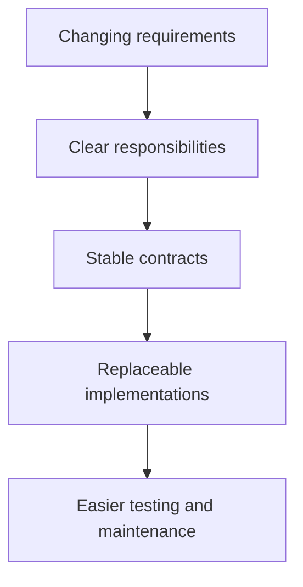
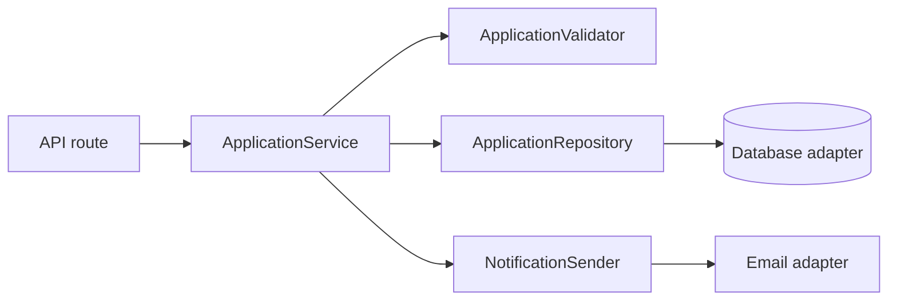
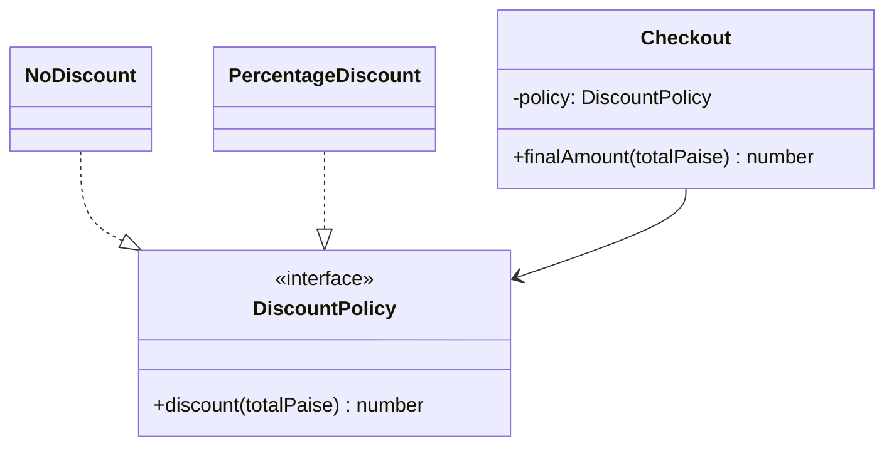
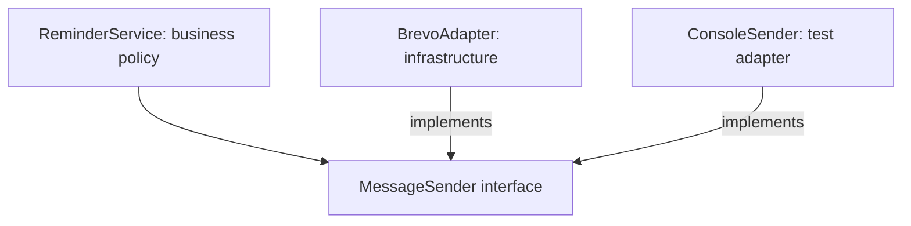
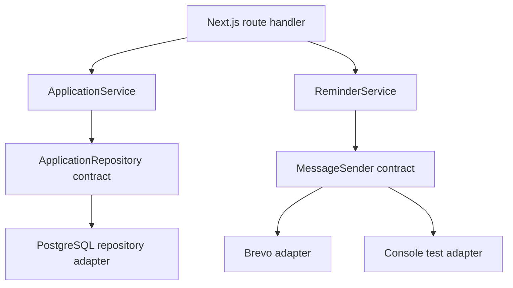

# Lesson 07 — SOLID Principles ⭐⭐⭐⭐⭐

> **Learning goal:** Understand all five SOLID principles deeply, learn the problems they solve, and use them correctly in real TypeScript/Node.js applications. We will use CareerLoop, payments, notifications, and checkout examples.

## 1. Why do SOLID principles exist?

Imagine CareerLoop starts with one developer and a small codebase. You build an `ApplicationManager` that:

- Validates applications.
- Saves them to PostgreSQL.
- Sends reminder emails.
- Generates reports.
- Handles billing.

It works today. Later, changing the email provider unexpectedly breaks application creation. Testing requires a real database and network calls. One class keeps growing.

**SOLID** is a set of five object-oriented design principles that help manage change, reduce unnecessary coupling, and make code easier to understand, extend, and test.

| Letter | Principle | Simple mental model |
|---|---|---|
| S | Single Responsibility Principle | One coherent reason to change |
| O | Open/Closed Principle | Extend behavior without repeatedly modifying stable code |
| L | Liskov Substitution Principle | A subtype must honor the base type's promises |
| I | Interface Segregation Principle | Don't force clients to depend on operations they don't need |
| D | Dependency Inversion Principle | Business policy should depend on abstractions, not concrete infrastructure |

**Important:** SOLID is guidance, not five strict compiler rules. Good design depends on the actual requirements. Too many interfaces and classes can make a simple app worse.



## 2. First understand coupling, cohesion, and abstraction

**Coupling:** how strongly one component depends on another. If changing the email provider requires editing many unrelated modules, coupling is high.

**Cohesion:** how closely the responsibilities inside a module belong together. A class that only manages application status has stronger cohesion than one that also sends emails and processes payments.

**Abstraction:** a useful contract that hides unnecessary implementation details.

```text
High cohesion + appropriate low coupling → easier change and testing
```

Avoid the misconception that “zero coupling” is possible. Components must collaborate; the goal is **intentional, manageable dependencies**.

---

# S — Single Responsibility Principle (SRP)

## 3. Definition: one reason to change

**SRP:** A module should have one reason to change—more precisely, it should be responsible to one cohesive set of business concerns or actors.

This does **not** mean “a class can only have one method.”

A `JobApplication` entity may have `changeStatus()`, `reopen()`, and `canScheduleInterview()` if all support the same application-domain responsibility.

### Bad example: one class does everything

```ts
class ApplicationManager {
  async create(input: { company: string; role: string }) {
    if (!input.company.trim()) throw new Error("Company required");

    // Imagine a direct PostgreSQL insert here.
    console.log("INSERT INTO applications ...");

    // Imagine direct provider-specific email API call here.
    console.log("Send welcome email");

    // Imagine analytics/report generation here.
    console.log("Update dashboard report");
  }
}
```

**Problems:**
- Database schema changes affect the same class as email changes.
- Unit tests require unrelated infrastructure.
- Failure handling becomes tangled.
- The class grows for unrelated reasons.

## 4. Better SRP design: separate responsibilities



```ts
type CreateApplicationInput = {
  company: string;
  role: string;
  ownerId: string;
};

class ApplicationValidator {
  validate(input: CreateApplicationInput): void {
    if (!input.company.trim() || !input.role.trim()) {
      throw new Error("Company and role are required");
    }
  }
}

interface ApplicationRepository {
  create(input: CreateApplicationInput): Promise<string>;
}

interface NotificationSender {
  send(to: string, message: string): Promise<void>;
}

class ApplicationService {
  constructor(
    private readonly validator: ApplicationValidator,
    private readonly repository: ApplicationRepository
  ) {}

  async create(input: CreateApplicationInput): Promise<string> {
    this.validator.validate(input);
    return this.repository.create(input);
  }
}
```

Notification delivery can be coordinated by a separate workflow or a durable event/job mechanism. **Do not automatically send email in the same transaction** without considering failure and consistency.

**SRP nuance:** A use-case service may legitimately coordinate several components. Its responsibility is the business workflow, not each low-level operation.

### When SRP helps
- A module changes for unrelated reasons.
- Tests need many unrelated mocks.
- One class has many unrelated dependencies.
- Different teams frequently edit the same file for separate features.

### When not to overdo it
A small validation helper does not always need its own class. A well-named function can be enough.

---

# O — Open/Closed Principle (OCP)

## 5. Definition: open for extension, closed for modification

**OCP:** Design stable components so new variants can often be added by extending behavior rather than editing many existing branches.

“Closed for modification” does **not** mean never edit existing code. Bugs, changed requirements, and simpler designs still justify modifications.

### Bad example: growing conditional logic

```ts
function calculateDiscount(type: string, totalPaise: number): number {
  if (type === "regular") return 0;
  if (type === "premium") return Math.floor(totalPaise * 0.1);
  if (type === "festival") return Math.floor(totalPaise * 0.2);
  throw new Error("Unknown discount type");
}
```

Every new discount type requires editing the function. This may be perfectly fine for a tiny fixed set, but can become hard to maintain when rules frequently expand.

## 6. Better OCP design: strategy pattern

```ts
interface DiscountPolicy {
  discount(totalPaise: number): number;
}

class NoDiscount implements DiscountPolicy {
  discount(): number {
    return 0;
  }
}

class PercentageDiscount implements DiscountPolicy {
  constructor(private readonly percent: number) {
    if (!Number.isFinite(percent) || percent < 0 || percent > 100) {
      throw new Error("Invalid percentage");
    }
  }

  discount(totalPaise: number): number {
    return Math.floor((totalPaise * this.percent) / 100);
  }
}

class Checkout {
  constructor(private readonly policy: DiscountPolicy) {}

  finalAmount(totalPaise: number): number {
    if (!Number.isSafeInteger(totalPaise) || totalPaise < 0) {
      throw new Error("Invalid amount");
    }

    const discount = this.policy.discount(totalPaise);
    if (!Number.isSafeInteger(discount) || discount < 0 || discount > totalPaise) {
      throw new Error("Invalid discount");
    }

    return totalPaise - discount;
  }
}

const checkout = new Checkout(new PercentageDiscount(10));
console.log(checkout.finalAmount(50000)); // 45000 paise
```

Now you can add `FixedAmountDiscount` without changing `Checkout`.



**Production note:** Monetary rounding, tax ordering, coupon stacking, and currency handling require explicit business rules. This is a simplified integer-paise example.

### OCP trade-off
An interface with multiple implementations is useful when variants are real and expected. For one fixed rule, a simple function may be clearer. Avoid predicting dozens of future variants without evidence.

---

# L — Liskov Substitution Principle (LSP)

## 7. Definition: subtypes must honor the contract

**LSP:** Code using a base type should continue to behave correctly when given a valid subtype.

It is **not** merely “TypeScript allows assigning subclass to parent.”

Subtypes must respect behavior, including:
- Preconditions: don't demand stricter inputs than the base contract allows.
- Postconditions: don't promise less than the base contract guarantees.
- Invariants: preserve important state rules.
- Error behavior and semantics: don't unexpectedly violate documented expectations.

## 8. Bad example: a misleading file storage subtype

```ts
abstract class FileStorage {
  abstract save(name: string, data: Uint8Array): Promise<void>;
  abstract read(name: string): Promise<Uint8Array>;
}

class WriteOnlyStorage extends FileStorage {
  async save(_name: string, _data: Uint8Array): Promise<void> {
    // Store data somewhere.
  }

  async read(_name: string): Promise<Uint8Array> {
    throw new Error("Reading is not supported");
  }
}
```

A consumer expecting any `FileStorage` to support `read()` will break with `WriteOnlyStorage`. The subclass satisfies the method signatures but violates the behavioral contract.

### Better: model actual capabilities

```ts
interface WritableStorage {
  save(name: string, data: Uint8Array): Promise<void>;
}

interface ReadableStorage {
  read(name: string): Promise<Uint8Array>;
}

interface ReadWriteStorage extends WritableStorage, ReadableStorage {}

class ArchiveWriter implements WritableStorage {
  async save(name: string, data: Uint8Array): Promise<void> {
    console.log("Archiving", name, data.length);
  }
}
```

Now a write-only implementation is not falsely advertised as readable.

## 9. Classic rectangle/square problem

In geometry, a square is a rectangle. But a mutable `Rectangle` with independent `setWidth()` and `setHeight()` can conflict with a `Square` that must keep equal sides.

If a function sets width to 4 and height to 5 and expects area 20, a square subtype cannot satisfy that expectation while remaining a square.

**Lesson:** Real-world “is-a” language does not automatically imply safe software inheritance. Prefer immutable shapes or separate interfaces that describe actual supported behavior.

### LSP interview checklist

Ask:
1. Can every documented base-type operation work on the subtype?
2. Does the subtype throw new unsupported-operation errors?
3. Does it silently change return meanings?
4. Does it require stricter inputs?
5. Does it break expected state invariants?

**Important nuance:** A subtype may throw documented errors in legitimate error conditions. LSP does not mean “subclasses can never throw.”

---

# I — Interface Segregation Principle (ISP)

## 10. Definition: small, focused client contracts

**ISP:** Clients should not be forced to depend on methods they do not use.

### Bad example: one giant employee interface

```ts
interface Worker {
  writeCode(): void;
  reviewCode(): void;
  driveDeliveryVan(): void;
}

class Developer implements Worker {
  writeCode() {}
  reviewCode() {}

  driveDeliveryVan() {
    throw new Error("Not supported");
  }
}
```

The `Developer` is forced to implement unrelated behavior.

## 11. Better ISP design: role-based interfaces

```ts
interface CodeWriter {
  writeCode(): void;
}

interface CodeReviewer {
  reviewCode(): void;
}

interface DeliveryDriver {
  driveDeliveryVan(): void;
}

class Developer implements CodeWriter, CodeReviewer {
  writeCode() {
    console.log("Writing code");
  }

  reviewCode() {
    console.log("Reviewing code");
  }
}

function startReview(reviewer: CodeReviewer) {
  reviewer.reviewCode();
}
```

`startReview()` depends only on the capability it needs.

### Real CareerLoop example

Instead of one huge `UserService` interface with `createUser`, `sendEmail`, `generateReport`, `deleteAccount`, and `chargeSubscription`, expose focused capabilities to the consumers that need them.

**Important:** ISP does not mean “one method per interface.” Group operations that form one cohesive client contract. Too many tiny interfaces can make navigation difficult.

---

# D — Dependency Inversion Principle (DIP)

## 12. Definition: high-level policy depends on abstractions

**DIP:**
1. High-level modules should not depend directly on low-level modules. Both should depend on abstractions.
2. Abstractions should not depend on implementation details; details should conform to abstractions.

A high-level module expresses business policy (for example, scheduling reminders). A low-level module performs infrastructure work (for example, sending through Brevo).

### Bad example: business logic tied to one provider

```ts
class BrevoEmailClient {
  async sendEmail(to: string, text: string) {
    console.log("Brevo:", to, text);
  }
}

class ReminderService {
  private readonly client = new BrevoEmailClient();

  async remind(email: string) {
    await this.client.sendEmail(email, "Follow up today");
  }
}
```

Problems:
- Hard to test without the concrete client.
- Provider changes affect business code.
- Business policy knows implementation details.

## 13. Better DIP design: ports and adapters

```ts
interface MessageSender {
  send(to: string, message: string): Promise<void>;
}

class BrevoAdapter implements MessageSender {
  async send(to: string, message: string): Promise<void> {
    console.log("Brevo:", to, message);
  }
}

class ConsoleSender implements MessageSender {
  async send(to: string, message: string): Promise<void> {
    console.log("Test message:", to, message);
  }
}

class ReminderService {
  constructor(private readonly sender: MessageSender) {}

  async sendReminder(email: string): Promise<void> {
    await this.sender.send(email, "Follow up today");
  }
}

const service = new ReminderService(new BrevoAdapter());
await service.sendReminder("user@example.com");
```



The **source-code dependency direction** points toward the business-facing contract. The concrete adapter satisfies that contract.

### DIP vs Dependency Injection (DI)

They are related but different:

- **DIP** is a design principle about dependency direction.
- **DI** is a technique for supplying dependencies externally (constructor, factory, parameter).
- A DI container is optional.
- Constructor injection of a concrete class does not automatically mean DIP is satisfied.

---

## 14. Putting all five principles together: CareerLoop architecture

Imagine CareerLoop needs:
- Create job applications.
- Store applications in PostgreSQL.
- Schedule follow-up reminders.
- Deliver reminders through different providers.



### Responsibility map

| Component | Responsibility | Principle illustrated |
|---|---|---|
| ApplicationService | Coordinate application use cases | SRP |
| ApplicationRepository | Contract for persistence | DIP |
| PostgreSQL adapter | Database-specific implementation | DIP |
| MessageSender | Focused sending capability | ISP |
| Brevo/Console adapters | Replaceable implementations | OCP, LSP |
| ReminderService | Reminder business workflow | SRP, DIP |

These principles reinforce each other; the mapping is not one-to-one.

## 15. Worked refactoring: before and after

### Before

```ts
class JobTracker {
  async addApplication(company: string, role: string, email: string) {
    if (!company.trim() || !role.trim()) throw new Error("Invalid input");

    console.log("Direct SQL insert");
    console.log("Direct provider email call");
    console.log("Update analytics");
  }
}
```

This code mixes validation, persistence, communication, and analytics.

### After: clear contracts

```ts
type NewApplication = {
  ownerId: string;
  company: string;
  role: string;
};

interface ApplicationRepository {
  create(input: NewApplication): Promise<string>;
}

interface ApplicationEvents {
  applicationCreated(applicationId: string): Promise<void>;
}

class CreateApplication {
  constructor(
    private readonly repository: ApplicationRepository,
    private readonly events: ApplicationEvents
  ) {}

  async execute(input: NewApplication): Promise<string> {
    if (!input.ownerId || !input.company.trim() || !input.role.trim()) {
      throw new Error("Invalid input");
    }

    const id = await this.repository.create(input);
    await this.events.applicationCreated(id);
    return id;
  }
}
```

**Production caveat:** If the DB write succeeds but event publication fails, the caller may receive an error even though the application was saved. A **transactional outbox** is one possible approach: store the business change and an event record in one database transaction, then publish asynchronously. SOLID improves code structure but does **not** automatically solve distributed consistency.

## 16. Testing SOLID-based code

You should be able to test business logic without real network or database calls.

```ts
class FakeRepository implements ApplicationRepository {
  public saved: NewApplication[] = [];

  async create(input: NewApplication): Promise<string> {
    this.saved.push(input);
    return "app-1";
  }
}

class FakeEvents implements ApplicationEvents {
  public published: string[] = [];

  async applicationCreated(id: string): Promise<void> {
    this.published.push(id);
  }
}

async function testCreateApplication() {
  const repo = new FakeRepository();
  const events = new FakeEvents();
  const useCase = new CreateApplication(repo, events);

  const id = await useCase.execute({
    ownerId: "user-1",
    company: "Acme",
    role: "Frontend Developer",
  });

  console.assert(id === "app-1");
  console.assert(repo.saved.length === 1);
  console.assert(events.published[0] === "app-1");
}

testCreateApplication().catch(console.error);
```

**Note:** This example demonstrates dependency substitution. Real tests should also assert failures and edge cases using a framework such as Vitest.

## 17. SOLID and functional programming

SOLID is usually taught with OOP, but many ideas also help functional TypeScript code.

Example: pass a dependency as a function rather than creating a class.

```ts
type SendMessage = (to: string, message: string) => Promise<void>;

function createReminderService(send: SendMessage) {
  return {
    remind(email: string) {
      return send(email, "Follow up today");
    },
  };
}
```

This supports replaceable dependencies and testing without a class hierarchy.

**Lesson:** Prefer clear boundaries and understandable code over forcing every concept into an interface/class.

## 18. SOLID trade-offs: when not to apply patterns mechanically

### Too much abstraction

```text
Route → Controller → Manager → Handler → Service → Provider → Adapter → Repository
```

If each layer only forwards arguments, complexity increases without much benefit.

### Premature extension points

Don't create a payment-provider plugin architecture when the product has one fixed provider and no realistic plan to change it—unless testing or a meaningful boundary justifies it.

### Interface explosion

Not every helper needs `IHelper`, `HelperImpl`, and a factory.

### Unnecessary inheritance

Deep inheritance trees make behavior harder to trace. Composition is often easier.

### Performance and simplicity

Extra abstraction has a cognitive and maintenance cost. Most ordinary method calls have negligible runtime overhead compared with database/network operations, but always measure performance-critical paths.

## 19. Common interview traps

| Claim | Why it is misleading |
|---|---|
| “SRP means one method per class” | It means one coherent responsibility/reason to change |
| “OCP means never modify existing code” | It means stable extension points where useful |
| “LSP is satisfied if TypeScript compiles” | Behavioral contracts matter beyond types |
| “ISP means every interface has one method” | Interfaces should match cohesive client needs |
| “DIP and DI are the same thing” | Principle vs implementation technique |
| “SOLID requires inheritance” | Composition and interfaces often work better |
| “Every class must have an interface” | Add abstractions when they provide value |
| “SOLID guarantees scalable distributed systems” | Runtime scalability, consistency, and failure handling are separate concerns |

## 20. Interview questions with answer direction

1. **What is SOLID?** Five design principles for manageable responsibilities, contracts, and dependencies.
2. **What is a reason to change in SRP?** A coherent business responsibility or stakeholder concern.
3. **How is OCP related to Strategy?** Strategies add variants behind a stable contract.
4. **Explain LSP with an example.** A write-only storage subtype violates a readable-storage contract.
5. **How does ISP help a large codebase?** Clients depend on only relevant capabilities.
6. **What is DIP?** Business policy depends on abstractions, and infrastructure implements those contracts.
7. **DIP vs DI?** Dependency direction vs supplying dependencies.
8. **Can SOLID be overused?** Yes; excessive layers and abstractions can harm clarity.
9. **Can a class have multiple methods and still satisfy SRP?** Yes, if they support one cohesive responsibility.
10. **How would you refactor a giant checkout service?** Identify independent responsibilities, extract clear boundaries, test behavior, and avoid unnecessary layers.
11. **Does SOLID solve concurrency and database transactions?** No; those require separate correctness design.
12. **Can SOLID ideas apply to functional code?** Yes, especially dependency boundaries and focused responsibilities.

## 21. Practice exercises

### Exercise A — SRP
Refactor a `UserManager` that validates passwords, writes to PostgreSQL, sends emails, and generates analytics. Identify reasons to change before creating new modules.

### Exercise B — OCP
Implement `ShippingCostPolicy` for standard, express, and free shipping. Add a new shipping type without editing the checkout calculator.

### Exercise C — LSP
Design a `DocumentStore` interface. Decide whether a read-only adapter can safely implement it. Split contracts if needed.

### Exercise D — ISP
Split a large `CloudStorage` interface into focused upload, download, and delete capabilities. Explain which clients use each.

### Exercise E — DIP
Replace direct Brevo usage in a reminder service with a `MessageSender` contract and a fake sender for tests.

### Exercise F — CareerLoop mini-project
Design application creation and reminder scheduling using interfaces and TypeScript. Draw a class diagram, identify which SOLID principles you applied, and explain at least one trade-off.

## 22. Quick revision

- **S:** One coherent reason to change.
- **O:** Add new variants through well-chosen extension points.
- **L:** Subtypes must preserve promised behavior.
- **I:** Clients depend on focused capabilities.
- **D:** High-level business rules depend on abstractions, not infrastructure details.
- SOLID helps maintainability and testability; it does not replace security, transactions, monitoring, or performance engineering.
- Start with the simplest clear design, then refactor when real change patterns emerge.

### Next lesson

**Lesson 08 — Composition & Dependency Injection:** object composition, constructor injection, factories, DI containers, dependency lifetimes, testing, and real-world Node.js/TypeScript architecture.
