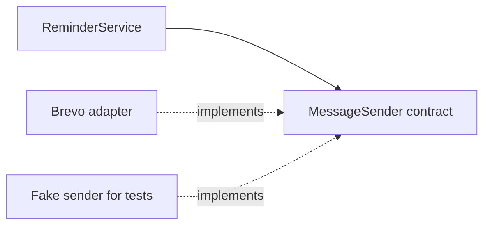
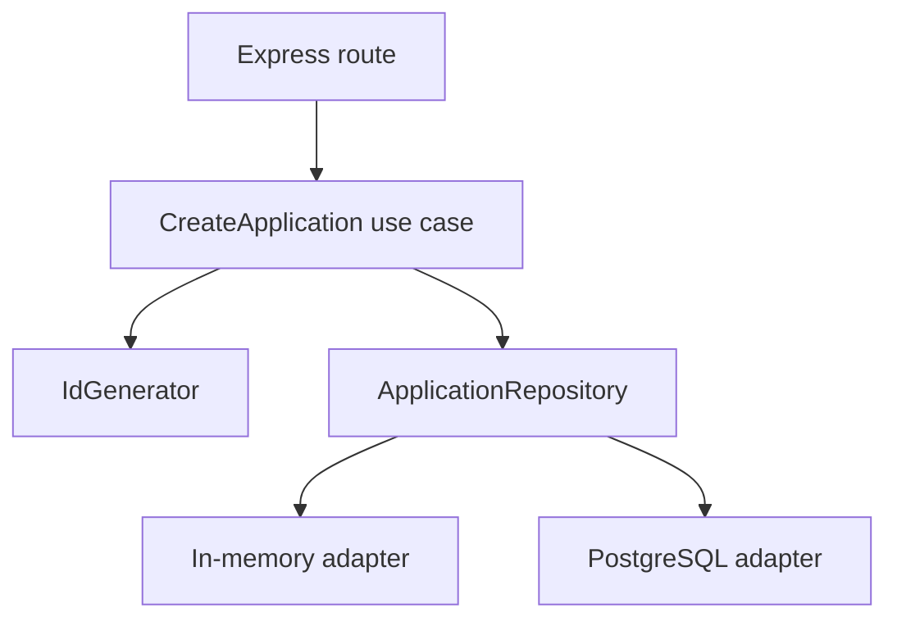
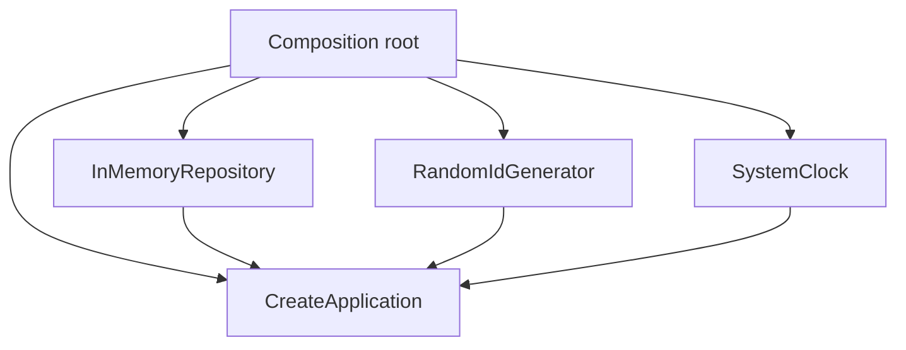
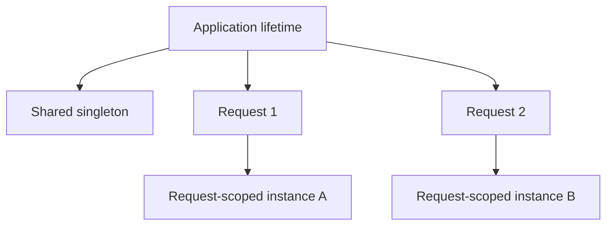
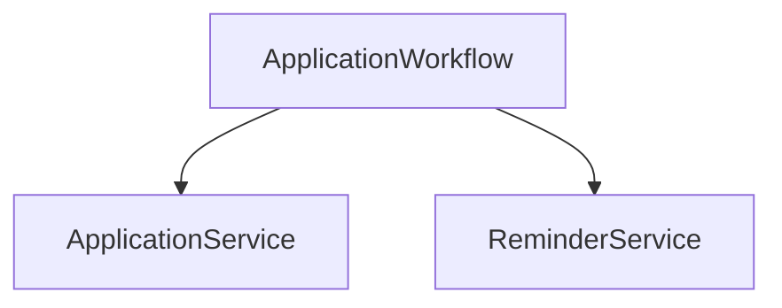

# Lesson 08 — Composition & Dependency Injection ⭐⭐⭐⭐⭐

> **Goal:** Learn how to build software from small cooperating parts, provide dependencies cleanly, and test business logic without connecting to real infrastructure. Examples use TypeScript, Node.js/Express, CareerLoop, and e-commerce.

## 1. The problem we are solving

Suppose CareerLoop sends a reminder when a user should follow up on a job application.

```ts
class ReminderService {
  async remind(email: string) {
    const client = new BrevoClient();
    await client.send(email, "Follow up today");
  }
}
```

This service creates the provider itself. That is convenient initially, but:
- A test may accidentally send a real email.
- Switching to another provider requires changing the service.
- Configuration and credentials are mixed into business logic.
- It is hard to simulate provider failure.

**Composition** and **dependency injection (DI)** help us separate *what a component does* from *which components it uses*.



## 2. Composition in simple words

**Composition** means building a larger behavior by combining smaller objects or functions that each have a clear responsibility.

Example: a car **has an** engine; it is not a type of engine.

```ts
class Engine {
  start() {
    console.log("Engine started");
  }
}

class Car {
  constructor(private readonly engine: Engine) {}

  drive() {
    this.engine.start();
    console.log("Driving");
  }
}

new Car(new Engine()).drive();
```

Here, `Car` *uses* `Engine`. It does not `extend Engine`.

**Composition vs UML composition:** In general programming discussions, “composition” often means assembling behavior through collaborators. In UML, a filled-diamond composition relationship additionally communicates strong whole–part ownership/lifecycle. Not every constructor-injected dependency is a UML composition relationship.

## 3. Inheritance vs composition

| Inheritance | Composition |
|---|---|
| “Is-a” relationship | “Has-a” or “uses-a” relationship |
| `class Admin extends User` | `class ReminderService` uses `MessageSender` |
| Reuses or specializes base behavior | Combines replaceable capabilities |
| Can create tight base/subclass coupling | Often easier to swap collaborators |
| Useful for genuine subtypes | Useful for most service collaboration |

Bad inheritance:

```ts
class EmailReminder extends EmailClient {
  // A reminder is not a kind of email client.
}
```

Better:

```ts
class EmailReminder {
  constructor(private readonly emailClient: EmailClient) {}
}
```

**Rule of thumb:** Prefer composition when you need a capability; choose inheritance when subtype semantics are real and stable. Do not treat either as an absolute rule.

## 4. What exactly is a dependency?

A **dependency** is something a unit needs to perform its job.

For a `CreateApplicationService`, dependencies may include:
- `ApplicationRepository` to save data.
- `IdGenerator` to create identifiers.
- `Clock` to obtain the current time.
- `EventPublisher` to announce an event.

Some dependencies are *pure values* (configuration), some are *functions*, and some are *objects/services*. Not all dependencies need interfaces.

## 5. What is dependency injection?

**Dependency injection** means supplying a component's dependencies from outside rather than having the component construct or look them up itself.

```ts
interface MessageSender {
  send(to: string, message: string): Promise<void>;
}

class ReminderService {
  constructor(private readonly sender: MessageSender) {}

  remind(email: string) {
    return this.sender.send(email, "Follow up today");
  }
}
```

The caller chooses the implementation:

```ts
class ConsoleSender implements MessageSender {
  async send(to: string, message: string) {
    console.log(to, message);
  }
}

const service = new ReminderService(new ConsoleSender());
await service.remind("dev@example.com");
```

The business service knows the **contract**, not how messages are delivered.

## 6. Dependency injection vs dependency inversion

These terms sound similar but mean different things.

**Dependency Inversion Principle (DIP)**: High-level policy should depend on abstractions rather than concrete low-level details.

**Dependency Injection (DI)**: A technique for supplying dependencies from outside.

You can use DI **without** DIP:

```ts
class ReminderService {
  constructor(private readonly sender: BrevoSender) {}
}
```

The caller injects the dependency, but the service is still tied to the concrete `BrevoSender` type.

You can use DI **with** DIP:

```ts
class ReminderService {
  constructor(private readonly sender: MessageSender) {}
}
```

The distinction matters in interviews.

## 7. Three common DI techniques

### 7.1 Constructor injection (usually the default)

```ts
class ApplicationService {
  constructor(private readonly repository: ApplicationRepository) {}
}
```

Good for **required dependencies**. They are available as soon as the object is constructed.

### 7.2 Method/parameter injection

```ts
class ReportService {
  generate(formatter: (value: number) => string, count: number) {
    return formatter(count);
  }
}

const report = new ReportService().generate(String, 12);
```

Useful when the dependency varies per operation.

### 7.3 Property/setter injection

```ts
class ReportController {
  private logger?: (message: string) => void;

  setLogger(logger: (message: string) => void) {
    this.logger = logger;
  }

  show() {
    this.logger?.("Showing report");
  }
}
```

Useful for truly optional dependencies, but required dependencies can be forgotten, creating partially initialized objects. Prefer constructor injection for essentials.

## 8. A complete CareerLoop example: requirements

We want to:
1. Create an application for the authenticated user.
2. Validate company and role.
3. Generate an ID.
4. Save it through a repository.
5. Return the created application.

We'll keep the business logic independent from Express and PostgreSQL.



## 9. Define domain types and contracts

```ts
type Application = {
  id: string;
  ownerId: string;
  company: string;
  role: string;
  status: "Applied";
  createdAt: Date;
};

type CreateApplicationInput = {
  ownerId: string;
  company: string;
  role: string;
};

interface ApplicationRepository {
  save(application: Application): Promise<void>;
  findById(id: string): Promise<Application | null>;
}

interface IdGenerator {
  next(): string;
}

interface Clock {
  now(): Date;
}
```

Why inject a clock and ID generator? Tests become deterministic instead of depending on the real current time or random IDs.

## 10. Implement the use case

```ts
class CreateApplication {
  constructor(
    private readonly repository: ApplicationRepository,
    private readonly ids: IdGenerator,
    private readonly clock: Clock
  ) {}

  async execute(input: CreateApplicationInput): Promise<Application> {
    const company = input.company.trim();
    const role = input.role.trim();

    if (!input.ownerId || !company || !role) {
      throw new Error("Invalid application input");
    }

    const application: Application = {
      id: this.ids.next(),
      ownerId: input.ownerId,
      company,
      role,
      status: "Applied",
      createdAt: this.clock.now(),
    };

    await this.repository.save(application);
    return application;
  }
}
```

Notice that the use case does not import `express`, `drizzle-orm`, or a specific database client.

**Security note:** `ownerId` must come from verified server-side authentication context, not an untrusted request body. Validate request data at runtime.

## 11. Create a simple in-memory adapter

```ts
class InMemoryApplicationRepository implements ApplicationRepository {
  private readonly items = new Map<string, Application>();

  async save(application: Application): Promise<void> {
    this.items.set(application.id, {
      ...application,
      createdAt: new Date(application.createdAt),
    });
  }

  async findById(id: string): Promise<Application | null> {
    const item = this.items.get(id);
    return item
      ? { ...item, createdAt: new Date(item.createdAt) }
      : null;
  }
}

class RandomIdGenerator implements IdGenerator {
  next(): string {
    return crypto.randomUUID();
  }
}

class SystemClock implements Clock {
  now(): Date {
    return new Date();
  }
}
```

On modern Node.js, `crypto.randomUUID()` can be accessed via the global Web Crypto API in supported environments; alternatively use `import { randomUUID } from "node:crypto"` and call `randomUUID()`.

This adapter is suitable for learning and unit tests. It is **not durable** and does not implement database concurrency guarantees.

## 12. The composition root: where objects are wired

A **composition root** is the place where an application assembles concrete implementations and passes them to business components.

```ts
const repository = new InMemoryApplicationRepository();
const ids = new RandomIdGenerator();
const clock = new SystemClock();

const createApplication = new CreateApplication(
  repository,
  ids,
  clock
);
```



**Why this matters:** We want one clear place that knows infrastructure details, instead of scattering `new PostgreSQLClient()` and `new BrevoClient()` throughout business logic.

For a larger app, the composition root might be a startup module, a server bootstrap function, or a carefully scoped dependency container.

## 13. Integrate with Express

```ts
import express from "express";

const app = express();
app.use(express.json());

app.post("/applications", async (req, res) => {
  try {
    // Example only: in production derive this from verified auth middleware.
    const authenticatedUserId = "demo-user-1";

    const input = {
      ownerId: authenticatedUserId,
      company: req.body?.company,
      role: req.body?.role,
    };

    if (typeof input.company !== "string" ||
        typeof input.role !== "string") {
      res.status(400).json({ error: "Invalid request" });
      return;
    }

    const result = await createApplication.execute(input);
    res.status(201).json(result);
  } catch (error) {
    res.status(400).json({ error: "Could not create application" });
  }
});
```

**Production notes:** Replace the hard-coded user with verified authentication, validate schemas (e.g. Zod), use centralized error handling, avoid exposing internal errors, and distinguish validation failures from database failures. Express 5 can propagate rejected async handlers to error middleware, so the explicit try/catch is not required for that purpose.

## 14. Swap storage without changing business code

Today:

```ts
const repository: ApplicationRepository =
  new InMemoryApplicationRepository();
```

Tomorrow:

```ts
// Illustrative: implement this class with Drizzle/Neon.
class PostgresApplicationRepository implements ApplicationRepository {
  async save(application: Application): Promise<void> {
    // INSERT using a parameterized query/Drizzle adapter.
    throw new Error("Implement database write");
  }

  async findById(id: string): Promise<Application | null> {
    // SELECT and map database row to domain type.
    throw new Error("Implement database read");
  }
}
```

The interface lets us change infrastructure without editing `CreateApplication`. The PostgreSQL adapter above is intentionally a **contract skeleton**, not a runnable persistence implementation.

**Important:** Swapping adapters is not always free. Transaction behavior, query capabilities, and performance may differ. Keep contracts honest and test adapters against their expected behavior.

## 15. Testing without a database or email provider

```ts
class FixedIds implements IdGenerator {
  next() {
    return "app-test-1";
  }
}

class FixedClock implements Clock {
  now() {
    return new Date("2026-01-01T00:00:00.000Z");
  }
}

async function testCreateApplication() {
  const repository = new InMemoryApplicationRepository();
  const service = new CreateApplication(
    repository,
    new FixedIds(),
    new FixedClock()
  );

  const created = await service.execute({
    ownerId: "user-1",
    company: " Acme ",
    role: " Developer ",
  });

  console.assert(created.id === "app-test-1");
  console.assert(created.company === "Acme");
  console.assert(created.createdAt.toISOString() ===
    "2026-01-01T00:00:00.000Z");
  console.assert((await repository.findById(created.id)) !== null);
}

testCreateApplication().catch(console.error);
```

These are simple illustrative assertions. In production use Vitest/Jest with proper assertions, negative test cases, and separate integration tests against the actual database.

## 16. Function-based dependency injection

You do **not** need classes for DI.

```ts
type SendMessage = (to: string, message: string) => Promise<void>;

function makeReminderService(sendMessage: SendMessage) {
  return {
    remind(email: string) {
      return sendMessage(email, "Follow up today");
    },
  };
}

const fakeSend: SendMessage = async (to, message) => {
  console.log("Fake:", to, message);
};

const reminders = makeReminderService(fakeSend);
await reminders.remind("dev@example.com");
```

This is often excellent for small JavaScript/TypeScript modules. DI is about **supplying dependencies**, not using a particular framework.

## 17. Factories and dependency injection

A **factory** creates objects, possibly choosing implementations based on configuration.

```ts
function createMessageSender(
  mode: "console" | "email"
): MessageSender {
  if (mode === "console") return new ConsoleSender();
  return new BrevoSender();
}
```

Assume `ConsoleSender` and `BrevoSender` implement the earlier `MessageSender` contract.

The factory belongs near application configuration or the composition root, not inside core business rules.

**Factory vs DI:**
- Factory: *how an object gets created*.
- DI: *how a dependency is supplied to its consumer*.
- They frequently work together.

## 18. DI container: what is it?

A **dependency injection container** is a tool that registers components and resolves their dependency graphs.

Without a container:

```ts
const repository = new InMemoryApplicationRepository();
const service = new CreateApplication(
  repository,
  new RandomIdGenerator(),
  new SystemClock()
);
```

With a container, registrations and resolution may be automated.

A DI container can help in a large app with many dependencies, but it also adds indirection, configuration, and sometimes runtime errors.

**Key idea:** You can practice excellent DI without installing a container.

## 19. Why TypeScript interfaces cannot be runtime injection tokens

TypeScript interfaces disappear when TypeScript is compiled to JavaScript.

```ts
interface MessageSender {
  send(to: string, message: string): Promise<void>;
}
```

At runtime there is no JavaScript value named `MessageSender` to look up.

DI containers often use **strings, symbols, classes, or explicit tokens**.

```ts
const TOKENS = {
  messageSender: Symbol("messageSender"),
};
```

A symbol token exists at runtime. This distinction matters in NestJS and other DI frameworks.

## 20. Dependency lifetimes: singleton, transient, request-scoped

A container or composition root may manage object lifetimes.

| Lifetime | Meaning | Example |
|---|---|---|
| Singleton | One shared instance for the relevant application/container lifetime | Stateless config or shared connection manager |
| Transient | A new instance each time it is requested | Short-lived formatter |
| Request-scoped | One instance for a particular request | Request context or transaction unit |



### Dangerous example: user data in a singleton

```ts
class CurrentUserContext {
  userId = "";
}
```

If one singleton stores the current request's user ID, concurrent requests may overwrite each other's state and cause serious data leakage.

**Rule:** Do not store request-specific mutable state in shared singleton services. Pass user identity explicitly or use carefully managed request-scoped context.

### Node.js nuance

A “singleton” is usually singleton **per process/module instance or DI container**, not globally across all server instances, workers, or serverless invocations.

## 21. Circular dependencies

A circular dependency occurs when A depends on B and B depends on A.


This can make initialization and testing difficult.

### Better approach

Extract a smaller shared abstraction, use domain events, or move orchestration into a higher-level workflow.



**Avoid** resolving every circular dependency by introducing a global service locator; it hides dependencies rather than fixing responsibilities.

## 22. Service locator vs dependency injection

A **service locator** is a global or shared registry that business code asks for dependencies.

```ts
class BadService {
  run() {
    const sender = GlobalRegistry.get("messageSender");
    // Hidden dependency.
  }
}
```

With constructor injection, dependencies are explicit:

```ts
class GoodService {
  constructor(private readonly sender: MessageSender) {}
}
```

A service locator can be useful at infrastructure boundaries, but widespread use inside business code hides requirements and complicates tests.

## 23. DI in Next.js App Router

In a Next.js app, you can compose dependencies in a server-only module:

```ts
// server/services.ts (illustrative)
export function buildApplicationService() {
  const repository = makePostgresRepository();
  return new CreateApplication(
    repository,
    new RandomIdGenerator(),
    new SystemClock()
  );
}
```

Then use it from a server route handler or server action.

**Important:**
- Keep credentials and database clients on the server.
- Don't import server-only modules into Client Components.
- Don't assume one global instance is shared across all serverless workers.
- Reuse database clients/pools according to the deployment provider's guidance.
- Use request-specific authentication context for ownership checks.
- Creating new DB pools per request is usually undesirable.

`makePostgresRepository()` is an application-specific factory you would implement using Drizzle/Neon or another database client.

## 24. DI in a background job worker

CareerLoop reminder delivery can be built from separate capabilities:

```ts
interface ReminderRepository {
  findDue(): Promise<Array<{ id: string; email: string }>>;
  markDelivered(id: string): Promise<void>;
}

class ReminderWorker {
  constructor(
    private readonly reminders: ReminderRepository,
    private readonly sender: MessageSender
  ) {}

  async runOnce() {
    const due = await this.reminders.findDue();

    for (const reminder of due) {
      await this.sender.send(reminder.email, "Follow up today");
      await this.reminders.markDelivered(reminder.id);
    }
  }
}
```

This demonstrates collaboration but is **not production-safe as written**: two workers can pick the same reminder; a crash after sending but before marking delivered can produce duplicates.

Production design may need durable queue claims, atomic status transitions, retry/backoff, idempotency keys, dead-letter handling, and provider reconciliation. DI helps testing but does not solve distributed delivery guarantees.

## 25. Common mistakes

1. **Using `new` inside every business method**: hard-codes infrastructure and makes tests harder.
2. **Creating an interface for every trivial helper**: unnecessary complexity.
3. **Assuming DI requires NestJS or a container**: manual constructor injection works.
4. **Confusing DIP with DI**: design principle vs wiring technique.
5. **Injecting request state into a singleton**: risks data leakage.
6. **Building circular dependency graphs**: unclear responsibilities.
7. **Using a global service locator everywhere**: hidden dependencies.
8. **Creating DB pools for every request**: wastes connections.
9. **Assuming adapters are interchangeable without tests**: semantics may differ.
10. **Believing DI solves database consistency**: transactions and concurrency control remain separate concerns.

## 26. Interview questions

**Q1. What is composition?**  
Building behavior from collaborating parts instead of relying only on inheritance.

**Q2. What is DI?**  
Supplying required collaborators externally, often through constructors.

**Q3. Why is constructor injection popular?**  
It makes required dependencies explicit and available immediately.

**Q4. DI vs DIP?**  
DI is a wiring technique; DIP guides dependency direction.

**Q5. Does DI require interfaces?**  
No. Functions, concrete objects, and values can be injected.

**Q6. Does DI require a framework?**  
No. Manual wiring is enough for many systems.

**Q7. What is a composition root?**  
The place where concrete dependencies are assembled.

**Q8. Singleton vs request-scoped?**  
Shared instance vs instance dedicated to a request.

**Q9. Why avoid user state in singletons?**  
Concurrent requests may leak or overwrite each other's data.

**Q10. Why use a fake repository?**  
To test business rules quickly and deterministically without a real database.

**Q11. What is a circular dependency?**  
Two or more components depend on each other in a cycle.

**Q12. Why can’t an interface be used directly as a runtime DI token?**  
TypeScript erases interfaces during compilation.

## 27. Practice exercises

### Exercise A — Notification providers
Create `MessageSender` implementations for console and email. Inject them into one reminder service. Show how to test without network calls.

### Exercise B — Payment checkout
Design a `PaymentGateway` interface with two adapters. Inject it into `CheckoutService`. Explain what DI solves and what payment correctness concerns remain.

### Exercise C — CareerLoop
Implement a `GetApplication` use case using `ApplicationRepository`. Ensure the authenticated user owns the application before returning it.

### Exercise D — Clock injection
Create a `FollowUpPolicy` that decides whether a reminder is due. Inject a clock so tests do not depend on the real date.

### Exercise E — Scope bug
Explain what can go wrong when a shared singleton stores `currentUserId`. Refactor the API to accept the authenticated user ID as a method argument.

### Exercise F — Architecture diagram
Draw a composition root, two use cases, a PostgreSQL adapter, and a fake repository. Label dependency directions.

## 28. Quick revision checklist

- [ ] I can explain composition vs inheritance.
- [ ] I know what a dependency is.
- [ ] I can distinguish DI from DIP.
- [ ] I can implement constructor, method, and property injection.
- [ ] I can build a composition root.
- [ ] I understand factories and DI containers.
- [ ] I know why TypeScript interfaces disappear at runtime.
- [ ] I understand singleton, transient, and request-scoped lifetimes.
- [ ] I can identify and refactor circular dependencies.
- [ ] I can test a use case with a fake repository and clock.
- [ ] I understand DI does not solve distributed consistency or security.

### Next lesson

Continue with the next lesson in the repository curriculum. Keep the same learning pattern: clear theory, production examples, diagrams, TypeScript implementations, trade-offs, exercises, and interview preparation.
