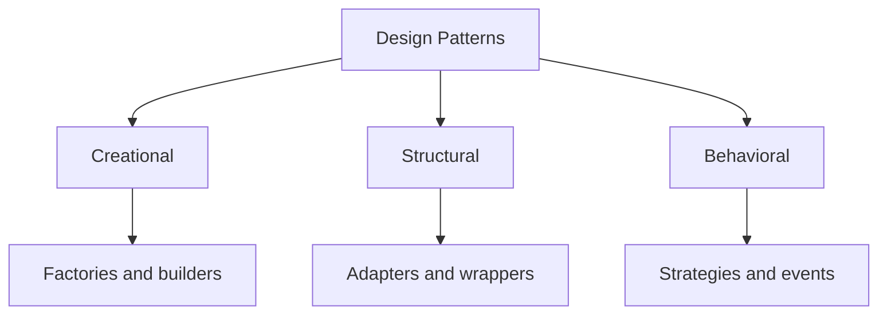
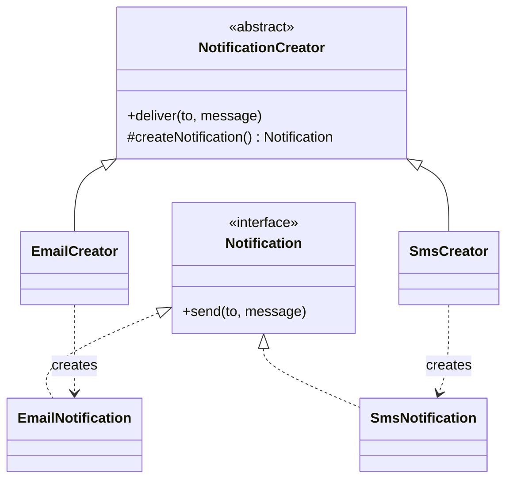
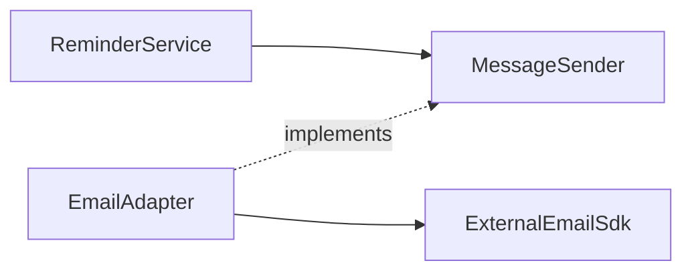
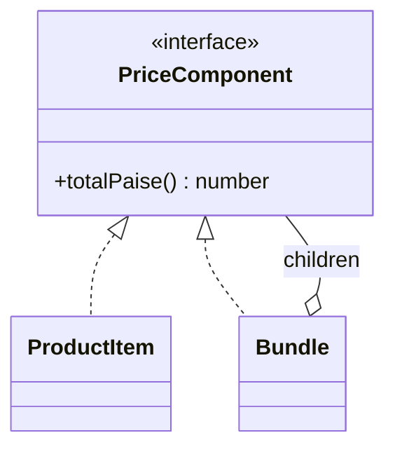
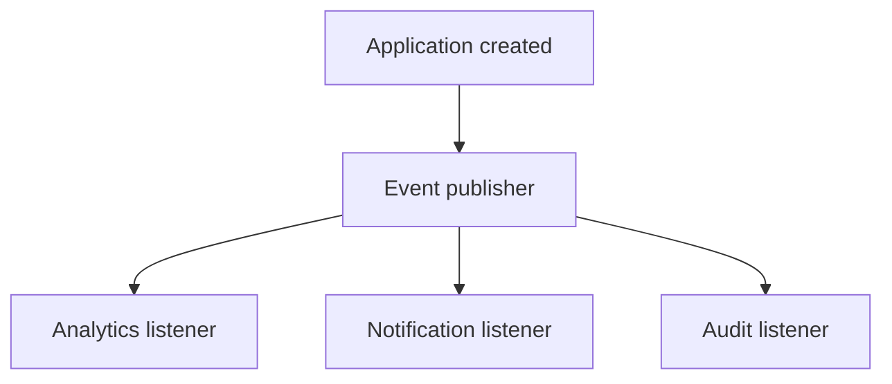
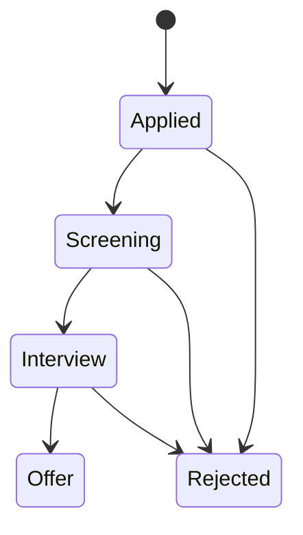
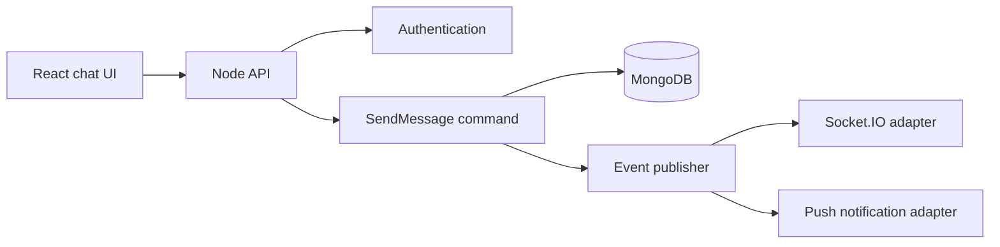
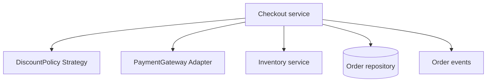

# Lesson 09 — Design Patterns ⭐⭐⭐⭐⭐

> **Goal:** Learn reusable solutions to common object-design problems, understand their trade-offs, and recognize when simple TypeScript functions are better. Examples connect to CareerLoop, CodeBuddy, and e-commerce.

## 1. What is a design pattern?

A **design pattern** is a reusable *idea* for organizing collaborating objects. It is not a library, framework, or code snippet that must be copied exactly.

Imagine a job tracker that sends reminders by email today, SMS tomorrow, and in-app notifications later. You could keep adding conditionals, or you could use a **Strategy** pattern to swap notification implementations behind one contract.

Patterns give developers a shared vocabulary: “use a factory,” “wrap it with a decorator,” or “publish an event to observers.”

**Important:** A pattern is helpful only when it solves a real design problem. Unnecessary patterns add complexity.

## 2. Three major categories

| Category | Main question | Patterns |
|---|---|---|
| **Creational** | How are objects created? | Factory Method, Abstract Factory, Builder, Singleton, Prototype |
| **Structural** | How are objects assembled? | Adapter, Decorator, Facade, Composite, Proxy, Bridge, Flyweight |
| **Behavioral** | How do objects collaborate and vary behavior? | Strategy, Observer, Command, State, Chain of Responsibility, Template Method, Iterator, Mediator, Memento, Visitor, Interpreter |

These are the **23 classic Gang of Four (GoF) patterns**. Modern JavaScript also has simpler functional alternatives, event emitters, and module patterns.



## 3. How to choose a pattern

Before applying a pattern, ask:

1. **What is changing?** Provider, algorithm, workflow state, object creation, or external API?
2. **What must remain stable?** The business use case, domain rules, or caller contract?
3. **Is the variation real?** Avoid inventing requirements.
4. **Can a simple function solve it?** In TypeScript, often yes.
5. **What is the cost?** More files, indirection, tests, and debugging effort.

---

# Part A — Creational Patterns

## 4. Factory Method

**Problem:** Callers should not need to know every detail of constructing an object.

**Idea:** Define a creation operation and let a subclass or specialized creator decide which concrete product to construct.

```ts
interface Notification {
  send(to: string, message: string): Promise<void>;
}

class EmailNotification implements Notification {
  async send(to: string, message: string) {
    console.log("EMAIL", to, message);
  }
}

class SmsNotification implements Notification {
  async send(to: string, message: string) {
    console.log("SMS", to, message);
  }
}

abstract class NotificationCreator {
  protected abstract createNotification(): Notification;

  async deliver(to: string, message: string): Promise<void> {
    const notification = this.createNotification();
    await notification.send(to, message);
  }
}

class EmailCreator extends NotificationCreator {
  protected createNotification(): Notification {
    return new EmailNotification();
  }
}

class SmsCreator extends NotificationCreator {
  protected createNotification(): Notification {
    return new SmsNotification();
  }
}

await new EmailCreator().deliver("dev@example.com", "Interview tomorrow");
```



**Factory Method vs simple factory:** A function like `createNotification(type)` is often called a *simple factory*. It is useful, but it is not the classic GoF Factory Method unless creation is delegated through a creator hierarchy/overridable method.

**Use when:** Product creation varies across specialized workflows. **Avoid when:** A one-line constructor is sufficient.

## 5. Abstract Factory

**Problem:** Create a *family of related objects* that must work together.

Example: different cloud providers need compatible storage and queue clients.

```ts
interface Storage {
  upload(key: string): Promise<void>;
}

interface Queue {
  publish(message: string): Promise<void>;
}

interface CloudFactory {
  storage(): Storage;
  queue(): Queue;
}

class AwsFactory implements CloudFactory {
  storage(): Storage {
    return { async upload(key) { console.log("S3", key); } };
  }

  queue(): Queue {
    return { async publish(message) { console.log("SQS", message); } };
  }
}

class LocalFactory implements CloudFactory {
  storage(): Storage {
    return { async upload(key) { console.log("Local disk", key); } };
  }

  queue(): Queue {
    return { async publish(message) { console.log("Local queue", message); } };
  }
}

async function bootstrap(factory: CloudFactory) {
  await factory.storage().upload("resume.pdf");
  await factory.queue().publish("resume-uploaded");
}

await bootstrap(new LocalFactory());
```

**Difference from Factory Method:** Factory Method typically creates one product through an overridable method. Abstract Factory exposes multiple related product-creation methods.

**Trade-off:** Adding a new provider family is straightforward; adding a new product type may require updating every factory.

## 6. Builder

**Problem:** Creating a complex object requires many optional parameters and validation rules.

```ts
type SearchQuery = {
  keyword: string;
  status?: "Applied" | "Interview";
  limit: number;
  sort: "newest" | "oldest";
};

class SearchQueryBuilder {
  private keyword = "";
  private status?: SearchQuery["status"];
  private limit = 20;
  private sort: SearchQuery["sort"] = "newest";

  withKeyword(value: string): this {
    this.keyword = value.trim();
    return this;
  }

  withStatus(value: SearchQuery["status"]): this {
    this.status = value;
    return this;
  }

  withLimit(value: number): this {
    if (!Number.isInteger(value) || value < 1 || value > 100) {
      throw new Error("Limit must be 1–100");
    }
    this.limit = value;
    return this;
  }

  build(): SearchQuery {
    return {
      keyword: this.keyword,
      status: this.status,
      limit: this.limit,
      sort: this.sort,
    };
  }
}

const query = new SearchQueryBuilder()
  .withKeyword("React")
  .withStatus("Interview")
  .withLimit(10)
  .build();
```

**Use when:** Construction is complex, incremental, or must enforce invariants. **Avoid when:** A typed object literal is already readable. TypeScript's named properties often eliminate the need for a builder.

## 7. Singleton

**Problem:** An application wants one shared instance *within a defined runtime scope*.

```ts
class ConfigStore {
  private static instance: ConfigStore | undefined;

  private constructor(public readonly environment: string) {}

  static getInstance(): ConfigStore {
    return (this.instance ??= new ConfigStore("production"));
  }
}

const a = ConfigStore.getInstance();
const b = ConfigStore.getInstance();
console.log(a === b); // true
```

**Real-world nuance:** A singleton is not globally unique across Node.js processes, cluster workers, serverless instances, or regions. JavaScript modules can also naturally share exported instances per module-loader context.

**Danger:** Mutable singleton state can leak data between concurrent requests. Never store `currentUserId` in a shared singleton.

**Better alternative in many systems:** Compose one shared instance at startup and inject it into consumers.

## 8. Prototype

**Problem:** Create a new object by copying an existing prototype/template.

```ts
type ReminderTemplate = {
  title: string;
  channels: string[];
  settings: { retryCount: number };
};

const defaultTemplate: ReminderTemplate = {
  title: "Follow up",
  channels: ["email"],
  settings: { retryCount: 3 },
};

const custom = structuredClone(defaultTemplate);
custom.channels.push("in-app");
custom.settings.retryCount = 5;
```

The example demonstrates **copying a template**. The classic Prototype pattern delegates creation to a prototype object's clone operation. `structuredClone` is useful for supported data but does not preserve arbitrary custom class prototypes or clone functions.

**Use when:** You need reusable object templates or expensive initialization can be avoided through cloning. **Avoid when:** Normal object construction is simpler.

---

# Part B — Structural Patterns

## 9. Adapter

**Problem:** Your application expects one interface, but an external library exposes a different one.

CareerLoop expects `MessageSender.send()`, while a provider exposes `sendEmail()`.

```ts
interface MessageSender {
  send(to: string, text: string): Promise<void>;
}

class ExternalEmailSdk {
  async sendEmail(payload: { recipient: string; body: string }) {
    console.log("Provider request", payload);
  }
}

class EmailAdapter implements MessageSender {
  constructor(private readonly sdk: ExternalEmailSdk) {}

  send(to: string, text: string): Promise<void> {
    return this.sdk.sendEmail({ recipient: to, body: text });
  }
}

const sender: MessageSender = new EmailAdapter(new ExternalEmailSdk());
await sender.send("dev@example.com", "Apply today");
```



**Use when:** Integrating incompatible APIs, migrating vendors, or insulating business code from SDK details.

## 10. Decorator

**Problem:** Add behavior around an object without modifying the underlying implementation.

```ts
interface ApplicationReader {
  get(id: string): Promise<string>;
}

class DatabaseReader implements ApplicationReader {
  async get(id: string) {
    return `Application ${id}`;
  }
}

class LoggingReader implements ApplicationReader {
  constructor(private readonly inner: ApplicationReader) {}

  async get(id: string): Promise<string> {
    console.log("Reading", id);
    return this.inner.get(id);
  }
}

const reader = new LoggingReader(new DatabaseReader());
await reader.get("app-1");
```


You can stack decorators for logging, metrics, caching, or authorization, but **order matters**. A cache placed outside authorization can be unsafe unless keys and access controls are carefully designed.

**Distinction:** This is the object-oriented Decorator pattern, not necessarily TypeScript's `@decorator` language feature.

## 11. Facade

**Problem:** A subsystem requires several steps; callers want a simpler entry point.

```ts
class Inventory {
  reserve(sku: string) { console.log("Reserve", sku); }
}

class Payment {
  charge(amountPaise: number) { console.log("Charge", amountPaise); }
}

class Receipt {
  issue() { console.log("Receipt issued"); }
}

class CheckoutFacade {
  constructor(
    private readonly inventory: Inventory,
    private readonly payment: Payment,
    private readonly receipt: Receipt
  ) {}

  checkout(sku: string, amountPaise: number) {
    this.inventory.reserve(sku);
    this.payment.charge(amountPaise);
    this.receipt.issue();
  }
}
```

**Important:** This synchronous sample is not a safe real payment workflow. Actual checkout requires transactions, compensating actions, idempotency, provider confirmation, and failure recovery.

**Facade vs Adapter:** Adapter changes an interface to match a consumer; Facade simplifies access to a complex subsystem.

## 12. Composite

**Problem:** Treat one item and a group of items through the same interface.

```ts
interface PriceComponent {
  totalPaise(): number;
}

class ProductItem implements PriceComponent {
  constructor(private readonly pricePaise: number) {}

  totalPaise() { return this.pricePaise; }
}

class Bundle implements PriceComponent {
  constructor(private readonly children: PriceComponent[]) {}

  totalPaise() {
    return this.children.reduce((sum, item) => sum + item.totalPaise(), 0);
  }
}

const bundle = new Bundle([
  new ProductItem(10000),
  new Bundle([new ProductItem(5000), new ProductItem(2000)]),
]);

console.log(bundle.totalPaise()); // 17000
```



**Use when:** Modeling trees such as folders, UI components, menus, or product bundles.

## 13. Proxy

**Problem:** Control access to another object, possibly adding caching, lazy initialization, or remote communication.

```ts
interface ProfileReader {
  read(id: string): Promise<string>;
}

class RemoteProfileReader implements ProfileReader {
  async read(id: string) {
    return `Profile for ${id}`;
  }
}

class CachedProfileProxy implements ProfileReader {
  private readonly cache = new Map<string, string>();

  constructor(private readonly remote: ProfileReader) {}

  async read(id: string) {
    if (this.cache.has(id)) return this.cache.get(id)!;
    const value = await this.remote.read(id);
    this.cache.set(id, value);
    return value;
  }
}
```

**Important:** Real caches need expiration, invalidation, bounded size, and user-specific authorization. This example intentionally omits those concerns.

**Proxy vs Decorator:** Both wrap an object. A proxy primarily controls access to the original; a decorator primarily adds responsibilities. Implementations can look similar.

## 14. Bridge

**Problem:** Two independent dimensions vary, and inheritance would create many combinations.

Example: report type (applications vs interviews) and output format (text vs JSON).

```ts
interface Formatter {
  format(data: unknown): string;
}

class JsonFormatter implements Formatter {
  format(data: unknown) { return JSON.stringify(data); }
}

class TextFormatter implements Formatter {
  format(data: unknown) { return String(data); }
}

class Report {
  constructor(private readonly formatter: Formatter) {}

  render(data: unknown) {
    return this.formatter.format(data);
  }
}
```

The report abstraction and formatter implementation can evolve separately.

**Use when:** Two dimensions of behavior vary independently.

## 15. Flyweight

**Problem:** Thousands of objects repeat the same immutable information, wasting memory.

Example: a code editor renders many tokens. Instead of storing identical style definitions in each token, share a style object.

```ts
type Style = Readonly<{ font: string; color: string }>;

const stylePool = new Map<string, Style>();

function getStyle(key: string): Style {
  let style = stylePool.get(key);
  if (!style) {
    style = Object.freeze({ font: "monospace", color: key });
    stylePool.set(key, style);
  }
  return style;
}

const tokenA = { text: "const", style: getStyle("blue") };
const tokenB = { text: "let", style: getStyle("blue") };
console.log(tokenA.style === tokenB.style); // true
```

**Use when:** There is proven memory pressure from large numbers of similar objects. Don't add pools without measuring.

---

# Part C — Behavioral Patterns

## 16. Strategy

**Problem:** Choose among interchangeable algorithms or policies.

CareerLoop may sort applications by newest, oldest, or company.

```ts
type Job = { company: string; createdAt: number };

interface SortStrategy {
  sort(items: Job[]): Job[];
}

class NewestFirst implements SortStrategy {
  sort(items: Job[]) {
    return [...items].sort((a, b) => b.createdAt - a.createdAt);
  }
}

class CompanyAlphabetical implements SortStrategy {
  sort(items: Job[]) {
    return [...items].sort((a, b) =>
      a.company.localeCompare(b.company)
    );
  }
}

class JobList {
  constructor(private readonly strategy: SortStrategy) {}

  display(items: Job[]) {
    return this.strategy.sort(items);
  }
}
```

**Use when:** Policies vary independently of callers. **Functional alternative:** Pass a comparator function directly.

## 17. Observer

**Problem:** When an event happens, several independent listeners should react.

```ts
type Listener = (applicationId: string) => void;

class ApplicationEvents {
  private readonly listeners = new Set<Listener>();

  subscribe(listener: Listener): () => void {
    this.listeners.add(listener);
    return () => this.listeners.delete(listener);
  }

  publishCreated(id: string) {
    for (const listener of this.listeners) listener(id);
  }
}

const events = new ApplicationEvents();
const unsubscribe = events.subscribe((id) =>
  console.log("Update analytics for", id)
);

events.publishCreated("app-1");
unsubscribe();
```



**Important:** This is **in-process**, synchronous event delivery. A process crash can lose events. Durable cross-service delivery needs a queue, broker, or transactional outbox design. Listeners that throw can interrupt this basic publisher; production implementations should define failure semantics.

## 18. Command

**Problem:** Represent an action as an object that can be queued, logged, retried, or executed later.

```ts
interface Command {
  execute(): Promise<void>;
}

class SendReminderCommand implements Command {
  constructor(
    private readonly sender: MessageSender,
    private readonly email: string
  ) {}

  execute() {
    return this.sender.send(this.email, "Follow up today");
  }
}

async function run(command: Command) {
  await command.execute();
}
```

Commands can also support undo, but **not every operation is reversible** (especially payments and external messages).

**Command vs Strategy:** Strategy selects *how* an algorithm runs; Command represents *an action to perform*.

## 19. State

**Problem:** An object's behavior depends on its current state, and giant conditionals become difficult to manage.

Consider a job application workflow: Applied → Screening → Interview → Offer, with rejection possible.

```ts
interface ApplicationState {
  next(): ApplicationState;
  label(): string;
}

class AppliedState implements ApplicationState {
  next() { return new ScreeningState(); }
  label() { return "Applied"; }
}

class ScreeningState implements ApplicationState {
  next() { return new InterviewState(); }
  label() { return "Screening"; }
}

class InterviewState implements ApplicationState {
  next() { return new OfferState(); }
  label() { return "Interview"; }
}

class OfferState implements ApplicationState {
  next(): ApplicationState {
    throw new Error("No next state");
  }
  label() { return "Offer"; }
}

class ApplicationWorkflow {
  constructor(private state: ApplicationState = new AppliedState()) {}

  advance() { this.state = this.state.next(); }
  status() { return this.state.label(); }
}
```



The code demonstrates the happy-path progression; the diagram also shows rejection transitions, which would require additional methods/rules to implement.

**State vs Strategy:** Both delegate behavior. Strategy is usually selected as a policy; State typically changes as an object's lifecycle evolves.

**When not to use:** A small enum and validated transition table can be clearer than many state classes.

## 20. Chain of Responsibility

**Problem:** Pass a request through a sequence of handlers, each of which can handle, reject, or forward it.

Express middleware is a familiar example.

```ts
import express from "express";

const app = express();

app.use((req, res, next) => {
  console.log(req.method, req.path);
  next();
});

app.use((req, res, next) => {
  if (!req.headers.authorization) {
    res.status(401).json({ error: "Unauthorized" });
    return;
  }
  next();
});

app.get("/applications", (_req, res) => {
  res.json([]);
});
```

**Important:** This middleware only checks whether a header exists; it does not verify a token. Never use it as real authentication.

**Use when:** Multiple independent processing steps should be ordered and composed.

## 21. Template Method

**Problem:** An algorithm follows fixed steps, but some steps vary in subclasses.

```ts
abstract class Importer {
  async run(input: string) {
    const records = this.parse(input);
    const valid = records.filter((record) => record.length > 0);
    return this.save(valid);
  }

  protected abstract parse(input: string): string[];
  protected abstract save(records: string[]): Promise<number>;
}

class CsvImporter extends Importer {
  protected parse(input: string) {
    return input.split(",");
  }

  protected async save(records: string[]) {
    console.log("Saving", records);
    return records.length;
  }
}
```

**Template Method vs Strategy:** Template Method uses inheritance to vary steps in an algorithm; Strategy uses composition to replace an entire policy or algorithm. Composition is often more flexible.

## 22. Iterator

**Problem:** Traverse a collection without exposing its internal storage.

JavaScript already has the iterator protocol:

```ts
class ApplicationIds implements Iterable<string> {
  constructor(private readonly ids: string[]) {}

  *[Symbol.iterator](): Iterator<string> {
    for (const id of this.ids) yield id;
  }
}

for (const id of new ApplicationIds(["a1", "a2"])) {
  console.log(id);
}
```

Built-in arrays, maps, sets, generators, and `for...of` already make Iterator very common in JavaScript.

## 23. Mediator

**Problem:** Many components communicate directly with one another, creating a web of dependencies.

A mediator coordinates their interaction.

```ts
interface ChatMediator {
  broadcast(from: string, message: string): void;
}

class ChatRoom implements ChatMediator {
  private readonly members = new Map<string, (message: string) => void>();

  join(name: string, receive: (message: string) => void) {
    this.members.set(name, receive);
  }

  broadcast(from: string, message: string) {
    for (const [name, receive] of this.members) {
      if (name !== from) receive(`${from}: ${message}`);
    }
  }
}
```

**CodeBuddy example:** A chat-room coordinator can mediate communication between connected clients.

**Caution:** A mediator can itself become a “god object.” Keep its responsibilities focused.

## 24. Memento

**Problem:** Save and restore an object's earlier state without exposing all its internal details.

```ts
type EditorSnapshot = Readonly<{ text: string }>;

class NoteEditor {
  private text = "";

  write(text: string) { this.text = text; }
  snapshot(): EditorSnapshot { return { text: this.text }; }
  restore(snapshot: EditorSnapshot) { this.text = snapshot.text; }
  read() { return this.text; }
}

const editor = new NoteEditor();
editor.write("First draft");
const saved = editor.snapshot();
editor.write("Second draft");
editor.restore(saved);
console.log(editor.read()); // First draft
```

**Use when:** Undo/history is a requirement. **Trade-off:** Snapshots consume memory; complex state may need incremental history.

## 25. Visitor

**Problem:** Add new operations across an existing hierarchy of element types without putting every operation in those classes.

```ts
interface ShapeVisitor {
  visitCircle(circle: Circle): string;
  visitRectangle(rect: Rectangle): string;
}

interface Shape {
  accept(visitor: ShapeVisitor): string;
}

class Circle implements Shape {
  constructor(public readonly radius: number) {}
  accept(visitor: ShapeVisitor) { return visitor.visitCircle(this); }
}

class Rectangle implements Shape {
  constructor(
    public readonly width: number,
    public readonly height: number
  ) {}
  accept(visitor: ShapeVisitor) { return visitor.visitRectangle(this); }
}

class AreaVisitor implements ShapeVisitor {
  visitCircle(circle: Circle) {
    return String(Math.PI * circle.radius ** 2);
  }

  visitRectangle(rect: Rectangle) {
    return String(rect.width * rect.height);
  }
}

console.log(new Circle(2).accept(new AreaVisitor()));
```

**Trade-off:** Adding a new operation is easy (new visitor), but adding a new element type means updating visitor interfaces and implementations.

In TypeScript, discriminated unions with exhaustive switches are often simpler for a small, fixed set of variants.

## 26. Interpreter

**Problem:** Represent and evaluate a small language or expression grammar.

```ts
interface Expression {
  evaluate(context: Record<string, number>): number;
}

class NumberLiteral implements Expression {
  constructor(private readonly value: number) {}
  evaluate() { return this.value; }
}

class Variable implements Expression {
  constructor(private readonly name: string) {}

  evaluate(context: Record<string, number>) {
    const value = context[this.name];
    if (value === undefined) throw new Error("Unknown variable");
    return value;
  }
}

class Add implements Expression {
  constructor(
    private readonly left: Expression,
    private readonly right: Expression
  ) {}

  evaluate(context: Record<string, number>) {
    return this.left.evaluate(context) + this.right.evaluate(context);
  }
}

const expression = new Add(new Variable("x"), new NumberLiteral(5));
console.log(expression.evaluate({ x: 7 })); // 12
```

This represents the expression `x + 5`. Real language parsers require tokenization, parsing, grammar rules, and error handling. Never use `eval()` on untrusted user input.

**Use when:** Implementing a small domain-specific language or expression tree. For complex grammars, a parser library may be more appropriate.

---

# Part D — Compare, Apply, and Practice

## 27. Patterns that are easy to confuse

| Pair | Key distinction |
|---|---|
| Factory Method vs Abstract Factory | One overridable product creation vs families of related products |
| Factory vs Builder | Choose/create implementation vs assemble complex configuration step by step |
| Adapter vs Facade | Translate an interface vs simplify a subsystem |
| Adapter vs Decorator | Make incompatible APIs compatible vs add behavior |
| Decorator vs Proxy | Add responsibilities vs control access |
| Strategy vs State | Swap policy vs change lifecycle-dependent behavior |
| Strategy vs Template Method | Composition vs inheritance for algorithm variation |
| Observer vs Mediator | Notify subscribers vs coordinate participant interactions |
| Command vs Strategy | Encapsulated action vs interchangeable algorithm |
| Singleton vs dependency injection | Controlled shared instance vs supplying collaborators |

## 28. CareerLoop: choose patterns based on actual needs

| Requirement | Candidate pattern | Why |
|---|---|---|
| Switch email providers | Adapter + Strategy | Stable sending contract, swappable implementation |
| Sort application lists | Strategy | Replaceable sorting policy |
| Application status workflow | State or transition table | Explicit allowed transitions |
| Create configured services | Factory | Centralized construction |
| Log and measure repository calls | Decorator | Wrap existing behavior |
| Notify multiple modules on changes | Observer | Decoupled event subscribers |
| Schedule background reminder action | Command | Represent work for later execution |
| Complex dashboard filter configuration | Builder (optional) | Fluent validated construction |

**Avoid pattern stacking for its own sake.** One simple function may solve a requirement more clearly.

## 29. CodeBuddy chat example

For a developer networking app with one-to-one messaging:



Patterns:
- **Command:** represent a send-message action.
- **Adapter:** isolate Socket.IO/provider APIs from business services.
- **Observer:** trigger secondary work after a message is persisted.
- **Strategy:** select delivery behavior (real-time vs notification) if the requirements justify it.

**Production concerns beyond patterns:** authenticate socket connections, authorize room membership, persist before acknowledging delivery, handle duplicate retries, define ordering guarantees, and avoid losing events between DB commit and publication. A transactional outbox may be useful.

## 30. E-commerce checkout example



- **Strategy:** discounts and shipping policies.
- **Adapter:** payment gateway integration.
- **Facade:** a simplified checkout entry point.
- **State:** order lifecycle when transitions become complex.
- **Observer:** downstream notifications and analytics.

**Critical reminder:** Patterns organize code. They do not guarantee transaction atomicity across a database and external payment provider, prevent duplicate webhooks, or make retries safe. Design those concerns separately.

## 31. Testing patterns

A well-chosen pattern makes behavior easier to test.

Example: test a notification strategy using a fake sender.

```ts
class FakeSender implements MessageSender {
  sent: Array<{ to: string; text: string }> = [];

  async send(to: string, text: string) {
    this.sent.push({ to, text });
  }
}

const fake = new FakeSender();
await fake.send("test@example.com", "Reminder");
console.assert(fake.sent.length === 1);
```

This demonstrates the test double. For a real unit test, inject `fake` into the *consumer* (e.g. `ReminderService`) and assert that the consumer invokes it correctly. Also test error propagation, timeouts, and invalid inputs.

**Testing checklist:**
- Does the interface contract hold for every implementation?
- Do decorators preserve return values and errors?
- Does a state transition reject invalid moves?
- Do observers unsubscribe and handle errors correctly?
- Does a factory return the expected implementation?
- Can a new strategy be added without modifying stable callers?

## 32. Common mistakes

1. Memorizing pattern names without understanding the problem.
2. Using inheritance where composition would be simpler.
3. Building a Singleton that holds mutable per-request data.
4. Assuming TypeScript interfaces enforce runtime validation.
5. Confusing a simple factory function with classic Factory Method.
6. Applying Observer across processes without durable delivery.
7. Assuming a cache proxy is safe without authorization/invalidation.
8. Using State classes for a trivial two-state toggle.
9. Adding a Builder for a small object literal.
10. Treating a Facade as a guarantee of distributed transaction correctness.
11. Adding layers only to claim a design uses more patterns.
12. Ignoring performance, error handling, and security when abstracting providers.

## 33. Interview questions

**Q1. What is a design pattern?** A reusable design approach for a recurring problem.

**Q2. What are the three categories?** Creational, structural, and behavioral.

**Q3. Factory Method vs Abstract Factory?** A specialized creator's product creation vs a factory for a related product family.

**Q4. Adapter vs Decorator?** Adapt an incompatible interface vs wrap an object to add behavior.

**Q5. Strategy vs State?** Select a policy vs vary behavior as internal state changes.

**Q6. Observer vs message queue?** Observer describes a notification relationship; a durable broker/queue adds persistence, delivery, and distributed operational semantics.

**Q7. When is Singleton dangerous?** When mutable shared state leaks across requests or hides dependencies.

**Q8. Why use Builder?** To manage complex construction with validation.

**Q9. What is Composite?** A shared interface for leaves and groups in a tree.

**Q10. What is Command useful for?** Representing an operation that can be queued, logged, or executed later.

**Q11. How do you choose patterns?** Identify what changes, what stays stable, and whether the abstraction pays for its complexity.

**Q12. Can JavaScript functions replace some patterns?** Yes; closures, callbacks, object literals, and higher-order functions can express many patterns cleanly.

## 34. Practice exercises

### Exercise A — Strategy
Implement three CareerLoop sorting strategies: newest, oldest, and company name. Compare an interface-based design with a comparator function.

### Exercise B — Adapter
Wrap two different email provider SDK shapes behind one `MessageSender` contract. Write a fake adapter for tests.

### Exercise C — State
Model application status transitions. Reject invalid transitions and discuss whether a transition table is simpler than state classes.

### Exercise D — Decorator
Wrap an `ApplicationRepository` with logging and timing. Preserve return values and thrown errors.

### Exercise E — Factory
Create a factory that chooses an in-memory repository for tests and PostgreSQL for production. Keep business code unchanged.

### Exercise F — Observer
Implement an application-created event with analytics and notification listeners. Explain how you would make delivery durable across process crashes.

### Exercise G — Composite
Model an e-commerce bundle with nested products and bundles. Calculate total price in integer paise.

### Exercise H — Command
Represent a reminder send action as a command. Explain how to handle retries, duplicate execution, and idempotency.

### Exercise I — Full LLD
Draw UML and write TypeScript interfaces for a notification system supporting email, in-app, and SMS. Choose at most three patterns and justify each.

## 35. Quick revision checklist

- [ ] I can explain why patterns exist and when not to use them.
- [ ] I know the three pattern categories.
- [ ] I understand the intent of all 23 classic GoF patterns.
- [ ] I can implement Factory Method, Adapter, Strategy, Observer, and State.
- [ ] I can distinguish similar patterns in an interview.
- [ ] I can map patterns to CareerLoop, CodeBuddy, and checkout.
- [ ] I understand that TypeScript often offers simpler functional alternatives.
- [ ] I can discuss error handling, security, and distributed-system limitations.

### Next lesson

**Lesson 10 — LLD Case Study:** Start from requirements, identify entities and invariants, draw UML class and sequence diagrams, implement a complete TypeScript design, write tests, and explain trade-offs.
