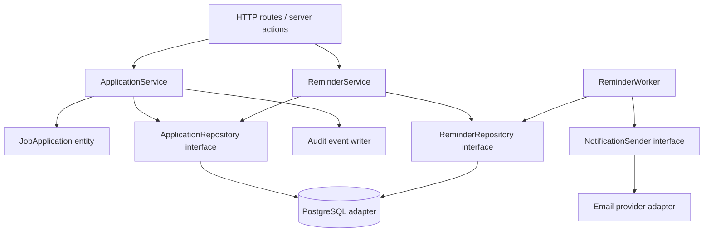
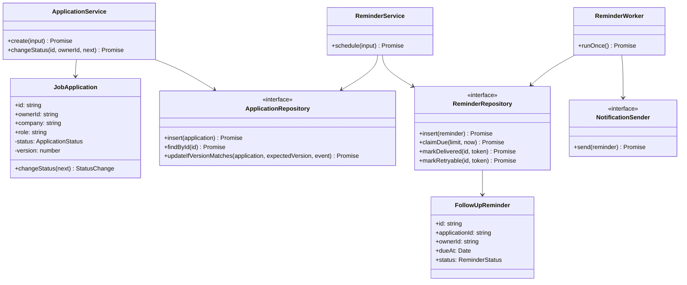
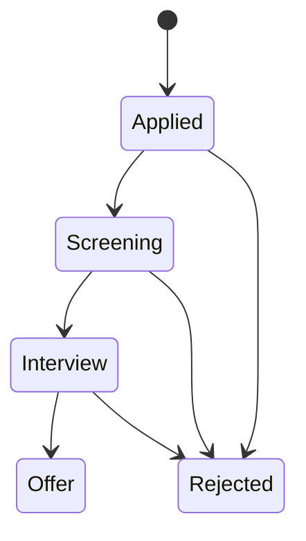
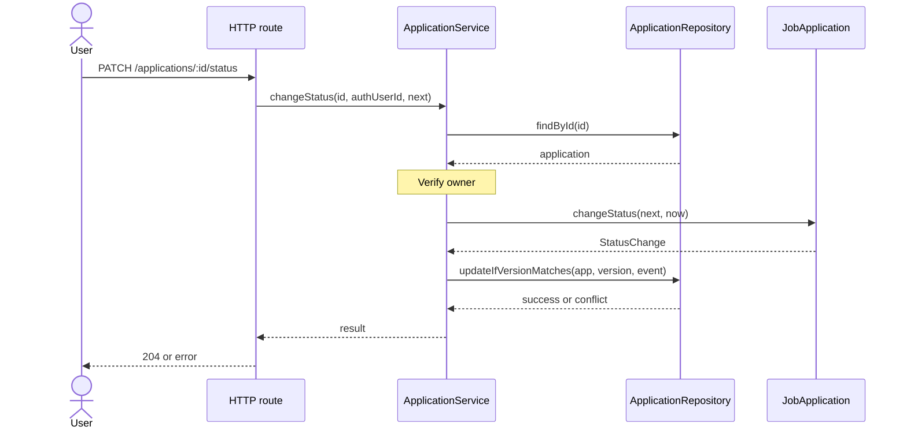
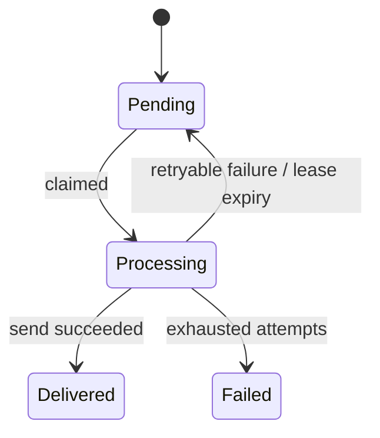
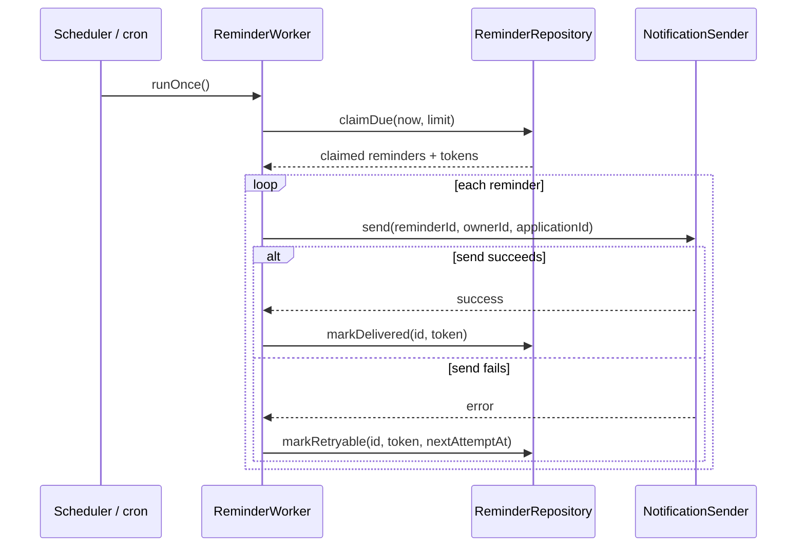

# Lesson 10 — Complete Low-Level Design Case Study: CareerLoop ⭐⭐⭐⭐⭐

> **Goal:** Practice the full LLD interview and engineering process: requirements → domain model → interfaces → UML → implementation → tests → concurrency, security, and trade-offs. This lesson integrates OOP, SOLID, composition, dependency injection, and design patterns.

## 1. The problem statement

**Design a job application tracker (CareerLoop).**

A user can:
1. Add an application to a company for a role.
2. See their own applications.
3. Move an application through hiring stages.
4. Schedule a follow-up reminder.
5. Receive a reminder when it becomes due.
6. See a history of status changes.

The system should be understandable, testable, and ready to evolve from a single-user project into a multi-user application.

**What we are designing:** The internal domain and service design (LLD), not the entire distributed deployment architecture. We will mention database and worker concerns where they affect correctness.

## 2. Start with clarifying questions

In an interview, don't immediately write classes. Clarify behavior.

| Question | Working assumption for this lesson |
|---|---|
| Who can view an application? | Only its owner |
| Can a status move backward? | No, unless the product explicitly enables it |
| Can a rejected application reopen? | Not in this version |
| Can one application have multiple reminders? | Yes |
| Are reminders guaranteed exactly once? | No; delivery is at-least-once or best-effort depending on infrastructure |
| Is email required? | Use a pluggable notification sender |
| Do we need recruiter management? | Out of scope for this iteration |
| Should status changes be auditable? | Yes |
| Is authentication part of the domain model? | Identity comes from trusted auth middleware |
| What happens with concurrent updates? | Detect conflicts with a version field |

### Functional requirements

- Create and retrieve applications.
- List applications for the authenticated user.
- Change status only through allowed transitions.
- Record status-change events.
- Schedule reminders for future times.
- Deliver due reminders and record their outcomes.

### Non-functional requirements

- **Correctness:** no unauthorized changes, invalid transitions, or silently overwritten updates.
- **Maintainability:** responsibilities separated and dependencies replaceable.
- **Testability:** domain logic runs without database/network.
- **Observability:** trace failures and retries.
- **Reliability:** recover from worker crashes without silently losing reminders.

### Out of scope

Real OAuth/JWT implementation, email provider setup, UI, calendar integrations, full PostgreSQL migrations, and production-grade queue infrastructure.

## 3. Identify domain entities and value objects

### Entities

- **JobApplication:** stable identity, owner, company, role, status, version.
- **FollowUpReminder:** identity, application reference, due time, delivery state.
- **ApplicationEvent:** audit record of a status transition.

### Value objects and enums

- **ApplicationStatus:** one of Applied, Screening, Interview, Offer, Rejected.
- **ReminderStatus:** Pending, Processing, Delivered, Failed.
- **ApplicationId / UserId:** can begin as strings; branded types are optional for larger projects.

### Services and infrastructure

- **ApplicationService:** application use cases and authorization.
- **ReminderService:** reminder scheduling.
- **ReminderWorker:** dispatch due reminders.
- **ApplicationRepository:** persistence contract.
- **ReminderRepository:** reminder persistence and claiming contract.
- **NotificationSender:** external notification contract.
- **Clock / IdGenerator:** injectable utilities for deterministic tests.

## 4. Responsibility boundaries



**Key design rule:** Domain entities do not import Express, Next.js, Drizzle, or Brevo.

## 5. Class diagram



**UML reading:** Solid arrows show collaborations/dependencies. Interfaces specify contracts; concrete adapters implement them. The domain entity owns its state transition rules.

## 6. Application lifecycle and invariants



Rules:
- Application has a nonempty owner, company, and role.
- Only allowed status transitions succeed.
- Every successful transition increments a version.
- A successful transition creates an audit event.
- Unauthorized users cannot read or modify an application.
- Repeated requests should not silently produce duplicate state transitions.

**Why versioning?** Two browser tabs might read the same application and both attempt to change it. Optimistic concurrency detects a stale write rather than overwriting the newer state.

## 7. Folder structure

```text
src/
  domain/
    application.ts
    reminder.ts
  application/
    ports.ts
    application-service.ts
    reminder-service.ts
    reminder-worker.ts
  infrastructure/
    postgres-application-repository.ts
    postgres-reminder-repository.ts
    email-sender.ts
  http/
    application-routes.ts
  bootstrap/
    composition-root.ts
  tests/
    application.test.ts
    reminder.test.ts
```

These are **suggested boundaries**, not a mandatory file-per-class rule. For small projects, fewer files can be clearer.

---

# Part A — Implement the domain

## 8. Domain types and errors

```ts
export type ApplicationStatus =
  | "Applied"
  | "Screening"
  | "Interview"
  | "Offer"
  | "Rejected";

export type StatusChange = {
  applicationId: string;
  from: ApplicationStatus;
  to: ApplicationStatus;
  changedAt: Date;
};

export class DomainError extends Error {}
export class NotFoundError extends Error {}
export class ForbiddenError extends Error {}
export class ConflictError extends Error {}

const allowedTransitions: Record<ApplicationStatus, ApplicationStatus[]> = {
  Applied: ["Screening", "Rejected"],
  Screening: ["Interview", "Rejected"],
  Interview: ["Offer", "Rejected"],
  Offer: [],
  Rejected: [],
};
```

The transition graph is a product decision. A real company might allow reopening or moving backward. Do not hard-code assumptions without clarifying requirements.

## 9. JobApplication entity with encapsulation

```ts
export class JobApplication {
  private constructor(
    public readonly id: string,
    public readonly ownerId: string,
    public readonly company: string,
    public readonly role: string,
    private _status: ApplicationStatus,
    private _version: number
  ) {}

  static create(
    id: string,
    ownerId: string,
    company: string,
    role: string
  ): JobApplication {
    if (!id || !ownerId || !company.trim() || !role.trim()) {
      throw new DomainError("Invalid application data");
    }
    return new JobApplication(
      id, ownerId, company.trim(), role.trim(), "Applied", 0
    );
  }

  static restore(data: {
    id: string;
    ownerId: string;
    company: string;
    role: string;
    status: ApplicationStatus;
    version: number;
  }): JobApplication {
    if (!data.id || !data.ownerId || !data.company.trim() ||
        !data.role.trim() ||
        !Object.hasOwn(allowedTransitions, data.status) ||
        !Number.isSafeInteger(data.version) || data.version < 0) {
      throw new DomainError("Invalid persisted application");
    }

    return new JobApplication(
      data.id,
      data.ownerId,
      data.company,
      data.role,
      data.status,
      data.version
    );
  }

  get status(): ApplicationStatus { return this._status; }
  get version(): number { return this._version; }

  changeStatus(next: ApplicationStatus, now: Date): StatusChange {
    if (!allowedTransitions[this._status].includes(next)) {
      throw new DomainError(
        `Invalid transition: ${this._status} → ${next}`
      );
    }

    const change: StatusChange = {
      applicationId: this.id,
      from: this._status,
      to: next,
      changedAt: new Date(now),
    };

    this._status = next;
    this._version += 1;
    return change;
  }
}
```

**Why `create()` and `restore()`?**
- `create()` starts a new application in the correct initial state.
- `restore()` rebuilds an existing application from database data.
- The constructor is private so callers cannot freely create inconsistent objects.

**Runtime validation still matters:** TypeScript types disappear when JSON arrives over HTTP. Validate request inputs and persisted data at boundaries.

## 10. Domain object vs database row

A domain object is an in-memory representation of business behavior. A database row is persisted data.

```text
PostgreSQL row
     ↓ map / restore
JobApplication domain object
     ↓ changeStatus()
Updated domain object + audit event
     ↓ conditional update + transaction
PostgreSQL rows
```

Do not assume changing an object property automatically writes to PostgreSQL. The repository must explicitly persist changes.

---

# Part B — Design application ports

## 11. Repository, clock, and ID interfaces

```ts
export interface ApplicationRepository {
  insert(application: JobApplication): Promise<void>;
  findById(id: string): Promise<JobApplication | null>;

  updateIfVersionMatches(
    application: JobApplication,
    expectedVersion: number,
    event: StatusChange
  ): Promise<boolean>;
}

export interface IdGenerator {
  next(): string;
}

export interface Clock {
  now(): Date;
}
```

The conditional update must **atomically**:
1. Check the expected version.
2. Update status and version.
3. Insert the audit event.

If the expected version no longer matches, it returns `false` without writing anything.

In PostgreSQL this should be implemented using a transaction and a conditional `UPDATE ... WHERE id = ? AND version = ?`, checking affected rows, followed by the event insert in the **same transaction**.

## 12. ApplicationService: authorization and orchestration

```ts
export class ApplicationService {
  constructor(
    private readonly applications: ApplicationRepository,
    private readonly ids: IdGenerator,
    private readonly clock: Clock
  ) {}

  async create(input: {
    authenticatedUserId: string;
    company: string;
    role: string;
  }): Promise<JobApplication> {
    const application = JobApplication.create(
      this.ids.next(),
      input.authenticatedUserId,
      input.company,
      input.role
    );

    await this.applications.insert(application);
    return application;
  }

  async get(id: string, authenticatedUserId: string) {
    const application = await this.applications.findById(id);
    if (!application) throw new NotFoundError("Application not found");
    if (application.ownerId !== authenticatedUserId) {
      throw new ForbiddenError("Not allowed");
    }
    return application;
  }

  async changeStatus(
    id: string,
    authenticatedUserId: string,
    next: ApplicationStatus
  ): Promise<void> {
    const application = await this.get(id, authenticatedUserId);
    const expectedVersion = application.version;
    const event = application.changeStatus(next, this.clock.now());

    const updated = await this.applications.updateIfVersionMatches(
      application,
      expectedVersion,
      event
    );

    if (!updated) {
      throw new ConflictError("Application was updated elsewhere");
    }
  }
}
```

**Separation of responsibilities:**
- Entity: valid transitions.
- Service: use case and owner check.
- Repository: persistence and concurrency.
- Clock/ID generator: replaceable runtime dependencies.

**Privacy/security nuance:** Some APIs return `404` for both missing and unauthorized resources to avoid leaking existence. Choose the behavior deliberately.

## 13. Sequence diagram: changing application status



## 14. Example database schema

Illustrative PostgreSQL schema:

```sql
CREATE TABLE applications (
  id UUID PRIMARY KEY,
  owner_id UUID NOT NULL,
  company TEXT NOT NULL CHECK (length(trim(company)) > 0),
  role TEXT NOT NULL CHECK (length(trim(role)) > 0),
  status TEXT NOT NULL CHECK (
    status IN ('Applied', 'Screening', 'Interview', 'Offer', 'Rejected')
  ),
  version INTEGER NOT NULL DEFAULT 0 CHECK (version >= 0),
  created_at TIMESTAMPTZ NOT NULL DEFAULT now()
);

CREATE INDEX applications_owner_created_idx
  ON applications (owner_id, created_at DESC);

CREATE TABLE application_events (
  id BIGINT GENERATED ALWAYS AS IDENTITY PRIMARY KEY,
  application_id UUID NOT NULL REFERENCES applications(id),
  from_status TEXT NOT NULL,
  to_status TEXT NOT NULL,
  changed_at TIMESTAMPTZ NOT NULL
);
```

If the users table exists, add a foreign key for `owner_id`. The example intentionally leaves that external schema out.

## 15. Optimistic concurrency: how the repository works

```sql
BEGIN;

UPDATE applications
SET status = $1, version = version + 1
WHERE id = $2 AND version = $3
RETURNING id;

-- Only if exactly one row was returned:
INSERT INTO application_events
  (application_id, from_status, to_status, changed_at)
VALUES ($2, $4, $1, $5);

COMMIT;
```

The repository must check the `UPDATE` result; if zero rows were updated, **roll back** and return `false`. If the event insert fails, roll back the status update as well.

**Why this matters:**

```text
Tab A reads version 3
Tab B reads version 3
Tab A updates to version 4 → succeeds
Tab B updates WHERE version = 3 → affects 0 rows → conflict
```

Without a conditional update, Tab B might overwrite Tab A's change.

**Production refinement:** Include `owner_id` in queries where appropriate, and handle transaction errors, retry policy, and unique constraints explicitly.

---

# Part C — Reminder scheduling

## 16. Reminder lifecycle



A reminder must have:
- An ID.
- An application ID.
- An owner ID.
- A future due time when scheduled.
- A delivery state.
- An attempt count.
- A claim token or lease metadata for safe worker coordination.

## 17. Reminder model

```ts
export type ReminderStatus =
  | "Pending"
  | "Processing"
  | "Delivered"
  | "Failed";

export type FollowUpReminder = {
  id: string;
  applicationId: string;
  ownerId: string;
  dueAt: Date;
  status: ReminderStatus;
  attempts: number;
};
```

We use a plain typed record here because the example's reminder business logic is small. **Not every domain concept needs a class.**

## 18. Reminder repository and sender contracts

```ts
export interface ReminderRepository {
  insert(reminder: FollowUpReminder): Promise<void>;

  claimDue(
    now: Date,
    limit: number
  ): Promise<Array<FollowUpReminder & { claimToken: string }>>;

  markDelivered(id: string, claimToken: string): Promise<void>;

  markRetryable(
    id: string,
    claimToken: string,
    nextAttemptAt: Date
  ): Promise<void>;
}

export interface NotificationSender {
  send(input: {
    reminderId: string;
    ownerId: string;
    applicationId: string;
  }): Promise<void>;
}
```

**Why a claim token?** If one worker's lease expires and another worker claims the reminder, the first worker should not be allowed to overwrite the second worker's processing state. A repository should compare the active token before acknowledging or rescheduling.

## 19. ReminderService: schedule only for the owner

```ts
export class ReminderService {
  constructor(
    private readonly applications: ApplicationRepository,
    private readonly reminders: ReminderRepository,
    private readonly ids: IdGenerator,
    private readonly clock: Clock
  ) {}

  async schedule(input: {
    applicationId: string;
    authenticatedUserId: string;
    dueAt: Date;
  }): Promise<string> {
    const application = await this.applications.findById(input.applicationId);

    if (!application) throw new NotFoundError("Application not found");
    if (application.ownerId !== input.authenticatedUserId) {
      throw new ForbiddenError("Not allowed");
    }

    const dueAt = new Date(input.dueAt);
    if (!Number.isFinite(dueAt.getTime()) ||
        dueAt.getTime() <= this.clock.now().getTime()) {
      throw new DomainError("Reminder must be in the future");
    }

    const reminder: FollowUpReminder = {
      id: this.ids.next(),
      applicationId: application.id,
      ownerId: application.ownerId,
      dueAt,
      status: "Pending",
      attempts: 0,
    };

    await this.reminders.insert(reminder);
    return reminder.id;
  }
}
```

**Edge case:** The application could be deleted between lookup and reminder insert. Enforce a foreign key or transactional constraint in the database. Authorization and referential integrity are separate requirements.

## 20. ReminderWorker: dispatching due reminders

```ts
export class ReminderWorker {
  constructor(
    private readonly reminders: ReminderRepository,
    private readonly sender: NotificationSender,
    private readonly clock: Clock
  ) {}

  async runOnce(): Promise<void> {
    const due = await this.reminders.claimDue(this.clock.now(), 20);

    for (const reminder of due) {
      try {
        await this.sender.send({
          reminderId: reminder.id,
          ownerId: reminder.ownerId,
          applicationId: reminder.applicationId,
        });

        await this.reminders.markDelivered(
          reminder.id,
          reminder.claimToken
        );
      } catch (error) {
        const delayMs = Math.min(
          60_000 * 2 ** Math.min(reminder.attempts, 6),
          60 * 60_000
        );

        await this.reminders.markRetryable(
          reminder.id,
          reminder.claimToken,
          new Date(this.clock.now().getTime() + delayMs)
        );
      }
    }
  }
}
```

This is a **teaching skeleton**, not a complete production worker. It assumes repository implementations enforce atomic claims, lease ownership, attempt limits, and valid state transitions. A failed acknowledgement should be logged/handled separately from a failed send; the simple catch block does not distinguish them.

## 21. Sequence diagram: reminder delivery



## 22. Exactly-once delivery: an important misconception

Suppose the email provider accepts a message, but the worker crashes before recording `Delivered`.

On retry, the message may be sent again.

```text
Provider accepts email
        ↓
Worker crashes
        ↓
Database still says Processing
        ↓
Lease expires
        ↓
Another worker retries
        ↓
Potential duplicate email
```

This is why “exactly once” is not a realistic blanket promise across arbitrary external systems.

Mitigations:
- Stable reminder ID as an idempotency key **if the provider supports it**.
- Atomic claiming and lease expiry.
- Retry limits and exponential backoff.
- Delivery attempt records.
- Deduplication when possible.
- Operational alerts and reconciliation.

**Important:** An idempotency key only helps when the receiving system actually enforces its semantics.

## 23. PostgreSQL reminder table and claim concept

```sql
CREATE TABLE reminders (
  id UUID PRIMARY KEY,
  application_id UUID NOT NULL REFERENCES applications(id),
  owner_id UUID NOT NULL,
  due_at TIMESTAMPTZ NOT NULL,
  next_attempt_at TIMESTAMPTZ NOT NULL,
  status TEXT NOT NULL CHECK (
    status IN ('Pending', 'Processing', 'Delivered', 'Failed')
  ),
  attempts INTEGER NOT NULL DEFAULT 0 CHECK (attempts >= 0),
  claim_token UUID,
  lease_expires_at TIMESTAMPTZ
);

CREATE INDEX reminders_due_idx
  ON reminders (next_attempt_at)
  WHERE status = 'Pending';
```

A production worker may claim batches using a transaction with `FOR UPDATE SKIP LOCKED` and update status/lease metadata before committing.

**Nuance:** A crashed worker can leave `Processing` reminders stranded. Add a recovery query for expired leases and ensure claim tokens prevent stale acknowledgements.

---

# Part D — Tests and design trade-offs

## 24. Test the entity without a database

Example using Vitest:

```ts
import { describe, expect, it } from "vitest";

describe("JobApplication", () => {
  it("starts as Applied", () => {
    const app = JobApplication.create(
      "app-1", "user-1", "Acme", "Frontend Developer"
    );

    expect(app.status).toBe("Applied");
    expect(app.version).toBe(0);
  });

  it("allows a valid transition and increments version", () => {
    const app = JobApplication.create(
      "app-1", "user-1", "Acme", "Developer"
    );

    const event = app.changeStatus(
      "Screening", new Date("2026-01-01T00:00:00Z")
    );

    expect(app.status).toBe("Screening");
    expect(app.version).toBe(1);
    expect(event.from).toBe("Applied");
    expect(event.to).toBe("Screening");
  });

  it("rejects skipping directly to Offer", () => {
    const app = JobApplication.create(
      "app-1", "user-1", "Acme", "Developer"
    );

    expect(() =>
      app.changeStatus("Offer", new Date())
    ).toThrow(DomainError);
  });
});
```

In a real project, import `JobApplication` and `DomainError` from the domain module. The snippets are intended to be placed into the suggested files.

## 25. Test authorization

```ts
it("rejects another user's application", async () => {
  const repo = new FakeApplicationRepository();
  await repo.insert(
    JobApplication.create("app-1", "owner-1", "Acme", "Developer")
  );

  const service = new ApplicationService(
    repo,
    { next: () => "unused" },
    { now: () => new Date() }
  );

  await expect(
    service.changeStatus("app-1", "attacker-1", "Screening")
  ).rejects.toThrow(ForbiddenError);
});
```

`FakeApplicationRepository` is a test double that implements the repository interface. The next section provides an implementation.

## 26. In-memory fake with optimistic version checks

```ts
class FakeApplicationRepository implements ApplicationRepository {
  private readonly items = new Map<string, JobApplication>();
  readonly events: StatusChange[] = [];

  async insert(app: JobApplication) {
    this.items.set(app.id, JobApplication.restore({
      id: app.id,
      ownerId: app.ownerId,
      company: app.company,
      role: app.role,
      status: app.status,
      version: app.version,
    }));
  }

  async findById(id: string) {
    const app = this.items.get(id);
    return app
      ? JobApplication.restore({
          id: app.id,
          ownerId: app.ownerId,
          company: app.company,
          role: app.role,
          status: app.status,
          version: app.version,
        })
      : null;
  }

  async updateIfVersionMatches(
    app: JobApplication,
    expectedVersion: number,
    event: StatusChange
  ) {
    const stored = this.items.get(app.id);
    if (!stored || stored.version !== expectedVersion) return false;

    this.items.set(app.id, JobApplication.restore({
      id: app.id,
      ownerId: app.ownerId,
      company: app.company,
      role: app.role,
      status: app.status,
      version: app.version,
    }));
    this.events.push(event);
    return true;
  }
}
```

**Limitation:** This fake models version checks for sequential unit tests, but it is not a substitute for testing actual PostgreSQL transactions and concurrent requests. Production concurrency guarantees belong in the database adapter.

## 27. Test a stale update

```ts
it("detects an optimistic concurrency conflict", async () => {
  const repo = new FakeApplicationRepository();
  await repo.insert(
    JobApplication.create("app-1", "user-1", "Acme", "Developer")
  );

  const tabA = (await repo.findById("app-1"))!;
  const tabB = (await repo.findById("app-1"))!;

  const eventA = tabA.changeStatus("Screening", new Date());
  expect(await repo.updateIfVersionMatches(tabA, 0, eventA)).toBe(true);

  const eventB = tabB.changeStatus("Rejected", new Date());
  expect(await repo.updateIfVersionMatches(tabB, 0, eventB)).toBe(false);
});
```

This illustrates why version checks matter even if both requested transitions are individually valid.

## 28. What to test at each level

| Test level | What to verify |
|---|---|
| Domain unit tests | Validation and state transitions |
| Service unit tests | Authorization, orchestration, conflict handling |
| Repository integration tests | SQL, transactions, conditional updates, mapping |
| Worker integration tests | Atomic claims, leases, retries, expired claims |
| API tests | Authenticated identity, runtime validation, status codes |
| End-to-end tests | Create → status update → reminder → delivery outcome |

**Critical edge cases:**
- Missing application.
- Unauthorized user.
- Empty company or role.
- Invalid status transition.
- Two concurrent updates.
- Reminder scheduled in the past.
- Invalid date.
- Worker crash after sending.
- Provider timeout.
- Repeated scheduling request.
- Deleted application with pending reminders.

## 29. Design patterns used—and deliberately not used

| Pattern/principle | Where used | Why |
|---|---|---|
| Encapsulation | JobApplication | Prevent invalid direct state changes |
| SRP | Separate entity, services, repositories | Clear responsibilities |
| DIP | Repository and sender interfaces | Business code independent of infrastructure |
| Dependency Injection | Service constructors | Testable collaborators |
| Repository pattern | Persistence boundary | Separate domain from SQL |
| State transition table | Application status | Simpler than many state classes here |
| Adapter | Email/DB implementations | Integrate external technologies |
| Command-like job | Reminder worker processing | Represent asynchronous work |
| Observer/event concept | Audit/change events | Record domain changes |

We **did not** introduce Factory Method, Builder, Singleton, and every GoF pattern just to demonstrate them. Good LLD uses the minimum complexity needed.

## 30. Why not put everything into classes?

TypeScript allows several valid styles:
- Entity classes for meaningful business invariants.
- Plain objects for simple data records.
- Functions for pure calculations and validation.
- Interfaces for important replaceable boundaries.
- Services for use-case orchestration.

A `FollowUpReminder` record can remain a plain object until its behavior becomes complex enough to justify a class.

**LLD quality is measured by clarity and correctness, not the number of classes.**

## 31. API contracts (illustrative)

```text
POST   /applications
GET    /applications
GET    /applications/:id
PATCH  /applications/:id/status
POST   /applications/:id/reminders
GET    /applications/:id/events
```

Example status update:

```http
PATCH /applications/app-123/status
Content-Type: application/json

{"status":"Interview"}
```

The API should obtain `ownerId` from verified authentication, not the request body. Use a runtime schema validator (for example, Zod).

Typical responses:
- `201`: created.
- `200` or `204`: success.
- `400`: malformed request.
- `401`: not authenticated.
- `403` or privacy-preserving `404`: not authorized.
- `404`: resource not found.
- `409`: concurrent modification or relevant business conflict.
- `422`: semantically invalid transition (depending on API convention).
- `500`: unexpected infrastructure failure.

## 32. Interview walkthrough: 10–15 minute structure

**Minute 1–2: Clarify scope**
- Users, workflows, ownership, reminders, audit history.

**Minute 3–4: Identify entities**
- Application, Reminder, ApplicationEvent.

**Minute 5–6: Define contracts**
- Repository, NotificationSender, Clock, IdGenerator.

**Minute 7–9: Draw UML**
- Classes and sequence for a status update.

**Minute 10–11: Discuss invariants**
- Valid transitions, authorization, version conflicts.

**Minute 12–13: Discuss failure cases**
- Duplicate reminders, worker crashes, provider retries.

**Minute 14–15: Trade-offs**
- Transition table vs State pattern, in-memory vs PostgreSQL, synchronous vs asynchronous notifications.

If the interviewer asks for code, prioritize one correct end-to-end use case rather than writing dozens of empty classes.

## 33. Common interview questions

**Q: What is the difference between HLD and LLD in this example?**  
A: HLD decides services, storage, queues, and deployment. LLD defines domain rules, classes, interfaces, and collaboration inside components.

**Q: Where should status validation live?**  
A: The entity/domain layer should enforce state transition rules so different callers cannot bypass them.

**Q: Where should ownership checks live?**  
A: At trusted use-case/API boundaries, supported by database query scoping and policies where appropriate.

**Q: Why use repositories?**  
A: They separate persistence details from business logic and make focused tests easier.

**Q: What happens when two requests update the same application?**  
A: Use optimistic concurrency with a version check and report a conflict to the stale request.

**Q: Why do we need an audit table?**  
A: To preserve historical transitions independently of the application's current status.

**Q: How do we avoid two workers sending the same reminder?**  
A: Atomic claims and leases reduce concurrent duplication; retries after ambiguous provider outcomes can still duplicate messages.

**Q: Does dependency injection make the system scalable?**  
A: Not by itself. It improves modularity and testability; scaling depends on infrastructure, workloads, and data design.

**Q: Why not use a State class for every hiring stage?**  
A: A small validated transition table is simpler until states have substantial distinct behavior.

**Q: How would you extend to multi-user?**  
A: Add verified auth, owner-scoped queries, authorization tests, tenant isolation where needed, and indexes for access patterns.

## 34. Exercises

### Exercise A — Add recruiters
Model recruiter contacts and their many-to-many association with applications. Decide whether a join entity is needed for notes and timestamps.

### Exercise B — Add interview scheduling
Introduce an Interview entity, conflict validation, and calendar integration through an adapter.

### Exercise C — Add status history endpoint
Implement `GET /applications/:id/events` with owner verification and pagination.

### Exercise D — Retry-safe reminder creation
Design an idempotency key for scheduling a reminder. Explain how a unique database constraint prevents duplicate creation on repeated requests.

### Exercise E — Database implementation
Implement `updateIfVersionMatches()` using Drizzle and Neon PostgreSQL. Ensure the status update and audit insert are atomic.

### Exercise F — Production worker
Implement PostgreSQL row claiming with `FOR UPDATE SKIP LOCKED`, claim tokens, lease expiry, bounded retries, and observability.

### Exercise G — UML
Draw a class diagram and sequence diagram for scheduling and delivering a reminder.

### Exercise H — Tests
Add Vitest cases for invalid transitions, unauthorized access, stale versions, and duplicate reminder attempts.

## 35. Final revision checklist

- [ ] I can clarify requirements before designing classes.
- [ ] I can identify entities, value objects, services, and repositories.
- [ ] I can draw a useful UML class diagram and sequence diagram.
- [ ] I can enforce invariants through domain behavior.
- [ ] I can separate authorization from persistence.
- [ ] I can use constructor injection and interfaces effectively.
- [ ] I understand optimistic concurrency and audit-event atomicity.
- [ ] I understand reminder retries, leases, and duplicate delivery.
- [ ] I can test domain and service logic without real infrastructure.
- [ ] I can explain why each pattern is used—or avoided.

---

## Section 2 complete — what you learned

You have now covered:

1. **Lesson 06 — OOP for LLD:** objects, encapsulation, abstraction, inheritance, polymorphism, relationships.
2. **Lesson 07 — SOLID:** responsibilities, extension, substitutability, focused contracts, dependency direction.
3. **Lesson 08 — Composition & DI:** collaborating objects, dependency injection, factories, lifetimes, testability.
4. **Lesson 09 — Design Patterns:** all 23 classic GoF patterns, trade-offs, and real applications.
5. **Lesson 10 — LLD Case Study:** requirements → domain → UML → TypeScript → tests → concurrency and failure handling.

**Remember:** A strong system designer does not memorize a class diagram. They clarify requirements, protect invariants, make trade-offs explicit, and choose the simplest design that meets the real needs.

### Next: Section 3 — HLD Building Blocks

**Lesson 11 — DNS & HTTP:** What happens when you type a URL into the browser? DNS resolution, TCP/TLS, HTTP requests and responses, caching, proxies, HTTP/1.1 vs HTTP/2 vs HTTP/3, and production architecture.
