# Lesson 11 — DNS & HTTP: From Browser URL to Server Response ⭐⭐⭐⭐⭐

> **Learning goal:** Understand what actually happens when a browser opens a website, how DNS finds servers, how HTTP moves requests and responses, how HTTPS secures traffic, and how these concepts influence real system design. Examples use Next.js, Node.js, Vercel, and APIs.

## 1. Why this lesson matters

You type `https://careerloop.example/applications` into a browser. A page appears. Behind that simple action, many components collaborate:

1. The browser parses the URL.
2. It determines whether a cached response or existing connection can be reused.
3. DNS may resolve a hostname to one or more IP addresses.
4. The browser establishes a transport connection (TCP or QUIC).
5. HTTPS establishes encryption and authenticates the server.
6. The browser sends an HTTP request.
7. A CDN, reverse proxy, or application server processes it.
8. The server returns an HTTP response.
9. The browser parses HTML, loads additional resources, and renders the page.

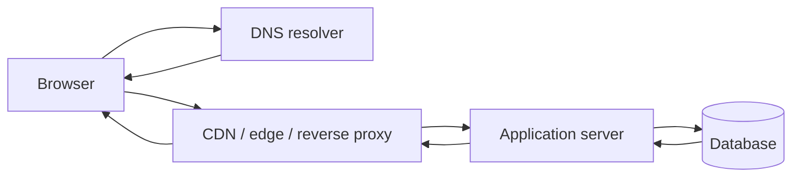

**Important:** This is a *possible* production architecture, not a mandatory sequence. A cache hit may avoid contacting the origin server; an already-open connection may skip new DNS and handshakes.

## 2. First understand URLs

Example:

```text
https://app.example.com:443/applications?status=Applied&page=2#results
\___/   \_____________/ \_/ \___________/ \___________________/ \_____/
scheme        host       port     path             query           fragment
```

| Part | Meaning |
|---|---|
| Scheme | `https` selects HTTPS semantics |
| Host | `app.example.com` is the hostname |
| Port | `443` is HTTPS's default port (often omitted) |
| Path | `/applications` identifies a resource/route |
| Query | `status=Applied&page=2` supplies parameters |
| Fragment | `#results` is processed by the client and **not sent in the HTTP request target** |

A URL is not the same thing as an IP address. A hostname can resolve to multiple addresses and change over time.

## 3. What is DNS?

**DNS (Domain Name System)** translates domain names into records that applications can use, most commonly IP addresses.

Humans remember `example.com`; network software needs a destination address.

```text
app.example.com  --DNS lookup-->  203.0.113.10
```

`203.0.113.10` is a documentation-only example address, not a real service endpoint.

**DNS is not a database of website HTML.** It helps locate services; HTTP then retrieves application data.

## 4. DNS hierarchy: root, TLD, authoritative

DNS is distributed and hierarchical.

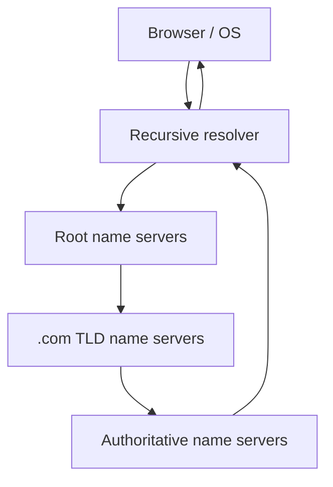

- **Stub resolver:** OS/application component that asks a resolver for answers.
- **Recursive resolver:** Does the work of obtaining answers, usually caching results.
- **Root servers:** Point toward the relevant top-level domain (TLD) infrastructure.
- **TLD servers:** Point toward authoritative name servers for a domain.
- **Authoritative servers:** Provide authoritative DNS records for the zone.

**Nuance:** A resolver normally does *not* query root, TLD, and authoritative servers on every lookup. Caches often answer earlier.

## 5. DNS lookup step by step

Suppose you open `app.example.com`.

1. Browser checks relevant DNS/connection caches.
2. The OS resolver may check its cache and local name-resolution configuration.
3. A configured recursive resolver receives the query.
4. If the resolver has no usable cached answer, it follows DNS delegation.
5. It retrieves the relevant A and/or AAAA record, possibly following CNAME aliases.
6. The answer is returned and cached according to applicable policies and TTLs.
7. The browser chooses an address and attempts a connection.

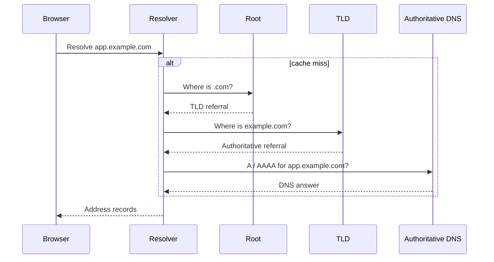

The diagram simplifies DNS recursion, alias handling, DNSSEC validation, and negative caching.

## 6. Important DNS record types

| Record | Purpose | Example |
|---|---|---|
| **A** | Hostname → IPv4 address | `app.example.com → 203.0.113.10` |
| **AAAA** | Hostname → IPv6 address | `2001:db8::10` |
| **CNAME** | Alias from one DNS name to another | `www → hosting.example.net` |
| **MX** | Mail-exchange servers for a domain | Incoming mail routing |
| **TXT** | Text metadata | SPF, DKIM-related records, domain verification |
| **NS** | Delegation to name servers | Authoritative DNS servers |
| **SOA** | Zone authority metadata | Zone serial, timing values |
| **CAA** | Which certificate authorities may issue certs | Certificate issuance policy |
| **SRV** | Service location with port/priority/weight | Some service-discovery protocols |
| **PTR** | Reverse DNS: address → name | Mail/server diagnostics |

### A vs CNAME

- `A` gives an IPv4 address.
- `CNAME` points to another DNS name; that target must be resolved.

**Important:** Standard DNS does not permit a CNAME to coexist with other record types at the same owner name. Root/apex domains therefore often use A/AAAA records or provider-specific ALIAS/ANAME-style flattening rather than a standard CNAME.

## 7. DNS caching and TTL

A DNS record may specify a **TTL (time to live)** indicating how long a resolver can normally cache the answer.

Example: TTL = 300 seconds means a cache can generally reuse the record for up to five minutes, subject to resolver behavior.

```text
First request → resolver fetches answer → caches it
Later request → cached answer (if still valid)
After expiry → resolver refreshes answer
```

**Why TTL matters in system design:**
- Short TTL: potentially faster propagation of planned changes, but more DNS queries.
- Long TTL: fewer lookups, but stale records can remain cached longer.

**Trap:** Lowering TTL immediately before a migration does not erase already-cached records with the old TTL. Plan changes in advance.

## 8. DNS does not guarantee load balancing or failover

DNS can return multiple addresses, but clients and resolvers decide how to use them. DNS responses do not continuously verify that every server is healthy.

DNS-based routing can support traffic distribution and disaster recovery, but it is **not a replacement for a health-aware load balancer**.

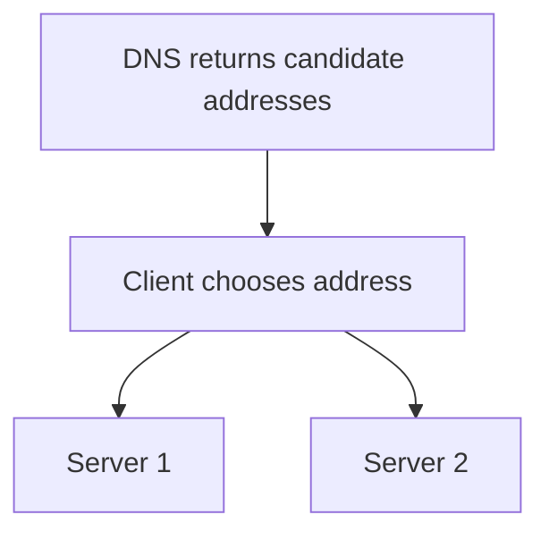

## 9. DNS security: DNSSEC, DoH, and DoT

- **DNSSEC** provides cryptographic authenticity/integrity for signed DNS data when properly validated. It does **not** encrypt DNS queries.
- **DNS over HTTPS (DoH)** transports DNS queries over HTTPS to a resolver.
- **DNS over TLS (DoT)** transports DNS queries over TLS to a resolver.
- **HTTPS/TLS** separately protects the application connection.

DoH/DoT encrypt transport between the client and its resolver, but they do not make the user invisible to that resolver.

## 10. Troubleshooting DNS on Linux

```bash
dig example.com
dig example.com A
dig example.com AAAA
dig example.com MX
dig example.com +short
dig +trace example.com
getent hosts example.com
resolvectl status
```

Useful interpretation:
- `ANSWER SECTION`: records returned.
- `TTL`: remaining cache lifetime in the answer.
- `NXDOMAIN`: queried name does not exist according to the DNS response.
- `SERVFAIL`: server could not successfully process the query.
- `NOERROR` with no answer: name may exist but not have the requested record type.

`dig +trace` explores the delegation chain; it is not identical to the path your system's configured recursive resolver uses.

---

# Part B — Connections: TCP, UDP, QUIC, and TLS

## 11. DNS resolves names; transport moves data

After resolving a destination, the browser needs a transport.

- **TCP:** Reliable, ordered byte stream used by HTTP/1.1 and HTTP/2 over TLS in common browser deployments.
- **UDP:** Datagram transport without built-in reliable ordering; DNS often uses UDP, though TCP and encrypted transports are also used.
- **QUIC:** Reliable, multiplexed transport built over UDP, used by HTTP/3.
- **TLS:** Encryption, integrity protection, and server authentication for HTTPS.

**Important:** HTTP/3 uses QUIC over UDP, so “HTTPS always uses TCP” is incorrect.

## 12. TCP three-way handshake

A new TCP connection is usually established with:

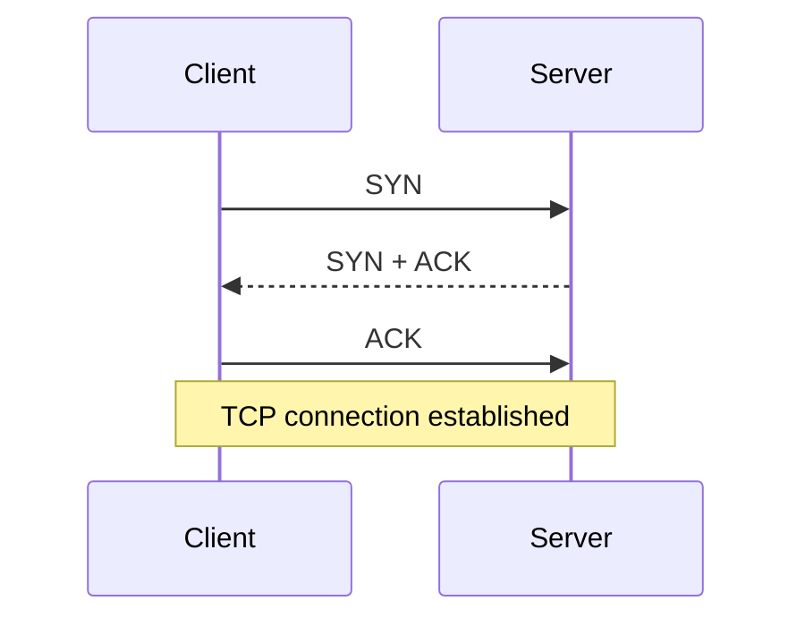

The handshake synchronizes connection state and sequence numbers. It does **not** encrypt traffic.

### Why connection reuse matters

Opening a new connection adds round trips and overhead. HTTP keep-alive and HTTP/2 multiplexing can reuse connections for multiple requests.

## 13. TLS handshake in HTTPS

TLS helps the client verify the server's identity and negotiate encryption keys.

Simplified TLS 1.3 flow:

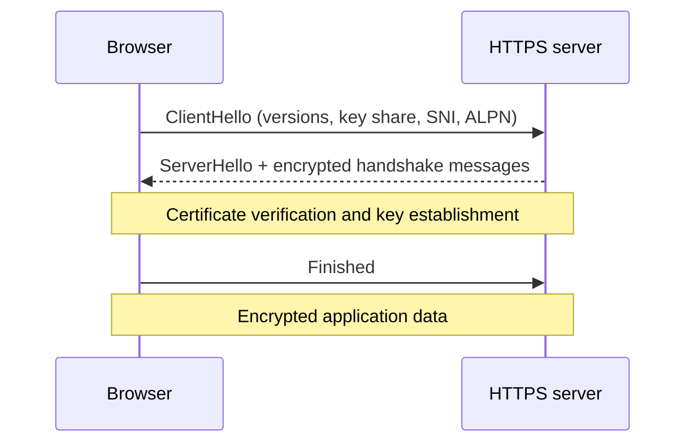

**Certificate validation** checks the trust chain, hostname, validity period, and relevant constraints. Certificate issuance alone does not mean the site is trustworthy in every business sense.

### SNI and ALPN

- **SNI (Server Name Indication):** Lets the server know which hostname the client wants during TLS negotiation. Traditional SNI can expose the hostname; ECH aims to encrypt this information where supported.
- **ALPN (Application-Layer Protocol Negotiation):** Negotiates protocols such as `h2` (HTTP/2) or `http/1.1`.

### TLS termination

A CDN or reverse proxy may terminate HTTPS and forward traffic to an origin.

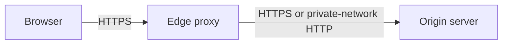

**Security note:** Encrypting browser-to-edge traffic does not automatically mean edge-to-origin traffic is encrypted. Configure origin transport appropriately for the threat model.

## 14. What is latency and RTT?

**RTT (round-trip time)** is the time for a message to travel to a destination and for a response to return.

A new connection may incur:
- DNS lookup time.
- TCP handshake RTT.
- TLS handshake overhead.
- HTTP request/response network time.
- Server processing time.
- Browser rendering time.

```text
User-perceived load time
≈ DNS + connection setup + TLS + request/response + processing + rendering
```

This is a conceptual breakdown, **not an exact additive formula**: browsers overlap work, reuse connections, stream responses, and use caches.

---

# Part C — HTTP Fundamentals

## 15. What is HTTP?

**HTTP (Hypertext Transfer Protocol)** is an application-layer protocol for exchanging requests and responses.

A client sends a request; a server returns a response. HTTP is used for HTML, JSON APIs, images, CSS, JavaScript, and more.

HTTP semantics are broadly shared across HTTP/1.1, HTTP/2, and HTTP/3, although the wire formats and transports differ.

## 16. Anatomy of an HTTP request

```http
GET /api/applications?status=Applied HTTP/1.1
Host: careerloop.example
Accept: application/json
Authorization: Bearer <token>
User-Agent: ExampleClient/1.0
```

A request has:
- **Method:** what operation is requested.
- **Target:** path and query.
- **Protocol version:** shown explicitly in HTTP/1.1's text representation.
- **Headers:** metadata such as accepted content types and credentials.
- **Body:** optional request content.

**Important:** HTTP/2 and HTTP/3 do not use the same text start-line format. They use binary framing and pseudo-headers such as `:method`, `:path`, and `:authority`.

## 17. Anatomy of an HTTP response

```http
HTTP/1.1 200 OK
Content-Type: application/json
Cache-Control: private, no-store

{"applications":[{"id":"app-1","status":"Applied"}]}
```

- **Status code:** outcome category.
- **Headers:** response metadata.
- **Body:** returned content, when applicable.

A `204 No Content` response has no response body.

## 18. HTTP methods

| Method | Typical use | Safe? | Idempotent by HTTP semantics? |
|---|---|---|---|
| GET | Retrieve a representation | Yes | Yes |
| HEAD | Retrieve headers without response body | Yes | Yes |
| POST | Submit/create/process | No | Not guaranteed |
| PUT | Replace a resource's representation | No | Yes |
| PATCH | Partial modification | No | Not guaranteed |
| DELETE | Remove a resource | No | Yes |
| OPTIONS | Discover communication options / CORS preflight | Yes | Yes |

### Safe vs idempotent

**Safe** means the client does not request a state-changing action. Logging or analytics may still occur as side effects.

**Idempotent** means repeating the same request has the same *intended effect on server state* as performing it once; responses can still differ.

Example:
- Repeating `DELETE /applications/app-1` can return `204` then `404`, while deletion remains idempotent.
- Repeating `POST /payments` may create multiple charges unless the API adds idempotency protection.

**Important:** `PATCH` can be designed to be idempotent (e.g., setting a field to a fixed value), but the method itself does not guarantee it.

## 19. HTTP status codes

| Family | Meaning | Common examples |
|---|---|---|
| 1xx | Informational | 100 Continue |
| 2xx | Success | 200 OK, 201 Created, 202 Accepted, 204 No Content |
| 3xx | Redirection | 301 Moved Permanently, 302 Found, 304 Not Modified, 307 Temporary Redirect, 308 Permanent Redirect |
| 4xx | Client-side request problem | 400, 401, 403, 404, 409, 422, 429 |
| 5xx | Server/upstream problem | 500, 502, 503, 504 |

### Important distinctions

- **400 Bad Request:** malformed or invalid request.
- **401 Unauthorized:** authentication is missing/invalid (despite the name, it concerns authentication).
- **403 Forbidden:** request is understood but not allowed.
- **404 Not Found:** resource not found, or deliberately hidden from unauthorized callers.
- **409 Conflict:** current resource state conflicts with the operation.
- **422 Unprocessable Content:** syntactically valid content with semantic validation errors.
- **429 Too Many Requests:** rate limit.
- **500 Internal Server Error:** unexpected server failure.
- **502 Bad Gateway:** gateway/proxy received an invalid upstream response.
- **503 Service Unavailable:** temporarily unable to handle request.
- **504 Gateway Timeout:** gateway/proxy did not receive a timely upstream response.

## 20. Headers you should know

| Header | Purpose |
|---|---|
| `Content-Type` | Media type of body |
| `Accept` | Media types the client accepts |
| `Authorization` | Credentials/token |
| `Cookie` | Browser sends stored cookies |
| `Set-Cookie` | Server instructs browser to store cookie |
| `Cache-Control` | Caching policy |
| `ETag` | Representation validator |
| `If-None-Match` | Conditional cache validation |
| `If-Match` | Conditional update / optimistic concurrency |
| `Location` | Redirect destination or newly created resource |
| `Origin` | Origin of a cross-origin request |
| `Access-Control-Allow-Origin` | CORS permission for a particular origin |
| `Content-Encoding` | Compression, e.g. gzip or br |
| `Strict-Transport-Security` | Browser policy to prefer/require HTTPS for a host |
| `Retry-After` | When retry may be appropriate |

HTTP header names are case-insensitive.

## 21. HTTP is stateless—what does that mean?

Each HTTP request carries enough information for the server to understand it in context; HTTP itself does not require the server to remember a previous request.

But **applications can be stateful** using:
- Cookies and server-side sessions.
- JWTs or other tokens.
- Databases.
- Caches.
- Connection/session state at lower layers.

**Common misconception:** “HTTP is stateless, so authentication sessions are impossible.” False. Application state is layered on top.

## 22. Cookies, sessions, and JWTs

### Cookie-based session

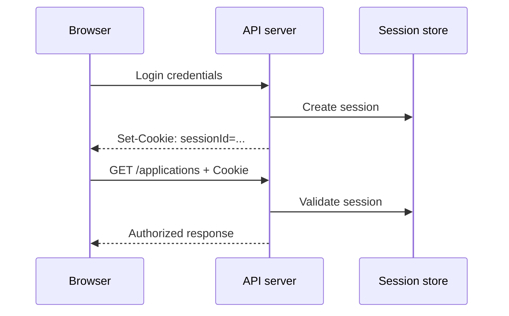

### JWT in an HttpOnly cookie

A server can issue a signed JWT and place it in an `HttpOnly` cookie. This reduces direct JavaScript access to the token but does not automatically eliminate CSRF risk.

Important cookie attributes:
- `HttpOnly`: prevents normal browser JavaScript from reading the cookie.
- `Secure`: restricts transmission to secure contexts (with browser-specific localhost exceptions).
- `SameSite=Lax/Strict/None`: affects cross-site sending behavior.
- `SameSite=None` requires `Secure` in modern browsers.

**Security:** Validate token signature, expiry, issuer/audience as appropriate, and enforce resource-level authorization. Cookies do not replace CSRF defenses when the threat model requires them.

## 23. CORS: what it is and what it is not

**CORS (Cross-Origin Resource Sharing)** is a browser-enforced mechanism that controls whether scripts on one origin can read responses from another origin.

An origin is defined by **scheme + hostname + port**.

```text
https://app.example.com
https://api.example.com
```

These are different origins, even though they share a parent domain.

### Preflight example

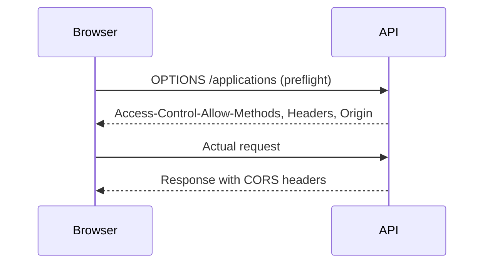

Not every cross-origin request triggers a preflight.

**Important:**
- CORS is **not** authentication.
- CORS does not prevent non-browser clients such as `curl` from sending requests.
- With credentialed requests, the server cannot use `Access-Control-Allow-Origin: *` to grant browser access.
- Correctly configure allowed origins and credentials.

## 24. Browser rendering after HTTP

For an HTML page, receiving the first response is not the end of page loading.

The browser may:
1. Parse HTML into the DOM.
2. Download CSS and construct style information.
3. Download and execute JavaScript.
4. Build layout, paint, and composite.
5. Request images, fonts, API data, and additional chunks.

With Next.js, rendering can include server-rendered HTML, streamed React Server Components payloads, client-side hydration, and subsequent client navigation.

**System-design lesson:** Backend response latency and browser-perceived page speed are related but not identical.

---

# Part D — HTTP Performance, Versions, and Caching

## 25. HTTP/1.1 vs HTTP/2 vs HTTP/3

| Feature | HTTP/1.1 | HTTP/2 | HTTP/3 |
|---|---|---|---|
| Common transport | TCP | TCP | QUIC over UDP |
| Framing | Textual message format | Binary frames | Binary frames over QUIC |
| Multiplexing | No native stream multiplexing on one connection | Yes | Yes |
| Header compression | No HPACK/QPACK | HPACK | QPACK |
| Transport-level head-of-line blocking | TCP-based | Still possible due to TCP | Independent QUIC streams reduce cross-stream blocking |
| Common browser security | HTTPS common | HTTPS effectively standard in browsers | TLS 1.3 integrated into QUIC |

### Why HTTP/2 helped

HTTP/1.1 browsers often needed multiple TCP connections to load many resources efficiently. HTTP/2 allows many logical streams on one connection.

### Why HTTP/3 exists

If a TCP packet is lost, later bytes on that TCP connection may be blocked while the missing packet is retransmitted. HTTP/3's QUIC transport allows independent streams, reducing cross-stream head-of-line blocking.

**Nuance:** HTTP/3 does not eliminate all latency or all packet-loss effects. Congestion control, application dependencies, and network conditions still matter.

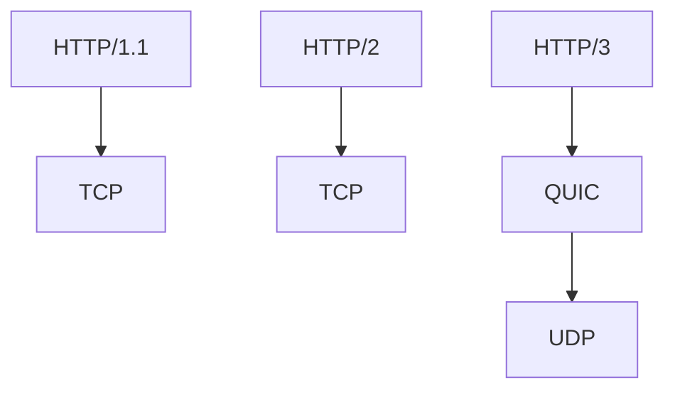

## 26. Connection reuse and keep-alive

For multiple API requests to the same server:
- A new connection incurs setup overhead.
- Reusing a connection avoids repeated setup.
- HTTP/2 and HTTP/3 support concurrent streams.
- Browser connection management is automatic but depends on origin, protocol, limits, and network state.

**Practical impact:** Avoid unnecessary round trips, use caching, and reduce waterfall dependencies.

## 27. HTTP caching: browser, CDN, origin

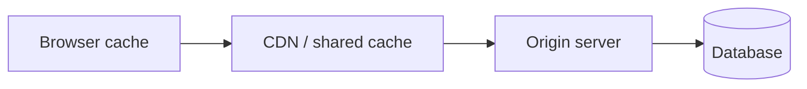

A request can be answered by:
- The browser cache.
- A CDN/shared proxy cache.
- The origin application.
- An application-level cache such as Redis (not itself HTTP caching).

### Common Cache-Control directives

| Directive | Meaning |
|---|---|
| `max-age=60` | Response can be considered fresh for 60 seconds |
| `public` | Response may be stored by shared caches, subject to other rules |
| `private` | Intended for a private cache, not a shared cache |
| `no-cache` | May be stored but must be validated before reuse |
| `no-store` | Cache should not store the response |
| `immutable` | Fresh resource is not expected to change during freshness lifetime |
| `s-maxage=300` | Shared-cache freshness lifetime |

**Crucial distinction:** `no-cache` does **not** mean “never store.” `no-store` is the directive for preventing storage by compliant caches.

### Practical policy examples

For a versioned JS bundle:

```http
Cache-Control: public, max-age=31536000, immutable
```

For a private job application response:

```http
Cache-Control: private, no-store
```

A CDN should not accidentally cache one user's private applications and serve them to another.

## 28. ETag and conditional requests

A server can attach an `ETag` identifying a representation version.

First response:

```http
HTTP/1.1 200 OK
ETag: "applications-v7"
Cache-Control: private, max-age=0, must-revalidate
```

Next request:

```http
GET /api/applications HTTP/1.1
If-None-Match: "applications-v7"
```

If unchanged:

```http
HTTP/1.1 304 Not Modified
ETag: "applications-v7"
```

The browser/cache can reuse its stored representation.

### Conditional updates with If-Match

```http
PATCH /applications/app-1/status HTTP/1.1
If-Match: "version-3"
Content-Type: application/json

{"status":"Screening"}
```

If the version no longer matches, a server can respond with **412 Precondition Failed**, avoiding a lost update.

**Connection to Lesson 10:** This is an HTTP-facing form of optimistic concurrency control.

## 29. Compression and content negotiation

Servers may compress responses using:
- `gzip`
- `br` (Brotli)
- `zstd` (where supported)

Clients advertise supported encodings using `Accept-Encoding`; servers indicate the chosen encoding with `Content-Encoding`.

**Benefits:** Smaller transfers for HTML, JSON, CSS, and JavaScript.

**Trade-offs:** Compression uses CPU, and compressing tiny responses may not help. Already compressed media often benefits little. Be mindful of compression-related side-channel risks when secrets and attacker-controlled text share compressed responses.

## 30. CDN, reverse proxy, and API gateway

These terms overlap but emphasize different roles.

### CDN
Caches and serves content from geographically distributed edge locations. Many CDNs also provide security and request routing.

### Reverse proxy
Sits in front of origin servers, forwarding requests and potentially handling TLS, caching, compression, or load balancing.

### API gateway
An entry point for APIs that may provide routing, authentication integration, quotas, request transformations, and observability.

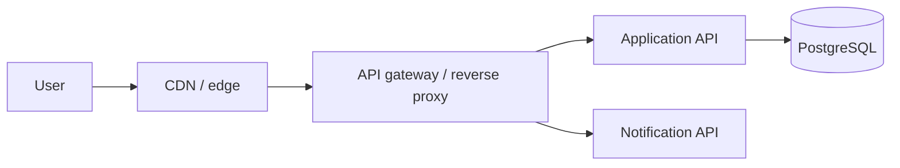

**Important:** These are architectural roles; one product can perform several of them. You do not need three separate services in every deployment.

## 31. HTTP timeouts, retries, and idempotency

Network calls can fail at several stages:
- DNS resolution.
- Connection establishment.
- TLS negotiation.
- Server processing.
- Waiting for response bytes.
- Reading a response body.

A client timeout does **not** prove the server did nothing.

For example, a payment POST might succeed server-side while the response is lost. Blind retry could create a duplicate charge.

**Safer approach:** Use idempotency keys where supported, define retryable error classes, add exponential backoff with jitter, and avoid unlimited retries.

```text
Client sends POST /payments
       ↓
Server processes payment
       ↓
Response lost
       ↓
Client sees timeout
       ↓
Retry must not create duplicate charge
```

This connects to the later dedicated lesson on idempotency.

---

# Part E — Hands-on Node.js and Linux

## 32. Build a small HTTP server without Express

Save as `server.mjs`:

```js
import http from "node:http";

const server = http.createServer((req, res) => {
  if (req.method === "GET" && req.url === "/health") {
    res.writeHead(200, {
      "Content-Type": "application/json",
      "Cache-Control": "no-store",
    });
    res.end(JSON.stringify({ status: "ok" }));
    return;
  }

  res.writeHead(404, { "Content-Type": "application/json" });
  res.end(JSON.stringify({ error: "Not found" }));
});

server.listen(3000, () => {
  console.log("Listening on http://localhost:3000");
});
```

Run:

```bash
node server.mjs
curl -i http://localhost:3000/health
```

You should see `HTTP/1.1 200 OK` and a JSON body.

**What this teaches:** Node's HTTP server handles HTTP request/response semantics. HTTPS requires TLS configuration or an upstream TLS-terminating proxy.

## 33. Inspect real HTTP behavior with curl

```bash
# Show response headers and body
curl -i https://example.com

# Show only response headers (HEAD request)
curl -I https://example.com

# Follow redirects
curl -L -I https://example.com

# Verbose connection, TLS, and request details
curl -v https://example.com

# Show timing information
curl -o /dev/null -s -w 'DNS: %{time_namelookup}\nConnect: %{time_connect}\nTLS: %{time_appconnect}\nTTFB: %{time_starttransfer}\nTotal: %{time_total}\n' https://example.com

# Ask curl to use HTTP/2 if supported by this build/server
curl --http2 -I https://example.com
```

**Timing nuance:** Curl timing fields are measured from the start of the transfer; `time_connect`, `time_appconnect`, and `time_starttransfer` are cumulative milestones, not independent durations to add together.

To inspect HTTP/3, your curl build and the server must support it.

## 34. Diagnose a slow request systematically

Suppose your Next.js app takes 2.5 seconds to load.

Don't immediately blame React or the database. Measure each layer:

1. **DNS:** Is hostname resolution slow?
2. **Connection/TLS:** Is connection setup slow or repeatedly happening?
3. **TTFB:** Is the origin/CDN slow to produce first bytes?
4. **Download:** Is the response huge or bandwidth limited?
5. **Browser:** Are JavaScript execution, hydration, or rendering expensive?
6. **API waterfall:** Are multiple dependent requests serialized?
7. **Database:** Are queries or connection setup slow?

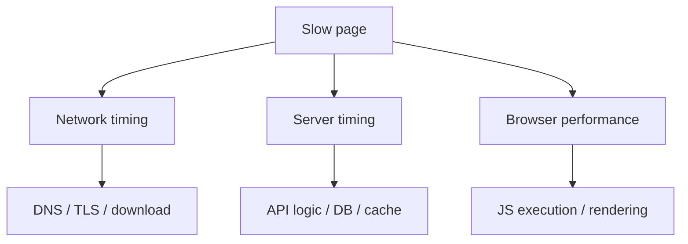

**Useful tools:** Chrome DevTools Network/Performance, `curl -w`, server logs, database query plans, and distributed traces.

## 35. Real-world architecture: CareerLoop on Vercel + API + Neon

A possible deployment:

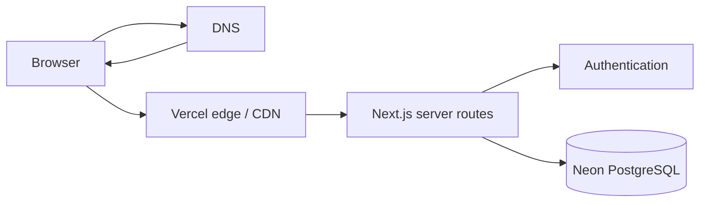

### Request example

`GET /applications`:
1. Browser resolves the site hostname if needed.
2. Browser establishes/reuses a secure connection.
3. Edge routes the request.
4. Server verifies authentication.
5. Application queries only records belonging to the user.
6. Server returns HTML or JSON as appropriate.
7. Private user data is not stored in a public shared cache.

**Note:** Actual Vercel routing, caching, and function placement depend on deployment configuration and platform behavior. The diagram is conceptual.

## 36. Real-world architecture: CodeBuddy chat

CodeBuddy uses REST endpoints plus real-time Socket.IO connections.

- **HTTP:** login, profiles, connection requests, initial message history.
- **WebSocket or fallback transports:** real-time chat updates.
- **DNS/TLS:** locate and secure the connection.
- **Reverse proxy:** may route requests to backend instances.
- **Authentication:** must be checked for both HTTP and socket connections.

### WebSocket vs HTTP

WebSocket commonly starts with an HTTP/1.1 Upgrade handshake (or protocol-specific extended CONNECT mechanisms on newer HTTP versions) and then provides a persistent bidirectional channel.

**Important:** Socket.IO is a library/protocol layered over transports such as WebSocket and HTTP long-polling; it is not identical to the raw WebSocket protocol.

For multi-instance Socket.IO deployments, room/event propagation may require an adapter or shared messaging layer, and long-polling deployments may have sticky-session considerations.

## 37. Frequent misconceptions

1. **“DNS always returns one IP.”** It can return multiple A/AAAA records or aliases.
2. **“DNS is queried from root every time.”** Caching often avoids that.
3. **“DNS TTL makes failover immediate.”** Clients and resolvers may retain answers.
4. **“HTTPS always uses TCP.”** HTTP/3 uses QUIC over UDP.
5. **“TCP encrypts data.”** TLS provides encryption; TCP itself does not.
6. **“HTTP/2 eliminates every head-of-line issue.”** TCP-level blocking remains possible.
7. **“HTTP is stateless, so sessions cannot exist.”** Applications add state above HTTP.
8. **“CORS protects APIs from all attackers.”** CORS is a browser read-access policy, not authentication.
9. **“401 means logged in but forbidden.”** 401 generally indicates missing/invalid authentication.
10. **“POST is always non-idempotent.”** The method does not guarantee idempotency, but applications can implement it.
11. **“no-cache means don't store.”** It means revalidate before reuse.
12. **“A CDN always improves private API caching.”** Shared caching can leak user data if configured incorrectly.
13. **“A timeout means the server never processed the request.”** It may have succeeded.
14. **“A browser URL fragment is sent to the server.”** It is not part of the HTTP request target.
15. **“An HttpOnly cookie eliminates CSRF.”** It protects against script access, not all cross-site request risks.

## 38. Interview questions with concise answers

**Q1. What happens when you type a URL into a browser?**  
URL parsing, cache checks, DNS resolution if needed, connection setup, TLS, HTTP request/response, and rendering.

**Q2. What is DNS?**  
A distributed naming system that maps hostnames to records such as IP addresses.

**Q3. Recursive vs authoritative DNS?**  
Recursive resolvers obtain/cache answers; authoritative servers publish zone data.

**Q4. A vs CNAME?**  
A maps to IPv4; CNAME aliases another DNS name.

**Q5. What is DNS TTL?**  
A time limit guiding DNS response caching.

**Q6. What is the TCP three-way handshake?**  
SYN → SYN-ACK → ACK to establish connection state.

**Q7. Why use TLS?**  
Encryption, integrity, and server authentication.

**Q8. HTTP vs HTTPS?**  
HTTPS is HTTP carried over an authenticated encrypted transport.

**Q9. HTTP/1.1 vs HTTP/2?**  
HTTP/2 adds binary framing and multiplexed streams.

**Q10. Why HTTP/3?**  
QUIC provides independent streams and improves behavior under some loss/mobility conditions.

**Q11. GET vs POST?**  
GET retrieves a representation and is safe/idempotent by semantics; POST submits data for processing and is not inherently idempotent.

**Q12. 401 vs 403?**  
Authentication required/invalid vs authenticated or understood request not permitted.

**Q13. What is CORS?**  
A browser policy for cross-origin script access to responses.

**Q14. What is a reverse proxy?**  
A server that receives requests on behalf of upstream services.

**Q15. What is a CDN?**  
Distributed edge infrastructure that can cache and deliver content closer to users.

**Q16. What is an ETag?**  
A validator for conditional retrieval or updates.

**Q17. Why are retries risky for payments?**  
The original request may have succeeded even if its response was lost.

**Q18. How do you troubleshoot a 502?**  
Inspect gateway logs, upstream health, network reachability, timeouts, and upstream response validity.

**Q19. Why is HTTP stateless?**  
The protocol does not require remembering earlier application requests.

**Q20. How do you protect private API responses?**  
Authentication, authorization, TLS, and careful cache controls; never publicly cache user-specific data accidentally.

## 39. Practice exercises

### Exercise A — Trace the URL
Draw the full path from browser to a Next.js page deployed behind a CDN. Mark optional cache hits and reused connections.

### Exercise B — DNS records
Explain when to use A, AAAA, CNAME, MX, TXT, and CAA. Describe why apex CNAME records are tricky.

### Exercise C — Linux commands
Use `dig` to inspect a domain's A/AAAA and MX records. Compare `dig +trace` with a normal lookup.

### Exercise D — HTTP server
Build the Node.js server above and add:
- `GET /health` → 200.
- `GET /applications` → JSON array.
- Unknown route → 404.
- Appropriate `Content-Type` and `Cache-Control`.

### Exercise E — Status codes
Choose status codes for missing authentication, invalid input, a duplicate application, a stale update, a provider outage, and rate limiting.

### Exercise F — Cache safety
Design cache headers for a public hashed JS asset, a public marketing page, and a private dashboard API.

### Exercise G — Retry safety
Explain why retrying `POST /payments` after a timeout can duplicate charges. Design an idempotency-key contract.

### Exercise H — Compare protocols
Explain TCP+TLS HTTP/2 vs QUIC HTTP/3 using a diagram and discuss packet loss.

### Exercise I — Debug slow site
Use browser DevTools and `curl -w` to distinguish DNS, TLS, TTFB, download, and rendering delays.

### Exercise J — System design interview
Answer “What happens when you type google.com into the browser?” in two minutes, then expand it into a ten-minute explanation.

## 40. Final revision checklist

- [ ] I can explain URL components and why fragments are not sent in HTTP requests.
- [ ] I understand recursive/authoritative DNS and caching.
- [ ] I know major DNS record types.
- [ ] I can explain TCP handshake, TLS, QUIC, and HTTPS.
- [ ] I can read HTTP requests, responses, methods, and status codes.
- [ ] I understand cookies, sessions, JWTs, and CORS boundaries.
- [ ] I can compare HTTP/1.1, HTTP/2, and HTTP/3.
- [ ] I know how browser/CDN caching and ETags work.
- [ ] I can explain reverse proxies, CDNs, and API gateways.
- [ ] I can troubleshoot slow requests and 502/504 errors.
- [ ] I understand retry and idempotency risks.
- [ ] I can connect these concepts to CareerLoop and CodeBuddy.

### Next lesson

**Lesson 12 — Load Balancers:** Why they exist, L4 vs L7, round-robin/least-connections/consistent hashing, health checks, sticky sessions, TLS termination, reverse proxies, load balancing for WebSockets, failover, and production trade-offs.
