# Lesson 12 — Load Balancers ⭐⭐⭐⭐⭐

> **Goal:** Understand why load balancers exist, how they distribute traffic, how they detect failures, and how to choose the right approach for Node.js, Next.js, and real-time applications. Includes diagrams, Nginx examples, practical scenarios, trade-offs, interview questions, and exercises.

## 1. Start with the problem

Imagine CodeBuddy initially runs on **one Node.js server**.

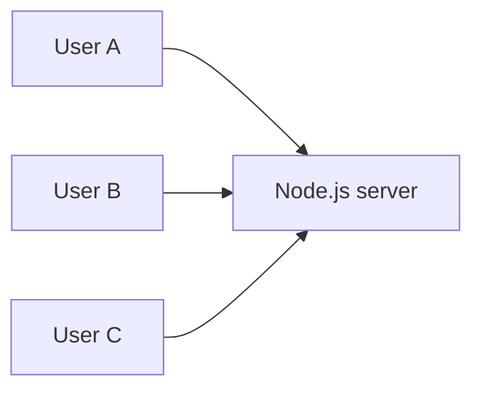

This works while traffic is small. But when the server becomes overloaded, requests slow down. If it crashes, everyone loses access.

We could add three servers, but then **who decides which server receives each request?**

A **load balancer** sits between clients and backend instances and distributes traffic according to a routing policy.

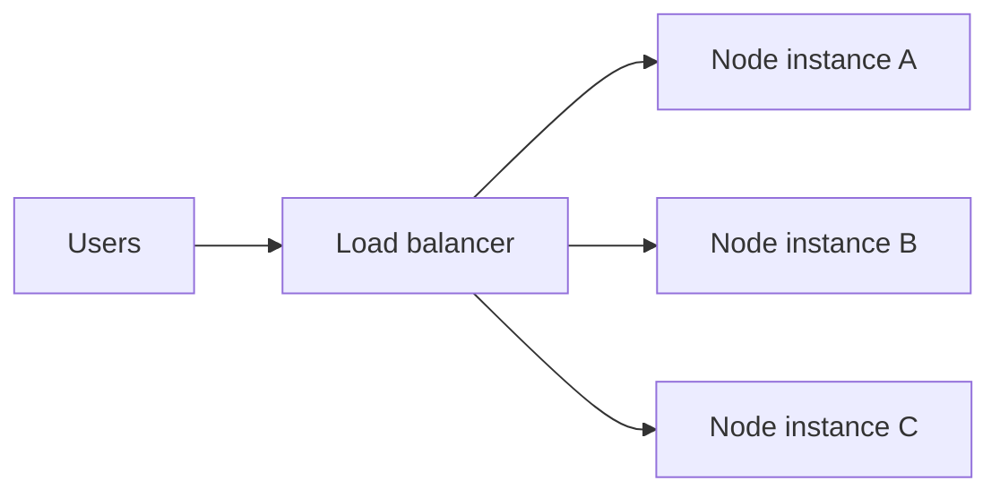

**Simple definition:** A load balancer receives incoming traffic and selects an appropriate backend to handle it.

## 2. What problems does a load balancer solve?

- **Traffic distribution:** Prevent all requests from reaching only one instance.
- **Horizontal scaling:** Add instances to increase total capacity.
- **Availability:** Route around unhealthy instances when possible.
- **Operational flexibility:** Drain instances during deployments.
- **TLS termination:** Some load balancers decrypt HTTPS at the edge.
- **Central routing:** Send different paths or hosts to different services.
- **Observability and controls:** Collect metrics and sometimes apply limits.

**Important:** A load balancer does not automatically make an application scalable. Shared databases, sessions, external APIs, CPU, and bottlenecks still matter.

## 3. Vertical vs horizontal scaling

**Vertical scaling:** Increase resources on one machine.

```text
4 CPU / 8 GB RAM → 16 CPU / 32 GB RAM
```

**Horizontal scaling:** Add more machines or processes.

```text
1 server → 3 servers → 10 servers
```

| Vertical | Horizontal |
|---|---|
| Simpler initially | Needs traffic distribution |
| Limited by machine size | More flexible capacity growth |
| May require resizing downtime | Supports rolling deployments |
| Single machine can remain failure point | Requires shared-state and data planning |

A load balancer is especially useful for horizontal scaling.

## 4. Where does a load balancer fit?

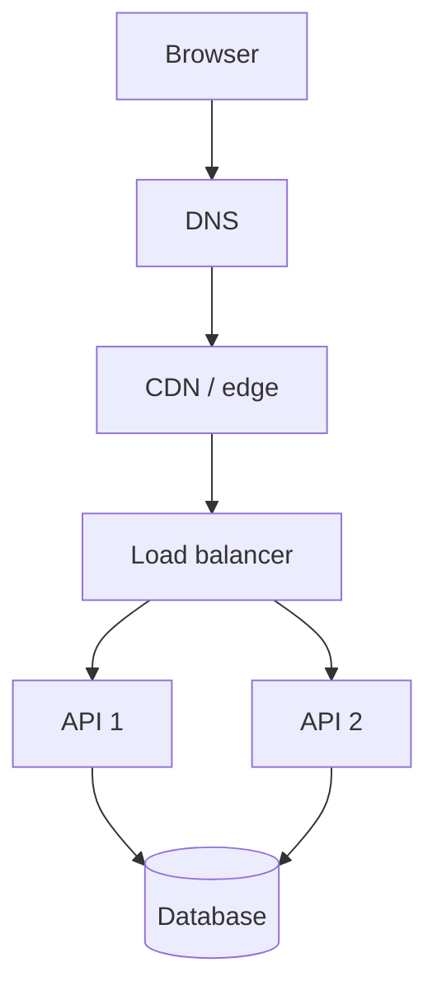

DNS helps locate a service. The load balancer then routes requests to backend instances. A CDN may also perform load balancing, and some architectures combine these roles in one platform.

**DNS vs load balancer:**
- DNS returns name-resolution information, such as IP addresses.
- A load balancer actively routes traffic to selected backends.

DNS-based routing can distribute clients across endpoints, but caching and client behavior make it different from per-request balancing.

## 5. Layer 4 vs Layer 7

The OSI model gives us two useful categories.

### Layer 4 (transport)

An **L4 load balancer** routes based primarily on transport/network information, such as destination IP, port, and connection state.

It generally does not need to parse an HTTP path or JSON body.

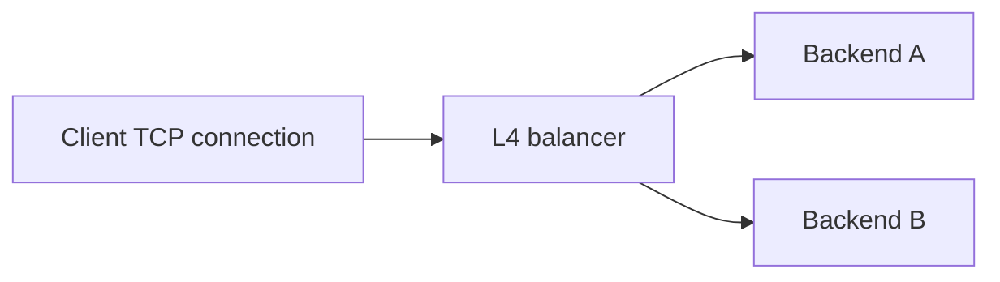

Typical strengths:
- Works with TCP and/or UDP traffic depending on product.
- Can have low overhead.
- Supports protocols beyond HTTP.
- Useful for raw TCP services, some databases, and transport-level routing.

### Layer 7 (application)

An **L7 load balancer** understands application protocols such as HTTP.

It can route using:
- Hostname.
- URL path.
- HTTP method.
- Headers.
- Cookies.
- Sometimes other request metadata.

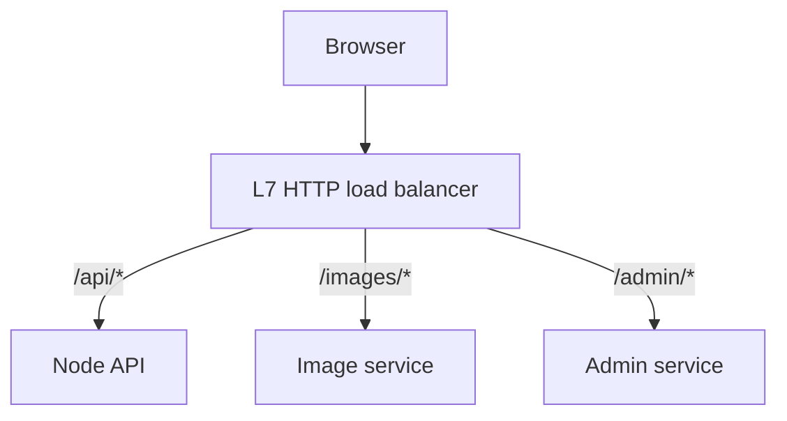

### Comparison

| Property | L4 | L7 |
|---|---|---|
| Main decision input | IP, port, connection metadata | HTTP host, path, headers, etc. |
| Protocol awareness | TCP/UDP-oriented | HTTP-aware |
| Path-based routing | Not normally | Yes |
| TLS termination | Product-dependent | Common |
| Per-request HTTP routing | Not normally | Yes |
| Overhead | Often lower | More processing/features |
| Common use | TCP/UDP services | Websites, REST APIs, microservices |

**Nuance:** Real products combine capabilities. Some L4 products support TLS-related features; an L7 balancer may forward traffic using different upstream protocols. Always inspect the actual service capabilities.

## 6. Reverse proxy vs load balancer

A **reverse proxy** accepts client requests and forwards them to upstream servers.

A **load balancer** distributes traffic among backend targets.

They often overlap: **Nginx, HAProxy, Envoy, and cloud gateways** can act as reverse proxies and load balancers.

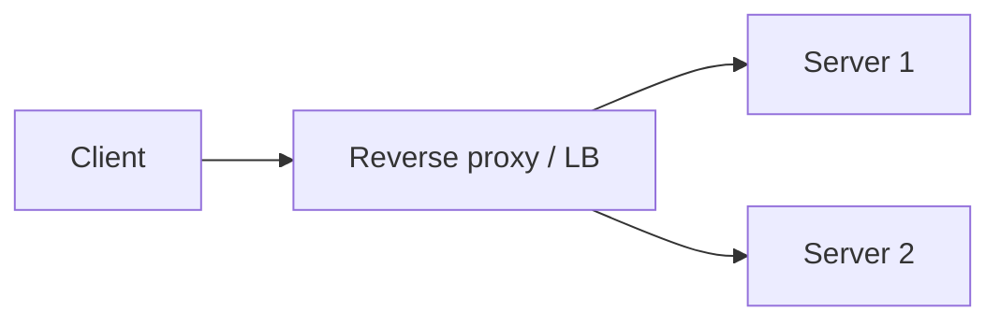

A reverse proxy can also:
- Terminate TLS.
- Compress responses.
- Add forwarding headers.
- Cache content.
- Enforce routing policies.

**Don't memorize “reverse proxy and load balancer are always different machines.”** They describe roles, not necessarily separate hardware.

---

# Part A — Load-balancing algorithms

## 7. Round Robin

Send successive new requests/connections to backends in rotation.

```text
Request 1 → A
Request 2 → B
Request 3 → C
Request 4 → A
Request 5 → B
```

**Advantages:** Simple, low scheduling overhead.

**Weakness:** A long-running request and a short request receive equal scheduling weight, even though they consume different resources.

**Use when:** Backends have similar capacity and workloads are relatively uniform.

## 8. Weighted Round Robin

Give more traffic to a stronger backend.

Example weights:

```text
A weight 3
B weight 1
```

Over a sufficiently representative period, the balancer aims to send roughly three times as much selected traffic to A as B. Exact short-term sequences depend on implementation.

**Use when:** Backend capacities differ or during gradual rollouts.

**Warning:** Weight does not measure live CPU usage unless combined with health/load feedback.

## 9. Least Connections

Select the backend with the fewest active connections (or a weighted variation).

```text
A: 50 active connections
B: 12 active connections
C: 35 active connections

New connection → B
```

**Why useful:** Connections may remain open for different lengths of time.

**Limitation:** Connection count is not equal to CPU usage or work. One connection can be idle while another performs an expensive request. HTTP/2 multiplexing also complicates naive connection-based reasoning.

## 10. Least Response Time / adaptive balancing

Some products choose backends using observed latency, outstanding requests, or load estimates.

**Advantage:** Can react to uneven backend performance.

**Risks:** Measurements may be noisy; feedback loops can overload a temporarily fast backend. Behavior depends heavily on the product and configuration.

## 11. Random / power of two choices

**Random:** Choose a backend at random.

**Power of two choices:** Sample two backends and choose the less loaded of the two.

This can provide good load distribution with limited coordination in some systems.

```text
Pick A and C randomly
A active requests = 20
C active requests = 8
Route to C
```

## 12. Hash-based routing

A balancer may hash a stable key, such as a session identifier, to select a backend.

```text
hash(session-123) → backend B
```

This can improve affinity but may create uneven distribution.

**Security:** Do not treat a client-supplied key as trustworthy identity. Authenticate sessions independently.

## 13. Consistent hashing

Ordinary hashing using `hash(key) % numberOfServers` can remap many keys when the number of servers changes.

**Consistent hashing** arranges nodes and keys on a logical ring. Adding/removing a node typically remaps a smaller portion of keys.

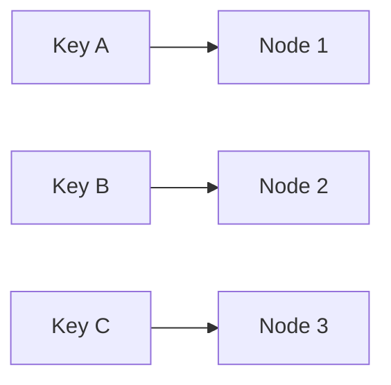

This simplified diagram illustrates key-to-node ownership, not the actual circular ring geometry.

**Use cases:** Distributed caches, partition placement, and affinity-sensitive workloads.

**Nuance:** Real systems often use virtual nodes or rendezvous hashing to improve distribution. Consistent hashing alone does not solve replication, availability, or rebalancing correctness.

## 14. Which algorithm should you choose?

| Workload | Reasonable starting choice |
|---|---|
| Similar short HTTP requests | Round robin |
| Different backend capacities | Weighted round robin |
| Long-lived connections | Least connections (with caveats) |
| Uneven request costs | Least outstanding requests or adaptive policy |
| Sticky affinity needed | Cookie affinity or stable hashing |
| Distributed cache ownership | Consistent/rendezvous hashing |

These are **starting points**, not universal winners. Benchmark with realistic workloads.

---

# Part B — Health checks and reliability

## 15. What is a health check?

A load balancer should avoid sending new traffic to an unhealthy backend.

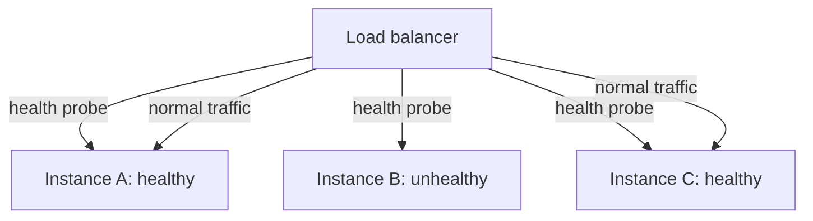

### Active health checks

The balancer periodically sends a probe such as:

```http
GET /health HTTP/1.1
Host: api.example.com
```

### Passive health checks

The balancer infers health from real traffic, such as connection failures, timeouts, or certain upstream errors.

Many systems combine both.

## 16. Liveness vs readiness

These terms are common in Kubernetes and operational monitoring.

- **Liveness:** Is the process alive enough to keep running?
- **Readiness:** Can it serve useful traffic now?

A server might be alive but unable to access a required database.

```text
/health/live  → process event loop is responsive
/health/ready → critical dependencies are available
```

**Trade-off:** Readiness checks should not perform excessively expensive operations or cause widespread outages during transient dependency failures.

## 17. Node.js readiness example

```js
import express from "express";

const app = express();
let shuttingDown = false;

app.get("/health/live", (_req, res) => {
  res.status(200).json({ alive: true });
});

app.get("/health/ready", (_req, res) => {
  if (shuttingDown) {
    res.status(503).json({ ready: false });
    return;
  }
  res.status(200).json({ ready: true });
});

const server = app.listen(3000, () => {
  console.log("Listening on 3000");
});

process.on("SIGTERM", () => {
  shuttingDown = true;
  server.close((error) => {
    if (error) {
      console.error(error);
      process.exitCode = 1;
    }
  });
});
```

This is a **minimal teaching example**. Production shutdown also needs a termination grace period, a timeout/forced-exit policy, cleanup of DB/queue resources, and attention to WebSocket connections. Readiness may also incorporate carefully chosen dependency checks.

## 18. Health-check configuration trade-offs

Common settings:
- **Interval:** how often probes run.
- **Timeout:** how long to wait.
- **Healthy threshold:** number of successful probes to mark healthy.
- **Unhealthy threshold:** number of failed probes to mark unhealthy.

Too aggressive: transient network glitches cause unnecessary removals.

Too relaxed: broken instances receive traffic for too long.

## 19. What happens when a backend fails?

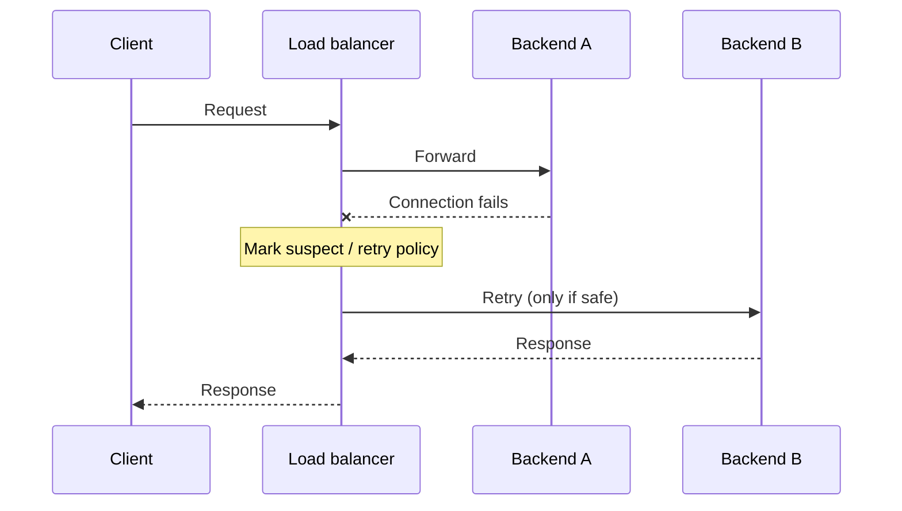

**Critical:** Retrying a request can duplicate side effects. A load balancer should not blindly retry non-idempotent payment or mutation requests after an ambiguous failure.

## 20. Is the load balancer itself a single point of failure?

Yes, if there is only one load balancer with no failover.

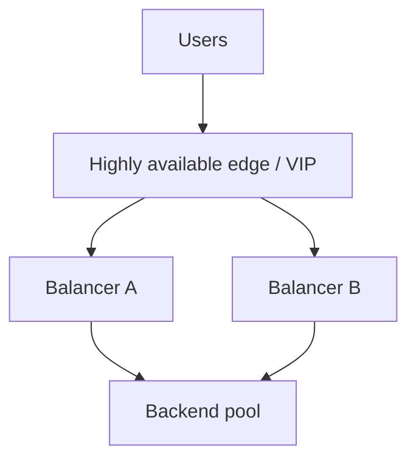

High availability can involve:
- Managed regional/multi-zone load-balancing infrastructure.
- Multiple load-balancer instances.
- Floating virtual IPs or routing failover.
- Health-aware DNS/edge routing.

**Nuance:** A pair of balancers is not automatically highly available. Failover control, shared configuration, network routes, and upstream dependencies must also be reliable.

## 21. Availability zones and failure domains

If all backend instances run on one machine or one availability zone, a host/zone outage can take them all down.

Spread capacity across independent failure domains where required:

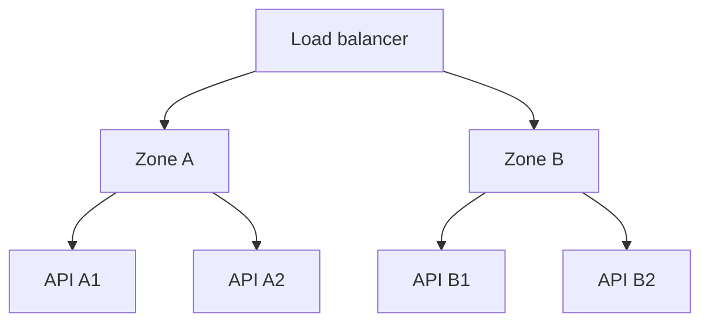

**Remember:** Multi-zone application instances still depend on databases, network paths, and shared services. Identify each failure domain.

---

# Part C — Sessions, HTTP, and WebSockets

## 22. Stateless services scale more easily

Suppose API instance A stores sessions in its own process memory.

```text
Login request → A stores session
Next request → B has no session
User appears logged out
```

Solutions:
1. **Shared session store** (Redis/database).
2. **Signed, verifiable tokens** with suitable revocation strategy.
3. **Sticky sessions** as an affinity mechanism, though not a replacement for durable shared state.

**Best general principle:** Keep user-specific persistent state outside individual API instances when horizontal scaling is a goal.

## 23. Sticky sessions / session affinity

**Sticky sessions** attempt to route a client repeatedly to the same backend.

Possible techniques:
- Load-balancer affinity cookie.
- Source-IP-based affinity.
- Hashing a stable session identifier.

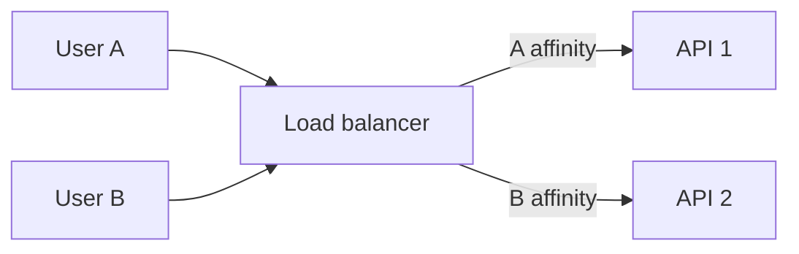

### Advantages
- Useful when connections or application state are tied to one instance.
- Can reduce some coordination overhead.

### Disadvantages
- Uneven distribution.
- Failover can break affinity.
- Scaling/draining can disrupt sessions.
- Client IP affinity is unreliable behind NAT and changing networks.

**Rule:** Use affinity for a clear technical requirement, not as a shortcut for ignoring state design.

## 24. Load balancing WebSocket connections

WebSocket is a long-lived, bidirectional connection.

Once a connection is established, messages typically continue through the backend that owns that connection.

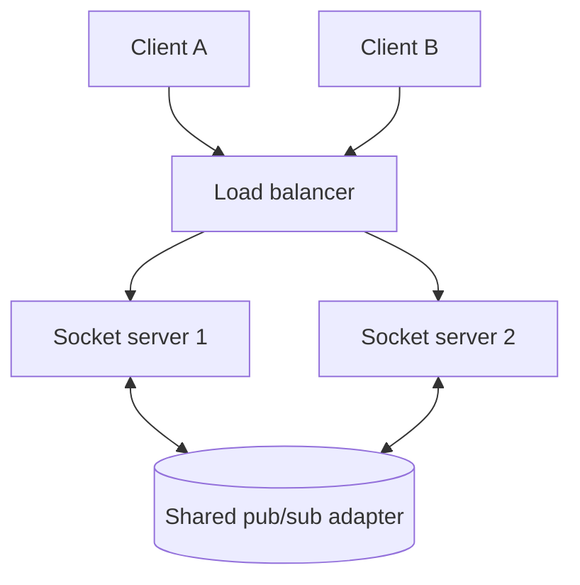

**Key issue:** User A may connect to server 1 while User B connects to server 2. Broadcasting only within one process cannot reach the other process's clients.

For Socket.IO, a compatible multi-server adapter (often Redis-based) can propagate events/room broadcasts across instances.

## 25. CodeBuddy Socket.IO: sticky sessions nuance

Socket.IO can use:
- WebSocket transport.
- HTTP long-polling transport.
- Transport upgrades, depending on configuration.

When HTTP long-polling is enabled, requests belonging to one Engine.IO session generally need to reach the correct instance unless the deployment provides a compatible shared-session routing solution. **Sticky sessions are commonly required in multi-node deployments using polling.**

With **WebSocket-only** transport, the connection stays attached to one backend, so polling-specific stickiness is generally unnecessary. But cross-instance event propagation is still required for multi-node rooms/broadcasts.

**Do not confuse:**
- Sticky sessions → routing a client's related requests to the right instance.
- Redis/Socket.IO adapter → propagating events between server instances.

They solve different problems.

## 26. WebSocket proxy configuration considerations

A reverse proxy must correctly forward WebSocket upgrade requests when using HTTP/1.1 WebSocket Upgrade.

Important considerations:
- Forward `Upgrade` and `Connection` headers correctly.
- Use HTTP/1.1 for the upstream upgrade path when required.
- Configure suitable read/idle timeouts.
- Support graceful connection draining.
- Authenticate sockets and authorize rooms.
- Monitor active connection counts, not only requests per second.

For newer HTTP versions, WebSocket negotiation can use different mechanisms; product support varies.

---

# Part D — TLS, routing, security, and operations

## 27. TLS termination at the load balancer

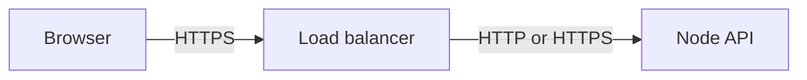

The load balancer may decrypt incoming HTTPS traffic, inspect HTTP requests, and forward them upstream.

**Advantages:**
- Centralized certificate management.
- HTTP-aware routing.
- Potentially simpler application instances.

**Security:** Browser-to-balancer encryption does not imply balancer-to-origin encryption. Choose HTTPS/mTLS for upstream traffic when needed by your security and network model.

## 28. Forwarded headers and client IP

Behind a reverse proxy, the application may see the proxy's IP rather than the original client's IP.

Common headers:
- `X-Forwarded-For`
- `X-Forwarded-Proto`
- `X-Forwarded-Host`
- Standardized `Forwarded`

**Security warning:** Clients can forge forwarding headers. Only trust them when set or sanitized by **known trusted proxies**.

Express example:

```js
// Configure this to match your real trusted proxy topology.
// Do not blindly trust all proxies on a public-facing app.
app.set("trust proxy", "loopback");
```

The correct value depends on your actual deployment. Wrong trust settings can cause spoofed client IPs, incorrect secure-cookie handling, or redirect issues.

## 29. Path-based and host-based routing

### Path-based

```text
/api/*    → Node.js API
/admin/*  → Admin service
/static/* → Static assets
```

### Host-based

```text
api.example.com  → API service
app.example.com  → Next.js app
chat.example.com → Socket service
```

This is commonly implemented by an L7 proxy or gateway.

**Trade-off:** Routing by path can introduce rewrite/base-path complications; host-based routing may simplify separation but requires DNS and certificate configuration.

## 30. Rate limiting vs load balancing

**Load balancing** distributes work.

**Rate limiting** controls how much work a client or group may submit.

They are complementary.

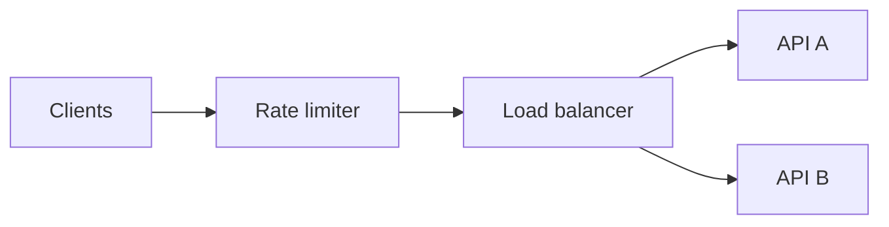

A load balancer can distribute a flood of requests across all servers and still overwhelm the entire system. Rate limits, authentication, backpressure, and capacity planning remain necessary.

## 31. Rolling deployments and connection draining

During a deployment:
1. Mark the instance as draining/unready.
2. Stop routing **new** traffic to it.
3. Allow in-flight requests to finish within a grace period.
4. Close or migrate long-lived connections where possible.
5. Stop the process.
6. Start the replacement and wait for readiness.

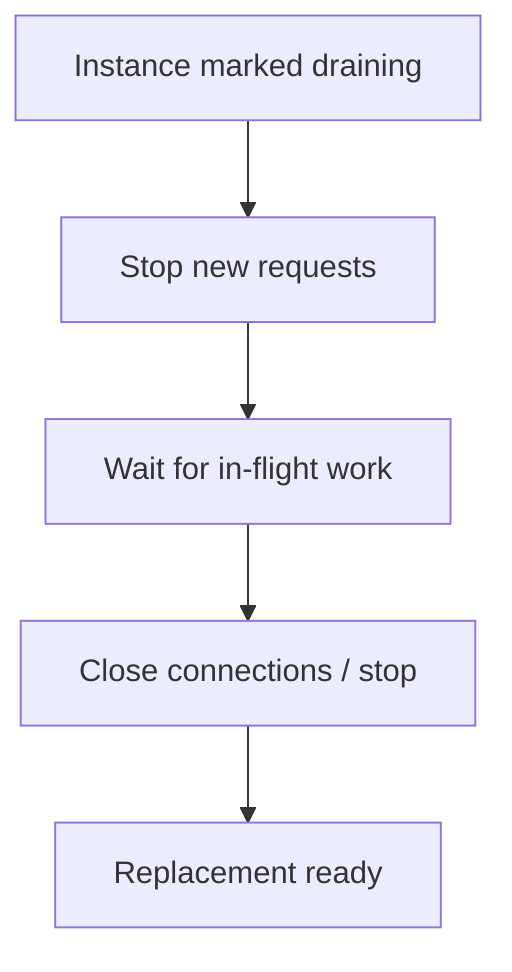

**Real-time nuance:** WebSocket connections can last for hours. Plan reconnect behavior, resubscription, and message recovery rather than waiting forever.

## 32. Overload and backpressure

A load balancer cannot manufacture capacity. If every backend is saturated, queues and latency rise.

Possible responses:
- Scale out when the bottleneck is parallelizable.
- Reject excess traffic early with `429` or `503` as appropriate.
- Bound concurrency and queue length.
- Shed low-priority work.
- Cache suitable responses.
- Optimize expensive endpoints.
- Use circuit breakers for failing dependencies.

**Little's Law intuition:** With arrival rate λ and average time in system W, average in-flight work L is approximately λ × W under suitable steady-state assumptions. Higher latency can mean many more concurrent requests.

## 33. Metrics you should monitor

| Metric | Why it matters |
|---|---|
| Requests per second | Incoming demand |
| Active connections | Important for WebSockets and long requests |
| p50/p95/p99 latency | Tail-user experience |
| 4xx and 5xx rates | Client vs service failures |
| Upstream connect failures | Network/backend issues |
| Healthy backend count | Available capacity |
| Queue length / pending requests | Overload signal |
| Per-backend request distribution | Detect imbalance |
| TLS handshake failures | Certificate/protocol problems |
| Retries and timeouts | Hidden instability |

**Tip:** Average latency alone hides slow tail requests. Track percentiles.

---

# Part E — Practical Nginx and Node.js

## 34. Start three Node.js instances

Create `server.mjs`:

```js
import http from "node:http";

const port = Number(process.env.PORT ?? 3001);

const server = http.createServer((req, res) => {
  if (req.url === "/health") {
    res.writeHead(200, { "Content-Type": "application/json" });
    res.end(JSON.stringify({ status: "ok", port }));
    return;
  }

  res.writeHead(200, { "Content-Type": "application/json" });
  res.end(JSON.stringify({ instance: port, path: req.url }));
});

server.listen(port, () => console.log(`Listening on ${port}`));
```

In separate terminals:

```bash
PORT=3001 node server.mjs
PORT=3002 node server.mjs
PORT=3003 node server.mjs
```

Each process responds with its own port, making distribution easy to observe.

## 35. Configure Nginx as a reverse proxy/load balancer

Example `nginx.conf` fragment:

```nginx
http {
    upstream node_pool {
        server 127.0.0.1:3001;
        server 127.0.0.1:3002;
        server 127.0.0.1:3003;
    }

    server {
        listen 8080;

        location / {
            proxy_pass http://node_pool;
            proxy_set_header Host $host;
            proxy_set_header X-Forwarded-For $proxy_add_x_forwarded_for;
            proxy_set_header X-Forwarded-Proto $scheme;
        }
    }
}
```

**Important:** This is a conceptual config fragment. If placed in `/etc/nginx/conf.d/*.conf` on a standard Nginx installation, the `http { ... }` wrapper is usually **already present** in the main config. Put only the `upstream` and `server` blocks inside that existing `http` context.

Test:

```bash
sudo nginx -t
sudo systemctl reload nginx

for i in $(seq 1 9); do curl -s http://localhost:8080/; echo; done
```

With default upstream balancing, you should usually see responses from multiple ports.

## 36. Weighted Nginx upstream

```nginx
upstream node_pool {
    server 127.0.0.1:3001 weight=3;
    server 127.0.0.1:3002 weight=1;
}
```

This gives instance 3001 a larger share of selected traffic over time.

## 37. Least-connections Nginx upstream

```nginx
upstream node_pool {
    least_conn;
    server 127.0.0.1:3001;
    server 127.0.0.1:3002;
    server 127.0.0.1:3003;
}
```

For long-running requests or uneven connection durations, this can be preferable to basic round robin.

## 38. Nginx WebSocket proxy example

At the `http` level:

```nginx
map $http_upgrade $connection_upgrade {
    default upgrade;
    ''      close;
}

upstream socket_pool {
    server 127.0.0.1:3001;
    server 127.0.0.1:3002;
}

server {
    listen 8080;

    location /socket.io/ {
        proxy_pass http://socket_pool;
        proxy_http_version 1.1;
        proxy_set_header Upgrade $http_upgrade;
        proxy_set_header Connection $connection_upgrade;
        proxy_set_header Host $host;
        proxy_read_timeout 75s;
    }
}
```

**Important:** This forwards WebSocket upgrades but **does not configure sticky sessions**. For multi-instance Socket.IO with HTTP long-polling enabled, add appropriate session affinity or choose a supported WebSocket-only design. Also add a multi-server Socket.IO adapter for cross-instance broadcasts.

## 39. Open-source Nginx health-check nuance

Nginx Open Source commonly supports **passive upstream failure detection** through settings such as `max_fails` and `fail_timeout`. Active HTTP health checks are not universally available in the same way across Nginx products/editions.

Don't assume the example above actively probes `/health`. For active checks, use a compatible product, external orchestrator, or supported module.

## 40. Load balancer vs Node.js cluster

**Node.js cluster / multiple processes:** Uses multiple Node.js worker processes on one machine to use CPU resources.

**Load balancer:** Distributes traffic among backend instances, which can run on the same or different machines.

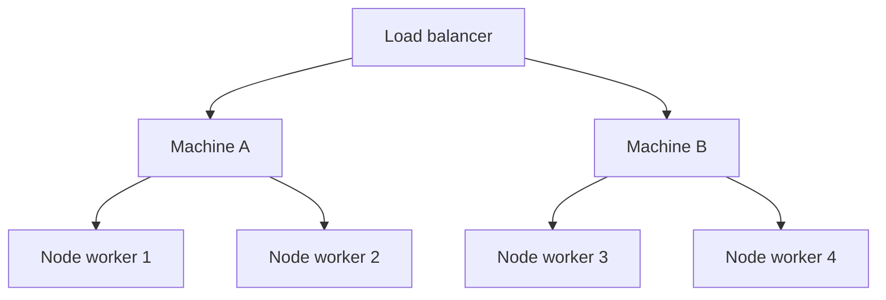

Both can coexist. Clustered workers still need shared state and multi-process Socket.IO coordination where applicable.

---

# Part F — Real architectures and trade-offs

## 41. CareerLoop architecture

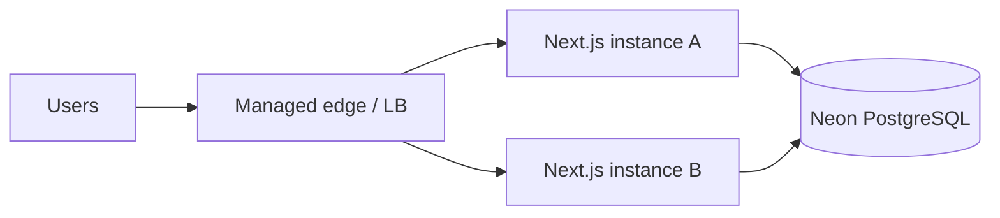

For a managed Vercel deployment, much of the request routing and scaling is handled by the platform. You normally do not need to install Nginx just to use multiple managed serverless/function instances.

**Design decisions:**
- Keep auth/session verification consistent across instances.
- Store applications in shared PostgreSQL.
- Avoid process-local mutable user state.
- Bound database connections according to the deployment environment.
- Keep user-specific responses out of public shared caches.

## 42. CodeBuddy architecture

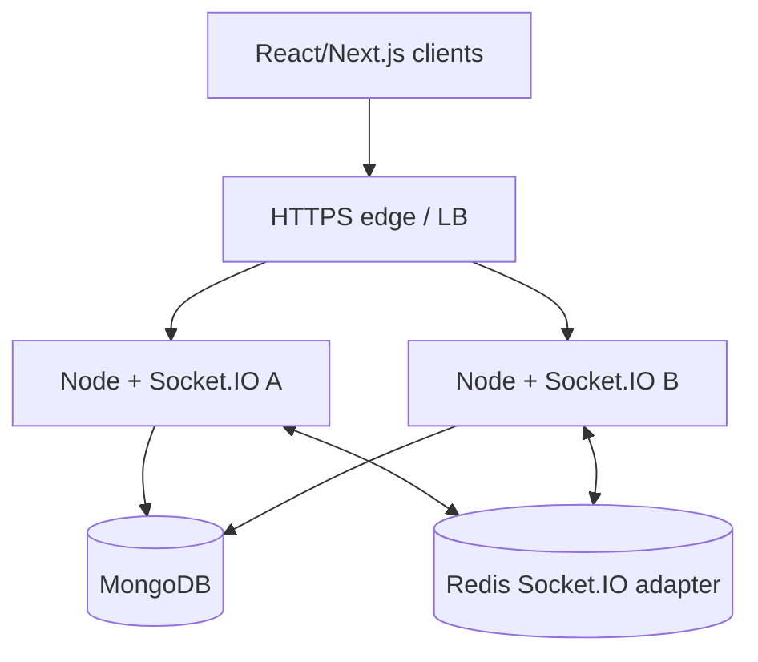

**Scenario:** Alice connects to A; Bob connects to B. When Alice sends a message:
1. Server A authenticates and authorizes the sender.
2. The application persists the message.
3. A publishes a room event.
4. The Socket.IO adapter propagates it to B.
5. B delivers it to Bob's connected socket.

**Production questions:** What if the DB write succeeds but event publication fails? How does Bob recover missed messages? How are duplicate retries handled? How do reconnecting clients resynchronize message history?

A load balancer alone does not answer those questions.

## 43. When should you introduce a load balancer?

You may need one when:
- Multiple backend instances must share traffic.
- You need health-aware routing or failover.
- You want controlled rolling deployments.
- You need L7 path/host routing.
- You need a stable frontend for a changing backend pool.

You may **not** need to operate one yourself when:
- Your managed hosting platform already handles it.
- You run a small single-instance internal service.
- Added infrastructure cost/complexity outweighs the current benefit.

**Engineering rule:** Understand the role even if a cloud provider manages the implementation.

## 44. Common mistakes

1. Assuming adding a load balancer automatically increases database capacity.
2. Confusing DNS resolution with per-request load balancing.
3. Treating L4 and L7 as identical.
4. Using round robin without considering backend capacity.
5. Assuming least connections always means least CPU load.
6. Forgetting health checks.
7. Running one unprotected balancer as a single point of failure.
8. Keeping session state only in one API process.
9. Assuming sticky sessions replace a shared Socket.IO adapter.
10. Forgetting WebSocket idle timeouts and connection draining.
11. Trusting forged `X-Forwarded-For` headers.
12. Retrying unsafe requests after ambiguous failures.
13. Assuming all Nginx editions have identical active health checks.
14. Treating every `502` as a load-balancer bug.
15. Adding custom Nginx to a managed platform without a clear need.

## 45. Interview questions

**Q1. What is a load balancer?**  
A component that selects backend targets for incoming traffic.

**Q2. Why is it needed?**  
To distribute load, enable horizontal scaling, and improve resilience.

**Q3. L4 vs L7?**  
L4 routes using transport/network metadata; L7 can inspect HTTP information.

**Q4. Round robin vs least connections?**  
Rotation vs choosing the backend with fewer active connections.

**Q5. What is weighted round robin?**  
Assigning a larger traffic share to higher-weight backends.

**Q6. What is consistent hashing?**  
A key-to-node mapping method that reduces remapping when membership changes.

**Q7. What is a reverse proxy?**  
An intermediary that accepts client requests and forwards them upstream.

**Q8. What is a health check?**  
A probe or observation used to determine backend availability.

**Q9. Liveness vs readiness?**  
Process alive vs able to serve traffic.

**Q10. What is sticky session affinity?**  
A routing preference to keep related client traffic on one backend.

**Q11. Why is WebSocket load balancing special?**  
Connections persist, and messages must reach clients across multiple instances.

**Q12. Does Socket.IO need Redis?**  
Not for one instance. Multi-instance room/event propagation commonly uses an appropriate adapter such as Redis.

**Q13. Can the load balancer fail?**  
Yes. Design high availability for the balancing layer itself.

**Q14. What is TLS termination?**  
Decrypting/handling client TLS at the balancer or proxy.

**Q15. What is connection draining?**  
Stopping new work while allowing existing work to finish before shutdown.

**Q16. Can load balancers retry requests?**  
Some can, but retries must respect side-effect and idempotency risks.

**Q17. Is a load balancer the same as a CDN?**  
No, though a CDN can include balancing/routing features.

**Q18. How do you monitor load balancing?**  
Backend health, request distribution, active connections, latency, error rates, and retries.

**Q19. How does a load balancer help deployment?**  
It can remove/drain old instances and add healthy new ones.

**Q20. When is a load balancer unnecessary?**  
When a managed platform already provides the needed routing or the service has no multi-instance requirement.

## 46. Practice exercises

### Exercise A — Manual routing
Draw three Node.js servers behind a balancer. Trace six requests using round robin and weighted round robin.

### Exercise B — Nginx lab
Run three Node.js instances on ports 3001–3003 and configure Nginx to balance across them. Verify responses using `curl`.

### Exercise C — Least connections
Imagine three backends with 50, 10, and 30 active connections. Which receives the next connection? Explain why the answer may still be suboptimal.

### Exercise D — Session design
Explain why in-memory sessions break when requests hit different instances. Design a shared-session alternative.

### Exercise E — Socket.IO
Draw two CodeBuddy socket servers behind a balancer and show how Alice's message reaches Bob on another server.

### Exercise F — Failure simulation
Stop one backend and observe proxy behavior. Explain the difference between passive failure detection and active health probes.

### Exercise G — Security
Explain why `X-Forwarded-For` is not trustworthy when accepted directly from arbitrary clients.

### Exercise H — Rolling deploy
Write a deployment sequence that prevents new traffic from reaching an old instance while allowing active requests to finish.

### Exercise I — Design trade-off
Choose L4 or L7 for: raw TCP service, REST API with path routing, and WebSocket-based chat. Justify each.

### Exercise J — Interview challenge
Design a high-availability API serving 100,000 concurrent users. Explain assumptions, load distribution, session strategy, failure handling, and bottlenecks without inventing throughput guarantees.

## 47. Final revision checklist

- [ ] I can explain the purpose of a load balancer.
- [ ] I know vertical vs horizontal scaling.
- [ ] I can compare L4 and L7 routing.
- [ ] I understand round robin, weighted, least connections, and hashing.
- [ ] I understand active/passive health checks.
- [ ] I can explain liveness vs readiness.
- [ ] I can design balancer high availability.
- [ ] I understand stateless services and sticky sessions.
- [ ] I can explain Socket.IO multi-instance requirements.
- [ ] I understand TLS termination and trusted proxy headers.
- [ ] I can configure a basic Nginx upstream.
- [ ] I can describe graceful shutdown and connection draining.
- [ ] I can recognize overload and retry risks.
- [ ] I can apply load balancing to CareerLoop and CodeBuddy.

### Next lesson

**Lesson 13 — Caching & Redis:** Cache-aside, read-through/write-through/write-behind, TTL, eviction, cache invalidation, consistency, stampedes, distributed caches, Redis data structures, and production Node.js examples.
