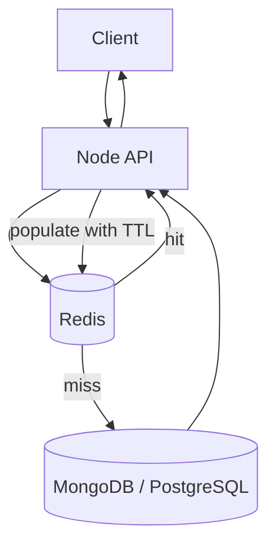

# Lesson 13 — Caching & Redis ⭐⭐⭐⭐⭐

> **Learning goal:** Deeply understand caching, Redis, consistency, failure handling, and practical Node.js architecture. Simple English, concrete examples, and diagrams.

## 1. Why caching exists

A cache stores a reusable copy of data to reduce latency, compute, or database work. Example: CodeBuddy's popular developer profile is read thousands of times but changes rarely. Redis can hold the profile temporarily so MongoDB does not execute the same query on every request. A cache is an optimization, not automatically the source of truth.

## 2. Request lifecycle



## 3. Hit, miss, and performance

Hit = reusable cached value exists. Miss = absent, expired, or evicted. Hit ratio = hits / (hits + misses). If a cache hit takes 2 ms, a database lookup takes 40 ms, and 80% of requests hit, a simplified expected lookup time is 0.8 × 2 + 0.2 × (2 + 40) = 10 ms. This ignores network and serialization overhead; benchmark real workloads. A high hit ratio alone does not guarantee good tail latency.

## 4. Cache layers

Browser cache stores assets and suitable responses; CDN caches eligible shared HTTP content; application memory is fastest but process-local; Redis shares cached data between servers; database buffer pools cache pages internally. Layers may overlap. Never publicly cache authenticated user data by accident.

## 5. Cache-aside (lazy loading)

Application GETs Redis; on miss, fetches DB, SETs value with TTL, returns result. On write, update DB then invalidate cache. Benefits: simple, caches only popular keys. Costs: cold misses, staleness, possible stampedes. This is a sensible default for read-heavy APIs.

## 6. Read-through

Application reads a caching abstraction; the abstraction itself loads the database on misses. Unlike cache-aside, the caller does not implement cache population. Plain Redis GET does not automatically provide read-through behavior; it needs a wrapper or supporting system.

## 7. Write-through

Writes pass through a layer that coordinates updating the backing database and cache. Keeps cached values warm but adds write latency. Separate Redis and SQL writes are not automatically one atomic transaction. Define recovery behavior for partial failure.

## 8. Write-behind (write-back)

Write first to cache/buffer, then asynchronously persist to database. Can reduce perceived write latency, but crashes may lose unflushed data. Requires durable buffering, replay, ordering, and reconciliation for important data. Do not use casual SET-then-save-later for payments.

## 9. Write-around

Write directly to database without populating cache. Subsequent reads fill cache on demand. Invalidate any pre-existing stale cache entry; otherwise readers may keep seeing old data.

## 10. Strategy comparison

| Strategy | Miss | Write | Main risk |
|---|---|---|---|
| Cache-aside | Application loads DB | DB + invalidate | Staleness and stampede |
| Read-through | Cache layer loads DB | Configurable | Layer complexity |
| Write-through | Configurable | Coordinated cache and DB | Dual-write failures |
| Write-behind | Usually cache | Async DB flush | Durability |
| Write-around | Read miss loads DB | Direct DB | Cold reads |

## 11. TTL and freshness

TTL is the configured time before a key expires. SET profile:42 value EX 300 keeps it for about five minutes. TTL limits how long a normal cached value can live, but does NOT guarantee the value is fresh: the database may change one second after caching.

## 12. Expiration vs eviction

Expiration removes a key because its lifetime elapsed. Eviction removes keys under memory pressure according to maxmemory-policy. Redis offers noeviction, allkeys-lru, allkeys-lfu, volatile-lru, volatile-lfu, allkeys-random, volatile-ttl and related policies. Redis LRU/LFU are approximations. Choose policies carefully if Redis also stores important non-cache state.

## 13. Cache invalidation

After successfully updating a public profile in MongoDB, DEL public-profile:v1:user-42. Next read reloads it. If the database update succeeds but invalidation fails, stale data remains until expiry. Use retries, alerts, short TTL, versioned keys, or change-data-capture where requirements justify them.

## 14. The stale-repopulation race

Reader A misses cache and reads OLD DB value. Writer B updates DB and deletes cache. Reader A then writes OLD value into cache. Despite invalidation, stale data reappears. Fixes include versioned values, coordination, or reading the authoritative DB for strict freshness. DB-then-DEL is common, not a strong consistency guarantee.

## 15. Consistency and read-your-writes

Define acceptable staleness first. Public profiles can often tolerate seconds of stale data. Payment status, authorization, and inventory deduction require stricter rules. A cache-aside layer alone does not promise read-your-writes or linearizable reads. Critical actions must validate against authoritative storage.

## 16. Cache key design

Use namespaced, versioned, scoped keys: codebuddy:profile:v1:42; careerloop:dashboard:v1:user-42; shophub:product:v2:sku-123. Include user/tenant, filters, locale, and pagination when they affect the response. Missing tenant scope is a serious data-leak risk.

## 17. Negative caching and penetration

Cache a short-lived NOT_FOUND result for nonexistent IDs to reduce repeated database misses. This combats cache penetration. Trade-off: newly created resources may temporarily appear absent. Validate input and rate-limit abusive callers. Bloom filters can help at scale but can have false positives.

## 18. Cache stampede

When a popular key expires, hundreds of requests may all query DB simultaneously. Solutions: single-flight coalescing, bounded fallback, refresh leases, stale-while-revalidate, and prewarming. One hot key can cause stampede even if other keys have random TTLs.

## 19. Avalanche and TTL jitter

Avalanche occurs when many keys expire together or the cache fails, overloading the database. Add random jitter to TTLs, spread warmup, and bound fallback concurrency. Example JS: const ttl = 300 + Math.floor(Math.random() * 60);

## 20. Distributed refresh locks

Redis SET lock:profile:42 unique-token NX PX 5000 obtains a short lease when absent. Release only if the stored token still matches, atomically. An expired owner may still execute; fencing tokens or authoritative version checks are necessary for strict correctness. Avoid treating a lease as a distributed transaction.

## 21. Stale-while-revalidate

Serve a bounded stale result immediately while one worker refreshes in the background. Useful for public pages and catalog descriptions; unsuitable when stale values can authorize payments or oversell inventory.

## 22. What Redis is

Redis is an in-memory data store with strings, hashes, lists, sets, sorted sets, streams, and specialized structures. It is commonly used as a shared cache, but also for counters, rate limits, sessions, queues, and leaderboards. Redis processes core commands efficiently while modern versions can use additional I/O/background threads.

## 23. Strings and counters

Redis CLI examples:

    SET greeting hello
    GET greeting
    SET profile:42 "{\"name\":\"Asha\"}" EX 300
    TTL profile:42
    INCR page:views
    DEL greeting

INCR is atomic as one Redis command, not across an unrelated SQL transaction.

## 24. Hashes and sets

Hashes group fields: HSET user:42 name Asha role Developer; HGET user:42 name; HGETALL user:42. Sets represent unique membership: SADD online:users user-1; SISMEMBER online:users user-1; SCARD online:users. Presence needs heartbeats and expiry; disconnects are not always graceful.

## 25. Lists, sorted sets, streams

Lists: LPUSH jobs a; RPOP jobs. Sorted sets: ZADD leaderboard 100 alice; ZREVRANGE leaderboard 0 10 WITHSCORES. Streams: XADD events * type profile-updated; XREADGROUP supports consumer groups. A basic list pop does not provide robust job acknowledgment/retry; stream guarantees also depend on persistence, retention, and consumer behavior.

## 26. Other structures

Bitmaps represent compact flags; HyperLogLog estimates unique counts with bounded memory and approximation; GEOADD/GEOSEARCH support geographic indexing. Pick data structures from read/write operations and correctness requirements, not because Redis offers them.

## 27. Persistence: RDB vs AOF

RDB saves periodic snapshots; recent writes after the last snapshot may be lost. AOF records write operations for replay, with durability depending on fsync policy. Both have operational trade-offs. Replication is not a backup; no configuration should be assumed to guarantee zero data loss without verifying it.

## 28. Replication and failover

```mermaid
flowchart TD
  API --> Primary[(Redis primary)]
  Primary --> ReplicaA[(Replica A)]
  Primary --> ReplicaB[(Replica B)]

Replication is commonly asynchronous. During failover, recently acknowledged writes may be missing on promoted replicas. Sentinel, managed services, and Redis Cluster offer different failover models.
```

## 29. Redis Cluster

Redis Cluster partitions keys into 16,384 hash slots across nodes. Clients must support redirects and cluster topology. Cross-slot multi-key operations are restricted. Hash tags such as {user:42}:profile and {user:42}:settings can co-locate related keys. Cluster is not arbitrary cross-shard ACID transactions.

## 30. Memory and operational limits

Monitor used memory, fragmentation, maxmemory, evictions, expired keys, hot keys, large values, connections, network bandwidth, replication lag, and command p95/p99. Redis is fast but network hops and serialization still cost time.

## 31. Run Redis with Docker

For local development:

    docker run --name learning-redis -p 127.0.0.1:6379:6379 -d redis:7
    docker exec -it learning-redis redis-cli PING

Expected PONG. Binding to localhost avoids casually exposing an unauthenticated Redis port to the network. Production requires appropriate authentication, network controls, TLS, and persistence planning.

## 32. Node.js connection

Install npm install redis express. Example:

    import { createClient } from "redis";
    const redis = createClient({ url: process.env.REDIS_URL ?? "redis://localhost:6379" });
    redis.on("error", err => console.error("Redis:", err));
    await redis.connect();

Reuse a managed client per application instance. Don't create a connection for every request. Add timeouts and graceful shutdown in production.

## 33. Node.js cache-aside example

Assume getProfileFromMongo(id) is your existing Mongoose-backed function:

    async function getPublicProfile(id, redis) {
      const key = "profile:v1:" + id;
      try {
        const raw = await redis.get(key);
        if (raw !== null) return JSON.parse(raw);
      } catch (err) {
        console.warn("Cache unavailable:", err.message);
      }
      const profile = await getProfileFromMongo(id);
      if (!profile) return null;
      try {
        await redis.set(key, JSON.stringify(profile), { EX: 300 });
      } catch (err) {
        console.warn("Cache population failed:", err.message);
      }
      return profile;
    }

Validate IDs, select only public fields, enforce authorization when needed, and handle malformed cache entries and cache timeouts in production.

## 34. Updating a cached profile

After authenticating the caller and updating MongoDB:

    await User.updateOne({ _id: id, ownerId }, { $set: validatedUpdate });
    await redis.del("profile:v1:" + id);

Check matched/modified counts and handle invalidation failure. If strong freshness is required, cache-aside with separate Redis and MongoDB operations is not sufficient by itself.

## 35. Next.js vs Redis cache

Browser HTTP caching, CDN caching, Next.js framework caching, and Redis are different layers. Next.js caching APIs/defaults depend on framework version and route configuration; never assume every fetch or Server Component is cached. In CareerLoop, avoid sharing private dashboard data across authenticated users.

## 36. CareerLoop case study

Potential: short-TTL per-user dashboard counts; shared public company metadata; reusable aggregate results. Usually prioritize freshness for interviews and follow-up dates. Key dashboard by authenticated user and invalidate on create/update/delete. PostgreSQL remains authoritative for applications.

## 37. CodeBuddy case study

Cache public profile summaries, connection counts, and suitable recommendation snapshots. Use user-specific keys for personalized feeds and invalidate on relationship changes. Real-time Socket.IO messages should be persisted/reconciled through authoritative storage; a Redis pub/sub adapter alone is not durable message history.

## 38. ShopHub case study

Cache public product descriptions and images aggressively when versioned. Price and stock displays can be cached only within acceptable staleness. Final checkout must validate price, discounts, and available stock in an authoritative transaction to prevent overselling.

## 39. Cache failures and fallback

```mermaid
flowchart TD
  Request --> Redis{Redis healthy?}
  Redis -->|yes| Lookup[Read cache]
  Redis -->|no| Limit[Bounded DB fallback]
  Lookup -->|miss| Limit
  Lookup -->|hit| Response
  Limit --> DB[(Database)]
  DB --> Response

For disposable caches, degrade to bounded database reads and alert. For Redis-backed sessions, rate limits, or important queues, failing open may be unsafe; decide policy per workload.
```

## 40. Redis vs Memcached vs local Map

Redis offers rich data structures and optional persistence; Memcached focuses on distributed in-memory key/value caching; a JS Map is process-local and simple but not shared between instances. Select based on needed features, operational cost, and consistency.

## 41. Security boundaries

Keep Redis private, authenticate with ACLs, encrypt transport where needed, restrict admin commands, and never trust a cache hit as proof of authorization. Scope tenant keys and avoid logging sensitive values. Do not expose Redis port 6379 publicly.

## 42. Monitoring checklist

Track cache hit/miss rate, cache latency, eviction/expiration, hot keys, memory, errors/timeouts, DB fallback traffic, and p95/p99 endpoint latency. An excellent hit ratio can still hide a database overload during simultaneous expirations.

## 43. Common mistakes

Caching everything; forgetting invalidation; confusing no-cache with no-store; trusting TTL as strong freshness; global keys for personalized data; ignoring stampedes; unconditional lock DEL; assuming async replication cannot lose data; using Redis list as a reliable queue without acknowledgments; unbounded DB fallback; trusting cached inventory at checkout.

## 44. Interview questions

1. What is a cache hit vs miss?
2. When should data not be cached?
3. Cache-aside vs read-through?
4. Write-through vs write-behind?
5. TTL vs eviction?
6. What causes stale cache values?
7. How does a stale-repopulation race happen?
8. What is a cache stampede?
9. What is penetration vs avalanche?
10. How does TTL jitter help?
11. What is stale-while-revalidate?
12. Why is a distributed lease not a correctness guarantee?
13. When choose Redis Strings vs Hashes?
14. When use Sets vs Sorted Sets?
15. RDB vs AOF?
16. Is Redis replication synchronous?
17. What is Redis Cluster's hash slot model?
18. How should an API behave when Redis fails?
19. Why must cache keys include tenant scope?
20. Why must checkout verify stock against the database?

## 45. Practical exercises

**A:** Implement cache-aside for a public MongoDB profile. **B:** Add TTL and invalidation. **C:** Simulate a stale-repopulation race. **D:** Run 100 concurrent requests for one expired key; measure DB queries. **E:** Add single-flight refresh. **F:** Use Redis CLI Strings, Hashes, Sets, Sorted Sets, and Streams. **G:** Cache CareerLoop per-user dashboard counts. **H:** Design safe ShopHub inventory display and checkout. **I:** Stop Redis during traffic and observe bounded fallback. **J:** Explain your cache strategy in a 10-minute system-design interview.

## 46. Final revision checklist

- [ ] I can identify good and bad caching candidates.
- [ ] I can explain all five major cache strategies.
- [ ] I understand TTL, expiration, eviction, and invalidation.
- [ ] I can explain stale writes, stampedes, and avalanche.
- [ ] I know Redis structures and core CLI commands.
- [ ] I understand persistence, replication, and cluster limitations.
- [ ] I can build Node.js cache-aside and handle Redis failure.
- [ ] I can protect personalized data and authoritative checkout logic.
- [ ] I can discuss caching trade-offs with real examples.

---

**Next: Lesson 14 — Databases.** Relational vs NoSQL, indexes, transactions, query patterns, ACID, normalization, OLTP vs OLAP, and database selection.
