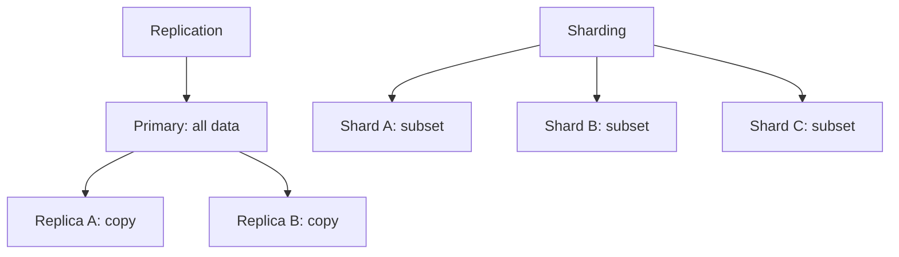
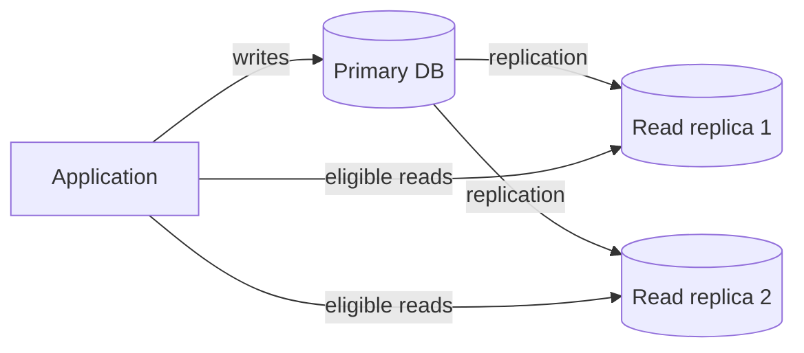
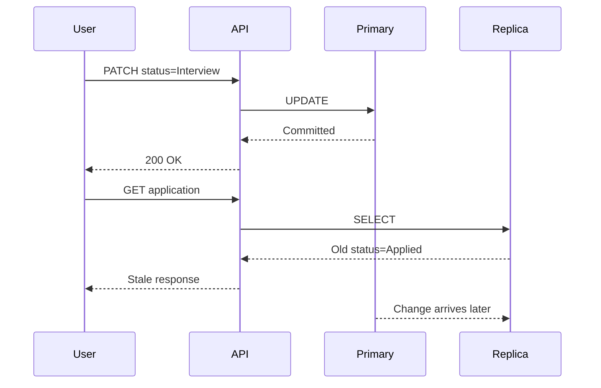
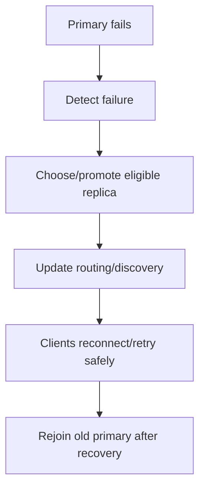
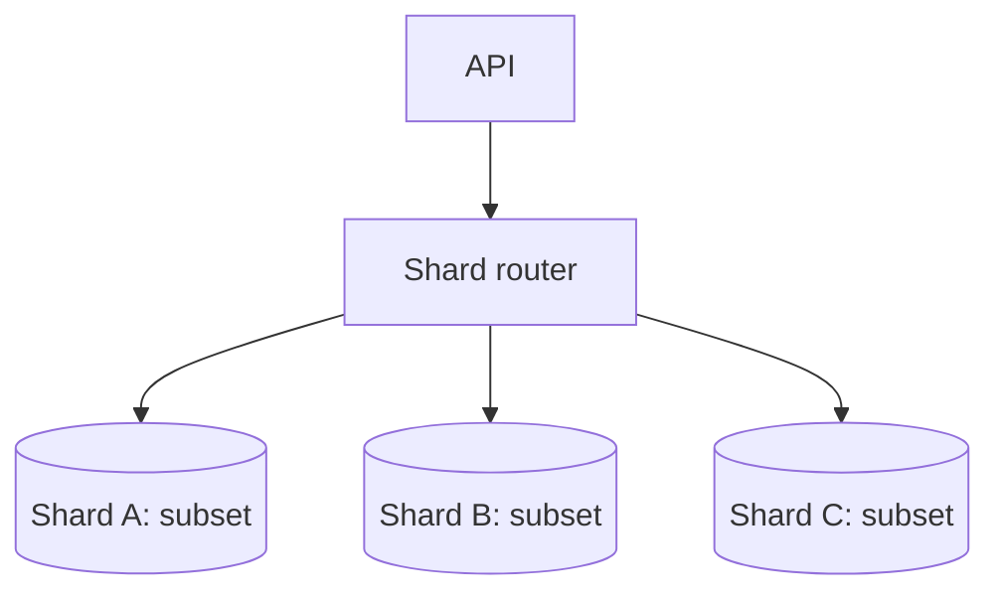
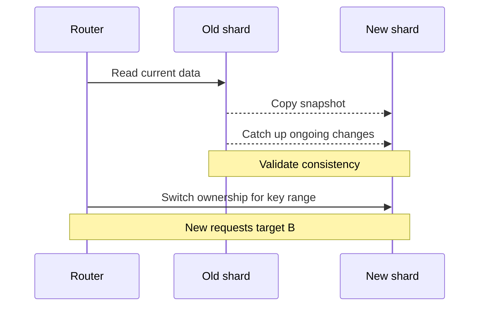
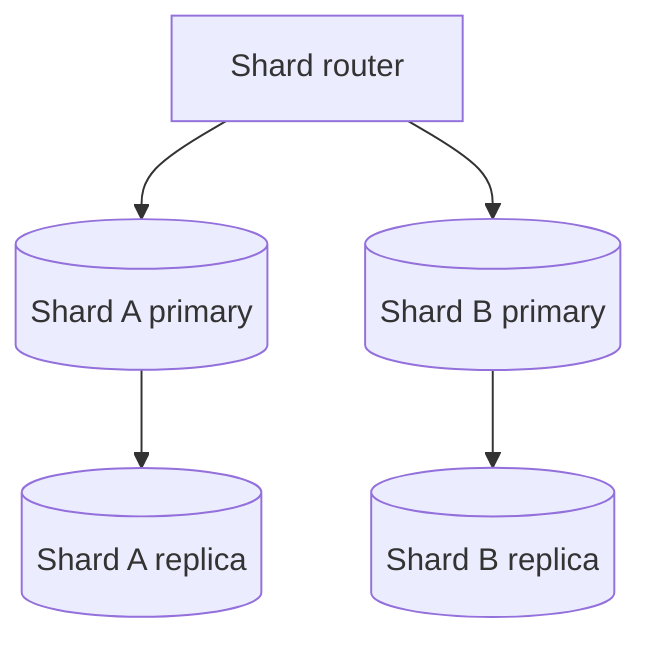

# Lesson 15 — Replication & Sharding ⭐⭐⭐⭐⭐

> **Goal:** Understand how databases scale reads, storage, and writes; why copies and partitions solve different problems; and how consistency, failover, routing, and operations work in production. Written in simple English with diagrams and real application examples.

## 01. The scaling problem

Suppose CareerLoop grows from 1,000 to 1 million users. One PostgreSQL server may eventually struggle with read traffic, storage, or write throughput. We have two different tools: **replication** copies data to additional nodes; **sharding** partitions different data across nodes. They solve different bottlenecks and introduce different failure modes.

## 02. Mental model: copies vs pieces

**Replication:** A, B, and C each contain copies of the same dataset (possibly with lag). **Sharding:** A contains users 1–100, B users 101–200, C users 201–300. A production system may combine both: each shard can have replicas.



## 03. Scaling before distributing

Before replication or sharding, check query plans, missing indexes, N+1 queries, connection pooling, pagination, data retention, caching, and machine capacity. Distributed data architecture costs operational complexity. A slow unindexed query remains slow when replicated or sharded.

## 04. Primary and replicas

A common architecture accepts writes on a **primary** and propagates changes to one or more **replicas**. Some systems call these leader/follower. Replicas can serve reads, provide standby capacity, and support some maintenance tasks.


A replica does not automatically mean a backup.

## 05. How replication works

The primary records changes, and replicas apply them in a compatible order. PostgreSQL commonly uses write-ahead log (WAL) streaming; MongoDB replica sets use an operation log (oplog). Exact mechanics differ, but the core idea is **propagating changes** rather than independently accepting unrelated writes on every node.

## 06. Synchronous vs asynchronous replication

**Asynchronous:** Primary can acknowledge a write before a replica applies it; usually lower commit latency but failover can lose recently acknowledged writes. **Synchronous:** Commit waits for configured replication acknowledgment, increasing latency and coupling availability to replica health. Terms such as synchronous do not necessarily mean all replicas have applied data; exact guarantees depend on product/configuration.

## 07. Replication lag

Replication lag is the delay between a write becoming visible on the primary and the replica reflecting it. Lag can come from network delay, disk I/O, slow replay, long transactions, or heavy replica queries. A lagging replica may return stale results even though the primary has already committed.

## 08. Read-after-write surprise

CareerLoop user changes an application status to Interview. The write succeeds on the primary; the next GET is routed to a lagging replica and returns Applied.



## 09. Read-your-writes solutions

Options: route the user's immediate subsequent reads to primary; use session/consistency tokens where supported; wait for replica to reach a required log position; or optimistically update the UI while reconciling against authoritative data. Sticky read routing is a policy, not an inherent database guarantee. Define the required freshness window.

## 10. Other consistency guarantees

**Monotonic reads:** A client should not observe an older version after a newer one. **Read-your-writes:** A client observes its completed writes. **Eventual consistency:** Replicas converge when writes stop and the system is healthy. **Strong consistency:** The specific system/operation meets a stricter ordering/visibility model. Never infer strong consistency merely from having a primary.

## 11. Read scaling

If most traffic is read-only, replicas can spread eligible queries. Example: public CodeBuddy profile reads may tolerate a little lag; final ShopHub inventory validation should use an authoritative transaction, not a stale read replica. Replicas still consume primary replication bandwidth and require storage/compute.

## 12. Write scaling limitations

Adding read replicas does not inherently increase the primary's write capacity. All primary writes must still be processed and propagated. If writes or dataset size exceed one node's practical limits, partitioning/sharding may be appropriate after simpler optimizations.

## 13. High availability vs scaling

Replication can improve availability by providing failover candidates. But availability depends on failure detection, election/quorum rules, client reconnection, and whether the surviving nodes contain the necessary writes. More copies do not guarantee zero downtime or zero data loss.

## 14. Failover lifecycle


Applications must handle transient errors during promotion. Avoid retrying ambiguous non-idempotent writes without idempotency safeguards.

## 15. Split brain

Split brain occurs when multiple nodes believe they can act as authoritative writer for the same data. Without proper fencing/quorum rules, conflicting writes can occur. Consensus/election protocols and fencing reduce this risk, but network partitions and operational mistakes still require careful design.

## 16. Quorum intuition

A quorum is a sufficient subset of members whose acknowledgments or votes are needed for a decision. For three voting members, a majority is two. Majority rules help avoid independent conflicting leaders when membership and protocol assumptions hold. **Quorum acknowledgment** is not identical to every replica having applied the write.

## 17. PostgreSQL physical streaming replication

PostgreSQL WAL records changes on the primary; standby servers can stream and replay WAL. A hot standby may serve read-only queries. Configuration involves WAL settings, replication credentials, network access, standby setup, and monitoring. Managed PostgreSQL providers may expose replicas without requiring manual WAL administration.

## 18. PostgreSQL replication example commands

```sql
-- Run on the primary with suitable privileges:
SELECT application_name, state, sync_state,
       sent_lsn, write_lsn, flush_lsn, replay_lsn
FROM pg_stat_replication;

-- On a standby:
SELECT pg_is_in_recovery();
SELECT pg_last_wal_replay_lsn();
SELECT pg_last_xact_replay_timestamp();
```
These are diagnostic examples, not a complete setup guide. Timestamp-based lag can be misleading during idle periods; compare appropriate LSN and operational metrics.

## 19. PostgreSQL logical replication

Logical replication publishes table-level data changes and subscribes on another PostgreSQL instance. It can support selective replication and some migration use cases. It differs from physical WAL streaming: not every schema change, sequence state, or database object is automatically handled the same way. Validate publication/subscription limitations for the deployed version.

## 20. MongoDB replica sets

A MongoDB replica set has a primary and secondary members. The primary accepts normal writes; secondaries replicate operations from the oplog. Elections select a new primary when needed. Read preference and read concern affect where and how reads happen; write concern affects acknowledgment.

## 21. MongoDB write concern and read concern

Write concern `w: "majority"` requests majority acknowledgment under MongoDB's rules; read concern `majority` controls which committed data a read can return. These settings do not automatically give every client linearizable reads. For stronger guarantees, understand MongoDB's read concern, session causal consistency, and primary read preference together.

## 22. MongoDB shell illustration

```js
// Illustrative MongoDB shell commands in a replica-set deployment:
rs.status();
db.getMongo().setReadPref("primary");
db.users.findOne({ _id: userId });
```
Use a valid userId and a properly configured replica set. Avoid assuming secondary reads are suitable for immediate read-after-write workflows.

## 23. Multi-primary replication

Some systems allow writes at multiple sites. This can improve locality or availability, but conflict resolution becomes central: what happens if two regions update the same record simultaneously? Strategies include application conflict resolution, version vectors, CRDTs, or last-write-wins, each with trade-offs. PostgreSQL physical replication and standard MongoDB replica sets are not general-purpose multi-primary designs.

## 24. Replication and backups

A replica can quickly copy an accidental DELETE or corrupted logical change. Backups and point-in-time recovery protect against errors that replication faithfully propagates. Define **RPO** (acceptable data loss) and **RTO** (acceptable restoration time), retain backups separately, and test restores.

## 25. When replication is not enough

A primary still holds the full dataset and processes writes. If data volume, per-node write throughput, or geographic locality becomes the bottleneck, sharding/partitioning may be considered. Sharding changes the data model and routing layer, so it is usually a later optimization.

## 26. What is sharding?

Sharding horizontally partitions records across separate database nodes or groups. Each shard owns a subset of the dataset. Example: CareerLoop users with IDs in one range live on shard A, others on B. Unlike replication, shards do not each store all data.



## 27. Sharding vs table partitioning

Database table partitioning divides a logical table into partitions, which may still live on the same database server. Sharding usually distributes ownership across independent nodes/instances. Partitioning can improve maintenance and pruning without solving the single-node capacity limit. Products sometimes use these terms differently; describe the actual physical architecture.

## 28. Choosing a shard key

The shard key determines where data belongs and whether requests can target one shard. A good key spreads storage/writes, appears in common queries, and minimizes cross-shard operations. Bad keys produce hotspots, fan-out queries, and difficult resharding. Analyze real traffic distributions, not only uniform synthetic IDs.

## 29. Range-based sharding

Assign ranges to shards, e.g. user IDs 1–100000 to A and 100001–200000 to B. Advantage: efficient range scans when aligned with queries. Risk: sequential IDs or timestamps direct all new writes to the newest shard, creating a hotspot.

## 30. Hash-based sharding

Hash the shard key and map hash ranges/buckets to shards. Advantage: distributes sequential identifiers more evenly. Trade-off: range queries on original key may require scatter-gather. Hashing cannot fix a single extremely hot logical key.

## 31. Directory-based sharding

Maintain a mapping service: tenant_id → shard location. Advantage: flexible tenant placement and migration. Costs: metadata consistency, availability, caching, and routing complexity. The directory becomes critical infrastructure and needs its own HA design.

## 32. Geo-based sharding

Place users/data according to region to improve locality or satisfy residency requirements. Challenges include users traveling, cross-region relationships, uneven regional growth, compliance, and global queries. Geographic partitioning is not automatically legally compliant; examine actual data residency rules.

## 33. Comparing shard strategies

| Strategy | Strength | Main risk |
|---|---|---|
| Range | Local range scans | Sequential-write hotspots |
| Hash | More even distribution | Range-query fan-out |
| Directory | Flexible placement | Metadata service complexity |
| Geography | Locality/residency | Uneven regions and cross-region queries |
Select from query patterns, growth, and failure requirements.

## 34. Shard routing

**Targeted query:** WHERE tenant_id = 42 and tenant_id is the shard key → route to one shard. **Scatter-gather:** Query without shard key → ask many shards and combine results. Scatter-gather raises latency, resource cost, and failure complexity. Include shard-key predicates in hot request paths when possible.

## 35. Hot shards and skew

Evenly distributed data size does not imply evenly distributed traffic. One enterprise tenant may send 80% of requests. Monitor storage, QPS, CPU, queueing, and p99 per shard. Options include splitting a hot tenant by subkey, isolating it, caching hot reads, or choosing a better key. Every option has query and migration costs.

## 36. Rebalancing and resharding

When nodes are added or data distribution changes, records must move. A safe migration often includes copying data, tracking ongoing writes, catching up, validating checksums/counts, changing routing atomically, and cleaning up old copies. Dual writes without coordination can diverge. Plan rollback and backpressure.

## 37. Resharding sequence


Actual algorithms vary by database. Routing cutover must account for in-flight writes.

## 38. Cross-shard joins

A relational join between records on different shards may require network fan-out, data movement, or application-level assembly. Prefer co-locating entities frequently accessed together when possible. For CareerLoop, placing a user's applications, recruiters, and followups by user_id can simplify user-scoped queries, but shared company records may need separate handling.

## 39. Cross-shard transactions

A transaction spanning multiple shards is harder than one local transaction. Some databases provide distributed transactions, but they increase coordination cost and can affect latency/availability. Avoid unnecessary cross-shard invariants; where appropriate, use sagas, outbox events, idempotency, and compensating actions. These provide different guarantees than a single ACID transaction.

## 40. Global uniqueness and ID generation

A shard-local auto-increment ID may collide with IDs generated on another shard. Options: UUID/ULID, centrally allocated ranges, Snowflake-style IDs, or composite (shard_id, local_id). Each has ordering, coordination, and index-locality trade-offs. Global uniqueness constraints across shards require deliberate design.

## 41. Sharding and secondary indexes

An index within one shard only indexes that shard's data. A query for email without shard key may need all shards unless you maintain a global directory/index. Such a directory must be updated reliably and can become a bottleneck. Design unique email/account lookup explicitly.

## 42. Replication within each shard


Sharding increases capacity; replicas within shards improve availability/read scaling. The total number of nodes and failure scenarios grows quickly.

## 43. MongoDB sharding architecture

MongoDB sharded clusters use **shards**, **mongos query routers**, and **config server replica sets** holding metadata. Shards are commonly replica sets. Shard key choice affects targeted queries, balancing, and hotspots. A sharded cluster does not eliminate the need for indexes, replication monitoring, and application-level consistency planning.

## 44. MongoDB shard-key example

```js
// Illustrative only; requires a configured sharded cluster and a suitable collection.
sh.shardCollection("careerloop.applications", { userId: "hashed" });
```
Hashed userId can spread different users but groups all records for a given user under one hash value; a very large/hot user can still be problematic. Confirm version-specific shard-key, uniqueness, and migration requirements before using in production.

## 45. PostgreSQL sharding approaches

PostgreSQL supports declarative table partitioning on one instance. Cross-node sharding generally requires an extension/distributed PostgreSQL system, application routing, or managed infrastructure. **PostgreSQL table partitioning alone is not multi-node sharding.** Compare operational support and transaction requirements before adopting a distributed solution.

## 46. CareerLoop growth plan

Stage 1: single managed PostgreSQL with indexes, good schema, pool limits, backups. Stage 2: optimize expensive dashboard reads; add safe caching or read replicas if needed. Stage 3: partition large event/history tables for retention and maintenance. Stage 4: consider tenant/user-based sharding only when capacity measurements justify it. Never introduce sharding just because the app has many users.

## 47. CodeBuddy growth plan

MongoDB replica set can provide failover and optional secondary reads for tolerant workloads. Index messages by conversationId and createdAt. At large scale, shard messages using an access-pattern-aware key. Sharding solely on createdAt risks a hot newest range; hashing solely on conversationId can still leave a celebrity/hot room concentrated. Benchmark actual distribution.

## 48. ShopHub correctness

Product catalog reads may use replicas and caches when slight staleness is acceptable. Checkout must use authoritative inventory reservation and payment idempotency. A stale replica's stock count must not determine whether an order succeeds. If inventory is partitioned, co-locate per-SKU mutations or design explicit coordination.

## 49. Operational monitoring

Replication: apply/replay lag, WAL/oplog retention, replica health, failover duration, write acknowledgment errors, disk usage. Sharding: per-shard QPS, storage, CPU, skew, scatter-gather ratio, routing errors, chunk migrations, hot keys, cross-shard operations, p95/p99. Also test backups and disaster recovery.

## 50. Common misconceptions

1. Replication and sharding are the same. 2. Read replicas always return current data. 3. Replicas increase primary write throughput automatically. 4. Replication replaces backups. 5. Majority acknowledgment means every node applied a write. 6. Sharding automatically speeds every query. 7. A good hash prevents all hotspots. 8. Cross-shard joins are free. 9. PostgreSQL partitioning means multi-node sharding. 10. Redis cache replicas and database replicas have identical guarantees. 11. Failover cannot lose acknowledged writes. 12. More nodes always improve availability.

## 51. Interview questions with short answers

**Q1. Replication vs sharding?** Copies vs partitions. **Q2. Why read replicas?** Eligible read scale and failover candidates. **Q3. What is replication lag?** Delay before replicas reflect primary changes. **Q4. How guarantee read-your-writes?** Primary routing or supported consistency mechanisms. **Q5. Async vs sync?** Different acknowledgment/latency/data-loss trade-offs. **Q6. Split brain?** Conflicting authoritative writers. **Q7. What is quorum?** Sufficient member votes/acks for a decision. **Q8. What is a shard key?** Field(s) used for data placement/routing. **Q9. Range vs hash?** Efficient ranges vs better distribution. **Q10. Hot shard?** One shard receives disproportionate load. **Q11. Scatter-gather?** Querying multiple shards and merging. **Q12. Cross-shard transaction?** Coordinated mutation spanning partitions. **Q13. Is a replica a backup?** No. **Q14. When not shard?** Before simpler bottlenecks are addressed. **Q15. Can MongoDB shard?** Yes, with mongos/shards/config servers. **Q16. Can PostgreSQL shard?** Via distributed approaches, not ordinary local partitioning alone.

## 52. Hands-on exercises

**A:** Draw primary plus two replicas; trace a write and stale read. **B:** Propose a read-your-writes strategy for CareerLoop. **C:** Query PostgreSQL replication diagnostics in a test environment. **D:** Explain MongoDB replica-set primary election. **E:** Compare range/hash/directory sharding for a chat app. **F:** Identify a hotspot from per-shard QPS metrics. **G:** Design a safe resharding migration plan. **H:** Explain why replicas do not replace backups. **I:** Choose shard keys for applications and messages and justify them. **J:** Design 99.9%-availability goals with explicit RPO/RTO assumptions.

## 53. Revision checklist

- [ ] I can explain replication vs sharding with a diagram.
- [ ] I understand primary, replicas, WAL/oplog, and lag.
- [ ] I can explain synchronous/asynchronous acknowledgment.
- [ ] I know read-your-writes and stale-read mitigations.
- [ ] I understand failover, quorum, and split brain.
- [ ] I can choose a shard key from access patterns.
- [ ] I understand hotspots, scatter-gather, and resharding.
- [ ] I know why cross-shard transactions are hard.
- [ ] I understand MongoDB and PostgreSQL implementation differences.
- [ ] I can apply the trade-offs to CareerLoop, CodeBuddy, and ShopHub.

---

**Next: Lesson 16 — Message Queues.** Producers, consumers, brokers, acknowledgments, retries, dead-letter queues, delivery guarantees, Kafka/RabbitMQ/Redis, and practical Node.js designs.
