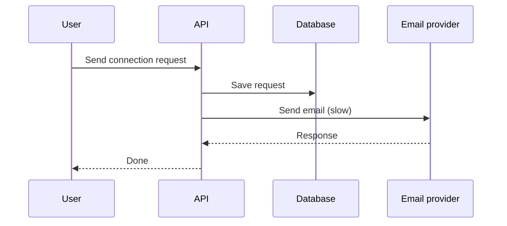
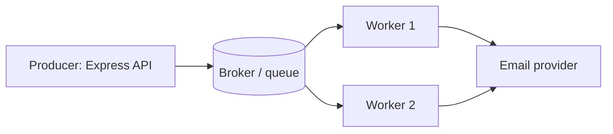
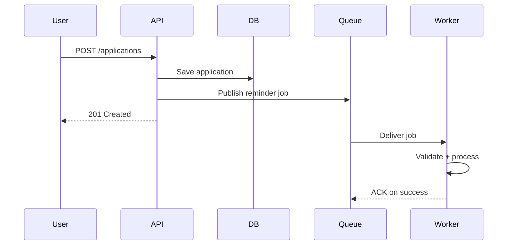
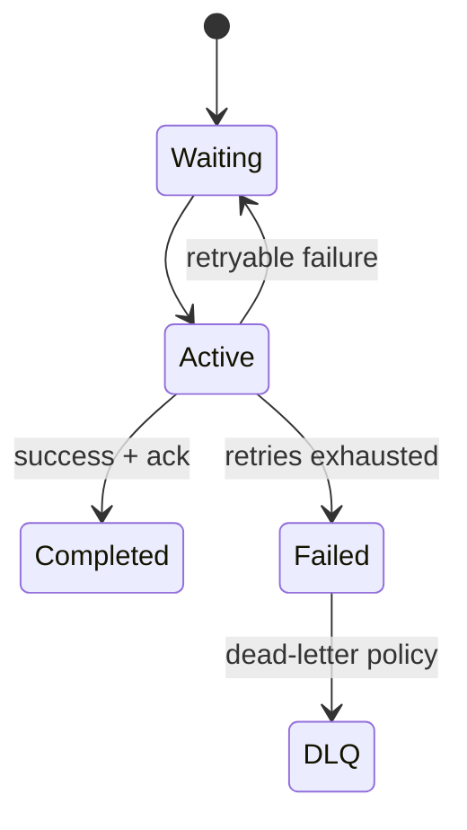
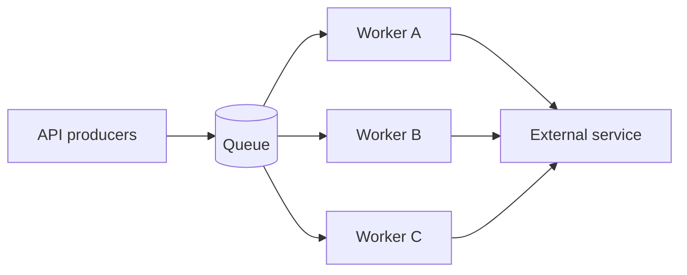
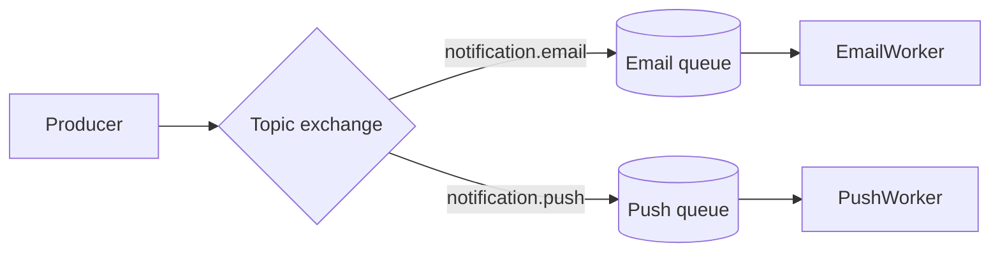
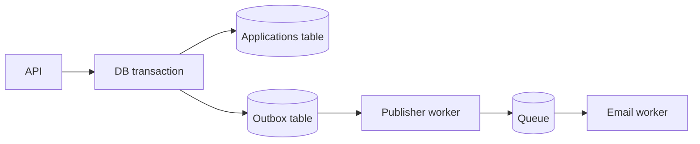

# Lesson 16 — Message Queues ⭐⭐⭐⭐⭐

> **Goal:** Learn background processing, reliable message delivery, queue architectures, broker selection, and production Node.js patterns in simple English. Includes diagrams, runnable BullMQ examples, failure scenarios, and interview preparation.

## 01 — Why message queues exist

Imagine CodeBuddy sends a connection request. The API must save the request, notify the recipient, and send an email. Doing all work inside the HTTP request makes the response slow and fragile. A queue lets the API record work and return while workers process it later. **A queue is not a guarantee that work will succeed:** you must design retries, durability, idempotency, and monitoring.

## 02 — Synchronous vs asynchronous workflows


With a queue, the API commits its business change and safely schedules background work; a worker handles the provider call separately.

## 03 — Producer, broker, consumer

**Producer:** publishes work/events. **Broker:** stores/routes messages. **Consumer:** receives and processes messages. **Acknowledgment:** signals successful handling according to broker semantics.



## 04 — Queue vs event

A **command/job** requests a specific action: `send-welcome-email`. An **event** describes something that happened: `user.registered`. Multiple consumers may react to one event. A queue often distributes tasks among competing workers; pub/sub topics often fan out events to subscribers. Actual behavior depends on broker configuration.

## 05 — Why decoupling matters

Producers should not need to know worker instances, how long processing takes, or provider implementation details. This reduces temporal coupling and allows independent scaling. But a queue introduces eventual completion, duplicate delivery, ordering questions, and operational dependencies.

## 06 — Typical use cases

Email and push notifications; image/video processing; PDF invoices; analytics events; payment webhooks; search indexing; data imports; thumbnail generation; retryable third-party calls. Avoid using a queue for operations where the user must immediately receive a strongly consistent result without an explicit pending state.

## 07 — Queue workflow


**Critical caveat:** DB commit and queue publish can fail separately. The transactional outbox pattern addresses this gap.

## 08 — Point-to-point work queues

Many workers compete for jobs from one queue. A message is typically handled by one worker at a time, though redelivery can cause multiple attempts. Good for sending emails or generating invoices. Workers can scale independently of the API.

## 09 — Pub/sub fan-out

One published event can reach multiple subscribed consumer groups: analytics, notifications, and search indexing. Fan-out is not necessarily durable: Redis Pub/Sub, for example, does not retain messages for disconnected subscribers. Kafka topics and RabbitMQ durable queues provide different retention/delivery models.

## 10 — Queue vs stream vs log

A work queue often removes/acknowledges tasks after processing. A durable event log retains records for a configured period and tracks consumer positions. Streams combine append-only storage with consumer processing features. **Kafka is not simply a faster RabbitMQ**; their storage, ordering, replay, and routing models differ.

## 11 — Message anatomy

A practical message has: stable messageId, type, version, createdAt, correlationId, entity identifiers, and minimal payload. Example:

```json
{
  "messageId": "evt-123",
  "type": "application.created",
  "version": 1,
  "createdAt": "2026-10-21T10:00:00Z",
  "applicationId": "app-42",
  "userId": "user-7",
  "correlationId": "req-99"
}
```
Avoid secrets and unnecessary personal data. Consumers should validate untrusted messages.

## 12 — Job lifecycle


Names vary by broker. Some systems retain completed jobs, some delete them, and some require explicit ack.

## 13 — Acknowledgments

ACK tells the broker the consumer finished work. For manual-ack brokers, acknowledge **after** the side effect succeeds. If the consumer crashes after the side effect but before ACK, the broker may redeliver: your handler must tolerate duplicates. Acknowledging before processing risks losing unfinished work.

## 14 — At-most-once delivery

A message is delivered zero or one time; processing may be lost if a failure occurs. Example: fire-and-forget notifications where occasional loss is acceptable. At-most-once does not imply the consumer successfully executed the business action.

## 15 — At-least-once delivery

A message can be delivered more than once until successfully acknowledged. This is common for reliable work queues. Duplicate deliveries are expected after crashes/timeouts. Design **idempotent consumers** and deduplication instead of assuming exactly one invocation.

## 16 — Exactly-once: scope matters

Some brokers offer exactly-once processing guarantees within specific broker/transaction boundaries. That does **not** mean a third-party email or payment API executes exactly once. End-to-end exactly-once side effects usually require idempotency keys, transactional coordination, or reconciliation. State the scope of any guarantee precisely.

## 17 — Idempotency

An operation is idempotent when repeating it does not create additional unintended effects. For `sendInvoice(invoiceId)`, record a unique delivery key and check whether that invoice has already been sent. Beware the check-then-act race: two workers can both observe “not sent.” Use unique constraints, atomic claims, or provider-supported idempotency keys.

## 18 — SQL idempotency example

```sql
CREATE TABLE processed_messages (
  consumer_name TEXT NOT NULL,
  message_id TEXT NOT NULL,
  processed_at TIMESTAMPTZ NOT NULL DEFAULT now(),
  PRIMARY KEY (consumer_name, message_id)
);
```
Inside the **same database transaction** as the business update, INSERT the processed marker with ON CONFLICT DO NOTHING and apply the update only if inserted. External email sending is outside that transaction and needs a separate delivery strategy.

## 19 — Retries

Transient errors include network timeouts, 429 rate limits, and short provider outages. Permanent errors include invalid addresses or unsupported payloads. Retry only retryable failures; cap attempts and expose terminal failures. Blindly retrying a payment charge without idempotency can duplicate charges.

## 20 — Exponential backoff and jitter

Example retry delays: 1 s, 2 s, 4 s, 8 s, with a maximum and randomized jitter. Jitter prevents thousands of workers retrying simultaneously after an outage. Honor provider Retry-After headers when relevant. Never implement infinite retries without a failure policy.

## 21 — Dead-letter queue (DLQ)

Messages that cannot be processed after configured attempts move to a DLQ or failed-job store. Include error category, attempt count, original message ID, and timestamps. Operators can inspect, fix data/configuration, and selectively replay. A DLQ is not a substitute for alerting.

## 22 — Poison messages

A poison message repeatedly crashes or fails a worker because of malformed payload or deterministic logic error. Validate schema, classify errors, quarantine terminal failures, and avoid blocking an entire partition/queue indefinitely. Schema versioning helps prevent incompatible consumers.

## 23 — Visibility timeout / lease

Some queues hide a delivered message for a visibility period. If the worker does not complete/ack in time, it can become visible again. Long-running tasks may need lease extension/heartbeats. Queue implementations differ: RabbitMQ uses channel acknowledgments, SQS uses visibility timeouts, and BullMQ uses locks/stalled-job recovery.

## 24 — Ordering

FIFO ordering may apply only within a queue, partition, session, or key—not across all consumers. Parallel workers can complete jobs out of order. If application updates must be processed in sequence, partition by entity ID or use version checks and serial processing for that entity.

## 25 — Partitioning by key

For CodeBuddy chat events, use conversationId as a partition key so events for one conversation are routed consistently. This preserves order within that partition under supported broker semantics, but a very hot conversation can overload one partition. Choose partitions from throughput and ordering requirements.

## 26 — Backpressure

Backpressure is the system's response when producers create work faster than consumers finish. Queue depth grows; latency increases; storage fills. Options: limit producer rate, autoscale consumers, batch efficiently, shed optional work, and prioritize jobs. A queue absorbs spikes only within finite capacity.

## 27 — Little's Law intuition

For a stable system, average items in system L ≈ arrival rate λ × average time in system W. If 100 jobs/second arrive and each spends 5 seconds queued/processing on average, expect roughly 500 jobs in the system. Assumptions matter; this is not a universal capacity formula for unstable bursts.

## 28 — Throughput sizing

If one worker sustainably handles 20 jobs/sec, 200 jobs/sec requires at least 10 workers **in the simplified ideal model**, plus headroom. Real capacity depends on CPU, I/O, broker limits, provider quotas, retries, and uneven job duration. Measure service time and p95 queue wait.

## 29 — Horizontal worker scaling


More workers help only until another bottleneck—database connections, provider rate limits, or hot partitions—dominates.

## 30 — Competing consumers vs broadcast

With a work queue, worker A and worker B compete to process jobs. With event fan-out, independent consumer groups each receive the event according to their subscriptions. RabbitMQ exchanges/bindings and Kafka consumer groups provide different concrete mechanisms. Define whether you want one handler or many reactions.

## 31 — RabbitMQ mental model

RabbitMQ commonly routes messages from **exchanges** to **queues** using bindings. Consumers read queues and ACK deliveries. Exchange types include direct, topic, fanout, and headers. Durable queues plus persistent messages improve survivability, but end-to-end durability also depends on publisher confirms, broker configuration, and failure behavior.

## 32 — RabbitMQ routing diagram



## 33 — Kafka mental model

Kafka stores records in topics divided into partitions. Consumer groups divide partition ownership among members; offsets track progress. Records are retained for configured time/size, enabling replay. Ordering is per partition, not globally across the topic. Replication and acknowledgment settings determine durability trade-offs.

## 34 — Kafka consumer offsets

If a consumer commits an offset before its database side effect completes, a crash can lose work. If it commits after, a crash between effect and commit may replay the record. Thus idempotent handlers and transaction boundaries remain important even with Kafka. Exactly-once claims must specify broker-only vs external side effects.

## 35 — Redis Pub/Sub vs Streams

Redis Pub/Sub is ephemeral: disconnected subscribers miss published messages. Redis Streams retain entries until trimmed/deleted and support consumer groups and acknowledgments. Redis lists support simpler queue patterns but need extra design for reliable processing. Pick by durability and replay requirements.

## 36 — BullMQ and Redis

BullMQ is a Node.js job-queue library backed by Redis. It provides job states, delayed jobs, retries, repeatable scheduling features, concurrency controls, and failed-job handling. Redis availability and persistence still matter. BullMQ is often a practical fit for an existing Node.js application that needs background tasks without Kafka-scale event streaming.

## 37 — Choosing a broker

| Need | Often consider | Watch out for |
|---|---|---|
| Node.js background jobs | BullMQ + Redis | Redis operations and persistence |
| Complex routing + task queues | RabbitMQ | ACKs, topology, publisher confirms |
| High-volume retained event log/replay | Kafka | Partitioning and operational complexity |
| Best-effort live broadcast | Redis Pub/Sub | No offline replay |
| Managed simple queues | Cloud queue service | Vendor semantics, visibility, quotas |
No broker is universally best.

## 38 — Run Redis locally

```bash
docker run --name queue-redis -p 127.0.0.1:6379:6379 -d redis:7
npm install bullmq ioredis
```
Bind to localhost for development; do not expose unauthenticated Redis publicly. Use a managed secure deployment with appropriate network controls, credentials, and persistence in production.

## 39 — BullMQ producer (runnable)

Create `producer.mjs`:

```js
import { Queue } from "bullmq";
const queue = new Queue("emails", {
  connection: { host: "127.0.0.1", port: 6379 },
});
try {
  const job = await queue.add(
    "welcome-email",
    { userId: "user-42", email: "asha@example.com" },
    {
      jobId: "welcome-user-42",
      attempts: 5,
      backoff: { type: "exponential", delay: 1000 },
      removeOnComplete: { age: 86400 },
    }
  );
  console.log("Queued:", job.id);
} finally {
  await queue.close();
}
```
Job ID deduplication is limited by how long the job record exists; once removed, the same ID can be enqueued again.

## 40 — BullMQ worker (runnable)

Create `worker.mjs`:

```js
import { Worker } from "bullmq";
const worker = new Worker(
  "emails",
  async (job) => {
    if (job.name !== "welcome-email") throw new Error("Unknown job");
    const { userId, email } = job.data;
    if (!userId || !email) throw new Error("Invalid payload");
    console.log("Send welcome email:", userId, email);
    // Replace with real provider call and durable idempotency strategy.
  },
  { connection: { host: "127.0.0.1", port: 6379 }, concurrency: 5 }
);
worker.on("completed", (job) => console.log("Done:", job.id));
worker.on("failed", (job, err) => console.error("Failed:", job?.id, err));
process.on("SIGTERM", async () => { await worker.close(); process.exit(0); });
```
Run `node worker.mjs` in one terminal and `node producer.mjs` in another.

## 41 — BullMQ delayed jobs

```js
await queue.add("followup-reminder", {
  applicationId: "app-42", userId: "user-7"
}, { delay: 60_000, attempts: 3 });
```
A delayed job is not a real-time timer guarantee. Scheduling and execution depend on worker availability and queue health. For business reminders, store the due time in the authoritative database and reconcile scheduled jobs.

## 42 — Why DB + queue publish can lose work

Scenario A: DB commits an application, process crashes before publishing notification → no job. Scenario B: queue publish succeeds, DB transaction rolls back → worker sees an event for nonexistent data. Separate DB and broker calls are a **dual-write problem**.

## 43 — Transactional outbox pattern

Write the business record and an outbox event in the **same database transaction**. A relay later publishes pending outbox events to the broker. Publishing can happen more than once if relay crashes before marking success, so consumers still need idempotency.



## 44 — Outbox schema

```sql
CREATE TABLE outbox_events (
  id UUID PRIMARY KEY,
  event_type TEXT NOT NULL,
  payload JSONB NOT NULL,
  created_at TIMESTAMPTZ NOT NULL DEFAULT now(),
  published_at TIMESTAMPTZ
);
```
Write the outbox row alongside the application update in one transaction. A relay selects unpublished rows, publishes with confirmation, then marks published. Use safe concurrent-claiming and retry logic; do not assume one relay process runs forever.

## 45 — Outbox trade-offs

Pros: durable handoff of DB changes to async workers, avoids the lost-publish gap. Cons: extra table, relay, latency, cleanup, and duplicate publication. It does not make external email or payment actions exactly once. Consumer idempotency and monitoring remain essential.

## 46 — Inbox / deduplication pattern

For a consumer that changes the same SQL database, insert a unique processed-message record in the same transaction as its business change. If the ID already exists, skip safely. For external provider calls, add a durable attempt/delivery state machine and provider idempotency when available.

## 47 — Saga and compensation

A saga coordinates multiple independent steps when one ACID transaction cannot cover all systems. Example: reserve inventory → create payment intent → confirm order. On failure, perform compensating actions such as release reservation. Compensation is not always a perfect undo (you cannot “unsend” an email). Define timeouts and reconciliation.

## 48 — Request/response over queues

A producer can attach correlationId and replyTo metadata and wait for a response event. This is asynchronous RPC and adds timeout, duplicate reply, and routing complexity. If a straightforward HTTP call meets latency/reliability needs, avoid adding a broker unnecessarily.

## 49 — Schema evolution

Messages outlive deployments. Include event type and version; favor additive changes and tolerant readers. Do not silently rename required fields when old jobs may still be queued. Validate payloads (e.g. Zod in Node.js), test compatibility, and coordinate consumer upgrades.

## 50 — Security

Authenticate producers/consumers, restrict publish/consume permissions, encrypt traffic where supported, and avoid placing secrets in message bodies. Treat message payloads as untrusted input. Limit payload size, use object storage for large files, and include only identifiers needed for work.

## 51 — Observability

Monitor queue depth, oldest-job age, enqueue rate, processing rate, worker concurrency, success/failure counts, retry attempts, DLQ size, broker memory/disk, consumer lag, and end-to-end completion latency. Trace messageId/correlationId from HTTP request through relay and worker.

## 52 — Deployment and graceful shutdown

Run workers as independent processes/services. Configure concurrency based on CPU, DB pool, and provider quotas. On SIGTERM, stop taking new jobs and allow in-flight work to finish within a bounded grace period; unfinished jobs should become retryable under the broker's recovery rules. Use health checks and avoid deploying all workers down simultaneously.

## 53 — CareerLoop case study

User creates a job application → PostgreSQL transaction saves application and outbox event → relay publishes `application.created` → reminder worker schedules follow-up. Persist reminder dueAt in DB and reconcile if Redis/jobs are lost. Keep user-specific authorization checks at API boundaries and validate job ownership where necessary.

## 54 — CodeBuddy case study

Connection request saved in MongoDB → notification job queued reliably → worker sends Brevo email. Socket.IO real-time delivery can be best effort while database stores authoritative notification history. Use stable connection-request IDs as deduplication keys and avoid sending repeated emails on redelivery.

## 55 — ShopHub case study

Order placed → authoritative inventory reservation and order record → event published via outbox → invoice/email workers. Payment callbacks may arrive repeatedly or out of order. Use provider event IDs, state transitions, and reconciliation; never rely on queue ordering alone to prevent duplicate charges.

## 56 — When NOT to use a queue

Avoid a queue for cheap synchronous computations; requests that must return an immediate authoritative result; workflows without tolerance for delayed completion; or systems where operational overhead exceeds benefit. Start with direct calls when sufficient, and introduce queues at measured reliability/latency boundaries.

## 57 — Common mistakes

ACK before work; assuming exactly-once external effects; no idempotency; retrying permanent errors; no DLQ; publishing outside DB transaction without outbox; unlimited worker concurrency; no schema version; treating Redis Pub/Sub as durable; assuming FIFO with parallel consumers; ignoring hot partitions; unbounded queue growth; storing secrets in jobs; no monitoring.

## 58 — Interview Q&A

**Q1:** Why queue? Decouple slow/retryable work from HTTP. **Q2:** Producer vs consumer? Publisher vs handler. **Q3:** Queue vs pub/sub? Competing work vs fan-out subscriptions. **Q4:** ACK? Signal successful handling. **Q5:** At-least-once? Duplicates possible. **Q6:** Exactly-once email? Not generally guaranteed. **Q7:** Idempotency? Safe repeated processing. **Q8:** DLQ? Quarantine terminal failures. **Q9:** Poison message? Deterministic failing payload. **Q10:** Backoff? Spread retries. **Q11:** Ordering? Usually scoped to partition/key. **Q12:** Backpressure? Consumers lag behind producers. **Q13:** RabbitMQ? Exchanges route to queues. **Q14:** Kafka? Retained partitioned event log. **Q15:** Redis Pub/Sub vs Streams? Ephemeral vs retained entries. **Q16:** BullMQ? Redis-backed Node jobs. **Q17:** Dual-write problem? DB commit and broker publish can diverge. **Q18:** Outbox? DB business change + event in one transaction. **Q19:** Inbox? Consumer deduplication. **Q20:** Saga? Coordinated steps with compensation. **Q21:** Consumer lag? Work waiting behind producer. **Q22:** How scale workers? Increase within downstream limits. **Q23:** How secure queue? ACLs, TLS, validation. **Q24:** What metrics? Depth, age, failures, lag. **Q25:** When avoid queues? When synchronous simplicity suffices.

## 59 — Practical exercises

**A:** Run Redis and BullMQ producer/worker. **B:** Add retries and inspect failures. **C:** Create delayed CareerLoop follow-up job. **D:** Simulate worker crash after side effect and before ACK. **E:** Add durable idempotency keys. **F:** Implement PostgreSQL outbox with a relay. **G:** Measure queue depth under a burst. **H:** Design DLQ replay procedure. **I:** Compare RabbitMQ routing vs Kafka partition ordering. **J:** Draw an end-to-end ShopHub order saga with compensations.

## 60 — Revision checklist

- [ ] I can draw producer → broker → consumer.
- [ ] I know commands vs events and queue vs pub/sub.
- [ ] I understand ACK, retries, DLQ, and poison messages.
- [ ] I can explain at-most-once, at-least-once, and exactly-once scope.
- [ ] I can build an idempotent handler.
- [ ] I know ordering, partitions, and backpressure.
- [ ] I can compare BullMQ, RabbitMQ, Kafka, and Redis Pub/Sub.
- [ ] I can run a BullMQ producer and worker.
- [ ] I understand the dual-write problem and transactional outbox.
- [ ] I can design real CareerLoop, CodeBuddy, and ShopHub workflows.

---

**Next lesson:** Continue the repository curriculum in README order. Do not assume every application needs a queue; start with a measured bottleneck and explicit delivery guarantees.
