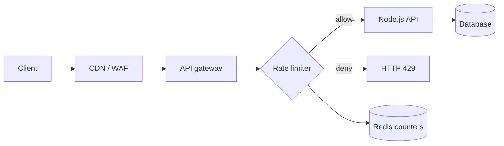
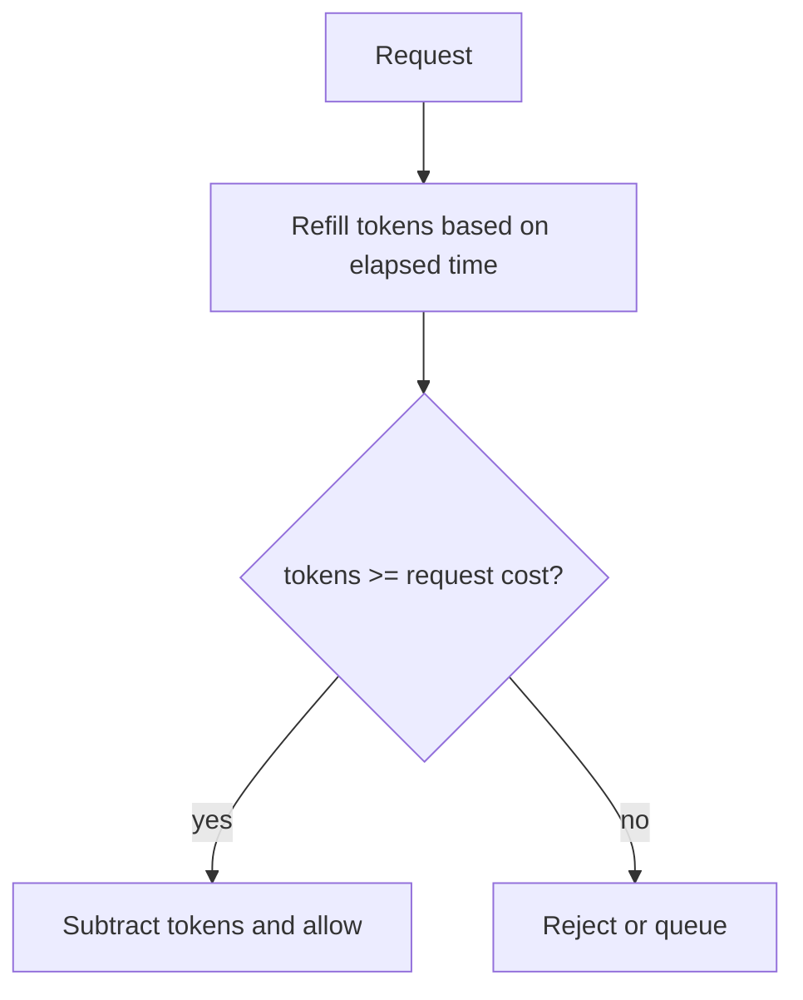

# Lesson 17 — Rate Limiting ⭐⭐⭐⭐⭐

> **Goal:** Learn how to protect APIs and real-time services from traffic spikes and abuse. Simple English, practical algorithms, Redis and Express examples, Mermaid diagrams, trade-offs, and interview preparation.

## 01. What is rate limiting?

Rate limiting restricts how many requests or actions a client can perform in a period. Example: allow 10 login attempts per account per 15 minutes, or 100 public API requests per user per minute. The goal is fairness, reliability, abuse resistance, and cost control—not guaranteed prevention of every attack.

## 02. Why rate limiting matters

Without limits, one client or bug can overwhelm database connections, saturate CPU, exhaust third-party API quotas, or run up costs. Rate limiting protects resources while allowing normal traffic. Pair it with authentication, input validation, concurrency limits, WAF controls, and monitoring.

## 03. Rate limiting vs throttling vs quotas

**Rate limit:** reject/defer operations exceeding a defined rate. **Throttling:** deliberately slow or shape traffic. **Quota:** cap usage over a longer accounting period (e.g. 10,000 API calls per month). **Concurrency limit:** cap simultaneous in-flight operations. These are related but not interchangeable.

## 04. Example architecture


A limiter can run at CDN, gateway, app, or multiple layers. Each layer protects a different resource.

## 05. Define the policy first

A policy needs: **subject** (user, API key, IP, tenant), **action** (route or operation), **limit**, **time basis**, **burst behavior**, **storage**, and **failure policy**. Example: authenticated user may create 20 job applications/minute with a burst of 5, while login attempts use a stricter account+IP rule.

## 06. Choosing the identity/key

Use authenticated user ID or API key for per-account fairness; tenant ID for organization quotas; IP for anonymous requests with caveats. NAT, mobile networks, proxies, and IPv6 privacy addresses make IP-only limiting imperfect. For login abuse, combine account, IP/network, and global controls without exposing whether an account exists.

## 07. Fixed window counter

Divide time into buckets such as 12:00:00–12:00:59. Increment counter per request; deny after N. Simple and cheap. At boundaries, clients can send N requests just before and N just after, effectively 2N requests in a short interval.

## 08. Fixed window visualization


If the 10 requests in A occur at 12:00:59 and 10 in B at 12:01:00, 20 arrive in roughly two seconds despite a limit of 10/minute.

## 09. Sliding window log

Store timestamps of recent requests per key. Remove timestamps older than the window; count remaining; allow only if below limit. Precise for a rolling interval, but storage and operations grow with traffic. Redis sorted sets are a common implementation; ensure prune/count/add are atomic under concurrency.

## 10. Sliding window counter

Approximate a rolling window using current and previous fixed-window counts, weighted by how much of the previous window overlaps. Lower storage than a timestamp log, but not exact. Useful when a small approximation is acceptable and scale matters.

## 11. Token bucket

Bucket has capacity B and refills at rate r tokens/second. Each accepted request spends one or more tokens. If insufficient tokens, reject or wait. Supports controlled bursts while enforcing long-term average rate. For example, B=10 and r=2/sec allows an initial burst of 10 then about 2 sustained requests/sec.

## 12. Token bucket math

At time t: tokens = min(capacity, oldTokens + elapsedSeconds × refillRate). If tokens ≥ cost, subtract cost and allow; otherwise deny. Store tokens and lastRefillTime atomically. For distributed systems, use Redis server time or carefully managed clock semantics rather than trusting each app instance's unsynchronized clock.

## 13. Token bucket diagram



## 14. Leaky bucket

A leaky bucket drains at a fixed processing rate; incoming requests join a bounded buffer, and excess overflows. It smooths bursts into steady output. The exact implementation may be a queue or a meter; distinguish **delaying work** from **rejecting requests** when describing the policy.

## 15. Token vs leaky bucket

| Feature | Token bucket | Leaky bucket |
|---|---|---|
| Bursts | Allows bursts up to capacity | Smooths output rate |
| Main state | Tokens and refill time | Queue level / departure schedule |
| Common use | API request admission | Traffic shaping / queued jobs |
| Excess requests | Reject or wait | Queue until full, then reject |
Both need atomic shared state when multiple API instances enforce one global policy.

## 16. Algorithm comparison

| Algorithm | Memory | Boundary accuracy | Burst handling |
|---|---|---|---|
| Fixed window | O(1)/key | Boundary burst weakness | Abrupt resets |
| Sliding log | O(requests in window)/key | Precise rolling window | Strict |
| Sliding counter | O(1)/key | Approximate | Smoother |
| Token bucket | O(1)/key | Rate + burst capacity | Explicit bursts |
| Leaky bucket | O(1) meter or queue memory | Smoothed | Bounded queue |
Choose based on fairness, memory, burst tolerance, and correctness.

## 17. Local in-memory limiter

A Map in one Node.js process can track requests cheaply. But with 4 instances, each instance sees only some traffic, so a per-instance 100/minute policy may permit up to about 400/minute depending on routing. Restarts also clear counters. Suitable for demos or deliberately per-process protection, not a global distributed quota.

## 18. Distributed rate limiting

When API instances share Redis, all requests for the same identity can update one logical limit. The update must be atomic: a separate GET followed by SET can race. Redis Lua scripts, supported atomic commands, or purpose-built libraries help implement correct shared counters.

## 19. Fixed-window Redis key design

Key format: `rl:v1:login:user-42:window-20261021T1200`. Avoid embedding raw secrets or emails. TTL should cover the entire bucket and a small safety margin. Do not use a new key for every request; cardinality and memory will grow.

## 20. Redis atomicity problem

Two servers both GET count=9 and both SET count=10. Both allow the tenth request, even though only one slot remained. Atomic INCR avoids this particular race; a Lua script can combine increment, expiry, and allow/deny decisions. Atomicity is within Redis command/script scope, not across Redis and a SQL transaction.

## 21. Lua fixed-window example

```lua
-- KEYS[1]: counter key; ARGV[1]: limit; ARGV[2]: ttl milliseconds
local count = redis.call('INCR', KEYS[1])
if count == 1 then
  redis.call('PEXPIRE', KEYS[1], ARGV[2])
end
if count > tonumber(ARGV[1]) then
  return {0, count}
end
return {1, count}
```
This is an atomic **first-request anchored window**, not an exact wall-clock fixed window. It increments even rejected requests, so the counter tracks attempts and can grow until expiry. Decide whether this is your desired policy.

## 22. Lua sliding-log idea

Within one Redis script: get authoritative current time, remove old timestamps from a sorted set, count entries, then insert a unique request member if below limit, and set expiry. Use unique IDs to avoid overwriting equal-timestamp entries. A sliding log costs memory proportional to recent requests.

## 23. Node.js Express in-memory example

```js
import express from "express";
const app = express();
const buckets = new Map();
const WINDOW_MS = 60_000;
const LIMIT = 5;
app.use((req, res, next) => {
  const key = req.ip; // demo only: proxy trust and NAT need attention
  const now = Date.now();
  let entry = buckets.get(key);
  if (!entry || now >= entry.resetAt) {
    entry = { count: 0, resetAt: now + WINDOW_MS };
    buckets.set(key, entry);
  }
  entry.count += 1;
  if (entry.count > LIMIT) {
    res.set('Retry-After', String(Math.max(1, Math.ceil((entry.resetAt - now) / 1000))));
    return res.status(429).json({ error: 'Too many requests' });
  }
  next();
});
app.get('/', (_req, res) => res.json({ ok: true }));
app.listen(3000);
```
Run with `npm install express` and `node server.mjs`. For production, clean up expired Map entries, use trusted identity, and move shared limits to a distributed store.

## 24. Redis and Node.js setup

```bash
docker run --name rate-redis -p 127.0.0.1:6379:6379 -d redis:7
npm install express redis
```
Keep Redis private. Never expose an unauthenticated Redis server on the public internet.

## 25. Redis Express middleware

```js
import express from 'express';
import { createClient } from 'redis';
const app = express();
const redis = createClient({ url: process.env.REDIS_URL ?? 'redis://localhost:6379' });
redis.on('error', err => console.error('Redis:', err.message));
await redis.connect();
const script = `
local n=redis.call('INCR',KEYS[1]);
if n==1 then redis.call('PEXPIRE',KEYS[1],ARGV[2]); end;
if n>tonumber(ARGV[1]) then return {0,n}; end;
return {1,n};
`;
app.use(async (req,res,next) => {
  try {
    // Demo IP identity; use authenticated ID and trusted proxy config in production.
    const key = 'rl:demo:' + req.ip;
    const [allowed, count] = await redis.eval(script, {
      keys: [key], arguments: ['20','60000']
    });
    res.set('X-RateLimit-Limit','20');
    res.set('X-RateLimit-Remaining', String(Math.max(0,20-Number(count))));
    if (!Number(allowed)) return res.status(429).json({error:'Too many requests'});
    next();
  } catch(err) { next(err); } // fail-closed for this demonstration
});
app.get('/',(_req,res)=>res.json({ok:true}));
app.listen(3000);
```
Run with `node server.mjs`. This first-request anchored window does not compute precise reset time; avoid inventing Retry-After. Choose an explicit Redis-failure policy.

## 26. Rate limiting in Next.js

In Next.js App Router, check authenticated identity in a route handler/server boundary, apply a shared limiter before expensive work, then return a Response with status 429 when denied. Serverless/multi-instance deployments should not rely on a module-level Map for a global quota. Edge runtime support varies by Redis client and hosting provider; select compatible network APIs.

## 27. HTTP 429 Too Many Requests

Return status **429** for a rejected HTTP request. Provide a clear machine-readable error. `Retry-After` may communicate when to retry, either as seconds or HTTP date, when you can compute it correctly. Avoid leaking whether a login account exists through different error details.

## 28. RateLimit response headers

Headers such as `RateLimit-Limit`, `RateLimit-Remaining`, and `RateLimit-Reset` may be supported by clients and infrastructure, but conventions/specification versions differ. Document the semantics and ensure values reflect the actual policy. Never report a reset time you have not calculated.

## 29. Client-side backoff

Clients should respect 429 and Retry-After, back off with jitter, and avoid immediate retry loops. Retrying POST requests may duplicate side effects unless idempotency keys are supported. UI should explain when a user can try again rather than silently spinning.

## 30. Fail-open vs fail-closed

**Fail-open:** Redis down → allow requests. Keeps service available but exposes it to abuse/cost spikes. **Fail-closed:** Redis down → deny or return 503. Protects critical resources but harms availability. **Hybrid:** local emergency limits, circuit breakers, and reduced quotas. Login/security endpoints may require stricter behavior than public read endpoints.

## 31. Race conditions and consistency

An atomic Redis script can enforce a shared counter on one Redis primary, but failover may lose recently acknowledged counter updates depending on replication/durability settings. Cross-region independent limiters cannot guarantee one strict global total without coordination. Define whether occasional overshoot is acceptable.

## 32. Clock skew

Algorithms relying on client clocks can disagree across servers. Redis TIME can provide a shared clock for script-based calculations, though time semantics and failover still require care. Avoid negative elapsed time and bound refill math. Fixed-window key generation from each app clock can misclassify requests near boundaries.

## 33. Weighted requests

Not all API calls cost the same. A search endpoint might cost 5 tokens, while a cached profile GET costs 1. Weighted token buckets help align admission with compute or provider cost. Document weights; attackers may still target unexpectedly expensive queries.

## 34. Hierarchical limits

Apply several limits: per-IP, per-user, per-tenant, and global. Example: 5 login attempts per account per 15 minutes, 30 per IP per minute, and a global safeguard. The request must pass all applicable policies. Updating multiple independent counters is not automatically one atomic operation across Redis Cluster slots.

## 35. Global and per-route limits

Use broad global limits for basic protection, then stricter route-specific limits for login, OTP, password reset, search, file upload, AI generation, or checkout. Limits should follow risk and cost, not one uniform number for the entire API.

## 36. Authentication and login

Rate limiting reduces credential-stuffing attempts but cannot replace secure password hashing, MFA, bot detection, and account monitoring. Per-account lockouts can be abused to deny service to a victim; use layered controls and avoid permanent lockout from unauthenticated attempts.

## 37. OTP and password reset

Apply per-identity cooldowns, per-IP/network limits, daily quotas, and provider spending limits. Always return similar responses for known and unknown accounts to reduce enumeration. Keep OTP verification attempt counts separate from OTP send counts.

## 38. WebSocket and Socket.IO

HTTP connection limits do not automatically limit messages after a socket connects. Track events per authenticated socket/user/room; limit connection creation, message size, and messages per time window. In a distributed Socket.IO deployment, use shared state or an appropriate coordination mechanism; do not assume one server sees every event.

## 39. GraphQL and expensive queries

One GraphQL request may perform far more work than another. Request-count limiting alone is insufficient. Add depth/complexity budgets, resolver batching, query timeouts, and concurrency controls. For REST, expensive search/export endpoints need separate limits.

## 40. Uploads and streaming

Rate limiting request counts does not cap bandwidth or body size. Apply upload size limits, concurrency caps, storage quotas, and streaming backpressure. Reject abusive uploads before expensive parsing when possible.

## 41. Concurrency limiter vs rate limiter

A 100 requests/minute policy allows a burst that might launch 100 simultaneous DB queries. A concurrency semaphore allowing 10 in-flight queries protects connection capacity. Use both when appropriate. Queueing excess work increases latency; rejecting may be safer under overload.

## 42. Rate limiting vs circuit breaker

Rate limiter controls demand from callers. Circuit breaker stops sending work to an unhealthy downstream service after failures, allowing recovery probes later. Bulkheads isolate resource pools; load shedding drops optional work during overload. They are complementary resilience patterns.

## 43. Rate limiting and caching

Caching reduces cost of repeated reads; limiting controls traffic volume. A cache miss storm can still overwhelm the database, so combine cache stampede prevention, concurrency caps, and fallback rate limiting. Do not rely on a high cache hit ratio as an abuse defense.

## 44. Multi-region rate limits

Independent Redis instances in multiple regions can allow overshoot of a nominal global quota. Options: regional allocations, approximate eventual counters, or a coordinated global authority with extra latency. Select by tolerance for overshoot and cross-region availability.

## 45. Proxy IP handling

Behind a load balancer, `req.ip` depends on Express `trust proxy` configuration. Blindly trusting `X-Forwarded-For` lets clients spoof identities if proxies are not trusted/validated. Configure exact trusted proxy hops/networks, and consider IPv6 subnet grouping and NAT fairness.

## 46. Cardinality and Redis memory

Per-IP, per-route, per-minute keys can explode in number during an attack. TTL every counter, bound key sizes, namespace keys, and monitor memory/evictions. A limiter whose counters are evicted under pressure may become less effective exactly when traffic spikes.

## 47. Hot keys

A global limiter may funnel all traffic into one Redis key, increasing contention. Sharding counters improves throughput but can permit overshoot and complicate correctness. Use coarse global admission at edge plus distributed per-user limits, and measure hot-key behavior.

## 48. Monitoring

Track allowed/denied requests by route/identity class, 429 rate, Redis latency/errors, limiter decision latency, backend CPU, DB saturation, p95/p99, key cardinality, and customer impact. Alert on sudden 429 spikes and on suspicious absence of rejections during an attack.

## 49. Testing strategy

Unit-test algorithm boundaries and refill math with a fake clock. Integration-test Redis atomicity with concurrent clients. Load-test bursts and steady traffic, multiple API instances, Redis restart/failover, clock skew, and 429 client behavior. Verify unauthorized callers cannot manipulate identity headers.

## 50. CareerLoop case study

Authenticated user: 60 reads/minute and 15 application writes/minute as illustrative starting policies, tuned from usage data. A dashboard refresh should not consume the same cost budget as creating an application. Use user-specific keys; enforce ownership and database constraints independently of limits.

## 51. CodeBuddy case study

Protect connection-request spam, chat-message floods, and account creation. Per-user chat-message token bucket plus per-conversation controls help fairness. Use shared Redis when Socket.IO runs on multiple Node instances. Rate limiting does not replace moderation or spam detection.

## 52. ShopHub case study

Protect login, cart mutations, checkout, coupon validation, and inventory APIs. A strict checkout rate limit must not create duplicate charges when clients retry. Use idempotency keys, authoritative stock checks, and provider webhook deduplication. Consider bot spikes during product launches.

## 53. Designing a policy in an interview

State the scale and constraints, select identity, choose algorithm, define Redis key/TTL, enforce atomically, decide failure behavior, handle 429 and client retry, monitor, and explain trade-offs. Discuss NAT/IP spoofing, distributed consistency, and burst fairness. Avoid giving arbitrary numbers without workload assumptions.

## 54. Common mistakes

IP-only limits for all users; trusting spoofable proxy headers; non-atomic GET+SET; no TTL; one Map across multiple servers; confusing quotas with rates; no Retry-After semantics; unlimited retries on 429; ignoring Redis failure; allowing one hot key to dominate; treating rate limiting as authorization; no tests at window boundaries; forgetting WebSocket messages; neglecting concurrency limits.

## 55. Interview questions

**Q1:** What is rate limiting? Bound request/action frequency. **Q2:** Why use it? Fairness, reliability, abuse/cost control. **Q3:** Fixed-window weakness? Boundary bursts. **Q4:** Sliding log? Timestamp-based rolling count. **Q5:** Sliding counter? Approximate rolling count. **Q6:** Token bucket? Refillable tokens allowing bursts. **Q7:** Leaky bucket? Smooths departures. **Q8:** Redis why? Shared state across instances. **Q9:** Why Lua? Atomic multi-step decision. **Q10:** 429? Too Many Requests. **Q11:** Retry-After? Client retry guidance. **Q12:** Fail-open? Allow if limiter fails. **Q13:** Fail-closed? Deny on limiter failure. **Q14:** IP drawbacks? NAT, proxies, spoofing, IPv6. **Q15:** Multi-region? Global coordination vs overshoot. **Q16:** Weighted limits? Charge by cost. **Q17:** Rate vs concurrency? Frequency vs simultaneous work. **Q18:** WebSockets? Limit events after connection. **Q19:** Hot keys? Central contention. **Q20:** What metrics? 429, latency, Redis health, downstream saturation.

## 56. Exercises

**A:** Implement fixed-window in Express and reproduce boundary burst. **B:** Implement token bucket with fake clock. **C:** Add Redis atomic script and test two concurrent instances. **D:** Return correct 429/Retry-After for a known window. **E:** Add per-user and per-IP login limits. **F:** Test fail-open and fail-closed behavior. **G:** Rate-limit Socket.IO messages. **H:** Compare sliding log memory to counter approximation. **I:** Design per-tenant API quota plus per-second burst limit. **J:** Write a production design for a public search API with p99 latency goals.

## 57. Revision checklist

- [ ] I can distinguish rate limits, throttling, quotas, and concurrency limits.
- [ ] I can explain fixed/sliding windows, token bucket, and leaky bucket.
- [ ] I know how bursts and window boundaries affect fairness.
- [ ] I can build a basic Express limiter.
- [ ] I can enforce a distributed counter atomically with Redis.
- [ ] I understand 429 and retry behavior.
- [ ] I can choose per-IP, per-user, per-tenant, and global keys.
- [ ] I understand proxy trust and clock-skew risks.
- [ ] I can explain fail-open/fail-closed trade-offs.
- [ ] I can design limits for CareerLoop, CodeBuddy, and ShopHub.

---

**Key takeaway:** Rate limiting is a resource-allocation policy, not just a counter. Choose identity, burst behavior, atomic storage, failure mode, and client response deliberately.
