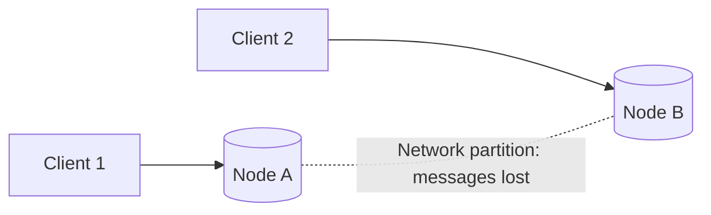
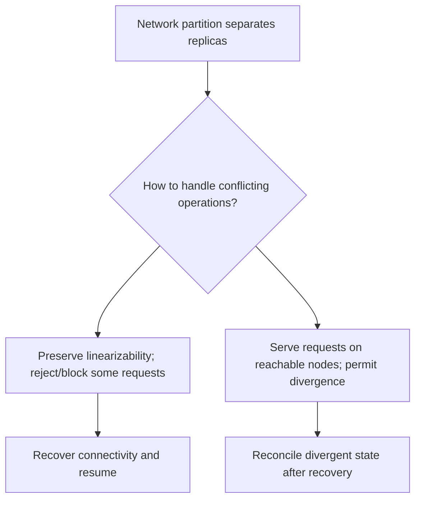
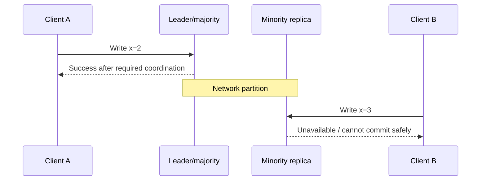
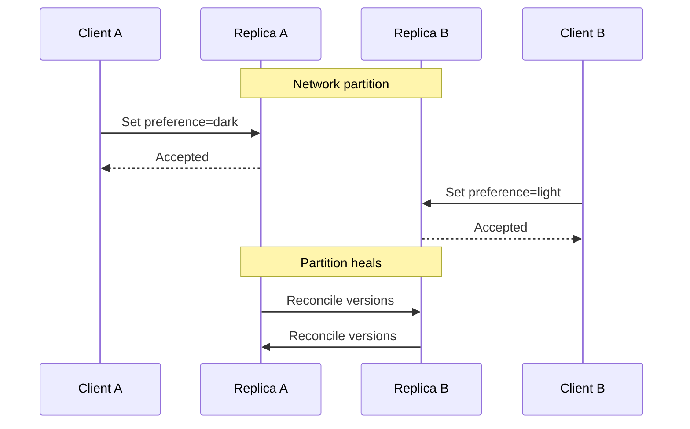
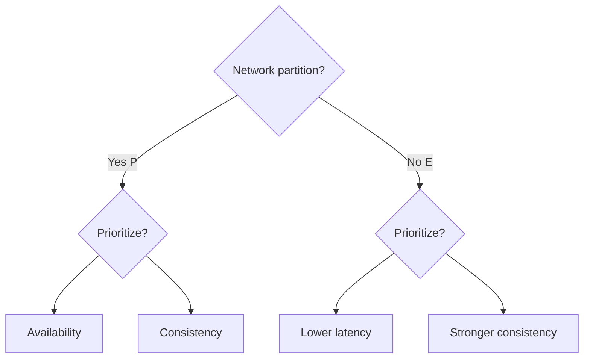

# Lesson 18 — CAP Theorem ⭐⭐⭐⭐⭐

> **Learning goal:** Understand CAP accurately, not as a memorized slogan. Simple English, failure scenarios, Mermaid diagrams, real database nuances, PACELC, interview questions, and practical exercises.

## 01. Learning objectives

By the end, explain CAP precisely; distinguish CAP consistency from ACID consistency; understand network partitions and failure models; compare CP and AP behavior under partition; understand why CA is not a meaningful partition-tolerant distributed choice; explain PACELC, quorums, replication lag, and business trade-offs; design realistic CareerLoop, CodeBuddy, and ShopHub scenarios.

## 02. Why CAP matters

A distributed database has multiple nodes communicating over a network. Networks can delay, drop, or isolate messages. When two nodes cannot communicate, a system must decide whether to refuse some requests to preserve a single authoritative view or continue serving requests with potentially divergent views. CAP helps reason about this specific failure situation.

## 03. A simple two-node story

Suppose replica A and replica B initially store `status = Applied`. A client updates A to `Interview`, but the network link to B fails. Another client reads from B. Can B safely claim the newest value? No, because it cannot know whether A accepted a newer write. This is the core conflict.

## 04. Distributed architecture diagram

During the partition, nodes may be healthy individually yet unable to exchange data.

## 05. What C means in CAP

**Consistency (C)** in CAP is **linearizability**, informally: each operation appears to take effect at one instant between invocation and response, respecting real-time ordering. Once a write completes, a later read should observe it or a later write. This is stronger than eventual consistency. CAP's C is not the same concept as the C in ACID.

## 06. Linearizability example

Client A receives success for `set balance=900` at 10:00:01. Client B starts `get balance` at 10:00:02. If no later write occurred, a linearizable system must not return the older balance 1000. Concurrent operations may be ordered in different valid ways, but completed-before-started operations must preserve real-time order.

## 07. What A means in CAP

**Availability (A)** in the CAP theorem means every request received by a non-failing node eventually gets a response (not merely an error saying “unavailable”). It is a formal property, not an SLA such as 99.9% uptime. A system that always returns HTTP 503 is not CAP-available for the requested operation.

## 08. What P means in CAP

**Partition tolerance (P)** means the system continues operating according to its chosen guarantees even when messages between groups of nodes can be lost or delayed indefinitely. A network partition is not simply high CPU or a database crash. In real multi-node deployments, you cannot assume partitions never happen.

## 09. Why the slogan 'pick any two' is misleading

In a partitionable distributed system, you do not freely turn off network failures. **When a partition occurs**, a design cannot guarantee both linearizable consistency and availability for all non-failing nodes and all relevant operations. Outside partitions, the system may provide both. Different operations or partitions can have different behavior.

## 10. The CAP decision

This is a conceptual decision. Actual systems may offer tunable policies and nuanced guarantees.

## 11. CP behavior

A **CP-oriented** design preserves linearizable behavior by refusing or delaying operations on nodes that cannot safely coordinate. Example: a minority partition cannot accept writes in a majority-based leader system. Clients connected only to that side may see timeouts or errors until connectivity returns.

## 12. CP timeline

The example assumes a consensus/quorum configuration that prevents minority commits.

## 13. AP behavior

An **AP-oriented** design continues responding to requests on separated nodes, allowing different values temporarily. When connectivity returns, replicas exchange updates and reconcile conflicts. It favors availability during partitions, but applications must handle stale reads, conflicting writes, and merge semantics.

## 14. AP timeline

Without a domain-specific merge rule, one user's preference may overwrite another. “Available” does not mean “conflict-free.”

## 15. Why CA is often misunderstood

A single-node database can provide strong consistency and availability while the node is healthy, but it is not a partition-tolerant distributed design. A multi-node system that assumes perfectly reliable communication avoids the CAP partition scenario by assumption, not by solving it. Therefore “choose CA” is not a practical answer for a genuinely partitionable multi-node system.

## 16. CAP comparison table

| Property | CP-oriented under partition | AP-oriented under partition |
|---|---|---|
| Linearizable operations | Preserved for supported operations | Not generally guaranteed |
| Responses from every reachable side | May reject/block | Continues accepting supported requests |
| Conflicting writes | Prevented/blocked | Possible; require reconciliation |
| Typical priority | Correctness of shared state | Continuity of local service |
| Cost | Reduced availability | Staleness/conflict handling |
These are design orientations, not permanent product labels.

## 17. CAP is about network partitions, not normal latency

When the network is healthy, a replicated system can provide both strong consistency and high availability, though coordination adds latency. CAP alone does not tell you whether a read takes 2 ms or 200 ms. To reason about latency trade-offs even without partitions, use PACELC.

## 18. CAP vs ACID consistency

**CAP C:** linearizable visibility across operations in a distributed system. **ACID C:** a transaction moves the database from one valid state to another while respecting defined constraints/invariants. ACID isolation controls concurrent transaction interactions. A database may provide ACID transactions without all reads from all replicas being linearizable.

## 19. Strong vs eventual consistency

**Strong/linearizable:** a completed write is visible to later reads under the operation's guarantee. **Eventual:** if no new writes occur and communication recovers, replicas converge eventually. Eventual consistency does not specify a universal maximum delay. Some systems provide session-level or bounded-staleness options between these extremes.

## 20. Read-your-writes

A user updates their CareerLoop interview status, then immediately reloads. A lagging read replica might still return the old status. Read-your-writes can be achieved by reading from the primary for a period, session guarantees, or waiting for a replica to catch up. This guarantee is not automatically implied by every “strongly consistent database” marketing label.

## 21. Monotonic reads

A client first sees application status Interview, then gets routed to an older replica and sees Applied. That violates monotonic reads. Session stickiness or tracking observed versions can avoid moving backward in a user's view.

## 22. Causal consistency

If event B depends on event A, causal consistency ensures observers do not see B without the causally prior A under its model. Example: seeing a reply should imply seeing the original message. Causal consistency is weaker than global linearizability but stronger than arbitrary eventual reads.

## 23. Quorum basics

With N replicas, a read quorum R and write quorum W can overlap when R + W > N. This is a useful intuition, but overlap **alone** does not prove linearizability: versions, concurrent writes, failed replicas, sloppy quorums, and repair protocols matter. Do not claim any R+W>N setup is automatically CP.

## 24. Quorum example

For N=3, choose W=2 and R=2. Every two-node read set intersects every two-node write set in at least one node. A correct protocol must still identify the newest valid version and handle concurrency/failures. During a partition with only one reachable replica, strict quorum operations may become unavailable.

## 25. Leader-based replication

A leader accepts writes and coordinates followers. If the leader or majority becomes unreachable, an election or failover may be required. A minority partition should not elect an independent authoritative leader in a correct consensus protocol. This commonly yields CP-like behavior for writes, but reads may use different policies.

## 26. Leaderless replication

Some distributed stores accept writes at multiple replicas and use versioning, quorum-like operations, and read repair. This can support AP-like behavior under selected settings, but exact availability and consistency depend on quorum configuration, hinted handoff, conflict resolution, and failure handling. “Leaderless” is not synonymous with “always AP.”

## 27. Split brain

Split brain occurs when multiple isolated nodes act as authoritative writers for the same data. Without fencing and correct membership/election rules, conflicting writes can occur. Consensus protocols help avoid this at the cost of refusing some operations during partitions.

## 28. Consensus is related but different

Consensus protocols such as Raft coordinate agreement on an ordered log despite certain failures. CAP describes a fundamental trade-off under network partitions. Consensus helps implement strongly consistent replicated state but does not make the partition trade-off disappear.

## 29. PACELC introduction

PACELC extends the question: **If Partition (P), choose Availability (A) or Consistency (C); Else (E), when no partition exists, trade Latency (L) against Consistency (C).** This better captures everyday distributed database choices.

## 30. PACELC diagram

This is a conceptual framework; actual systems have more than two settings and guarantees.

## 31. PACELC example

A multi-region database may require cross-region coordination for a strongly consistent write even when the network is healthy, increasing latency. A local replica can answer faster but may be stale. Thus the consistency-versus-latency decision exists outside partitions too.

## 32. Why database labels are oversimplified

It is tempting to say “MongoDB is CP,” “Cassandra is AP,” or “PostgreSQL is CA.” Such labels ignore deployment topology, read/write concerns, operation types, failover, and client behavior. Describe a **specific configuration and operation**, not a whole product as permanently CP or AP.

## 33. MongoDB replica-set nuance

MongoDB replica sets have a primary for ordinary writes and use elections. Majority write concern can improve durability/acknowledgment semantics, while read preference and read concern affect what readers observe. Secondary reads can be stale; a minority side cannot simply keep accepting primary writes after losing the necessary election/majority conditions. Linearizable read concern has additional requirements and costs.

## 34. PostgreSQL nuance

A single PostgreSQL primary offers strong transactional behavior locally. Asynchronous read replicas can lag; promoting a replica during failover may lose recently acknowledged writes depending on configuration. Synchronous replication settings affect acknowledgment and availability. PostgreSQL is not meaningfully classified “CA” without specifying architecture and operation.

## 35. Redis nuance

Redis primary/replica replication is commonly asynchronous. A client can receive success for a write that is not yet present on a replica. During failover, acknowledged writes may be lost depending on configuration. WAIT can request replica acknowledgment, but does not turn Redis into a consensus-based strongly consistent database or guarantee zero loss.

## 36. Cassandra/Dynamo-style nuance

Dynamo-inspired systems often emphasize availability and tunable consistency, but actual behavior depends on replica count, read/write consistency levels, topology, and failure state. Quorum configurations can reduce stale reads while reducing availability under partition. Avoid blanket “always AP” claims.

## 37. DNS and CAP

DNS is distributed and heavily cached, favoring availability and scalability for many lookups while updates propagate over time. TTL and caching can yield stale records. It illustrates eventual propagation, but the entire DNS ecosystem cannot be assigned one simple CAP guarantee.

## 38. CDN and cache consistency

A CDN may serve stale content when origin is unreachable or during propagation. This can be acceptable for public product images but dangerous for user-specific authorization decisions. Caches have their own freshness and failure semantics, separate from the authoritative database's guarantees.

## 39. Financial operations

Money movement and inventory reservations usually need authoritative correctness. If a partition prevents verifying a balance or stock invariant, reject or defer the transaction rather than accepting conflicting writes on both sides. Availability can be provided at the UI level by recording a **pending** request without claiming it has committed.

## 40. Social feeds and likes

A like counter or recommendation feed may tolerate brief staleness, and some systems can accept local writes during temporary disconnection then reconcile. However, if exact billing or abuse limits depend on counts, those particular operations may require stricter coordination.

## 41. Chat messaging

CodeBuddy can show a message as “sending” or “pending” while its authoritative storage is unavailable. Presence and typing indicators can be best-effort, while persisted message IDs and ordering require explicit guarantees. One application can use different consistency policies for different features.

## 42. CareerLoop case study

An application status update should not silently revert after a successful save. Route immediate reads appropriately or use session guarantees. Dashboard analytics counts may be briefly stale. If the database primary cannot safely accept writes during a partition, keep the edit pending and communicate status clearly.

## 43. ShopHub case study

Public product descriptions can be cached and slightly stale. Checkout must validate price, stock, and payment state against authoritative systems. During a partition, refusing checkout is often safer than accepting duplicate inventory reservations. An order can be shown as pending, but must not be represented as confirmed before durable acceptance.

## 44. CodeBuddy case study

Typing indicators and online presence favor responsiveness and can tolerate temporary inconsistency. Connection-request state, message persistence, and paid premium entitlements need stronger validation. Design each endpoint according to its correctness needs rather than declaring the whole app CP or AP.

## 45. Designing an offline-first app

An offline-first mobile app can accept local drafts or user-owned edits and sync later. But concurrent updates need conflict handling (timestamps, version vectors, field-level merges, or explicit user resolution). Offline acceptance is not equivalent to a globally committed transaction.

## 46. Conflict resolution: last-write-wins

Last-write-wins chooses a value based on timestamp or version ordering. It is simple but can discard concurrent edits, and clock skew complicates timestamp-based decisions. Good for some low-stakes preferences, poor for financial ledgers or inventory invariants.

## 47. Conflict resolution: CRDT intuition

Conflict-free replicated data types support certain concurrent operations that merge deterministically without central coordination, given their algebraic rules. Example: a grow-only counter merges by component-wise maximum. CRDTs are useful for specific mergeable state; they do not magically make arbitrary business transactions conflict-free.

## 48. Version checks and optimistic concurrency

Store a version number and update only if the expected version matches. If a concurrent writer changed the record, return a conflict and ask the client to refresh or merge. This prevents silent lost updates for the chosen authoritative store, but cannot by itself guarantee cross-partition availability.

## 49. Failure scenario: network partition

A three-node leader-based cluster splits into two nodes and one node. The majority may continue commits; the isolated minority must not commit conflicting authoritative writes. Clients routed to the minority receive errors/timeouts or must be redirected. Once connectivity returns, replicas catch up.

## 50. Failure scenario: stale read

User writes x=2 to the primary, gets success, then reads from a lagging replica and sees x=1. Fix by routing to primary, waiting for a replica position, or using a supported session-consistency feature. A CDN or application cache can introduce similar staleness even when DB reads are consistent.

## 51. Failure scenario: conflicting offline writes

Two devices edit the same note offline. Device A changes title to “Interview”; device B changes it to “Offer”. On reconnect, blindly accepting both is impossible without a conflict rule. Use version checks and user-assisted merge, or define a domain-specific deterministic policy.

## 52. CAP and availability metrics

CAP availability is a theoretical property of responding under partitions. Operational availability is measured as successful requests over time, often with SLIs/SLOs. A CP system can have excellent 99.99% operational availability; an AP-oriented system can still have outages due to bugs or overload. Do not conflate the two.

## 53. Latency and tail behavior

Cross-region coordination increases network round trips, affecting p95/p99 latency. Serving local replicas reduces latency but may reduce freshness. PACELC asks you to explain this normal-operation trade-off. Measure real workloads and user experience, not only averages.

## 54. Partition detection limitations

A timeout does not prove whether another node is dead or merely slow. Distributed systems cannot always distinguish crash from delay using timing alone. Conservative coordination can preserve safety but sacrifice liveness/availability when communication is uncertain.

## 55. Trade-off decision framework

1. Identify the operation and invariant. 2. Define acceptable stale data and conflict cost. 3. Decide whether to reject, queue, or accept writes during partition. 4. Choose replication/consistency settings. 5. Design retry, idempotency, and reconciliation. 6. Test partition scenarios. 7. Communicate pending/confirmed states to users.

## 56. Interview answer structure

Start: “CAP says a distributed system experiencing a network partition cannot guarantee both linearizable consistency and availability of every request to non-failing nodes.” Define C, A, P. Walk through a two-replica split. Explain CP vs AP, clarify that CA is not a practical partition-tolerant choice, then mention PACELC and a concrete use case.

## 57. Common misconceptions

**Wrong:** “Pick any two of C, A, P.” **Better:** During partitions, C and A conflict. **Wrong:** “Availability means 99.99% uptime.” **Better:** Formal response property. **Wrong:** “CAP consistency equals ACID consistency.” **Better:** Linearizability vs invariant preservation. **Wrong:** “CP always down.” **Better:** Only some operations/nodes may refuse. **Wrong:** “AP never consistent.” **Better:** May converge and offer stronger modes. **Wrong:** “Quorum overlap automatically proves linearizability.” **Better:** Protocol details matter. **Wrong:** “Every database is permanently CP or AP.” **Better:** Configuration and operation matter.

## 58. Interview Q&A

**Q1:** What is CAP? Partition-time trade-off between linearizability and availability. **Q2:** What is a partition? Lost/delayed communication between nodes. **Q3:** CAP C? Linearizability. **Q4:** CAP A? Every non-failing node eventually responds to requests. **Q5:** Why not choose CA? Real distributed networks can partition. **Q6:** CP example? Majority-backed leader refuses minority writes. **Q7:** AP example? Both sides accept mergeable updates and reconcile. **Q8:** Does AP guarantee no lost updates? No. **Q9:** ACID C vs CAP C? Invariants vs linearizability. **Q10:** PACELC? Partition A/C, Else latency/consistency. **Q11:** Why do read replicas return stale data? Replication lag. **Q12:** Does R+W>N guarantee linearizability? Not alone. **Q13:** Is MongoDB simply CP? No; depends on operation/configuration. **Q14:** Is Redis strongly consistent after WAIT? Not generally. **Q15:** What should checkout do during partition? Preserve stock/payment invariants, often defer/reject. **Q16:** What is read-your-writes? Client sees completed writes. **Q17:** What is causal consistency? Preserve cause-before-effect visibility. **Q18:** What is split brain? Multiple conflicting authoritative writers. **Q19:** Can one app mix models? Yes, per feature. **Q20:** Why use CRDTs? Merge certain concurrent updates deterministically.

## 59. Practice exercises

**A:** Draw two replicas separated by a partition and label which requests a CP system must refuse. **B:** Simulate AP conflicting preference edits and propose reconciliation. **C:** Explain a stale CareerLoop status after reading a replica. **D:** Design checkout behavior during DB partition. **E:** Compare CAP and PACELC in one paragraph. **F:** Show why R+W>N needs protocol assumptions. **G:** Research your MongoDB read/write concerns and state exact guarantees. **H:** Design CodeBuddy presence vs message persistence consistency. **I:** Build an optimistic version check for notes. **J:** Present a five-minute CAP interview explanation without “pick any two.”

## 60. Final revision checklist

- [ ] I can define CAP's C, A, and P precisely.
- [ ] I know why network partitions force a trade-off.
- [ ] I can explain CP and AP with timelines.
- [ ] I understand why CA is misleading for distributed deployments.
- [ ] I distinguish CAP C from ACID C.
- [ ] I understand linearizability, eventual consistency, and session guarantees.
- [ ] I know quorums do not automatically guarantee linearizability.
- [ ] I can explain PACELC and latency trade-offs.
- [ ] I avoid assigning permanent CP/AP labels to databases.
- [ ] I can choose policies for CareerLoop, CodeBuddy, and ShopHub.

---

**Remember:** CAP is about a partition-time safety-versus-availability trade-off for specified operations; it does not rank databases by general quality.
