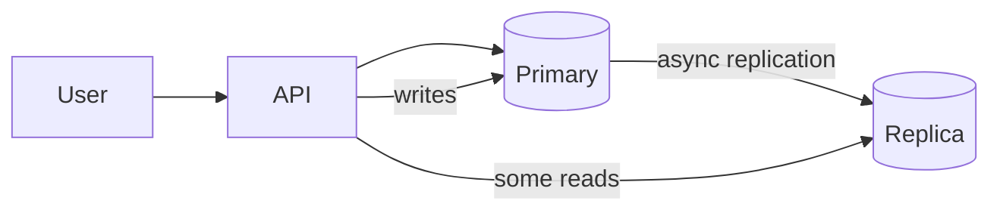
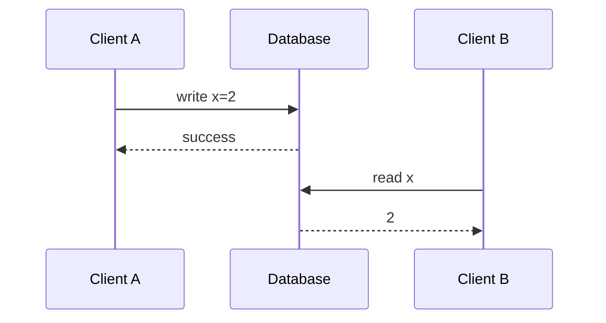
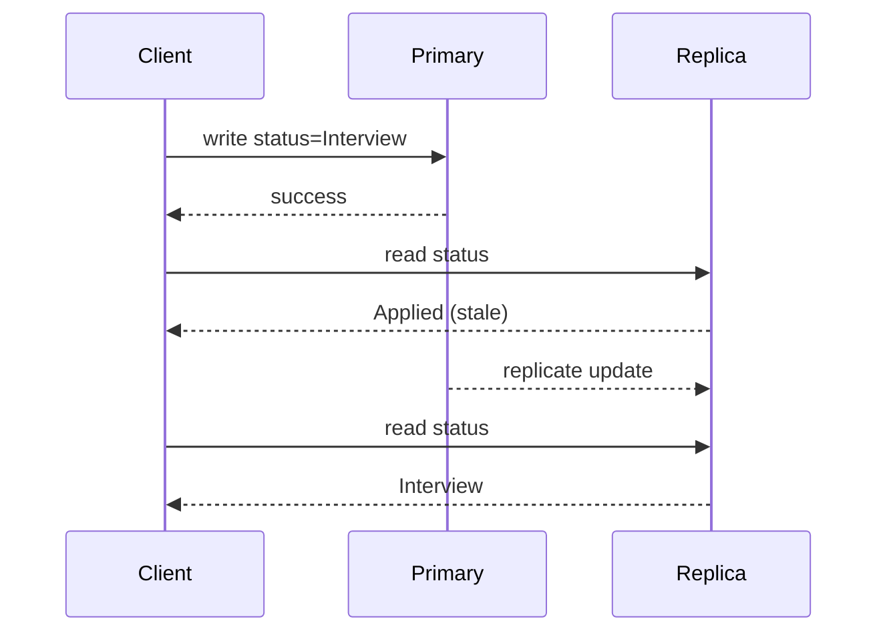
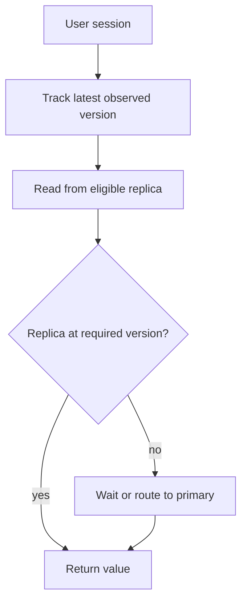
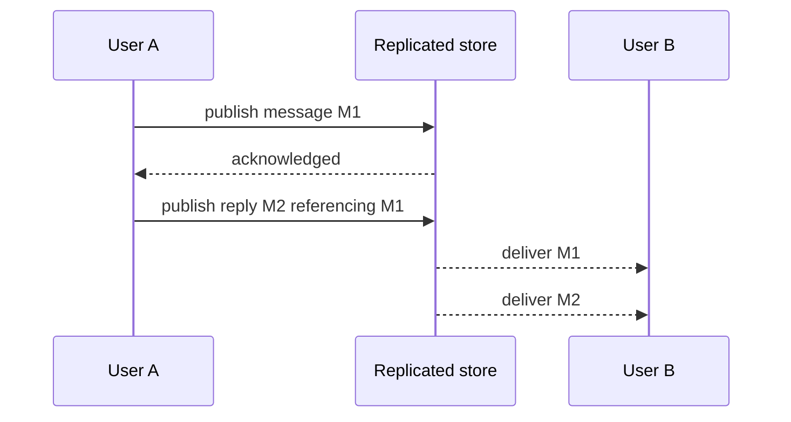

# Lesson 19 — Consistency ⭐⭐⭐⭐⭐

> **Goal:** Understand what users can observe when distributed systems read, write, replicate, cache, and fail. Detailed explanations in simple English, diagrams, SQL examples, and real project trade-offs.

## 01. Why consistency matters

A user updates a job application's status to **Interview**, but the dashboard still says **Applied**. Is the update lost, or is the dashboard reading an older replica or cache? Consistency models describe which values reads may return when writes, replicas, concurrency, and failures interact.

## 02. Learning objectives

Explain consistency versus durability and availability; understand operation histories; distinguish linearizability, sequential, causal, eventual, and session guarantees; reason about staleness and anomalies; select read/write concerns; design safe transactions, caches, and multi-region workflows; practice with CareerLoop, CodeBuddy, and ShopHub.

## 03. Consistency is a contract

A consistency model is a promise about the order and visibility of operations. It is not a speed ranking or a vague claim that “all data is the same.” The guarantee may apply per key, document, partition, transaction, or database; always specify its scope.

## 04. Replicated system diagram


A replica may be behind the primary. The application's read-routing policy determines what users observe.

## 05. Consistency vs availability vs durability

**Consistency:** which values and order clients may observe. **Availability:** whether requests can be served under specified failures. **Durability:** whether committed changes survive crashes under the storage guarantee. A system may be durable on the primary yet expose stale secondary reads; it may also serve fast reads while being unable to accept safe writes.

## 06. Consistency vs ACID consistency

In distributed systems, consistency usually concerns ordering/visibility. **ACID Consistency** concerns database constraints and application invariants preserved by valid transactions. ACID isolation affects concurrency; CAP's consistency refers to linearizability. These are related but not interchangeable.

## 07. Operations and histories

A **history** records when operations start and finish, which values are written, and what reads return. We test a model against histories. If write(x=2) finishes before read(x) begins, a linearizable read must not return x=1 unless a later write permits it.

## 08. Linearizability

Linearizability makes each operation appear to take effect at one instant between its invocation and response, preserving real-time ordering. It is a strong single-operation/object guarantee. It does not automatically mean a multi-key transaction is atomic unless the system explicitly provides transactional guarantees.

## 09. Linearizability timeline


If B's read starts after A's successful write finishes, returning 1 would violate linearizability in this example.

## 10. Concurrent operations nuance

If read(x) overlaps write(x=2), a linearizable history may permit the old or new value depending on the legal ordering. Linearizability preserves **non-overlapping** real-time precedence; it does not say every read during an in-flight write must see the new value.

## 11. Sequential consistency

Sequential consistency says operations appear in a single total order that preserves each individual client's program order, but not necessarily the real-time order between different clients. Therefore it is weaker than linearizability. A read started after another client's completed write may still see the older value if the chosen global order permits it.

## 12. Linearizable vs sequential

| Question | Linearizable | Sequential |
|---|---|---|
| Single global legal order | Yes | Yes |
| Preserves each client's program order | Yes | Yes |
| Preserves real-time order across clients | Yes | Not required |
| Typical cost | Strong coordination may be needed | Depends on implementation |
These are models, not labels for whole products.

## 13. Serializability

Serializability is a **transaction isolation** property: concurrent transactions produce a result equivalent to some serial execution. It does not by itself require respecting real-time ordering between completed transactions. **Strict serializability** combines serializability with real-time ordering. Do not confuse serializability with linearizability of individual operations.

## 14. Strict serializability

Imagine two transactions transferring and reading account balances. Strict serializability requires a valid serial order that also respects real-time precedence. This is a strong guarantee for multi-object transactions, and often more relevant to financial invariants than a linearizable single key alone.

## 15. Eventual consistency

If writes stop and communication eventually succeeds, replicas converge to the same state under the system's reconciliation rules. It does **not** guarantee a fixed maximum delay or prevent temporary conflicts. Eventual convergence is not a promise that every intermediate read is fresh.

## 16. Eventual consistency timeline



## 17. Strong vs eventual comparison

| Requirement | Stronger consistency | Eventual consistency |
|---|---|---|
| Immediately see completed writes | Supported by relevant guarantee | Not guaranteed |
| Coordination overhead | Often higher | Can be lower |
| Availability under partition | May reject some operations | May accept divergent operations |
| Conflict resolution | Often coordinated | Often application/system reconciliation |
Choose per operation, not just per database.

## 18. Bounded staleness

A system may promise reads are at most a specified time or version distance behind the authoritative state, subject to documented conditions. Example: at most 5 seconds old. This is more specific than eventual consistency, but enforcement can require waiting or rejecting reads when replicas lag.

## 19. Read-your-writes

After a user updates their own profile, subsequent reads in that session should reflect the completed update. This is a **session guarantee**; other users may still observe older data. Implement via primary routing, sticky sessions, version tokens, or waiting for replica catch-up.

## 20. Monotonic reads

Once a session sees version 7, later reads should not return version 6. Switching between replicas of different lag can violate this. Track the highest observed version or use routing that preserves session progress.

## 21. Monotonic writes

A client's writes should be applied in the order issued. If the client changes status Applied → Screening → Interview, the system must not apply Interview then later overwrite it with Screening due to reordered asynchronous messages. Sequence numbers or version checks can help.

## 22. Writes-follow-reads

If a client reads a value and then writes based on it, the write should be ordered after that observed version. This matters for read-modify-write workflows. Use optimistic version checks or appropriate transactional isolation to prevent overwriting concurrent changes.

## 23. Session consistency diagram


Version tokens must be meaningful for the database's replication model; timestamps alone may not be sufficient.

## 24. Causal consistency

If operation B causally depends on operation A, observers should not see B without the necessary preceding A. Example: seeing “I agree” as a reply should imply visibility of the original message it responds to. Causal order includes program order, read-from relationships, and their transitive closure.

## 25. Causal vs concurrent events

Two independent users liking different posts at the same time may be **concurrent** (neither caused the other). Causal consistency does not require a universal order for independent concurrent events. This can reduce coordination compared with linearizability.

## 26. Causal timeline


The required visibility ordering depends on the system's causal context and API guarantees.

## 27. PRAM/FIFO consistency

PRAM (also called FIFO consistency in some models) preserves each process's write order for all observers, but may not preserve causal order across different writers. It is weaker than causal consistency. This distinction matters when events depend on messages from other participants.

## 28. Consistency hierarchy caveat

For common single-object models, linearizability is stronger than sequential consistency, while causal and eventual consistency impose different weaker constraints. Transactional models such as serializability address a different axis. Do not draw one universal straight-line hierarchy containing every model without specifying scope and assumptions.

## 29. Replication lag

Lag is the delay between an accepted write and its visibility on a replica. Causes include network, replay, slow disks, large transactions, and load. Monitor actual lag and tail latency. A replica may be healthy but too stale for a particular endpoint.

## 30. Read routing strategies

**Primary reads:** simpler freshness, potentially higher load/latency. **Replica reads:** scalable and local, but possibly stale. **Session-aware routing:** send reads to replicas only after required progress. **Fallback:** wait briefly then read primary. All strategies need explicit failure handling.

## 31. Quorum reads/writes

With N replicas, quorum-style read size R and write size W may overlap if R + W > N. But overlap alone does not guarantee linearizability; correct version selection, concurrency handling, repair, and failure semantics matter. Be precise about the product's actual guarantees.

## 32. Quorum example

N=3, W=2, R=2 means any read quorum intersects any successful write quorum in at least one node. During a partition with only one reachable node, quorum operations may be unavailable. An implementation must still choose the correct version under concurrent writes.

## 33. Leader-based consistency

A leader may serialize writes, while followers apply changes asynchronously. Reads from followers can be stale. Majority-backed consensus systems may provide linearizable operations using specific read protocols; reading any follower is not automatically linearizable.

## 34. Leaderless consistency

Some stores accept writes at multiple replicas and reconcile using versions, timestamps, or application merge rules. Consistency depends on read/write settings and conflict resolution. “Leaderless” does not mean “no consistency guarantees,” and “quorum” does not guarantee correctness without a proper protocol.

## 35. Conflict resolution

If two disconnected replicas accept different values, choose a merge rule: last-write-wins, explicit conflict records, version vectors, or a mergeable data type. Last-write-wins can discard user edits. A financial balance should not be merged by casually choosing the newest timestamp.

## 36. Version vectors

Version vectors track causal progress across replicas or actors. If one version dominates another, it includes the other's history; if neither dominates, they are concurrent. They help detect conflicts, but vector size and membership management can be costly.

## 37. CRDTs

Conflict-free replicated data types use mathematically mergeable state/operations to support concurrent updates for suitable data. Example: a grow-only counter keeps per-replica components and merges by component-wise maximum. CRDTs do not automatically solve arbitrary business invariants such as “stock never below zero.”

## 38. Read repair and anti-entropy

**Read repair:** a read discovers inconsistent replicas and helps update older copies. **Anti-entropy:** background synchronization compares/merges replica state. These improve convergence, but do not necessarily guarantee immediate fresh reads or eliminate conflicts.

## 39. Caching introduces another consistency layer

Even if the database primary offers strong reads, Redis or a CDN may return old data. TTL is a freshness bound only under assumptions; a database update can happen immediately after cache population. Cache invalidation and versioned keys help, but races remain unless the design coordinates versions.

## 40. Cache-aside race

Reader A misses cache and reads old DB value. Writer B updates DB and invalidates cache. Reader A then stores the old value in cache. Stale data reappears after invalidation. Options include version-aware cache writes, short TTL, or bypassing cache for correctness-critical reads.

## 41. Database transactions and isolation

Read committed, repeatable read, and serializable isolation prevent different anomalies. A transaction can be serializable on the primary while a secondary read remains stale. Consistency of transactions and replication visibility must be specified separately.

## 42. Lost updates

Two clients read stock=1, both decide to decrement, and both write stock=0 while creating two orders. Avoid read-then-write races with conditional atomic updates, row locks, or transactions. Replication consistency alone does not prevent bad application-level concurrency.

## 43. Optimistic concurrency example

```sql
UPDATE applications
SET status = 'Interview', version = version + 1
WHERE id = 42 AND user_id = 7 AND version = 3
RETURNING id, status, version;
```
If zero rows return, the record may be missing, unauthorized, or concurrently changed. The caller must distinguish these cases appropriately and handle conflict instead of silently overwriting.

## 44. Multi-region trade-offs

A globally coordinated write may require cross-region network round trips, raising latency. Local writes can respond faster but may diverge during partitions. PACELC highlights that consistency-versus-latency trade-offs exist even without a network partition.

## 45. PostgreSQL primary/replica

PostgreSQL transactions on the primary provide defined isolation and durability behavior. Asynchronous streaming replicas can lag; read-only queries on standby may observe earlier committed states. Synchronous replication configuration changes acknowledgment behavior but does not make every possible read on every standby instantly current.

## 46. PostgreSQL monitoring

```sql
-- On the primary: replication sender progress
SELECT application_name, state, sync_state, sent_lsn, replay_lsn
FROM pg_stat_replication;
-- On a standby: last replay position
SELECT pg_last_wal_replay_lsn();
```
Interpret LSN progress with topology and workload. A timestamp-based lag estimate may be misleading during idle periods.

## 47. MongoDB read concern

MongoDB supports read concerns including local, majority, and linearizable for applicable operations. `majority` reads majority-committed data but does not mean every read sees the latest completed write in all circumstances. Linearizable read concern has stricter conditions and costs; verify exact server-version behavior.

## 48. MongoDB write concern

Write concern controls acknowledgment: for example `w: "majority"` requests majority acknowledgment under configured rules. Combine with appropriate read concern, read preference, and sessions when designing guarantees. Acknowledged write durability and reader freshness are distinct questions.

## 49. MongoDB causal sessions

Causally consistent sessions can provide guarantees such as read-your-writes and monotonic reads when used with supported read/write concern settings and correct session handling. They do not imply all unrelated clients globally observe a single instantaneous order.

## 50. Redis consistency

Redis commonly replicates asynchronously. A successful write on a primary may not have reached replicas before failover. Redis WAIT can wait for acknowledgment by replicas but is not a blanket guarantee of zero loss or consensus-level linearizability. Cache correctness must not be confused with authoritative database guarantees.

## 51. Kafka/event consistency

An event log may preserve order within a partition, but consumers can process asynchronously and projections can lag. A successful DB transaction does not automatically mean every downstream search index or dashboard is updated. Use outbox patterns, idempotent consumers, and version checks for materialized views.

## 52. CareerLoop case study

**Application status:** read-your-writes is important; route immediate reads to authoritative data or version-aware replicas. **Dashboard counts:** brief eventual consistency may be acceptable if UI labels them accordingly. **Follow-up reminders:** durable scheduling and reconciliation matter more than an always-fresh visual count.

## 53. CodeBuddy case study

**Typing indicator/presence:** best-effort and eventual updates are often fine. **Persisted messages:** require stable IDs, deduplication, and defined per-conversation ordering. **Premium entitlement:** verify against authoritative state for paid features; don't trust a stale cache for critical authorization.

## 54. ShopHub case study

**Product descriptions:** tolerate caching and stale replicas. **Inventory reservation:** use conditional updates/transactions to prevent overselling. **Order/payment status:** maintain an authoritative state machine, idempotent webhook handling, and reconciliation. Showing “pending” is better than falsely claiming success.

## 55. Designing consistency per feature

Start with the business invariant: What bad outcome occurs if a read is stale or a write is reordered? Specify acceptable staleness, visibility scope (same user vs all users), partition behavior, retry/idempotency, and performance budget. Only then select database/read concern/replica/cache settings.

## 56. Common mistakes

Treating consistency as “all replicas equal now”; equating CAP C with ACID C; saying majority read is always linearizable; assuming serializability implies real-time order; believing a completed primary write instantly updates every cache; reading payment state from lagging replicas; ignoring lost updates; using timestamps for conflict resolution without clock assumptions; trusting queue ordering across partitions; calling an entire database universally strong/eventual.

## 57. Interview questions

**Q1:** What is a consistency model? Allowed operation histories. **Q2:** Linearizability? Real-time-preserving atomic-looking operations. **Q3:** Sequential consistency? Single order preserving each client's program order. **Q4:** Serializability? Transactions equivalent to serial execution. **Q5:** Strict serializability? Serializable plus real-time order. **Q6:** Eventual? Converges after writes stop and communication recovers. **Q7:** Read-your-writes? Session sees its completed writes. **Q8:** Monotonic reads? Session never goes backward. **Q9:** Causal consistency? Preserves cause-before-effect visibility. **Q10:** Quorum overlap? Helpful but insufficient alone. **Q11:** Replication lag? Delay before replica reflects a write. **Q12:** Lost update? Concurrent changes overwrite. **Q13:** Version vector? Tracks causality/conflicts. **Q14:** CRDT? Mergeable replicated data type. **Q15:** Why can Redis cache be stale? TTL and invalidation races. **Q16:** PostgreSQL replica guarantee? Depends on config and routing. **Q17:** MongoDB majority vs linearizable? Different visibility guarantees. **Q18:** PACELC? Partition A/C and normal-operation L/C. **Q19:** When is eventual okay? Noncritical feeds/counters. **Q20:** When need stronger guarantees? Financial/inventory/entitlements.

## 58. Practice exercises

**A:** Draw a linearizable and non-linearizable read timeline. **B:** Construct a sequentially consistent but non-linearizable history. **C:** Reproduce a stale read from a simulated replica. **D:** Implement version-check UPDATE in PostgreSQL. **E:** Explain why serializability and linearizability differ. **F:** Design CodeBuddy causal message delivery. **G:** Implement a grow-only counter merge. **H:** Show a cache-aside stale repopulation race. **I:** Choose MongoDB read/write concerns for two endpoints and justify them. **J:** Design a CareerLoop API with read-your-writes and a 100ms p95 target, listing trade-offs.

## 59. Quick revision table

| Model | Main promise | Typical concern |
|---|---|---|
| Linearizability | Respect real-time completed operations | Coordination/latency |
| Sequential | One order preserving client program order | No global real-time promise |
| Serializability | Transactions equivalent to serial execution | Transaction conflicts/retries |
| Causal | Preserve cause-before-effect | Track causal context |
| Read-your-writes | Session sees its own completed writes | Session routing/version tracking |
| Monotonic reads | Session never sees older version | Replica switching |
| Eventual | Converges after updates stop | Temporary staleness/conflicts |

## 60. Final checklist

- [ ] I can define linearizability using an operation history.
- [ ] I can distinguish linearizable, sequential, and serializable.
- [ ] I understand eventual, bounded staleness, and causal consistency.
- [ ] I can explain all major session guarantees.
- [ ] I know why replication lag and caches cause stale reads.
- [ ] I understand quorum limitations and conflict resolution.
- [ ] I can use version checks to prevent lost updates.
- [ ] I know PostgreSQL/MongoDB/Redis consistency nuances.
- [ ] I can design different guarantees per product feature.
- [ ] I can answer consistency interview questions with examples.

---

**Core lesson:** Specify the consistency guarantee for each operation, not only the database product. Consistency, latency, availability, durability, and cost are separate design concerns.
