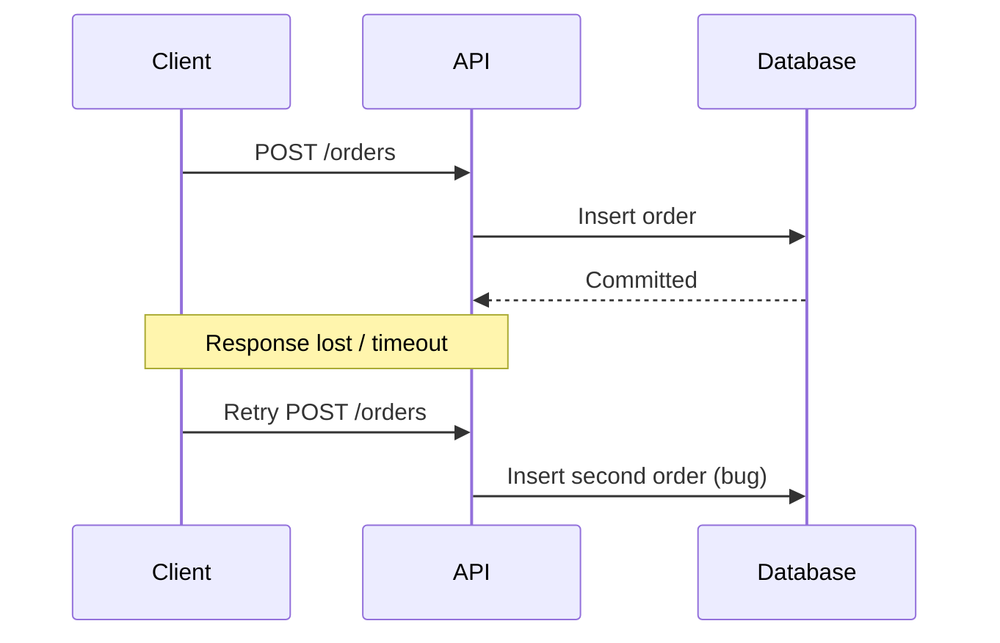
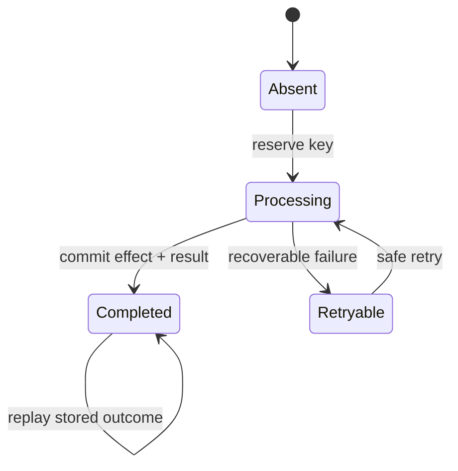
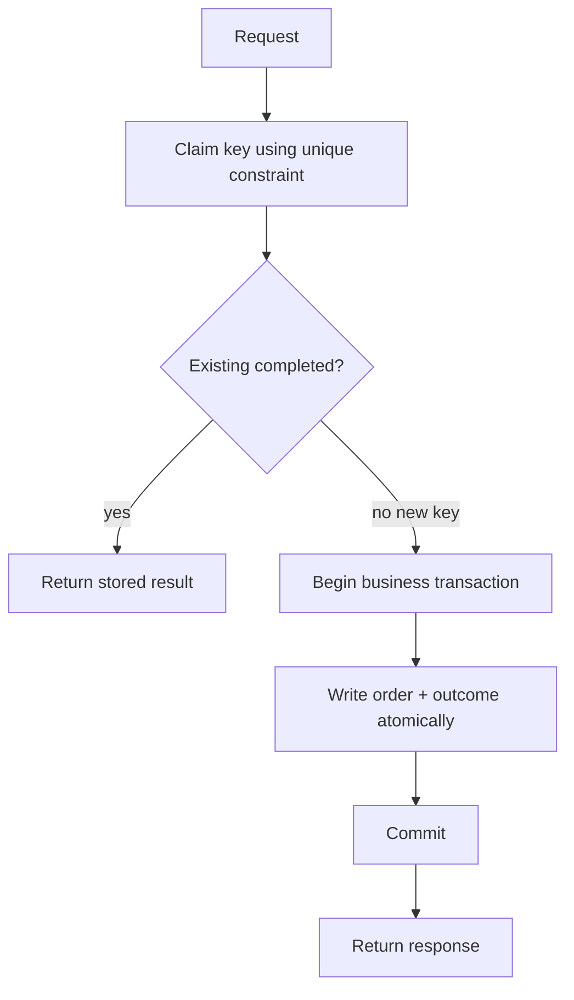
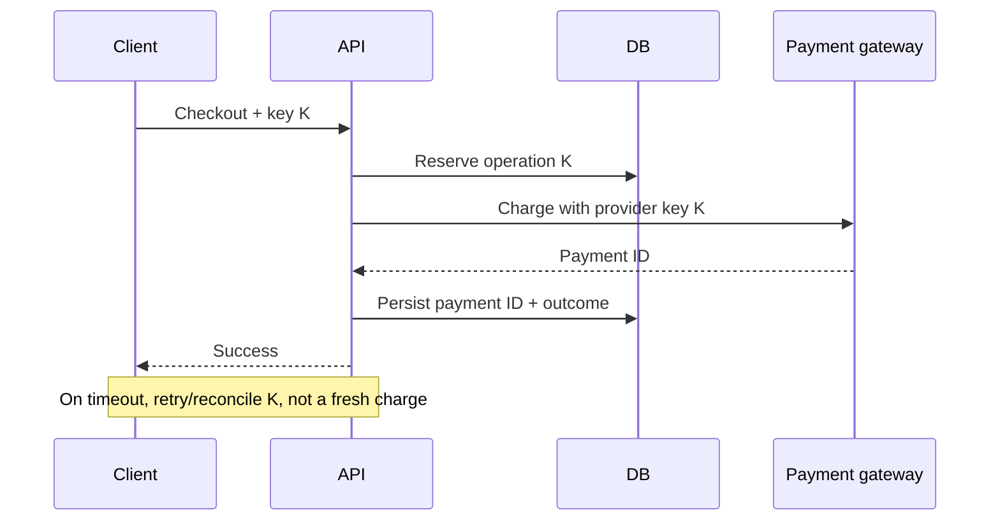
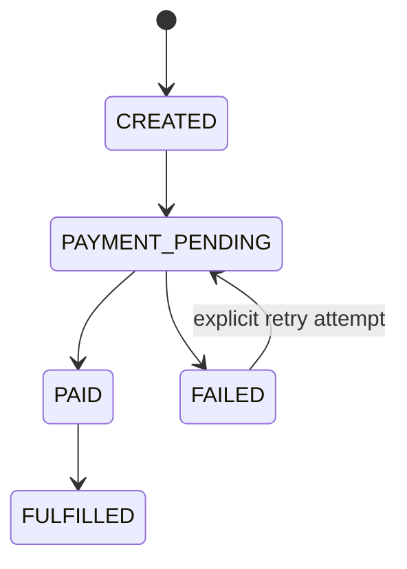

# Lesson 20 — Idempotency ⭐⭐⭐⭐⭐

> **Goal:** Learn to make APIs, payments, webhooks, and queue consumers safe under retries, duplicate delivery, and ambiguous network failures. Simple English, real Node.js/SQL/MongoDB examples, Mermaid diagrams, and interview practice.

## 01. What is idempotency?

An operation is **idempotent** when performing it once or multiple times has the same intended effect on the system's state. Example: “set user theme to dark” repeated three times still leaves theme dark. By contrast, “increment wallet balance by ₹100” repeated three times adds ₹300 unless protected.

## 02. Why it matters in distributed systems

Networks fail ambiguously. A server may commit a database write but the HTTP response gets lost. The client cannot know whether it succeeded and retries. Without idempotency, the retry may create duplicate orders, send duplicate emails, or charge a payment twice.

## 03. Ambiguous timeout example



## 04. Mathematical intuition

For an idempotent operation f, **f(f(x)) = f(x)**. For example, f(x) = “set status = Interview” is idempotent for the status field. g(x) = “increment count” is not. Real API idempotency usually means repeating the same **logical request** does not repeat its side effect, not that every response header or timestamp must be identical.

## 05. Idempotent vs safe HTTP methods

**Safe** means intended not to modify server state (e.g. GET). **Idempotent** means repeating a request has the same intended effect (e.g. PUT and DELETE by HTTP semantics). Safe methods are idempotent. Logging, metrics, and internal side effects do not automatically violate HTTP idempotency if the requested semantics remain unchanged.

## 06. HTTP method comparison

| Method | Safe by HTTP semantics | Idempotent by HTTP semantics | Notes |
|---|---|---|---|
| GET | Yes | Yes | Fetch resource, avoid intentional mutations |
| HEAD | Yes | Yes | Headers only |
| OPTIONS | Yes | Yes | Discover options |
| PUT | No | Yes | Replace/create state at target URI |
| DELETE | No | Yes | Deleting again leaves target absent |
| POST | No | Not inherently | Can be made idempotent using keys |
| PATCH | No | Not inherently | Can be idempotent depending on patch semantics |
Actual implementations can violate these intended semantics.

## 07. PUT vs POST

PUT /users/42/preferences with {theme:"dark"} sets a known resource to a desired state. Repeating it has the same intended effect. POST /orders creates a new resource and may create a new order on each retry. Use an idempotency key to make a logical POST request replay-safe.

## 08. DELETE nuance

DELETE /applications/42 repeated can return 204 first and 404 later while still being idempotent: the intended resource state is absent after both calls. Idempotency does **not** require identical HTTP status codes for every attempt, although API-level replay caching may intentionally return the same result.

## 09. PATCH nuance

PATCH setting status to Interview can be idempotent; PATCH incrementing count by 1 is not. Idempotency depends on operation semantics, not merely the method name.

## 10. What is an idempotency key?

A unique identifier supplied by the client for one logical operation, commonly in `Idempotency-Key` header. The server stores the request's outcome under a scoped key. Retrying the **same logical request with the same key** should not repeat the side effect.

## 11. Request example

```http
POST /api/orders HTTP/1.1
Content-Type: application/json
Idempotency-Key: 7dca1b72-6af7-4c84-bf77-bdf00f4ef482

{"cartId":"cart-42","shippingAddressId":"addr-7"}
```
A client generates a new key for each new checkout attempt, then reuses it for retries of that same attempt.

## 12. Key scope

Store idempotency identity using authenticated principal/tenant, operation scope, and client key, e.g. `(tenant_id, endpoint, key)`. Without scope, two different users might collide or one user's replay data could leak to another. Never trust a user ID supplied in the body when you already have authenticated identity.

## 13. Request fingerprint

The same key with a different request body must not silently replay an unrelated result. Store a canonical request fingerprint (e.g. hash of method, route, authenticated scope, normalized relevant payload). If the same key arrives with a different fingerprint, return a conflict such as 409. Canonicalization rules must be stable and documented.

## 14. Lifecycle of a key


A `Processing` state requires crash recovery or leases; never leave it stuck forever.

## 15. Three common outcomes

**New key:** atomically claim and execute. **Completed same request:** return stored result without redoing work. **In-progress same request:** wait, return 409/425-style retry guidance as appropriate, or attach to same operation; do not execute concurrently. **Same key, different payload:** reject as conflict.

## 16. The naive check-then-act race

```js
// UNSAFE under concurrency
if (!(await exists(key))) {
  await chargeCard();
  await saveKey(key);
}
```
Two requests can both see no key, both charge, and then save the same key. Use a database unique constraint or atomic claim, plus a durable state machine.

## 17. Database uniqueness

```sql
CREATE TABLE idempotency_records (
  principal_id TEXT NOT NULL,
  operation TEXT NOT NULL,
  key TEXT NOT NULL,
  request_hash TEXT NOT NULL,
  status TEXT NOT NULL CHECK (status IN ('processing','completed','failed')),
  response_code INTEGER,
  response_body JSONB,
  created_at TIMESTAMPTZ NOT NULL DEFAULT now(),
  updated_at TIMESTAMPTZ NOT NULL DEFAULT now(),
  PRIMARY KEY (principal_id, operation, key)
);
```
The primary key prevents concurrent requests from independently claiming the same logical operation.

## 18. Atomic claim

```sql
INSERT INTO idempotency_records
(principal_id, operation, key, request_hash, status)
VALUES ($1, $2, $3, $4, 'processing')
ON CONFLICT DO NOTHING
RETURNING key;
```
If one row returns, this caller claimed the key. If zero rows return, load the existing record and verify fingerprint/status. Claiming a key alone is not enough to guarantee the external side effect executes exactly once.

## 19. Same-DB atomicity

If the business effect and idempotency record live in **the same SQL database**, write both in one transaction where possible. Example: insert an order with unique client_request_id, and commit. If the transaction rolls back, neither business effect nor its completion record survives.

## 20. Transaction pattern


A production implementation also needs an explicit in-progress branch and recovery from crashes.

## 21. PostgreSQL order example

```sql
CREATE TABLE orders (
  id BIGINT GENERATED ALWAYS AS IDENTITY PRIMARY KEY,
  user_id BIGINT NOT NULL,
  client_request_id UUID NOT NULL,
  status TEXT NOT NULL,
  UNIQUE (user_id, client_request_id)
);

INSERT INTO orders (user_id, client_request_id, status)
VALUES (7, '7dca1b72-6af7-4c84-bf77-bdf00f4ef482', 'CREATED')
ON CONFLICT (user_id, client_request_id) DO NOTHING
RETURNING id;
```
On conflict, fetch the existing order under the authenticated user. Validate the request fingerprint separately if the same ID might be reused with different content.

## 22. External payment side effects

A SQL transaction cannot roll back a successful payment gateway charge. If the gateway supports an idempotency key, send the same stable key on retries and persist the provider operation ID. Design for ambiguous timeouts: query provider status or reconcile webhooks rather than blindly charging again.

## 23. Payment sequence


Exact behavior depends on provider's key scope, retention, and API guarantees.

## 24. The crash-after-charge gap

Gateway charge succeeds; API crashes before recording the payment result. On restart, a local `processing` row remains. Retrying with the **same provider idempotency key** or querying the provider operation can resolve it. A new provider key risks duplicate charge. A background reconciler should handle unresolved states.

## 25. Webhook duplication

Payment providers commonly retry webhook delivery when acknowledgments are lost or delayed. Treat webhooks as at-least-once events. Verify signatures, use provider event ID as a deduplication key, and make state transitions safe under duplicate and out-of-order delivery.

## 26. Webhook inbox table

```sql
CREATE TABLE processed_webhooks (
  provider TEXT NOT NULL,
  event_id TEXT NOT NULL,
  processed_at TIMESTAMPTZ NOT NULL DEFAULT now(),
  PRIMARY KEY (provider, event_id)
);
```
Insert the event ID and update the related order/payment in one database transaction. A duplicate insert conflict means this event was already processed successfully under that transaction design.

## 27. Out-of-order events

Suppose `payment.succeeded` arrives before `payment.pending`. Blindly applying every event in arrival order could regress state. Use a domain state machine, provider version/timestamps where trustworthy, and fetch authoritative payment status when uncertain. Idempotency prevents duplicates; ordering rules prevent regression.

## 28. State machine for orders


Define allowed transitions and reject invalid backward changes. Some real systems need cancellation, refunds, expiration, and partial fulfillment.

## 29. Message queues and duplicates

Workers can crash after a database update but before acknowledging a job. The broker redelivers. At-least-once delivery is common, so the consumer must be idempotent. A queue does not make duplicate work disappear.

## 30. Consumer deduplication

```sql
BEGIN;
INSERT INTO processed_messages (consumer_name, message_id)
VALUES ('notification-worker', 'evt-42')
ON CONFLICT DO NOTHING
RETURNING message_id;
-- Only perform the DB-side effect if one row was inserted.
COMMIT;
```
This assumes a processed_messages table with a unique composite key. For external email delivery, use provider IDs or a durable delivery workflow beyond this DB transaction.

## 31. Exactly-once myth

“Exactly-once delivery” is not the same as “exactly-once external side effect.” Brokers may offer scoped transactional processing, but a payment gateway or email provider lives outside that transaction. Practical end-to-end behavior combines at-least-once delivery, idempotent effects, and reconciliation.

## 32. Redis SET NX

```redis
SET idem:tenant-7:key-42 processing NX PX 30000
```
NX reserves only when absent; PX sets a lease. Useful for short-lived coordination, but **not sufficient as the only durable record** for a payment: Redis restart, eviction, lease expiry, or worker crashes can permit repeats. Keep authoritative business uniqueness in durable storage.

## 33. Lock expiration and fencing

If a worker's lease expires while it still runs, another worker can acquire the same key. Both may act. For operations requiring strict ownership, use fencing tokens or database version checks and ensure the downstream system rejects stale owners. Never treat a Redis lock as a global transaction.

## 34. TTL and key retention

An idempotency key needs a documented retention window, e.g. 24 hours for a specific API. After expiry, the same key might be treated as new. Payment/order correctness should also rely on durable business IDs and uniqueness constraints, not only a short TTL. Match retention to client retry patterns and provider behavior.

## 35. Client retry strategy

Retry only when safe: network timeouts, 429 with Retry-After, selected 5xx responses, or provider-documented transient failures. Use exponential backoff with jitter. Keep the **same key and same payload** across retries. Do not generate a new key on each retry.

## 36. Which errors to cache?

A common design stores a completed success response for replay. Whether to store validation errors, 4xx, or 5xx depends on the API contract. A transient 500 caused before the side effect should not permanently block legitimate retries. A failure after an irreversible side effect needs reconciliation, not blind re-execution.

## 37. Response replay

When an operation completed, returning the stored status/body can make retries easy for clients. Some APIs return the same 201 and resource ID; others return 200 with existing resource. Be consistent and document behavior. Sensitive response bodies must be scoped and protected.

## 38. Idempotency and authorization

Never return a stored response solely because a key matches. Authenticate the caller and scope the key to the principal/tenant and operation. If access rights changed, decide whether replaying the old response is still authorized. Idempotency is not an authorization bypass.

## 39. Request canonicalization

JSON property order, omitted defaults, decimal formats, and semantically equivalent inputs can produce different raw bytes. Define stable canonicalization for fingerprints. Include the operation identity and normalized relevant fields; exclude transient headers. Beware collisions and ensure the hash algorithm is appropriate.

## 40. Node.js hash helper

```js
import { createHash } from 'node:crypto';
function fingerprint(operation, normalizedPayload) {
  const data = JSON.stringify({ operation, payload: normalizedPayload });
  return createHash('sha256').update(data).digest('hex');
}
```
This example assumes `normalizedPayload` already has stable field ordering/format. Raw JSON.stringify of arbitrary objects is not a complete canonicalization strategy.

## 41. Express 5 endpoint skeleton

```js
import express from 'express';
const app = express();
app.use(express.json());
app.post('/orders', async (req, res) => {
  const userId = req.user.id; // Provided by real auth middleware.
  const key = req.get('Idempotency-Key');
  if (!key) return res.status(400).json({ error: 'Idempotency-Key required' });
  const result = await orderService.createOnce({ userId, key, body: req.body });
  return res.status(result.status).json(result.body);
});
```
`orderService.createOnce` must implement atomic uniqueness, fingerprint comparison, in-progress behavior, and durable result handling. This is an integration skeleton, **not** a complete secure runnable server.

## 42. Service algorithm

```text
1. Authenticate and validate payload.
2. Require bounded, valid Idempotency-Key.
3. Compute stable request fingerprint.
4. Atomically claim (principal, operation, key).
5. If existing, compare fingerprint.
6. If completed, return stored outcome.
7. If processing, return documented retry/in-progress response.
8. If new, execute business effect with transactional safeguards.
9. Persist completed result.
10. On ambiguous external side effect, reconcile before retry.
```

## 43. MongoDB unique index

```js
// Mongoose schema fragment
const operationSchema = new mongoose.Schema({
  userId: { type: mongoose.Schema.Types.ObjectId, required: true },
  key: { type: String, required: true },
  operation: { type: String, required: true },
  requestHash: { type: String, required: true },
  status: { type: String, enum: ['processing','completed','failed'], required: true }
});
operationSchema.index({ userId: 1, operation: 1, key: 1 }, { unique: true });
```
Create and verify the unique index before relying on it. Use MongoDB transactions where multi-document atomicity is required and supported.

## 44. MongoDB upsert caveat

An upsert can atomically claim a unique key when backed by a suitable unique index. Without the index, concurrent upserts can create duplicates. Duplicate-key errors are an expected race outcome; fetch the existing record and verify fingerprint/status. Avoid assuming `findOne` then `create` is safe.

## 45. CareerLoop case study

Creating a job application from a double-click should not create two identical records. Generate a clientRequestId for one form submission, send it as an idempotency key, and store a unique (userId, clientRequestId) constraint. A deliberate second application should use a new key. Don't dedupe solely by company name: users may legitimately reapply.

## 46. CodeBuddy case study

Connection requests can be deduplicated with a unique pair/direction policy or a stable request ID. Socket.IO reconnections may resend messages; give each message a client-generated ID and enforce uniqueness within sender/conversation scope. A repeated send should return the existing message rather than creating another.

## 47. ShopHub case study

Checkout is a high-stakes idempotency workflow: stable checkout attempt ID, unique order record, provider idempotency key, webhook deduplication, and reconciliation. A user retry must not charge twice. Keep the order's authoritative state separate from the frontend's loading/success display.

## 48. Email notification case study

An email worker may retry after a timeout even if the provider accepted the email. Some providers offer deduplication/message IDs, others do not. Maintain a delivery record and provider response ID when available. Exactly-once email sending may be impossible to guarantee without provider support; aim for controlled duplicates and clear monitoring.

## 49. Idempotency vs deduplication

**Idempotency** is the operation's repeat-safe behavior. **Deduplication** detects repeated identifiers/messages. Deduplication is one technique for implementing idempotency, but a dedup key that expires too early or is scoped incorrectly can still permit repeated side effects.

## 50. Idempotency vs locking

A lock prevents some concurrent execution while held. Idempotency ensures repeated logical requests do not repeat the intended effect across retries and restarts. Locks alone expire; keys and durable uniqueness persist. Many workflows need both concurrency coordination and durable idempotent state.

## 51. Idempotency vs optimistic concurrency

Idempotency prevents the **same request** from applying twice. Optimistic concurrency (version checks) prevents **different concurrent requests** from silently overwriting each other. Example: two distinct edits of a CareerLoop status need version control, even if each edit has its own idempotency key.

## 52. Testing duplicate requests

Send two requests with the same key concurrently and verify exactly one order row. Retry after response timeout and verify same resource ID. Reuse key with different payload and expect conflict. Restart API between attempts. Test in-progress state, expiration, and cross-tenant scoping.

## 53. Fault injection

Simulate crash (a) before DB commit, (b) after DB commit but before response, (c) after provider charge but before local persistence, (d) before queue ACK, and (e) during webhook processing. For each point, document how retry/reconciliation restores correctness.

## 54. Monitoring

Track new keys, replayed keys, payload conflicts, in-progress duration, duplicate-key conflicts, reconciliation backlog, ambiguous provider operations, and duplicate webhook rates. Alert on stuck processing records and repeated side-effect failures. Correlate requests with stable operation IDs without logging sensitive payloads.

## 55. Security considerations

Validate key length/format, scope by authenticated principal, rate-limit attempts, and prevent unbounded key storage. Don't accept attacker-controlled keys as a substitute for permission checks. Avoid exposing another user's cached response. Hash or minimize sensitive request details; protect replay data at rest.

## 56. Common mistakes

Generating a new key for every retry; using only Redis TTL for payment correctness; check-then-insert without unique constraints; failing to compare payloads; assuming same HTTP status is required for idempotency; using a lock instead of durable uniqueness; treating webhook delivery as once-only; retrying external charges without provider keys; no stuck-operation recovery; deduplicating legitimate distinct user actions.

## 57. Interview questions

**Q1:** Define idempotency. Same intended effect after repeats. **Q2:** Why needed? Ambiguous failures/retries. **Q3:** Which HTTP methods are idempotent? GET/HEAD/OPTIONS/PUT/DELETE by semantics. **Q4:** Is POST always non-idempotent? Not inherently; can add keys. **Q5:** Is PATCH idempotent? Depends on operation. **Q6:** Why same key on retry? Identify one logical attempt. **Q7:** Why fingerprint? Detect changed payload. **Q8:** Why unique constraint? Prevent concurrent duplicate claims. **Q9:** Does Redis NX guarantee exactly-once payment? No. **Q10:** How handle crash after charge? Provider key/reconciliation. **Q11:** What is webhook deduplication? Unique provider event ID. **Q12:** Why state machine? Prevent out-of-order regressions. **Q13:** What is the dual-write gap? DB and external side effect commit separately. **Q14:** Does ACK guarantee exactly-once? No. **Q15:** Difference from locking? Repeat-safe effect vs temporary exclusion. **Q16:** Difference from optimistic concurrency? Same request vs distinct concurrent writes. **Q17:** When expire keys? Documented retry window. **Q18:** Why tenant scope? Prevent collisions/leaks. **Q19:** What to do with in-progress retry? Return documented retry/wait behavior. **Q20:** How test? Concurrent duplicates and crash points.

## 58. Practical exercises

**A:** Add clientRequestId uniqueness to CareerLoop applications. **B:** Simulate double-click POST with Promise.all. **C:** Implement a request fingerprint and 409 conflict. **D:** Add processing/completed states and a recovery worker. **E:** Design ShopHub checkout with provider idempotency. **F:** Write webhook inbox transaction. **G:** Simulate crash after provider charge. **H:** Add message IDs to CodeBuddy chat. **I:** Compare idempotency vs optimistic versioning. **J:** Explain exactly-once limitations in a system design interview.

## 59. Revision checklist

- [ ] I can define idempotency with a real example.
- [ ] I understand safe vs idempotent HTTP methods.
- [ ] I can explain ambiguous timeouts and retries.
- [ ] I know how to scope keys and compare fingerprints.
- [ ] I can implement atomic uniqueness in PostgreSQL/MongoDB.
- [ ] I understand processing/completed/replay states.
- [ ] I know why Redis locks alone are insufficient.
- [ ] I can handle payment provider and webhook duplicates.
- [ ] I understand idempotency vs deduplication/locking/versioning.
- [ ] I can test crashes and concurrency.

---

**Key takeaway:** Retrying a request is normal. A robust system identifies one logical operation, prevents duplicate effects, and reconciles ambiguous external outcomes.
