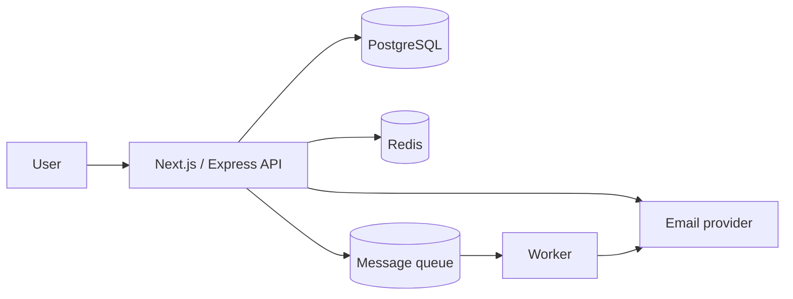
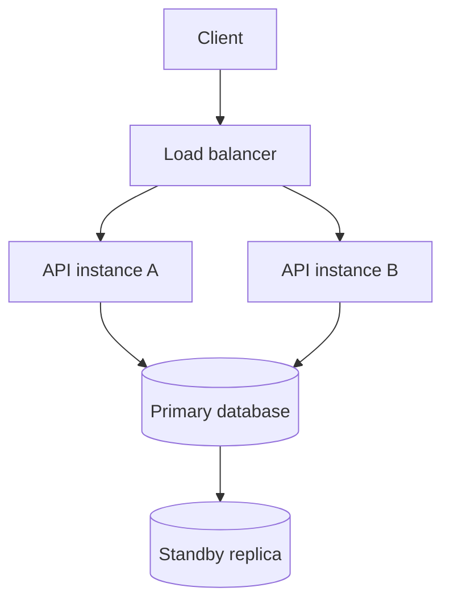
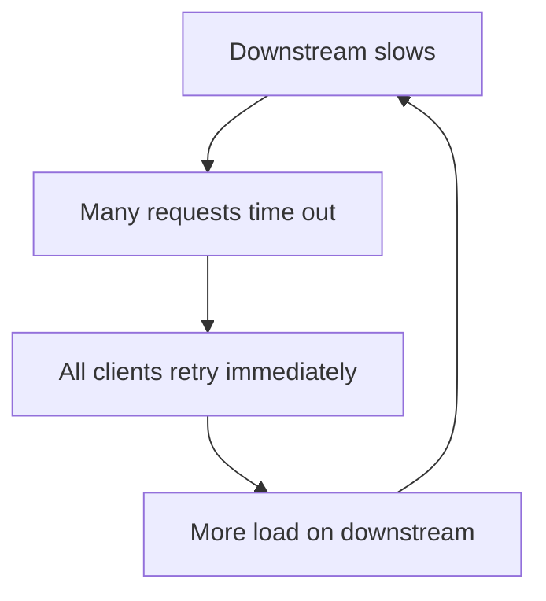
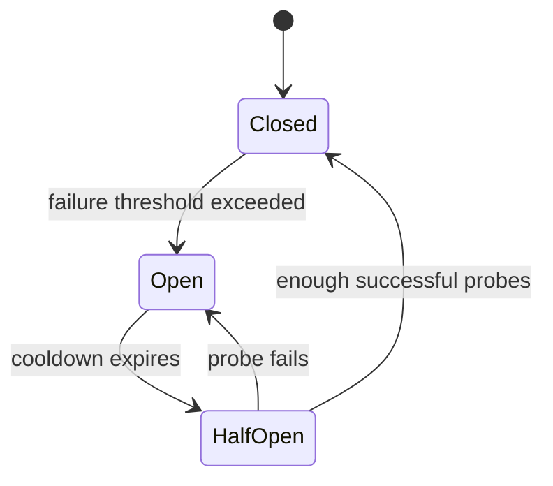
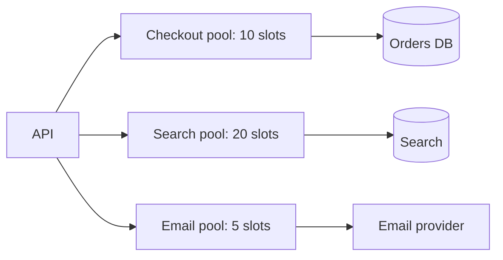
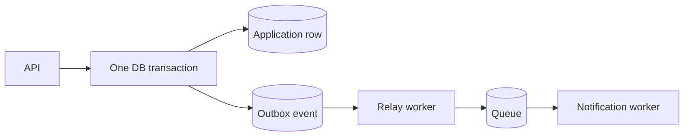

# Lesson 21 — Fault Tolerance ⭐⭐⭐⭐⭐

> **Goal:** Design systems that remain useful and correct when services, networks, databases, or external providers fail. Simple English, practical Node.js examples, Mermaid diagrams, real-world trade-offs, interview questions, and exercises.

## 01. What is fault tolerance?

Fault tolerance means a system continues providing an acceptable service when **some components fail**. A payment provider timing out, one Node.js instance crashing, or a replica becoming unreachable should not automatically break every feature. Fault tolerance does **not** mean zero errors or infinite availability.

## 02. Reliability vs availability vs resilience

**Reliability:** probability of correct operation over a period. **Availability:** proportion of time or requests the service is usable. **Resilience:** ability to absorb, recover, and adapt to disruptions. **Fault tolerance:** design mechanisms that keep selected operations functioning despite faults. A highly available system can still return incorrect data, so define correctness separately.

## 03. Fault, error, failure

A **fault** is an underlying defect or event (disk failure). An **error** is an incorrect internal state (missing replica data). A **failure** is an externally visible violation (GET returns 500). Faults do not always become user-visible failures because redundancy, detection, and recovery can mask them.

## 04. Failure types

Plan for crash-stop processes, transient network timeouts, dropped packets, slow downstreams, partial responses, resource exhaustion, corrupt data, misconfiguration, bad deployments, and entire availability-zone outages. Byzantine behavior is a distinct, more difficult failure model; ordinary web applications rarely implement Byzantine fault tolerance.

## 05. Why distributed systems fail partially

One service can be healthy while its database, queue, DNS resolver, or email provider is unavailable. A frontend request may pass through multiple dependencies, each with independent failure behavior. **Partial failure** is a defining property of distributed systems.

## 06. Failure dependency graph


If email is optional for the HTTP response, make it asynchronous. If DB is required to save the application, do not falsely report success when DB is unavailable.

## 07. Set an explicit service objective

Example: 99.9% monthly successful API availability, p95 response latency under 300 ms, and no duplicate charges. These are **illustrative targets**, not guaranteed performance. Define what counts as success, which endpoints are critical, and what degraded service looks like.

## 08. Error budget intuition

At 99.9% availability, the nominal monthly unavailable fraction is 0.1%; for a 30-day month this equals about **43.2 minutes**. This is a mathematical approximation, not an outage prediction. Error budgets help teams balance release velocity against reliability risk.

## 09. Single points of failure

One API server, one database instance, one DNS provider, or one shared Redis node can become a single point of failure. Redundancy reduces risk, but replicas may share a common failure domain (same rack, zone, region, credentials, or deployment pipeline).

## 10. Redundancy and failover


Redundant API instances help with process crashes. Database failover requires election, replication, fencing, and client reconnection logic; a standby does not automatically eliminate downtime or data-loss risk.

## 11. Active-active vs active-passive

**Active-active:** multiple instances handle requests simultaneously, improving utilization but requiring shared state and coordination. **Active-passive:** a standby takes over when primary fails; simpler write ownership, but failover delay and standby cost remain. Neither topology guarantees safety without correct state handling.

## 12. Health checks

**Liveness:** should the process be restarted? **Readiness:** should it receive traffic? A DB outage should often make an API temporarily unready without causing an infinite restart loop. A shallow liveness endpoint can remain healthy while readiness checks essential dependencies and startup state.

## 13. Timeouts: the first defense

Never wait indefinitely on network I/O. Set connection, response/header, and total-operation deadlines where supported. A timeout must fit within the upstream request's remaining budget. Too-short timeouts create false failures; too-long timeouts consume resources and increase tail latency.

## 14. Timeout budget example

If the HTTP endpoint has a 1000 ms deadline, budget roughly 100 ms authentication, 500 ms DB work, 200 ms other calls, and 200 ms reserve for network/serialization. These are **example budgets**. A downstream timeout of 2000 ms would violate the 1000 ms upstream budget.

## 15. Node.js fetch with timeout

```js
async function fetchProfile(userId) {
  const url = new URL('https://profiles.example.com/api/profile');
  url.searchParams.set('id', userId);
  const response = await fetch(url, {
    signal: AbortSignal.timeout(1500)
  });
  if (!response.ok) throw new Error('Profile service: ' + response.status);
  return response.json();
}
```
`AbortSignal.timeout` aborts the client wait; it does not guarantee the remote server stopped processing. Never blindly retry a non-idempotent mutation after timeout.

## 16. Retries: when they help

Retry transient failures: connection reset, temporary 503, some 429 responses, or leader failover. Do not retry malformed input, unauthorized requests, or deterministic validation failures. Every retry increases downstream load and may repeat a side effect; idempotency is essential.

## 17. Retry storm


A retry storm can turn a temporary slowdown into a full outage. Bound attempts, back off, add jitter, and use circuit breakers or retry budgets.

## 18. Exponential backoff and jitter

Typical delays might grow 200 ms, 400 ms, 800 ms, 1600 ms with randomization and a cap. Jitter prevents synchronized clients from retrying at the same instant. Honor `Retry-After` where appropriate, and stop when the overall deadline expires.

## 19. A bounded retry helper

```js
const sleep = ms => new Promise(resolve => setTimeout(resolve, ms));
async function retry(operation, { attempts = 3, baseMs = 200, shouldRetry } = {}) {
  for (let attempt = 0; attempt < attempts; attempt++) {
    try { return await operation(); }
    catch (error) {
      if (attempt === attempts - 1 || !shouldRetry?.(error)) throw error;
      const cap = Math.min(2000, baseMs * 2 ** attempt);
      await sleep(Math.random() * cap); // full jitter
    }
  }
}
```
This is a teaching helper: add a shared deadline, cancellation, telemetry, and rate-limit-aware retry timing in production.

## 20. Idempotency and retry safety

GETs are generally retry-safe by intended HTTP semantics; POST payment requests require a stable idempotency key or provider reconciliation. A timed-out write may have succeeded remotely. Retry the **same logical operation** with the same key rather than issuing a fresh charge.

## 21. Circuit breaker

A circuit breaker prevents repeatedly calling a dependency that is likely failing. **Closed:** allow calls and measure failures. **Open:** reject/fallback quickly. **Half-open:** allow a limited number of probes after a cooldown. Correct implementation requires concurrency-safe state, error classification, and thresholds.

## 22. Circuit breaker state machine


A circuit breaker does not fix the provider; it reduces wasted load and protects your own service.

## 23. Circuit breaker vs retry

**Retry:** try a transiently failing operation again. **Circuit breaker:** stop trying temporarily when failures indicate the dependency is unhealthy. Retries help isolated errors; circuit breakers help widespread outages. Combine with bounded attempts, timeouts, and fallback rather than stacking unlimited retries.

## 24. Bulkhead pattern

Like compartments in a ship, bulkheads prevent one failing subsystem from consuming every resource. Example: separate concurrency pools for email, search, and checkout. If email is slow, checkout still has DB connections and worker capacity.

## 25. Bulkhead diagram


The slot counts are illustrative. Tune from latency, throughput, and downstream quotas.

## 26. Concurrency limiter in Node.js

```js
function createLimiter(maxActive) {
  let active = 0;
  const waiting = [];
  return async function limit(task) {
    if (active >= maxActive) {
      await new Promise(resolve => waiting.push(resolve));
    }
    active++;
    try { return await task(); }
    finally {
      active--;
      waiting.shift()?.();
    }
  };
}
const limitEmail = createLimiter(5);
await limitEmail(() => sendEmail());
```
Educational only: an unbounded waiting list can itself exhaust memory. Production implementations need queue limits, deadlines, cancellation, and observability.

## 27. Load shedding

When the service is overloaded, reject lower-priority work early rather than letting everything time out. Return 429 for rate limiting or 503 for temporary capacity exhaustion as appropriate. Prioritize checkout over optional recommendation refreshes, but do not misreport an uncommitted order as successful.

## 28. Backpressure

Backpressure occurs when producers generate work faster than consumers can handle it. Use bounded queues, rate limits, streaming flow control, and worker concurrency caps. A message queue buffers bursts but has finite storage and does not eliminate overload.

## 29. Graceful degradation

Keep essential features usable while optional features fail. Example: CareerLoop can save an application even when analytics or notification services are unavailable, provided the authoritative DB write succeeds. Show a warning for delayed notifications instead of failing the entire workflow.

## 30. Fallbacks

Fallbacks include serving cached public content, returning partial results, using a secondary provider, or deferring work. Fallback data may be stale; label it honestly. Never fall back to an insecure authorization decision or invent a payment success response.

## 31. Cache fallback risk

If Redis fails, you may query the database directly—but a sudden flood of cache misses can overload it. Use request coalescing, local emergency limits, or a circuit breaker. A fallback that overwhelms the primary database is not resilient.

## 32. Failover and split brain

Promoting a standby must prevent two primaries from accepting conflicting authoritative writes. Leader election, quorum, fencing, and failover orchestration matter. Asynchronous replication may lose recently acknowledged writes on promotion; document recovery point objectives.

## 33. RTO and RPO

**Recovery Time Objective (RTO):** targeted time to restore service after an incident. **Recovery Point Objective (RPO):** maximum targeted amount of data loss measured in time. Example: RTO 15 minutes, RPO 5 minutes. Targets depend on replication, backups, testing, and business needs—not just a configuration checkbox.

## 34. Backups are not replicas

Replicas improve availability but can replicate accidental deletion or corruption. Backups and point-in-time recovery protect against logical mistakes and disasters. Verify restoration regularly; an untested backup is only an assumption.

## 35. Multi-zone and multi-region

Multi-zone redundancy reduces impact of one zone failure. Multi-region deployments can survive regional outages but introduce replication latency, data sovereignty issues, failover complexity, and split-brain risk. Start with measured needs; multi-region active-active is not always the right first step.

## 36. Stateless API design

Stateless API instances are easier to replace and scale. Store sessions in signed tokens or shared storage as appropriate, and keep durable user state in the database. In-memory process state disappears on restart and is not shared across replicas.

## 37. Database connection pool exhaustion

If each of 20 workers opens a pool of 20 connections, the database could see up to 400 connections. Scale workers and pool sizes together. Apply per-service limits, short transactions, queueing, and monitoring rather than assuming more instances always improve availability.

## 38. Timeouts across service chains

If A calls B and B calls C, each must respect the remaining end-to-end deadline. A 1-second budget cannot safely contain a 900 ms B call followed by an independent 900 ms C call. Propagate cancellation/deadlines when supported, while remembering cancellation does not undo committed side effects.

## 39. Hedged requests

A hedged request sends a duplicate read to another replica after a delay to reduce tail latency. It increases total work and should be limited to safe/idempotent operations with independent backends. Do not hedge a payment charge without robust idempotency.

## 40. Queue-based isolation

An API can durably enqueue optional work and return once the required business transaction is committed. Workers retry independently. But publishing to a queue after a DB commit has a dual-write gap; use a transactional outbox when missing the event would be unacceptable.

## 41. Transactional outbox reminder


The relay can publish duplicates after a crash, so consumers still need idempotency.

## 42. Poison messages and DLQs

A malformed job may fail repeatedly. Classify retryable vs permanent errors, cap attempts, and move exhausted jobs to a dead-letter queue or failed-job store. Alert and support safe replay after fixing the root cause.

## 43. Observability pillars

**Metrics:** error rates, latency, saturation, queue lag, retries, circuit state. **Logs:** structured events with correlation IDs. **Traces:** request path across services. Instrument failure paths, not only successful requests.

## 44. Golden signals

Track latency, traffic, errors, and saturation. A dependency can show healthy CPU yet still be failing requests due to DNS or connection exhaustion. Segment metrics by endpoint and dependency so you can find the failing boundary.

## 45. SLO-based alerting

Alert on user-visible error budget burn or critical dependency failures, not every single transient timeout. An alert should tell an operator what is broken and where to investigate. Combine short-window urgent alerts with longer-window trend alerts.

## 46. Chaos and fault injection

Deliberately simulate API process kills, Redis outages, DB failover, packet delay, dropped responses, and provider 429s in a safe environment. Confirm the expected fallback and recovery behavior. Avoid uncontrolled experiments on real payments or customer data.

## 47. Testing retry correctness

Simulate a payment provider that charges successfully but drops its response. Confirm the client retries with the same idempotency key and the system reconciles one charge. Also test concurrent retries, retry exhaustion, and worker restarts.

## 48. Testing circuit breakers

Verify that repeated qualifying failures open the breaker, open state rejects quickly, only bounded half-open probes run, and recovery closes it. Use a controllable clock and fake dependency; don't rely on real sleeps in unit tests.

## 49. CareerLoop case study

**Critical:** saving job applications and interview updates. **Optional:** analytics cards, reminders, and email notifications. When notification provider fails, commit the application and keep a durable outbox event. If DB is unavailable, return a clear failure/pending-draft behavior; never claim the application was saved.

## 50. CodeBuddy case study

Chat persistence is more important than online presence and typing indicators. If Socket.IO disconnects, the client reconnects and fetches authoritative message history. Stable message IDs and deduplication prevent duplicates. An email provider outage should not block accepting connection requests.

## 51. ShopHub case study

Checkout needs authoritative stock/payment correctness. If a payment provider times out, show payment status as **pending verification**, not failed or paid without evidence. Use stable idempotency keys, webhooks, reconciliation, and inventory reservation expiry. Recommendations and product image transformations can degrade independently.

## 52. Failure-mode matrix

| Failure | Critical action | Graceful response |
|---|---|---|
| Email provider down | Save application | Queue notification for retry |
| Redis cache down | Fetch profile | Controlled DB fallback |
| DB primary unavailable | Create order | Reject/defer; do not claim success |
| Socket.IO down | Send chat message | Persist via HTTP where supported, sync later |
| Payment response lost | Checkout | Reconcile using same provider key |
| Search index lag | Product search | Stale/limited results with clear messaging |

## 53. Common anti-patterns

Retry every exception; infinite timeouts; global shared thread/connection pool for all dependencies; fallback to stale authorization; assuming two replicas mean zero data loss; alerting on every harmless transient; retrying charges with new IDs; unlimited queues; no idempotency; treating backup as live failover; calling a system fault tolerant without testing it.

## 54. Interview design approach

1. Define user-visible SLO and critical invariants. 2. Draw dependencies and failure domains. 3. Identify single points of failure. 4. Set timeouts/deadlines. 5. Add bounded retries with jitter and idempotency. 6. Add circuit breakers, bulkheads, and load shedding. 7. Plan failover/backups and RTO/RPO. 8. Instrument and fault-test. Explain which failures you cannot mask.

## 55. Interview questions and answers

**Q1:** Fault tolerance? Continued acceptable service despite component faults. **Q2:** Retry vs circuit breaker? Retry transient failures; breaker pauses calls during widespread failure. **Q3:** Why jitter? Avoid synchronized retry storms. **Q4:** Bulkhead? Isolate resource pools. **Q5:** Timeout? Bound waiting and resource use. **Q6:** Graceful degradation? Preserve critical features, drop optional ones. **Q7:** Failover? Switch to healthy component. **Q8:** Split brain? Conflicting active leaders. **Q9:** RTO vs RPO? Restore time vs tolerated data loss. **Q10:** Replica vs backup? Live copy vs recoverable historical data. **Q11:** Backpressure? Slow or limit producers when consumers lag. **Q12:** Load shedding? Reject excess work early. **Q13:** Idempotency? Repeat-safe logical effect. **Q14:** Why outbox? Avoid lost DB-to-queue event. **Q15:** Can circuit breaker ensure success? No. **Q16:** What is a failure domain? Components sharing an outage cause. **Q17:** What is readiness? Safe to receive traffic. **Q18:** Why monitor saturation? Prevent resource exhaustion. **Q19:** How test? Fault injection and recovery drills. **Q20:** When not to retry? Non-retryable errors or unsafe side effects.

## 56. Hands-on exercises

1. Add a 1.5-second timeout to a Node.js fetch call and simulate slow response. 2. Build bounded retries with jitter and idempotency. 3. Implement a circuit breaker with a fake clock. 4. Add separate concurrency limits for checkout and email. 5. Simulate Redis down and cap fallback DB traffic. 6. Design CareerLoop's transactional outbox. 7. Simulate duplicate payment webhook delivery. 8. Calculate a 99.95% 30-day error budget. 9. Draw multi-zone failover and list shared failure domains. 10. Write an incident runbook for DB-primary failure.

## 57. Final revision checklist

- [ ] I can distinguish fault, error, failure, reliability, availability, and resilience.
- [ ] I can draw redundant services and identify shared failure domains.
- [ ] I understand deadlines, retries, backoff, and jitter.
- [ ] I can explain circuit breaker states and bulkheads.
- [ ] I can design graceful degradation without lying about commits.
- [ ] I understand load shedding, backpressure, and bounded queues.
- [ ] I can explain failover, split brain, RTO, and RPO.
- [ ] I know why backups and replicas solve different problems.
- [ ] I can test timeout, retry, failover, and crash-after-side-effect scenarios.
- [ ] I can apply fault tolerance to CareerLoop, CodeBuddy, and ShopHub.

---

**Next lesson:** Lesson 22 — Distributed Systems Basics. Remember: fault tolerance is about deliberate, tested failure behavior—not pretending failures cannot happen.
