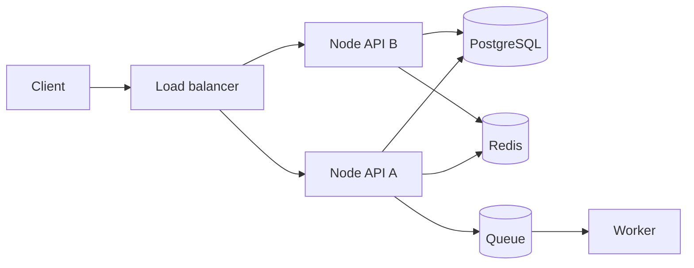
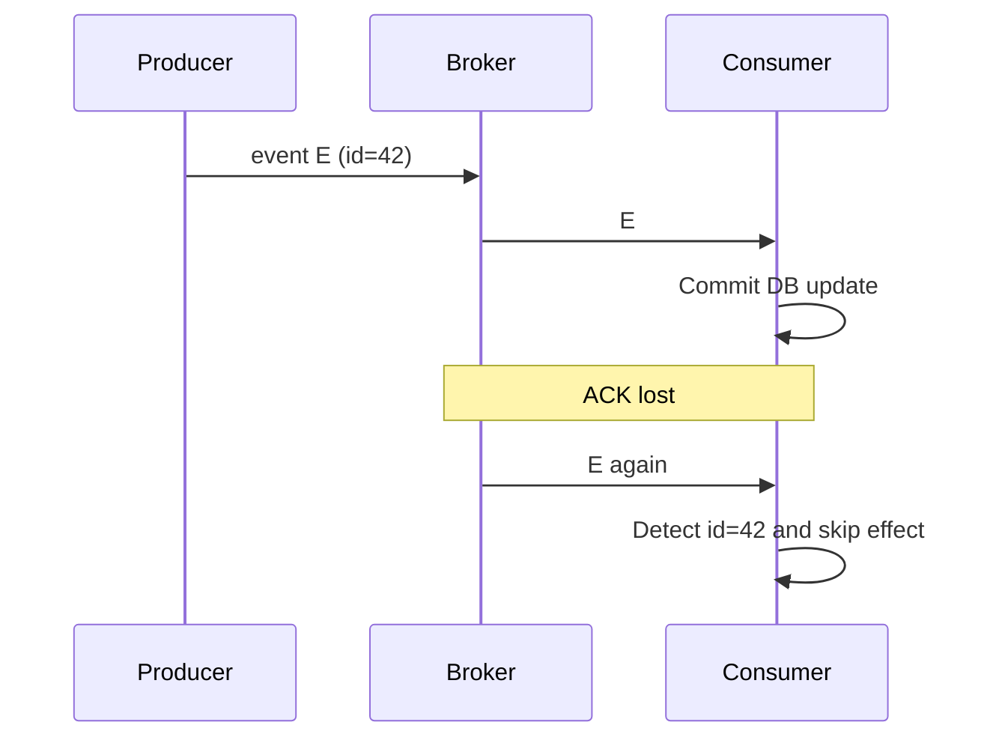
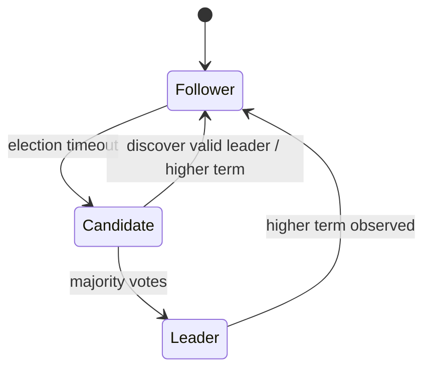
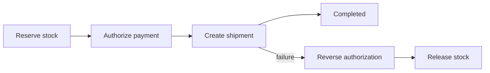
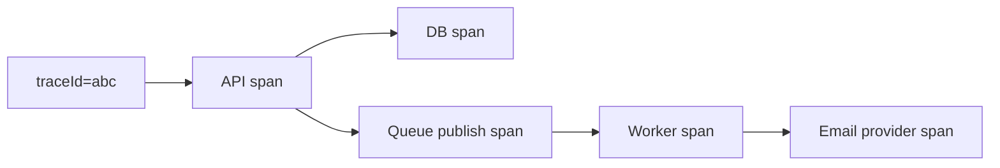

# Lesson 22 — Distributed Systems Basics ⭐⭐⭐⭐⭐

> **Goal:** Build a practical foundation in distributed systems using simple English, Mermaid diagrams, realistic Node.js/Next.js architecture, failure examples, interview Q&A, and exercises. This lesson connects CAP, consistency, idempotency, and fault tolerance into one mental model.

## 01. What is a distributed system?

A distributed system is a group of independent computers/processes that communicate over a network to provide one service. Each node has its own memory and failures; no node automatically knows the exact state of every other node. Example: Next.js frontend → Node.js API instances → PostgreSQL primary/replicas → Redis → queue workers.

## 02. Why build one?

Distribute work for scalability, fault isolation, geographic proximity, and organizational independence. Costs include network latency, partial failures, consistency trade-offs, harder debugging, and operational complexity. A single well-sized server can be the right architecture until requirements justify distribution.

## 03. Basic architecture


API instances cannot rely on one another's in-memory state. Shared durable data belongs in appropriate external systems.

## 04. Distributed vs parallel vs concurrent

**Concurrency** means multiple tasks make progress over overlapping time. **Parallelism** means tasks execute simultaneously on separate compute resources. **Distributed** means components communicate across process/machine boundaries, introducing network failures and independent clocks. A distributed service may be concurrent and parallel, but the terms are different.

## 05. Node, process, service, cluster

A **node** is a participating machine or logical member. A **process** runs an executable. A **service** exposes capabilities and may have many processes. A **cluster** is a cooperating group of nodes. A database primary and two replicas form one cluster; an API deployed across five pods is another.

## 06. Synchronous vs asynchronous communication

HTTP/gRPC request-response usually couples the caller's latency and availability to the callee. Queue/event communication decouples time: the producer records work and consumers process later. Neither guarantees success automatically; async requires delivery, ordering, retry, and deduplication design.

## 07. RPC mental model

A remote function call is **not** a local function call. The server may complete while the response is lost, and the caller cannot distinguish that from a server that never received the request. Use deadlines, retry rules, idempotency keys, and observability at every network boundary.

## 08. Partial failure

One API instance can crash while another serves traffic. Redis can be reachable from one zone and unreachable from another. A client timeout does not prove the server did nothing. This ambiguity drives many distributed-system patterns.

## 09. Network properties

Packets may be delayed, reordered, duplicated at application/message layers, dropped, or delivered after a timeout. Connections can break mid-response. Network bandwidth is finite and tail latency matters. Never assume instantaneous, lossless, perfectly ordered communication across all boundaries.

## 10. Eight fallacies of distributed computing

Common false assumptions: the network is reliable; latency is zero; bandwidth is infinite; the network is secure; topology never changes; there is one administrator; transport cost is zero; the network is homogeneous. For each assumption, design timeouts, authentication, capacity, discovery, or compatibility strategies.

## 11. Failure detectors

A heartbeat or timeout can suspect a node is dead, but a slow node and a crashed node may look identical. Failure detectors make imperfect judgments. Membership systems often trade false suspicions against slow failover.

## 12. Heartbeat example

```mermaid
sequenceDiagram
 participant A as Leader
 participant B as Follower
 A->>B: heartbeat
 B-->>A: ack
 Note over A,B: Network delay
 A->>B: heartbeat
 Note over A,B: no response before timeout
 Note over A: suspect B; not proof of crash
```

## 13. No global clock

Machines have independent physical clocks that can drift or be adjusted. If server A logs 10:00:01 and server B logs 10:00:00, B's event may still have happened later. Never infer global causality from timestamps alone.

## 14. Clock skew and NTP

NTP helps synchronize physical clocks but cannot eliminate all skew, drift, or uncertainty. Use time synchronization for operations and observability, but avoid assuming timestamps provide a perfect total order for conflicting writes.

## 15. Lamport logical clocks

Lamport clocks assign increasing logical numbers. On local/send event increment; on receiving timestamp t, set clock to max(local,t)+1. If event A happened-before B, then L(A) < L(B). The converse is **not** guaranteed: smaller Lamport timestamp does not prove causality.

## 16. Lamport clock example

```text
Node A: local event L=1; send message L=2
Node B: local event L=1; receives A's L=2
Node B updates L=max(1,2)+1=3
```
The numbers order causally related events without relying on wall-clock synchronization.

## 17. Happens-before relation

Event A happens-before B if (1) both occur in the same process and A precedes B, (2) A sends a message that B receives, or (3) transitivity applies. If neither A→B nor B→A, the events are concurrent. Concurrency does not necessarily mean simultaneous wall-clock execution.

## 18. Vector clocks

Vector clocks track each node's known event counts. If vector X is component-wise ≤ Y and at least one component is smaller, X causally precedes Y. If neither dominates, events are concurrent. Useful for conflict detection, but vector size and dynamic membership complicate scaling.

## 19. Vector clock example

Node A produces [1,0] and Node B independently produces [0,1]. Neither dominates the other, so they are concurrent. After B receives A's event and performs another event, B may have [1,2], which dominates [1,0].

## 20. Logical vs physical clocks

Physical time answers approximately **when**. Logical clocks answer **causal order**. Hybrid logical clocks combine physical time with logical counters to provide a useful timestamp order while handling clock uncertainty; guarantees depend on the implementation.

## 21. Ordering guarantees

Global total ordering is expensive. A queue may preserve ordering within one partition, not across all partitions. For chat, per-conversation ordering is often enough; for a global activity feed, eventual ordering may be acceptable. Define the required scope.

## 22. Message delivery semantics

**At-most-once:** messages may be lost but are not redelivered by the transport policy. **At-least-once:** retry until acknowledged, so duplicates are possible. **Exactly-once:** requires precise scope and often transactional processing; it does not automatically mean exactly-once external payments or emails.

## 23. Ordering + duplication diagram



## 24. Idempotency recap

Assign a stable operation/message ID, enforce a durable unique constraint, and make retries return or reuse the original outcome. Idempotency protects against duplicate effects; it does not solve out-of-order delivery, conflicting concurrent writes, or missing messages by itself.

## 25. Consistency recap

Linearizable reads respect completed real-time writes. Eventual consistency allows stale replicas that converge. Session guarantees such as read-your-writes help users avoid surprising regressions. Select guarantees per operation and specify which replica, key, or transaction they apply to.

## 26. CAP in one minute

During a network partition, a distributed operation cannot always guarantee both linearizable consistency and availability on every non-failing side. A CP-oriented design rejects unsafe operations; an AP-oriented design may accept divergent operations and reconcile. CAP is not “pick any two” under normal healthy networking.

## 27. Consensus: what problem does it solve?

Consensus lets a group of nodes agree on a value or ordered log despite certain failures. It is used for replicated metadata, leader election, and coordination. Consensus protocols need quorum and communication; they do not make partitions disappear.

## 28. Raft overview

Raft organizes nodes into followers, candidates, and a leader. The leader appends log entries and replicates them; entries become committed under Raft's quorum and term rules. Followers apply committed entries in log order. A minority partition cannot safely commit new leader entries.

## 29. Raft states


This is conceptual; real election and log-matching rules are more detailed.

## 30. Leader election

Leader election selects one coordinator for a term. Heartbeats, term numbers, voting rules, and log freshness help prevent competing legitimate leaders. A candidate must gather a quorum, and an old leader can be fenced when its authority expires.

## 31. Quorum math

In a cluster with N voting members, a simple majority quorum is floor(N/2)+1. With N=3, quorum=2; with N=5, quorum=3. Such clusters can tolerate up to floor((N−1)/2) failed/unreachable voting nodes for majority progress, assuming the remaining nodes can communicate.

## 32. Why odd cluster sizes?

Three voting nodes tolerate one unavailable member; four also require three votes and still tolerate only one. Five tolerate two. Odd sizes often use resources more efficiently for majority consensus, but topology, witnesses, and workload matter.

## 33. Split brain and fencing

Split brain happens when isolated components act as conflicting authorities. Quorum rules and fencing tokens prevent stale leaders from mutating protected state. A simple TTL-based lock is not sufficient if a paused worker resumes after its lease expires.

## 34. Fencing token example

Worker A receives token 11, pauses; lease expires; worker B gets token 12. Storage must reject any subsequent write with token 11. Without downstream enforcement, A can still corrupt data after B takes over.

## 35. Leader vs leaderless replication

Leader-based replication centralizes write ordering and may simplify conflict handling. Leaderless approaches accept writes through multiple replicas and use versions, read repair, and conflict resolution. Neither design has one universal consistency/availability behavior; settings and protocols matter.

## 36. Sharding vs replication

**Replication** keeps copies of data for availability/read scaling. **Sharding** divides the dataset across partitions for capacity. A sharded database may replicate each shard. Sharding introduces routing, rebalancing, cross-shard transactions, and hot-partition risks.

## 37. Partitioning and consistent hashing

Hash-based partitioning spreads keys across shards. Consistent hashing maps keys/nodes around a ring so membership changes remap fewer keys than naive modulo hashing in many configurations. Virtual nodes improve balance. Real systems may use ranges, placement maps, or hybrid strategies.

## 38. Service discovery

Service discovery maps logical service names to healthy endpoints. Options include DNS, orchestrator services, and registries. Health checking and caching affect freshness. Avoid hardcoding one instance's IP when services scale or restart.

## 39. Load balancing

Load balancers distribute requests across healthy instances using round robin, least connections, hashing, or other strategies. Sticky sessions may hide incorrect state sharing; prefer stateless services and shared storage where possible.

## 40. Distributed transactions

A transaction across multiple independent services/databases is harder than one local SQL transaction. Two-phase commit can coordinate prepared participants but introduces blocking and coordinator complexity. Many application workflows instead use sagas and compensating actions.

## 41. Two-phase commit intuition

Phase 1: coordinator asks participants to **prepare**. Phase 2: if all vote yes, coordinator orders **commit**; otherwise abort. Prepared participants may remain blocked if the coordinator becomes unavailable, depending on protocol and recovery design.

## 42. Saga pattern

A saga is a sequence of local transactions with compensating actions for failures. Example: reserve inventory → authorize payment → create shipment. If shipment creation fails, release inventory and reverse/void authorization where possible. Compensation is not always a perfect inverse (an email cannot be unsent).

## 43. Saga diagram



## 44. Transactional outbox

Write business state and an outbox event in one database transaction. A relay publishes events later; consumers deduplicate because relay retries can produce duplicates. This avoids the gap where the DB commits but the queue publish fails.

## 45. Inbox and deduplication

A consumer stores processed message IDs with business updates in one local transaction. This helps handle at-least-once delivery. For external APIs, pair it with provider idempotency keys and reconciliation.

## 46. Distributed locks

Locks coordinate exclusive access, but lease expiration, clock assumptions, network partitions, and stale owners create risk. Prefer database uniqueness or optimistic concurrency for many business operations. For strict shared-resource fencing, require monotonically increasing tokens enforced by the protected resource.

## 47. Rate limiting across nodes

A local Map on each API instance cannot enforce one global quota. Use shared atomic state such as Redis scripts for distributed limits, and define failure behavior if Redis becomes unavailable. Cross-region limits may allow bounded overshoot without global coordination.

## 48. Fault tolerance and retries

Every network call needs deadlines and carefully chosen retries. Retry storms can overload a failing dependency; use exponential backoff, jitter, circuit breakers, bulkheads, and load shedding. Retrying a non-idempotent payment without a stable key is unsafe.

## 49. Backpressure

If workers process 100 jobs/second but producers create 1000/second, the queue grows by about 900 jobs/second. Add bounded queues, producer throttling, autoscaling with downstream capacity awareness, or early rejection. Queueing alone does not create capacity.

## 50. Observability across services

Use correlation IDs, structured logs, metrics, and distributed tracing to follow a request across API, DB, queue, and workers. Include trace context in events, but avoid storing secrets or sensitive user data in logs.

## 51. Tracing diagram



## 52. Consistency in caches

Even if the primary database offers strong reads, Redis/CDN caches may return stale data. TTLs, invalidation, and versioned cache writes must be designed for the endpoint. Never use a stale cache as the sole source for critical payment authorization.

## 53. Security boundaries

Authenticate service-to-service requests, authorize per resource, encrypt transport, rotate credentials, and limit network reachability. Internal network location does not automatically mean a caller is trusted. Propagate user identity carefully and validate it at the receiving boundary.

## 54. Data ownership

In microservices, one service should own authoritative writes for a business domain. Other services consume events or call its API. Shared mutable tables across services create hidden coupling and make independent deployment and consistency reasoning difficult.

## 55. Schema evolution

Events and APIs evolve while old and new versions run concurrently. Use backward-compatible additions, schema versioning, and consumer-tolerant parsing. Never assume all nodes deploy simultaneously. Test mixed-version compatibility during rolling releases.

## 56. Multi-region complexity

Multi-region deployment can improve locality and disaster recovery, but cross-region coordination adds latency. Active-active writes need conflict handling and failover policies. Data residency, cost, and operational expertise often dominate the architecture decision.

## 57. CareerLoop case study

Run stateless Next.js instances behind a platform load balancer. PostgreSQL is authoritative for applications and interviews; Redis is optional for caching/rate limits. Store reminder events transactionally and process them asynchronously. After updating a status, use read-your-writes behavior so the dashboard does not show an older value.

## 58. CodeBuddy case study

Socket.IO instances require a shared adapter/coordinator for cross-instance room broadcasts where applicable, plus authoritative message persistence. Give each message a stable client-generated ID for retries. Presence/typing can be best-effort; premium entitlement and connection ownership need authoritative checks.

## 59. ShopHub case study

Orders and inventory need strong local transactional invariants. Use idempotent checkout attempts, payment provider keys, webhook inbox deduplication, and reconciliation. Product recommendations can be eventually consistent. Never claim payment success just because an HTTP timeout occurred.

## 60. Interview system design process

1. State requirements and invariants. 2. Draw services and data flow. 3. Estimate traffic/data. 4. Identify state ownership and partitioning. 5. Choose consistency per operation. 6. Design retries, idempotency, queues, and failure recovery. 7. Add observability, security, and capacity planning. 8. Explain trade-offs and alternatives.

## 61. Common misconceptions

“Distributed means microservices” (not necessarily). “RPC is like local call” (no). “Timeout means failed operation” (ambiguous). “More replicas guarantee fresh reads” (no). “Exactly-once queue means exactly-once payment” (no). “Lamport clocks prove causality in both directions” (no). “Leader election removes partitions” (no). “Locks alone guarantee correctness” (not without assumptions/fencing). “More services always scale better” (often false).

## 62. Interview Q&A

**Q1:** Distributed system? Independent nodes coordinating over network. **Q2:** Partial failure? Some components fail while others work. **Q3:** Why clocks difficult? Skew and uncertainty. **Q4:** Lamport clock? Logical ordering respecting happens-before. **Q5:** Vector clock? Tracks causal relationships/concurrency. **Q6:** Consensus? Agreement on value/log. **Q7:** Raft? Leader-based replicated log consensus. **Q8:** Quorum? Required agreeing subset. **Q9:** Split brain? Competing authorities. **Q10:** Fencing? Reject stale lock holders. **Q11:** Replication vs sharding? Copies vs data partitioning. **Q12:** Saga? Local transactions with compensation. **Q13:** Outbox? Atomic business write plus event record. **Q14:** At-least-once? Duplicates possible. **Q15:** CAP? Partition-time C/A trade-off. **Q16:** Why idempotency? Safe retries. **Q17:** Why tracing? Follow cross-service execution. **Q18:** Service discovery? Locate healthy instances. **Q19:** What is backpressure? Control faster producers. **Q20:** When avoid microservices? Small team/low complexity with no clear need.

## 63. Exercises

**1.** Draw CareerLoop with two API instances and shared DB. **2.** Simulate a lost HTTP response after a successful order write. **3.** Calculate majority quorum for N=3,5,7. **4.** Trace Lamport timestamps across two processes. **5.** Compare two vector clocks and identify concurrency. **6.** Design a saga for checkout failure. **7.** Add outbox/inbox tables to a Node/Postgres project. **8.** Explain a stale Redis cache read. **9.** Design CodeBuddy chat deduplication across Socket.IO instances. **10.** List failure domains and recovery plans for a three-zone deployment.

## 64. Final revision checklist

- [ ] I can define distributed systems and partial failure.
- [ ] I know RPC is not a local function call.
- [ ] I understand clock skew, happens-before, Lamport and vector clocks.
- [ ] I can explain consensus, Raft, leader election, quorum, and split brain.
- [ ] I know replication vs sharding and leader vs leaderless trade-offs.
- [ ] I can explain at-least-once delivery, idempotency, and ordering scope.
- [ ] I can design a saga and transactional outbox.
- [ ] I understand distributed locks and fencing tokens.
- [ ] I can draw CareerLoop, CodeBuddy, and ShopHub distributed architectures.
- [ ] I can discuss failures, consistency, latency, and operational costs in interviews.

---

**Next:** Lesson 23 — URL Shortener (first complete real-world system design case study).
