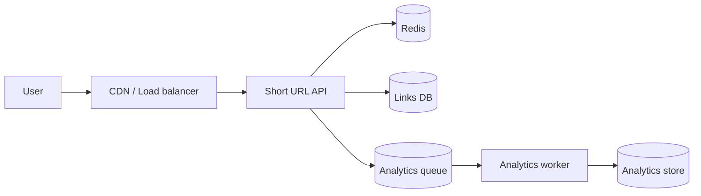
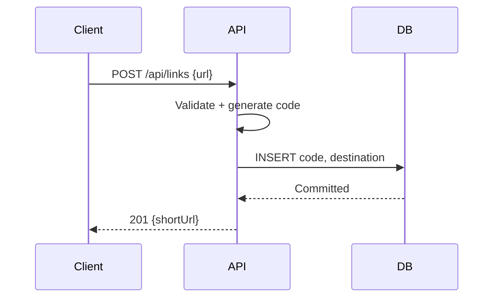
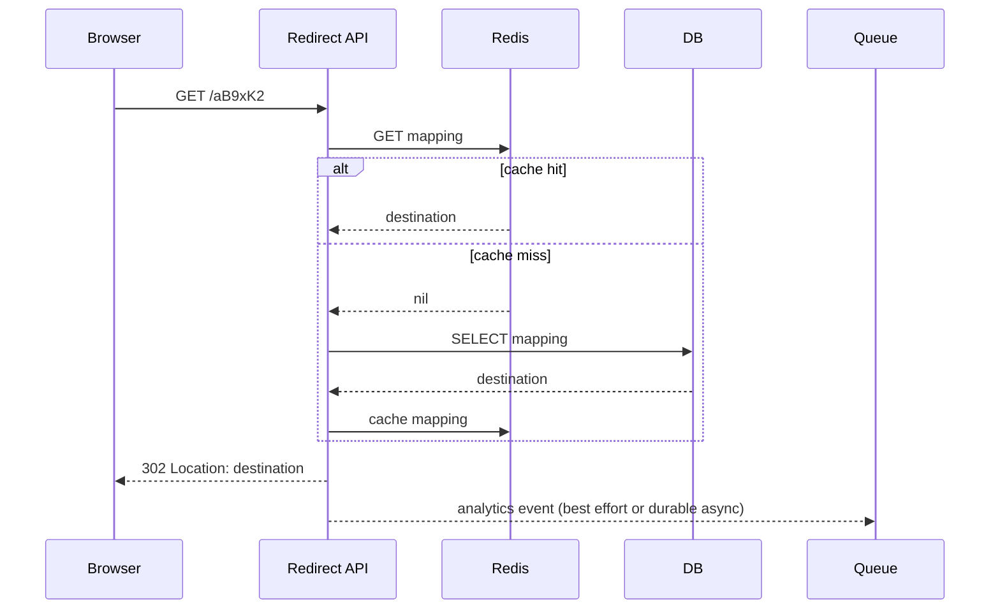
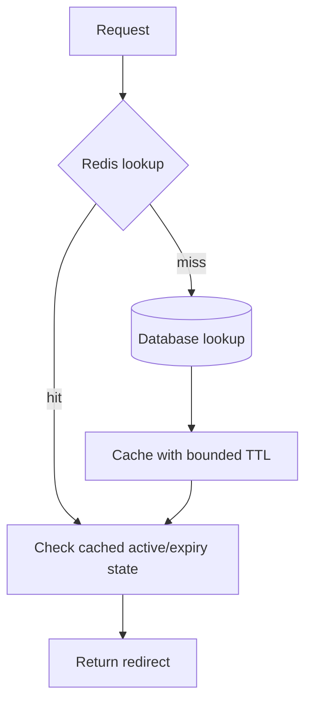
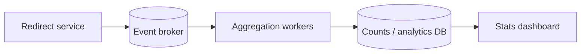

# Lesson 23 — URL Shortener ⭐⭐⭐⭐⭐

> **Goal:** Design a production-minded URL shortener step by step using simple English, realistic estimates, API and database design, Mermaid diagrams, runnable Node.js code, caching, analytics, security, and interview practice. All traffic figures are illustrative assumptions.

## 01. Problem statement and interview scope

Design a URL shortener like bit.ly: users submit a long URL and receive a short link, such as `https://sho.rt/aB9xK2`. Visiting the short link redirects to the original destination. We will design requirements, APIs, code generation, database, caching, analytics, abuse protection, scaling, failures, and a runnable Node.js implementation. Ask the interviewer for assumptions rather than pretending one scale fits every product.

## 02. Functional requirements

Must: create short URL, redirect short code, prevent duplicate code collisions, support optional expiry. Nice-to-have: custom aliases, user-owned link management, click analytics, QR code, disabled links, bulk creation. State whether repeated shortening of the same long URL should return the same short link: both behaviors are valid product decisions.

## 03. Non-functional requirements

Redirects should be low latency, highly available, and correct. Short links should not be guessable if privacy is promised (ordinary base62 links are **not** secure secrets). Handle abusive URLs, bot traffic, hot links, and analytics bursts. Define durability, availability, and acceptable eventual consistency for click counts.

## 04. Assumptions and capacity estimation

Illustrative workload: **1 million new links/day**, **100 million redirects/day**, 5-year retention, average stored record 500 bytes before indexes/replication. These are interview assumptions, not real bit.ly statistics. Recompute when requirements change.

## 05. Writes per second

`1,000,000 / 86,400 ≈ 11.6 creates/second` average. At 10× peak, plan around **116 creates/second**. Creation is relatively small compared with reads; ensure abuse controls and uniqueness.

## 06. Reads per second

`100,000,000 / 86,400 ≈ 1,157 redirects/second` average. At 10× peak, **~11,574 redirects/second**. Hot links can cause more uneven traffic than the average suggests.

## 07. Read/write ratio

At this scale, redirects to creates = **100:1**. Optimize the read path: short-code lookup, caching, regional routing, and asynchronous analytics. Do not add complex sharding before verifying that a normal relational database plus cache can meet measured load.

## 08. Storage estimate

1 million × 365 × 5 = **1.825 billion links** over five years. At 500 bytes/record, raw record storage ≈ **912.5 GB decimal**, excluding indexes, replicas, metadata, backups, and growth. Real storage may be substantially higher. Retention/expiry policy strongly affects this estimate.

## 09. Bandwidth estimate

If a redirect response is roughly 400 bytes on average, 100 million/day produces ~40 GB/day of response bytes, excluding TLS, headers beyond the assumption, network overhead, and client retries. Analytics events can be much larger than redirect responses.

## 10. High-level design


The redirect path must not wait for analytics processing. Cache misses query the authoritative links database.

## 11. Create URL flow


Only return success after the authoritative mapping is committed.

## 12. Redirect flow


Validate disabled/expired status consistently across cache and DB.

## 13. API design

| Method | Path | Purpose |
|---|---|---|
| POST | `/api/links` | Create short link |
| GET | `/:code` | Redirect |
| GET | `/api/links/:code` | Link details (authorized) |
| DELETE | `/api/links/:code` | Disable/delete owned link |
| GET | `/api/links/:code/stats` | Aggregated analytics |
Use separate namespaces so a short code cannot collide with reserved routes like `api` or `health`.

## 14. Create request and response

```http
POST /api/links HTTP/1.1
Content-Type: application/json

{"url":"https://example.com/articles/42","expiresAt":null}

HTTP/1.1 201 Created
Content-Type: application/json

{"code":"aB9xK2","shortUrl":"https://sho.rt/aB9xK2"}
```
Return 400 for malformed URLs, 409 for unavailable custom aliases, and 429 for rate limits.

## 15. HTTP redirects: 301 vs 302

**301 Moved Permanently** can be cached aggressively by browsers and intermediaries, making destination changes and click measurement harder. **302 Found** is often a safer default for editable links and server-observed analytics. 307/308 preserve request method; for a typical GET redirect they may not add value. Set explicit cache policy based on product semantics.

## 16. Status codes and edge cases

Unknown code: 404. Expired or disabled code: 404 or 410 according to public contract and privacy requirements. Malformed create input: 400. Alias collision: 409. Abuse throttling: 429. Temporary database outage: 503; do not redirect to a guessed destination.

## 17. Database schema

```sql
CREATE TABLE short_links (
  id BIGINT GENERATED ALWAYS AS IDENTITY PRIMARY KEY,
  code VARCHAR(16) NOT NULL UNIQUE,
  destination_url TEXT NOT NULL,
  owner_id BIGINT,
  created_at TIMESTAMPTZ NOT NULL DEFAULT now(),
  expires_at TIMESTAMPTZ,
  disabled_at TIMESTAMPTZ,
  click_count BIGINT NOT NULL DEFAULT 0
);
CREATE INDEX short_links_owner_created_idx
  ON short_links (owner_id, created_at DESC);
```
The unique code index makes redirect lookup efficient. A counter updated on every redirect can become a write hotspot; prefer async aggregation at scale.

## 18. Relational vs NoSQL database

PostgreSQL is a good default for correctness, unique aliases, ownership, and manageable scale. A distributed key-value store may help very large read/write scale and geographic replication, but introduces operational and consistency trade-offs. Choose based on measured requirements, not a rule that URL shorteners must use NoSQL.

## 19. Base62 encoding

Alphabet: `0-9a-zA-Z` (62 symbols). Encode a nonnegative integer by repeated division by 62 and map remainders to characters. A code of length L has **62^L** possibilities. Six characters offer ~56.8 billion possible strings; usable capacity depends on allocation strategy, collisions, and reserved words.

## 20. Base62 JavaScript implementation

```js
const ALPHABET = '0123456789abcdefghijklmnopqrstuvwxyzABCDEFGHIJKLMNOPQRSTUVWXYZ';
function toBase62(number) {
  let n = BigInt(number);
  if (n < 0n) throw new Error('Nonnegative only');
  if (n === 0n) return '0';
  let result = '';
  while (n > 0n) {
    result = ALPHABET[Number(n % 62n)] + result;
    n /= 62n;
  }
  return result;
}
console.log(toBase62(125n));
```
BigInt avoids JavaScript Number precision loss for large IDs. Sequential IDs encoded in base62 are predictable, not private.

## 21. Code generation approaches

**Sequence + base62:** collision-free if globally unique IDs, simple, predictable. **Random base62:** decentralized, collision probability, require DB unique constraint and retry. **Snowflake-like IDs:** distributed unique ID generation with clock/worker assumptions. **Preallocated ranges:** reduce coordination but require lease/recovery handling. **Hash of URL:** deterministic but collision and normalization concerns.

## 22. Random code generation

```js
import { randomInt } from 'node:crypto';
const ABC = '0123456789abcdefghijklmnopqrstuvwxyzABCDEFGHIJKLMNOPQRSTUVWXYZ';
function randomCode(length = 8) {
  let out = '';
  for (let i = 0; i < length; i++) out += ABC[randomInt(ABC.length)];
  return out;
}
```
`randomInt` uses cryptographic randomness with unbiased range selection. Still enforce a unique DB constraint and retry on collision; randomness does not guarantee uniqueness.

## 23. Birthday paradox and collisions

For M equally likely codes and n independently generated links, the approximate collision probability is `1 − exp(−n(n−1)/(2M))`. This estimates the chance of **at least one collision** without retry; it does not mean the system must fail. A unique index plus regeneration resolves collisions. At billions of links, choose sufficient code length.

## 24. Collision handling algorithm

Generate code → attempt INSERT → if unique-code violation, generate a fresh code and retry a bounded number of times → return 503 if the service cannot allocate a code safely. Never do SELECT-to-check then INSERT without a unique constraint; two requests can race.

## 25. Custom aliases

Validate allowed characters and length, reserve system words (`api`, `admin`, `health`), and enforce case sensitivity consistently. A unique DB index is authoritative. Decide whether expired aliases can be reused; permanent non-reuse prevents surprising or dangerous link reassignment.

## 26. URL validation

Parse with `new URL(input)`; allow only `http:` and `https:` unless requirements explicitly permit more. Limit input length and reject malformed/control-character inputs. Normalize only where product semantics permit; URLs can differ in meaningful query strings, fragments, and encoding.

## 27. SSRF and redirect abuse

Simply redirecting a browser is not the same as server-side fetching, but the shortener can facilitate phishing and malicious destinations. If the server fetches previews, **SSRF** becomes a direct risk: block private/internal IP ranges, validate DNS resolutions and redirects, and isolate fetch workers. Use abuse reports, domain reputation checks, and safe-browsing controls as appropriate.

## 28. Open redirect and trust

A URL shortener intentionally redirects to user-supplied destinations. Users may treat its domain as trusted. Consider destination preview/interstitials for suspicious links, clear abuse policies, and moderation. Never imply every short link is safe.

## 29. Deduplicating long URLs

Two users may shorten the same destination but want separate analytics, ownership, expiry, and aliases. Do not globally deduplicate by long URL unless product requirements explicitly demand it. An optional per-user idempotency key can prevent accidental double-submit without merging distinct intended links.

## 30. Cache-aside

On redirect, read Redis by code; on miss, fetch DB and cache active mapping with TTL. If links can be disabled or edited, invalidation/versioning matters. A cached active mapping must not outlive its expiry; cache TTL should be bounded by remaining link lifetime.

## 31. Cache-aside diagram



## 32. Cache invalidation

On edit/disable, commit DB update then invalidate cached mapping. Races can repopulate stale values after invalidation; use short TTL, version-aware writes, or a consistency-sensitive read path. If immediate revocation is required, bypass or coordinate the cache rather than assuming best-effort deletion is sufficient.

## 33. Negative caching

Caching missing codes for a short time reduces DB load from repeated invalid requests, but attackers can generate huge numbers of unique misses and explode cache cardinality. Bound TTL, memory, and per-client request rates; avoid caching arbitrary attacker-controlled strings indefinitely.

## 34. Hot keys

A celebrity link may receive millions of redirects and become a hot cache key. Redis can serve many reads but single-key concentration and network bottlenecks still matter. CDN/edge redirects or replicated caches can reduce central load, subject to invalidation and analytics requirements.

## 35. CDN and edge redirects

At the edge, cached redirect responses reduce origin latency and load. However, long-lived caching can hide analytics events and delay link disabling. Decide whether edge logging is trustworthy/available and whether immediate link revocation is more important than maximum cache hit rate.

## 36. Analytics architecture

Do not synchronously update a database click counter for every redirect. Emit an event (code, timestamp, coarse location, referrer where permitted) to a queue/log, then aggregate asynchronously. Respect privacy and retention requirements; avoid collecting more personal data than needed.

## 37. Analytics pipeline diagram


Click counts are often eventually consistent; users should not expect immediate exact totals.

## 38. At-least-once analytics

A worker can crash after incrementing a count but before ACK. The event may be redelivered and counted twice. Deduplicate event IDs where exactness matters, or document approximate analytics. “Exactly-once delivery” claims require precise broker/storage transaction scope.

## 39. Privacy and bot filtering

Separate total hits from unique human clicks; bots, previews, and link scanners can inflate counts. Unique-visitor measurement is probabilistic and privacy-sensitive. Avoid storing raw IP addresses longer than necessary and comply with applicable laws and product policies.

## 40. Rate limiting

Apply stricter limits to link creation and custom alias attempts than to public redirects. Use authenticated user/API-key limits where possible, IP/network limits for anonymous traffic, and global abuse safeguards. Redis-based shared atomic limits help across multiple API instances.

## 41. Link expiry

Store `expires_at` in DB; every authoritative redirect decision must reject expired links. Cache TTL should not exceed remaining expiry. Background cleanup is optional for correctness but useful for storage management. Never depend solely on a cron job to enforce expiration.

## 42. Deletion and disabling

Soft-disable with `disabled_at` to preserve audit/history and prevent reuse. Hard deletion may be needed for retention/privacy requirements. Ensure caches and edge layers respect revocation; for strict immediate disable, choose a strongly coordinated validation path.

## 43. Multi-region design

Serve redirects close to users with regional caches/replicas, but define acceptable staleness. Link creation and custom alias uniqueness need a global coordination strategy or regional ownership. Multi-region active-active writes add complexity; don't choose them without a clear latency/availability requirement.

## 44. Sharding strategy

If one DB can no longer meet storage/write needs, shard by hash(code) to distribute redirects and records. Range sharding can create uneven load depending on code generation. Keep routing consistent and plan online resharding. Global alias uniqueness across shards needs explicit enforcement.

## 45. Availability and failure behavior

Redis down → controlled DB fallback with concurrency limits. DB down + cache hit → may redirect only if staleness/revocation policy allows; DB down + cache miss → 503. Analytics queue down → decide whether to drop approximate events or buffer durably, without blocking redirects unnecessarily.

## 46. Failure matrix

| Failure | Behavior |
|---|---|
| Redis unavailable | Limited DB fallback |
| DB unavailable, cache miss | 503; do not guess destination |
| Analytics queue unavailable | Continue redirects if analytics is best-effort |
| Duplicate generated code | Retry after unique violation |
| Link disabled but edge cache stale | Revocation policy determines acceptable risk |
| Region down | Route to healthy region if topology supports it |

## 47. Data consistency

The code→destination mapping is authoritative and must be correct. Redirects can use eventually consistent replicas/caches only within a defined staleness budget. Click counts can be eventual. Custom aliases need uniqueness. These features require different guarantees; one global “strong consistency” label is insufficient.

## 48. Observability

Measure redirect p50/p95/p99 latency, cache hit ratio, DB query time, create failures, unique collisions, 404/410/429/503 rates, hot codes, queue lag, event loss, and abuse reports. Correlate request IDs without exposing long URLs or sensitive query parameters in logs.

## 49. Cost optimization

The 100:1 read/write ratio favors caching and edge delivery. Avoid synchronous analytics writes. Tune Redis TTL based on hit rate and revocation needs; estimate storage with indexes and replication, not raw record bytes only. Benchmark before introducing sharding.

## 50. Security checklist

Validate schemes and lengths; reserve aliases; prevent phishing/abuse; protect authenticated management endpoints; rate-limit creation; avoid secrets in analytics logs; isolate preview fetchers against SSRF; enforce ownership on delete/stats; use HTTPS; handle malicious Unicode/punycode domains thoughtfully.

## 51. Minimal Express demo

```js
// demo.mjs — npm install express
import express from 'express';
import { randomInt } from 'node:crypto';
const app = express();
app.use(express.json());
const links = new Map(); // DEMO ONLY: not durable/shared
const chars = '0123456789abcdefghijklmnopqrstuvwxyzABCDEFGHIJKLMNOPQRSTUVWXYZ';
const code = () => Array.from({length: 8}, () => chars[randomInt(chars.length)]).join('');
app.post('/api/links', (req, res) => {
  let destination;
  try { destination = new URL(req.body?.url); }
  catch { return res.status(400).json({ error: 'Invalid URL' }); }
  if (!['http:', 'https:'].includes(destination.protocol))
    return res.status(400).json({ error: 'Only HTTP(S) URLs allowed' });
  let short;
  do { short = code(); } while (links.has(short));
  links.set(short, destination.toString());
  return res.status(201).json({ code: short, shortUrl: 'http://localhost:3000/' + short });
});
app.get('/:code', (req, res) => {
  const destination = links.get(req.params.code);
  if (!destination) return res.status(404).json({ error: 'Not found' });
  return res.redirect(302, destination);
});
app.listen(3000, () => console.log('http://localhost:3000'));
```
Run `node demo.mjs`. This deliberately omits authentication, expiry, rate limits, persistent storage, and distributed concurrency. For production, replace Map with a DB unique index and add abuse protections.

## 52. PostgreSQL create pseudocode

```text
validate URL and authenticate caller
repeat up to 5 attempts:
  candidate = secureRandomBase62(8)
  INSERT INTO short_links(code, destination_url, owner_id, expires_at)
  if success: return committed short URL
  if UNIQUE(code) violation: retry
  else: surface DB error
return 503 if no unique code allocated
```
Never use SELECT then INSERT as the only collision protection.

## 53. Redis redirect pseudocode

```text
GET link:{code}
if cached:
  if disabled or expired: return 410
  else: redirect 302
else:
  SELECT code,destination_url,expires_at,disabled_at FROM short_links
  if not found: return 404
  if disabled/expired: return 410
  SETEX link:{code} ttl bounded by remaining lifetime
  redirect 302
```
A cache record must contain sufficient validity metadata; handle revocation races deliberately.

## 54. Load test plan

Benchmark realistic redirect mix: hot links, cold misses, random nonexistent codes, and expired links. Measure latency at average and peak QPS, cache hit ratio, DB saturation, Redis memory, and queue lag. Simulate Redis failure, DB failover, and a burst of 404 requests. Verify correctness before throughput.

## 55. Interview trade-off discussion

**Random vs sequential codes:** decentralization vs predictability. **PostgreSQL vs key-value store:** transactional uniqueness vs horizontal scale complexity. **Cache TTL:** performance vs revocation freshness. **302 vs 301:** editable links/analytics vs caching. **Sync vs async analytics:** accurate immediate counters vs redirect latency. Explain assumptions and alternatives.

## 56. Common mistakes

Using an in-memory Map in production; forgetting unique code index; claiming base62 codes are private; assuming random codes never collide; treating 301 and 302 as identical; allowing cache TTL beyond expiry; updating one SQL click counter on every redirect; ignoring phishing; globally deduplicating long URLs without product requirements; designing sharding before measuring; omitting reserved aliases.

## 57. Interview Q&A

**Q1:** Why cache? Redirect-heavy workload. **Q2:** Why 302? Editable links and analytics. **Q3:** Why unique DB index? Prevent code collisions under concurrency. **Q4:** How generate code? Base62 sequence/random/ID allocation. **Q5:** Base62 six-char space? 62^6 ≈ 56.8 billion. **Q6:** Are codes secure? Not by default. **Q7:** Why async analytics? Avoid write bottleneck on redirects. **Q8:** What if Redis fails? Controlled DB fallback. **Q9:** How expire links? Check expires_at on every valid lookup. **Q10:** How disable immediately? Coordinated cache invalidation/authoritative validation. **Q11:** How scale DB? Cache, tune indexes, then shard if necessary. **Q12:** How prevent SSRF? Protect any server-side preview fetcher. **Q13:** What about duplicate long URLs? Product decision. **Q14:** How handle bots? Abuse controls and analytics filtering. **Q15:** What is hot key? Highly popular short code. **Q16:** What if response lost after creation? Client idempotency key. **Q17:** What consistency for counts? Usually eventual. **Q18:** How protect custom aliases? Unique constraint and reserved words. **Q19:** What if queue down? Defined best-effort/durable buffering policy. **Q20:** What to monitor? Latency, hit ratio, failures, queue lag, abuse.

## 58. Exercises

1. Build the Express demo and test redirects. 2. Replace Map with PostgreSQL and unique code index. 3. Add a Redis cache with expiry-aware TTL. 4. Implement custom aliases with reserved words. 5. Add client idempotency keys for creation retries. 6. Add disable/expiry tests. 7. Push click events into a queue and aggregate asynchronously. 8. Simulate 1000 concurrent code creations. 9. Estimate storage for 10 million links/day and 3 years. 10. Present the design in 30 minutes with an architecture diagram.

## 59. Final checklist

- [ ] I can clarify functional and non-functional requirements.
- [ ] I can calculate QPS, read/write ratio, and storage.
- [ ] I can draw create and redirect flows.
- [ ] I understand base62, random codes, and collision handling.
- [ ] I can design the PostgreSQL schema and indexes.
- [ ] I can explain 301 vs 302 and cache trade-offs.
- [ ] I can design async analytics and duplicate handling.
- [ ] I understand expiry, disable, and cache invalidation.
- [ ] I can handle failures, hot links, and abusive URLs.
- [ ] I can implement and test a simple Node.js shortener.

---

**Key takeaway:** Start with requirements and estimates, optimize the redirect-heavy read path, preserve code uniqueness and link validity, and keep analytics asynchronous.
