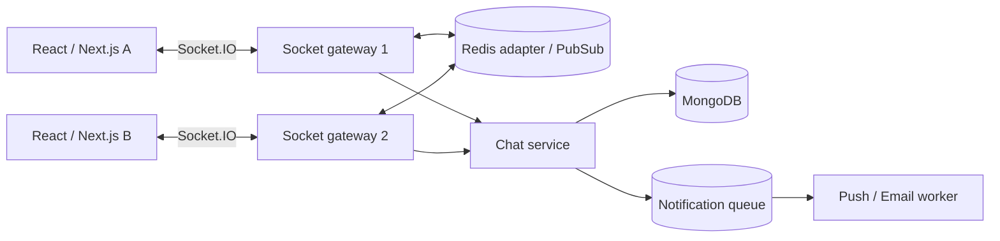
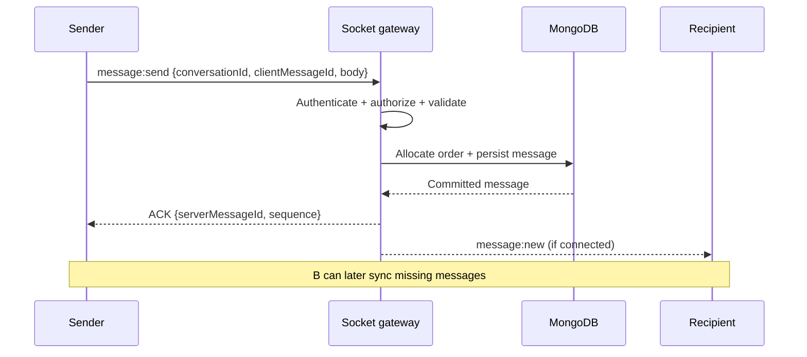
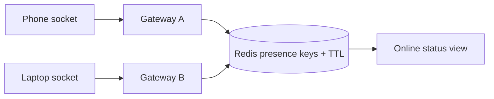
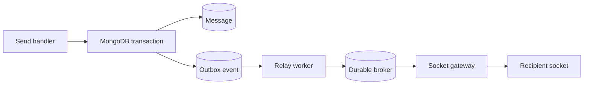

# Lesson 24 — Chat System ⭐⭐⭐⭐⭐

> **Goal:** Design a reliable, secure, scalable real-time chat system using simple English, Mermaid diagrams, TypeScript/JavaScript ideas, MongoDB, Socket.IO, Redis, and practical CodeBuddy examples. All capacity and latency figures are illustrative design assumptions.

## 01. Goal and scope

Design a WhatsApp-style **one-to-one chat** system, then extend it to group chat. Start with CodeBuddy's existing Node.js, Express, MongoDB, Socket.IO stack. Requirements: authenticated users, persistent messages, near-real-time delivery, conversation history, reconnect/sync, read receipts, typing indicators, and presence. Advanced: media, push notifications, search, groups, multi-device sync, and end-to-end encryption. Clearly separate MVP from production scale.

## 02. Functional requirements

A user can start a conversation with an authorized peer, send a text message, receive it online, load older messages, see delivery/read status, and reconnect without losing history. Define whether users can edit/delete messages, whether blocking prevents delivery, whether attachments are supported, and whether ordering is per conversation or global.

## 03. Nonfunctional requirements

Prioritize durable accepted messages, per-conversation ordering, low online delivery latency, secure authorization, and reasonable availability. Example targets for discussion: p95 online delivery under 300 ms in one region, 99.9% API availability, and no duplicate stored messages from retries. These are **design assumptions**, not performance claims.

## 04. Capacity planning example

Assume 100,000 daily active users, each sends 40 messages/day: **4 million messages/day**, average ~46 messages/sec. At 10× peak, ~463 messages/sec. If a stored message plus indexes/metadata averages 1 KB, raw new storage ≈4 GB/day or ~1.46 TB/year before replication, attachments, backups, and retention. For 20,000 simultaneous sockets, budget connection memory and file descriptors separately.

## 05. High-level architecture


Socket gateways manage live connections; MongoDB is authoritative for message history. Redis adapter helps cross-instance room broadcasts, not permanent message storage.

## 06. HTTP vs WebSocket vs Socket.IO

HTTP request/response is ideal for initial history, search, uploads, and account management. WebSocket maintains a bidirectional connection for real-time events. Socket.IO adds event framing, rooms, acknowledgments, reconnection, and fallback transport behavior. Socket.IO is **not** wire-compatible with a raw WebSocket client. Socket.IO delivery and connection-state recovery guarantees depend on configuration and adapters.

## 07. Handshake and authentication

Authenticate socket connections with a session cookie or short-lived token. Verify the token **server-side** and derive userId from trusted claims/session—not from a client-supplied room name. Check origin/CORS and cookie SameSite/security rules. Revalidate authorization for sensitive events, and handle expired sessions/revocation.

## 08. Room model

Use a stable conversation ID for rooms, e.g. `conversation:64f...`, and optionally a per-user room `user:123` for multi-device notifications. Room membership is an optimization for routing, **not** authorization. A user may join only if the database says they are an active participant.

## 09. CodeBuddy sorted pair ID nuance

For a two-person chat, sorting user IDs into `[minId,maxId]` can derive a deterministic pair key. However, the server must still verify an approved connection or permitted conversation. A MongoDB `Conversation` document with a unique normalized participant-pair key is safer than treating an arbitrary string as permission. Groups require separate membership tables/documents.

## 10. MongoDB data model

```js
// Conceptual Mongoose schemas
const conversationSchema = new Schema({
  type: { type: String, enum: ['direct', 'group'], required: true },
  participantIds: [{ type: Schema.Types.ObjectId, ref: 'User' }],
  directPairKey: { type: String }, // normalized direct chat pair
  nextSequence: { type: Number, default: 0 },
  lastMessageAt: Date
}, { timestamps: true });
conversationSchema.index({ directPairKey: 1 }, {
  unique: true, partialFilterExpression: { directPairKey: { $type: 'string' } }
});
const messageSchema = new Schema({
  conversationId: { type: Schema.Types.ObjectId, required: true, ref: 'Conversation' },
  senderId: { type: Schema.Types.ObjectId, required: true, ref: 'User' },
  clientMessageId: { type: String, required: true },
  sequence: { type: Number, required: true },
  body: { type: String, required: true, maxlength: 5000 },
  deletedAt: Date
}, { timestamps: true });
messageSchema.index({ conversationId: 1, sequence: 1 }, { unique: true });
messageSchema.index({ conversationId: 1, senderId: 1, clientMessageId: 1 }, { unique: true });
```
Enforce direct-pair uniqueness and message indexes in the DB. Sequence allocation needs an atomic design; see next sections.

## 11. Why indexes matter

To fetch history, query by `conversationId` and `sequence < cursor`, sorted descending, with a limit. Compound index `{conversationId:1, sequence:1}` supports efficient ordered lookup. An index on sender/clientMessageId prevents duplicate inserts. Indexes use storage and slow writes slightly; benchmark.

## 12. Send message end-to-end


Do not acknowledge a message as **persisted** before the authoritative write commits.

## 13. Acknowledgment semantics

Distinguish **client queued** (local only), **server accepted/persisted** (DB committed), **delivered** (recipient device received/acknowledged), and **read** (recipient explicitly opened/marked). Socket.IO ACK merely confirms a handler responded; it does not automatically prove database durability or recipient delivery.

## 14. At-most-once vs at-least-once

A bare socket emit can be lost during disconnect; default Socket.IO client-to-server delivery is not an end-to-end durable queue. Implement retries with stable `clientMessageId` and deduplication for at-least-once **attempts**. Server-to-client missed events require offset/history synchronization or a supported recovery mechanism. Exactly-once network delivery is not a practical blanket guarantee.

## 15. Message idempotency

When the sender times out after the DB commits, it retries the **same** clientMessageId. A unique index on (conversationId, senderId, clientMessageId) ensures only one stored logical message. On duplicate-key error, fetch the existing message and ACK it, after verifying the payload/fingerprint matches the original.

## 16. Ordering: define the scope

Most chat products need **per-conversation** order, not one global order across all users. Client timestamps are unreliable due to clock skew. MongoDB ObjectIds and creation timestamps are not sufficient to guarantee a strict per-conversation sequence under concurrent writes. Use server-assigned sequence numbers and a defined commit/visibility protocol.

## 17. Sequence allocation and atomicity

A naive `$inc` on Conversation followed by a separate message insert can leave gaps after a crash. Gaps are often acceptable if clients sort by sequence and sync correctly. If strict committed ordering is required, allocate sequence and insert message in one MongoDB transaction, with a retry strategy for concurrent transaction conflicts. Keep transactions short and understand hot-conversation contention.

## 18. Atomic counter example

```js
// Example within a supported MongoDB transaction/session.
const updated = await Conversation.findOneAndUpdate(
  { _id: conversationId, participantIds: senderId },
  { $inc: { nextSequence: 1 } },
  { new: true, session }
);
if (!updated) throw new Error('Conversation not found or unauthorized');
await Message.create([{
  conversationId, senderId, clientMessageId,
  sequence: updated.nextSequence, body
}], { session });
// Commit transaction before acknowledging to sender.
```
The transaction caller must handle duplicate client IDs, transient transaction retries, and uncertain commit results correctly. Never retry the entire business operation with a fresh clientMessageId.

## 19. Concurrency and ordering caveat

Concurrent sends to one conversation contend on the conversation counter, helping establish one sequence order. A successful sequence allocation is not a committed message until the transaction commits. Consumers should order by committed `sequence` and tolerate gaps if using nontransactional allocation. Per-conversation single-writer queues are an alternative for very hot chats.

## 20. Socket.IO server skeleton

```js
import { Server } from 'socket.io';
const io = new Server(httpServer, { cors: { origin: 'https://app.example.com', credentials: true } });
io.use(async (socket, next) => {
  try { socket.data.userId = await verifySocketSession(socket.handshake); next(); }
  catch { next(new Error('Unauthorized')); }
});
io.on('connection', socket => {
  socket.join('user:' + socket.data.userId);
  socket.on('conversation:join', async ({ conversationId }, ack) => {
    try {
      await assertParticipant(conversationId, socket.data.userId);
      await socket.join('conversation:' + conversationId);
      ack?.({ ok: true });
    } catch { ack?.({ ok: false, error: 'Forbidden' }); }
  });
  socket.on('message:send', async (input, ack) => {
    try {
      const msg = await persistMessageOnce(socket.data.userId, input);
      io.to('conversation:' + msg.conversationId).emit('message:new', msg);
      ack?.({ ok: true, messageId: msg.id, sequence: msg.sequence });
    } catch { ack?.({ ok: false, error: 'Unable to send message' }); }
  });
});
```
This is an **integration skeleton**, not a complete runnable app: provide `httpServer`, auth, validation, rate limiting, storage, and error classification. The broadcast may be lost after commit; history sync repairs it.

## 21. Socket.IO client skeleton

```js
import { io } from 'socket.io-client';
const socket = io('https://api.example.com', { withCredentials: true, autoConnect: false });
socket.connect();
socket.on('message:new', message => upsertById(message));
async function sendMessage(conversationId, body) {
  const clientMessageId = crypto.randomUUID();
  showPending({ clientMessageId, body });
  // Preserve clientMessageId if the same logical send is retried.
  const ack = await socket.timeout(5000).emitWithAck('message:send', {
    conversationId, clientMessageId, body
  });
  if (!ack.ok) throw new Error(ack.error);
  markPersisted(clientMessageId, ack.messageId);
}
```
Persist an unsent queue locally if you promise offline sending; `crypto.randomUUID()` is available in modern secure browser contexts.

## 22. Reconnect and missed-message sync

Store each conversation's last seen server sequence (or durable offset). On reconnect, call `GET /conversations/:id/messages?afterSequence=N` and merge by stable message ID. Live events can arrive while history loads; deduplicate and sort. Do not rely solely on transient room events for durable delivery.

## 23. History pagination

```js
const messages = await Message.find({
  conversationId,
  sequence: { $lt: beforeSequence }
}).sort({ sequence: -1 }).limit(30).lean();
```
First authorize membership. Cursor pagination scales better than large `skip` offsets. Reverse results for chronological display if desired; use the message sequence as cursor.

## 24. Offline recipients

Persist the message regardless of recipient socket presence. Mark it as available for later sync. Push notifications may wake mobile devices, but push delivery is best-effort and should not be treated as the authoritative message store. Avoid including sensitive message text in push payloads if privacy requirements prohibit it.

## 25. Delivery receipts

A recipient device sends an acknowledgment for message IDs/sequence it has received. Store per-user or per-device delivery cursor, depending on product semantics. Receiving a socket packet does not prove a human saw it. Define what “delivered” means for multiple devices.

## 26. Read receipts

Track a monotonic `lastReadSequence` per conversation participant (and optionally per device). Update with `$max` to prevent an old event from moving read state backward. A group chat may need per-member read cursors; don't update every message row individually if a cursor suffices.

## 27. Read cursor update

```js
await ConversationMember.updateOne(
  { conversationId, userId },
  { $max: { lastReadSequence: sequence } }
);
```
Validate that the sequence belongs to an accessible message in this conversation and does not exceed the authorized visible range.

## 28. Typing indicators

Typing is ephemeral: `typing:start` and `typing:stop` events, debounced/throttled, with short client-side expiry. Do not store every keystroke in MongoDB. On disconnect or timeout, clear indicators. Typing status is best-effort, not guaranteed consistent.

## 29. Presence: online and last seen

Presence is harder than it looks: a user may have several tabs/devices and connections across gateways. Maintain connection counts or sets with TTL/heartbeat in shared state. Mark offline only when all active connections expire/disconnect. Network partitions can produce false online/offline states, so treat presence as approximate.

## 30. Presence diagram


Redis Pub/Sub alone is not a durable presence database; use appropriate TTL-based coordination and cleanup.

## 31. One-to-one vs group chat

Direct chat has two authorized participants and a normalized pair key. Group chat adds membership, roles, joins/leaves, message fan-out, moderation, and potentially very large audiences. Use conversation IDs and membership records rather than deriving group rooms from sorted pairs.

## 32. Group membership schema

```text
Conversation: id, type, name, createdAt
ConversationMember: conversationId, userId, role, joinedAt, leftAt, lastReadSequence
Message: id, conversationId, senderId, sequence, body, createdAt
```
Enforce a unique (conversationId,userId) membership key. Decide whether a new member can view history before joining and whether departed members retain access.

## 33. Group fan-out trade-offs

**Fan-out on write:** precompute per-user inbox pointers/notifications, fast reads but expensive for huge groups. **Fan-out on read:** store one group message and query it per member, simpler writes but more expensive reads. Hybrid approaches are common; keep authoritative group messages once and optimize delivery separately.

## 34. Horizontal Socket.IO scaling

When users connect to different Node.js instances, `io.to(room).emit(...)` needs a cross-instance adapter to reach all sockets. Redis adapter publishes room broadcasts across gateways. It does not automatically share durable chat history or provide reliable replay after an outage.

## 35. Redis adapter example

```js
import { createAdapter } from '@socket.io/redis-adapter';
import { createClient } from 'redis';
const pub = createClient({ url: process.env.REDIS_URL });
const sub = pub.duplicate();
await Promise.all([pub.connect(), sub.connect()]);
io.adapter(createAdapter(pub, sub));
```
Install `@socket.io/redis-adapter` and `redis`. Adapter capabilities vary; check whether your chosen adapter supports connection state recovery. Standard Redis Pub/Sub is not durable.

## 36. Sticky sessions and transports

If HTTP long-polling is enabled, load balancers may need sticky sessions so successive polling requests reach the same Socket.IO server. Pure WebSocket transport can reduce this requirement, but introduces compatibility and fallback trade-offs. Configure the reverse proxy for upgrades, idle timeouts, and heartbeats.

## 37. Redis outage behavior

An adapter failure can prevent cross-instance broadcasts while local sockets remain connected. Durable messages should still be stored in MongoDB, and clients must catch up through history sync. Decide whether sends continue when the adapter is unavailable and monitor broadcast failures.

## 38. Socket gateway failure

When a gateway crashes, connected clients disconnect and reconnect to another instance. On reconnect, reauthenticate, rejoin authorized rooms, and sync from the last known message sequence. Pending sends retry with stable clientMessageIds; otherwise duplicate inserts can occur.

## 39. Database failure

If MongoDB is unavailable, do not acknowledge messages as persisted. The client can keep a local pending state and retry later. A queue-first design is possible but must define exactly when “accepted” becomes durable and how the queue is reconciled into history.

## 40. Commit-to-broadcast gap

MongoDB commit succeeds but the gateway crashes before broadcasting. Message exists yet online recipient receives no event. Recovery: reconnect/history sync; stronger near-real-time guarantees can use a transactional outbox and relay, with idempotent delivery. Broadcasting before commit creates a different bug: recipients see messages that may never persist.

## 41. Outbox architecture


The relay may publish twice; deduplicate events and rely on client history sync. MongoDB transactions require a compatible deployment.

## 42. Ordering across gateways

Two gateways can process messages for the same conversation concurrently. A shared sequence allocator or single-writer partition determines authoritative order. Network delivery may arrive out of order even when database sequences are correct; clients reorder by sequence and request missing gaps.

## 43. Consistency requirements

Message persistence and conversation membership need authoritative correctness. Typing and presence can be eventually consistent. Read receipts are monotonic but may arrive late. Analytics can lag. Specify consistency per feature rather than treating the entire chat product as one consistency model.

## 44. Rate limiting and abuse

Limit messages per user/conversation, room joins, connection attempts, attachment uploads, and typing events. Enforce body size, validate content, and apply spam/moderation rules. Distributed Socket.IO gateways need shared rate-limit state for global per-user policies. Limits are not substitutes for authorization.

## 45. Authorization and blocking

Before every send and history read, verify active membership and block rules. A room join is not proof of permission. If a user is removed or blocked, revoke membership/leave rooms and enforce DB-side checks so stale sockets cannot send or read unauthorized data.

## 46. Privacy and encryption

Use TLS for transport and encrypt sensitive data at rest where appropriate. End-to-end encryption is a separate architecture: servers cannot inspect plaintext and must manage device keys, multi-device synchronization, recovery, and abuse trade-offs. Do not call TLS-only chat “end-to-end encrypted.”

## 47. Attachment design

Upload media through authenticated, short-lived signed object-storage URLs; scan/validate files, store metadata in messages, and serve via authorized access paths. Avoid putting large binaries into Socket.IO events or MongoDB message documents. Handle unfinished uploads and orphan cleanup.

## 48. Search design

For MVP, query indexed recent conversation history. At scale, add a dedicated search index fed asynchronously from message events. Search results may lag new messages. For end-to-end encrypted chats, server-side plaintext search may be unavailable by design.

## 49. Push notifications

When recipients are offline, queue a push notification via FCM/APNs or email as appropriate. Deduplicate notification jobs and respect mute/privacy settings. A push success does not mean message read or delivered to every device. Avoid sending the same notification from every gateway.

## 50. Multi-device sync

Each device may connect independently and maintain its own last synced sequence. Persist server messages once and synchronize device cursors. Product policy decides whether “read” is per-user across devices or per-device. Stable IDs let each device merge duplicate live/history events.

## 51. Monitoring and SLOs

Track socket connections, disconnect/reconnect rate, authentication failures, send-to-commit latency, commit-to-delivery latency, DB errors, duplicate-key retries, Redis adapter errors, missed sequence gaps, queue lag, unread cursor updates, and per-conversation hot spots. Trace send request → DB commit → broadcast → client ACK.

## 52. Testing plan

Test two simultaneous sends, duplicate clientMessageIds, lost ACK, gateway crash after commit, recipient offline, reconnect during history fetch, stale membership, blocked users, Redis outage, MongoDB outage, 10k sockets, and multiple gateways. Use fault injection and load testing; verify no duplicate persisted messages and no unauthorized delivery.

## 53. CodeBuddy migration roadmap

**Phase 1:** persist conversation/message schemas with indexes; authenticate sockets; authorize rooms; stable clientMessageId and ACK. **Phase 2:** cursor history sync, read receipts, typing, presence. **Phase 3:** Redis adapter and multi-instance load testing. **Phase 4:** durable outbox, notifications, moderation, media. Deploy only the complexity you need; a single gateway is valid early on.

## 54. Interview trade-off table

| Choice | Benefit | Cost |
|---|---|---|
| Socket.IO | Rooms, ACK, reconnect | Framework protocol and scaling setup |
| MongoDB messages | Flexible docs, indexes | Hot counters/transactions need care |
| Per-conversation sequence | Stable ordering | Contention on hot conversations |
| Redis adapter | Cross-instance broadcast | Pub/Sub not durable |
| Cursor sync | Recovers missed events | Extra API and client merge logic |
| Async notifications | Fast send path | Eventual delivery/retries |
| Outbox | Repairs commit/broadcast gap | More moving parts |

## 55. Common mistakes

Trusting user-supplied senderId; assuming room names authorize access; emitting before DB commit; confusing Socket.IO ACK with durable delivery; no deduplication on retries; using timestamps as perfect ordering; expecting Redis Pub/Sub to replay missed messages; forgetting polling sticky sessions; storing every typing event; marking user offline when one of several tabs disconnects; claiming E2EE without key management; no reconnect history sync.

## 56. Interview questions

**Q1:** Why WebSocket? Bidirectional low-latency communication. **Q2:** Socket.IO vs raw WebSocket? Extra protocol, rooms, ACK, reconnect. **Q3:** Where persist messages? Authoritative database. **Q4:** Why clientMessageId? Idempotent retries. **Q5:** Why per-conversation sequence? Deterministic order. **Q6:** Is timestamp enough? No, clock/concurrency issues. **Q7:** What is ACK? Application-defined handler response, not automatic durability. **Q8:** Offline recipient? Persist then sync/push. **Q9:** Redis adapter? Cross-instance broadcast. **Q10:** Redis Pub/Sub durable? No. **Q11:** How reconnect? Cursor history sync. **Q12:** How handle duplicate send? Unique index and same ID. **Q13:** Why outbox? Bridge commit-to-broadcast gap. **Q14:** Read receipt vs delivery? Human view vs device receipt. **Q15:** Presence challenges? Multi-device and TTL. **Q16:** Group fan-out? Write vs read strategies. **Q17:** Sticky sessions? Polling transport across load balancers. **Q18:** How authorize? DB membership checks. **Q19:** E2EE? Client-held encryption keys and server cannot read plaintext. **Q20:** Scale hot chat? Partition/single-writer strategies and backpressure.

## 57. Practical exercises

1. Draw CodeBuddy's current and scaled chat architecture. 2. Create MongoDB schemas/indexes for Conversation and Message. 3. Implement authenticated Socket.IO room join. 4. Add clientMessageId uniqueness and simulate lost ACK. 5. Add per-conversation sequence allocation with a transaction. 6. Implement cursor history API and reconnect sync. 7. Add monotonic read receipts. 8. Simulate two devices for one user and presence. 9. Run two socket gateways with Redis adapter. 10. Crash gateway after DB commit and verify eventual message recovery.

## 58. Final checklist

- [ ] I can explain HTTP, WebSocket, and Socket.IO roles.
- [ ] I can design schemas and indexes for direct/group chat.
- [ ] I understand send ACK, delivery, and read semantics.
- [ ] I can prevent duplicate messages under retries.
- [ ] I can implement per-conversation ordering and cursor pagination.
- [ ] I can handle offline users and reconnect sync.
- [ ] I can explain typing, presence, and multi-device challenges.
- [ ] I understand Redis adapter scaling and its durability limits.
- [ ] I can design the outbox for commit-to-broadcast failures.
- [ ] I can explain authorization, abuse controls, and E2EE trade-offs.

---

**Core takeaway:** Persist first, ACK with precise semantics, deliver live where possible, and always provide durable history sync for missed events. Redis Pub/Sub improves routing but never replaces the message database.
