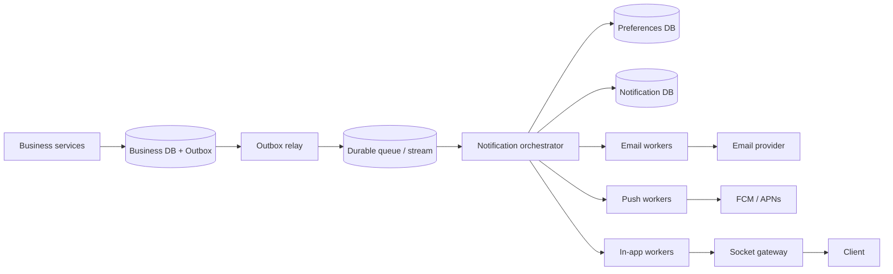
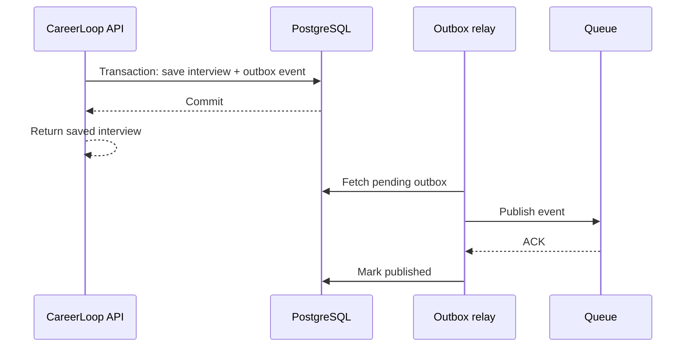
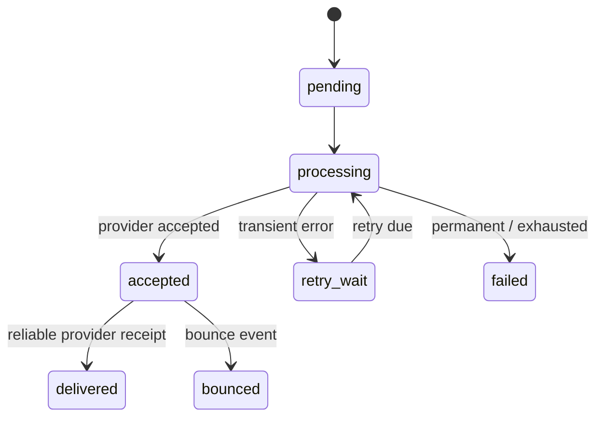
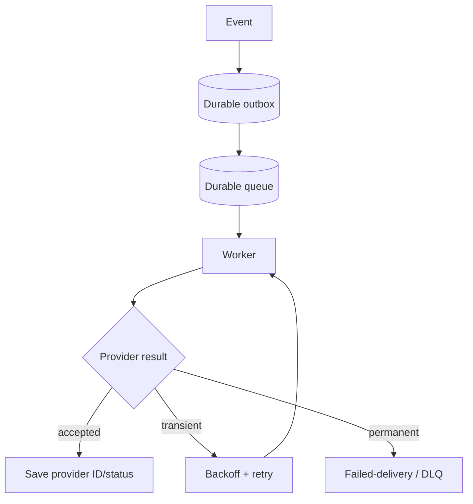

# Lesson 25 — Notification System ⭐⭐⭐⭐⭐

> **Goal:** Design a reliable, scalable notification platform in simple English, with diagrams, SQL/Node.js examples, channel-specific delivery, scheduling, preferences, fault tolerance, and real CareerLoop/CodeBuddy/ShopHub use cases. Numeric capacity estimates are illustrative.

## 01. Problem statement

Design a notification system for CareerLoop, CodeBuddy, and ShopHub. Events such as interview reminders, new chat messages, and order updates should reach users through **in-app**, **email**, and **mobile/web push** channels. The system must honor preferences, prevent unwanted duplicates, retry transient failures, and provide honest delivery status.

## 02. Functional requirements

Accept notification requests/events, choose channels, render templates, schedule or send immediately, respect opt-outs/quiet hours, track status, show unread in-app notifications, mark read, and allow retries. Optional: digests, localization, priority, admin broadcast, and provider failover.

## 03. Nonfunctional requirements

Define delivery latency, reliability, throughput, retention, and cost. Example: critical transaction notification enqueue p95 < 200 ms and in-app display in a few seconds when connected; email and push are best-effort provider-mediated delivery. These are illustrative objectives, not guarantees.

## 04. Clarify semantics

“Notification created” means a durable intent exists. “Queued” means work is durably available to a worker. “Sent to provider” means provider accepted the request. “Delivered” requires a trustworthy delivery receipt if available. “Read” requires a user action or product-defined acknowledgment. Never call provider acceptance human delivery.

## 05. Estimate scale

Assume 1 million active users, 10 notifications/user/day = **10 million notifications/day**, average ~116 notifications/sec. If peak is 10×, ~1,157/sec. If each notification triggers 2 channel deliveries on average, ~20 million channel attempts/day before retries. Model bursty campaigns separately.

## 06. Architecture


Keep business transaction and notification intent consistent. A queue or stream buffers work but cannot guarantee external provider delivery.

## 07. Event-driven design

Business services publish domain events such as `application.interview_scheduled`, `chat.message_created`, and `order.shipped`. The notification orchestrator decides who should receive what. This separates business logic from provider-specific email/push SDKs.

## 08. Event schema

```json
{
  "eventId": "evt_123",
  "eventType": "application.interview_scheduled",
  "occurredAt": "2026-10-21T10:00:00Z",
  "aggregateId": "app_42",
  "recipientUserId": "user_7",
  "payload": { "companyName": "ExampleCo", "interviewAt": "2026-10-25T09:30:00Z" },
  "schemaVersion": 1
}
```
Keep event payloads minimal; avoid secrets and sensitive content in broadly distributed queues. Schema-version events for mixed deployments.

## 09. Transactional outbox

If an application status update commits but publishing the notification fails, the user may miss the reminder. Store the domain change **and outbox event in one DB transaction**; a relay publishes later. This prevents the DB-commit/queue-publish gap, though relay retries may create duplicate events.

## 10. Outbox sequence


A crash after broker ACK but before marking published can cause republish: consumers must deduplicate.

## 11. Queue vs pub/sub

A durable work queue helps workers retry and survive restarts. Pub/Sub can fan out events to multiple independent consumers but plain Redis Pub/Sub does not persist missed events. Choose Redis Streams, RabbitMQ, Kafka, SQS, or another durable broker according to ordering, retention, operations, and budget.

## 12. Fan-out by channel

One logical notification can produce separate email, push, and in-app delivery records. Each channel has its own status, retries, cost, and provider ID. Do not store one ambiguous boolean `sent` for all channels.

## 13. Data model

```sql
CREATE TABLE notifications (
  id UUID PRIMARY KEY,
  user_id TEXT NOT NULL,
  event_id TEXT NOT NULL,
  template_key TEXT NOT NULL,
  payload JSONB NOT NULL,
  created_at TIMESTAMPTZ NOT NULL DEFAULT now(),
  read_at TIMESTAMPTZ,
  UNIQUE (user_id, event_id, template_key)
);
CREATE TABLE notification_deliveries (
  id UUID PRIMARY KEY,
  notification_id UUID NOT NULL REFERENCES notifications(id),
  channel TEXT NOT NULL CHECK (channel IN ('email','push','in_app')),
  status TEXT NOT NULL,
  attempts INTEGER NOT NULL DEFAULT 0,
  next_attempt_at TIMESTAMPTZ,
  provider_message_id TEXT,
  last_error TEXT,
  UNIQUE (notification_id, channel)
);
```
Real systems may need multiple devices/addresses per channel; expand the uniqueness scope accordingly.

## 14. Delivery state machine


Some providers never report delivered status; accepted can remain the last verifiable state. In-app read state is separate.

## 15. API design

| Method | Endpoint | Purpose |
|---|---|---|
| GET | `/api/notifications?cursor=...` | Paginated inbox |
| GET | `/api/notifications/unread-count` | Badge count |
| PATCH | `/api/notifications/:id/read` | Mark read |
| PATCH | `/api/notifications/read-all` | Mark all read |
| GET | `/api/notification-preferences` | Fetch settings |
| PUT | `/api/notification-preferences` | Update settings |
| POST | `/internal/notification-events` | Authenticated internal ingestion (if used) |
Authorize every user-facing query against the authenticated user, not a supplied userId.

## 16. Preferences and opt-outs

Store per-user, per-event-category, per-channel preferences. Example: interview reminders by email and in-app; chat messages by push only when offline. Marketing opt-outs and legally required consent must be honored. Essential transactional messages may have different rules depending on jurisdiction and product policy.

## 17. Preference example

```json
{
  "userId": "user_7",
  "preferences": {
    "interview_reminder": { "email": true, "push": true, "in_app": true },
    "chat_message": { "email": false, "push": true, "in_app": true },
    "marketing": { "email": false, "push": false, "in_app": false }
  },
  "timezone": "Asia/Kolkata",
  "quietHours": { "start": "22:00", "end": "07:00" }
}
```

## 18. Quiet hours and time zones

Store an IANA timezone such as `Asia/Kolkata` rather than a fixed UTC offset; DST changes matter elsewhere. Convert schedule to user-local time using timezone-aware libraries. Decide whether critical alerts bypass quiet hours, and respect user consent.

## 19. Scheduled notifications

A scheduler scans durable due jobs using an indexed `scheduled_at` field, claims them atomically, and publishes to workers. A cron tick can run twice or be missed, so claims and sends must be idempotent. Avoid keeping future reminders only in a process's `setTimeout` memory.

## 20. Reminder time calculation

For an interview at 2026-10-25 09:30 in a specified timezone, a 24-hour reminder should be scheduled relative to the actual timezone-aware instant. Don't subtract calendar days from an ambiguous local timestamp without resolving the timezone and DST transition.

## 21. Template rendering

Use versioned templates with variables, localization, and channel-specific layouts. Render on the server from trusted template keys, escape untrusted content, and validate required variables. Do not allow arbitrary user HTML in email or notification text.

## 22. Email channel

Send through a provider such as Brevo, SES, SendGrid, or Postmark. Track provider message ID, accepted/bounced/complained events, and suppression lists. Configure SPF, DKIM, and DMARC for your domain when applicable. Email delivery is not guaranteed even after provider acceptance.

## 23. Push channel

Web push uses service workers and push subscriptions; mobile push commonly uses FCM/APNs. Device tokens can expire, rotate, or become invalid. Store tokens per device, remove invalid ones based on provider errors, and avoid exposing sensitive text on lock screens without user consent.

## 24. In-app channel

Persist inbox records first, then optionally broadcast `notification:new` over Socket.IO. The UI fetches notifications after reconnect, since socket events can be missed. Unread badge counts should come from authoritative storage or a cache with a documented consistency policy.

## 25. Socket.IO event example

```js
// Called only after notification has been durably stored.
io.to('user:' + userId).emit('notification:new', {
  id: notification.id,
  title: notification.title,
  createdAt: notification.createdAt
});
```
Authenticate user room membership server-side. Socket delivery is best-effort; inbox sync is authoritative.

## 26. Retries

Retry network errors, timeouts, 429 with `Retry-After`, and appropriate 5xx failures. Do not retry invalid recipient addresses or permanent template errors. Use bounded exponential backoff with jitter, per-provider rate limits, and a total retry deadline.

## 27. Retry timing example

Attempt 1 now, then roughly 30s, 2m, 8m, 30m with jitter and a cap (illustrative). A user can update preferences between attempts; define whether workers re-check opt-outs before retry. For marketing, checking current consent before each send is safer.

## 28. Idempotency and duplicate delivery

Use `(userId,eventId,templateKey)` as a unique logical notification identity, then unique delivery identity per channel/device. Reprocessing the same event should reuse records. External providers may not support idempotent sends; a timeout after provider acceptance can still produce duplicates. Prefer provider idempotency keys when available and reconcile ambiguous results.

## 29. The external side-effect gap

A worker calls an email provider; provider accepts, but worker crashes before saving provider ID. Retrying might send a second email. A DB transaction cannot roll back an external email. Use provider idempotency, message lookup, controlled retries, and explicit uncertainty states where possible. Do not claim exactly-once email delivery without provider support.

## 30. Dead-letter queues

After bounded retries or permanent failure, move work to a dead-letter queue/failed-delivery table with reason, attempts, and correlation ID. Alert and allow controlled replay after fixing the issue. Never loop infinitely on malformed payloads.

## 31. Worker concurrency and backpressure

Cap concurrent sends and bound queue depth. If a provider allows 100 requests/sec, adding 50 workers does not increase its quota. Implement global rate limits and backpressure to avoid 429 storms and memory exhaustion.

## 32. Rate limiter example

```js
// Teaching pseudocode: shared provider rate limit must be distributed.
const maxInFlight = 10;
let inFlight = 0;
async function guardedSend(job) {
  if (inFlight >= maxInFlight) throw new Error('Requeue with delay');
  inFlight++;
  try { return await sendToProvider(job); }
  finally { inFlight--; }
}
```
This only limits one Node.js process and is not a complete queue implementation.

## 33. Priority and fairness

Critical security alerts and interview reminders may deserve higher priority than newsletters. Separate queues or priority scheduling prevent a large marketing campaign from starving transactional events. Add fairness so one tenant cannot monopolize the workers.

## 34. Batching and digests

Group non-urgent notifications into daily/weekly digests to reduce cost and user fatigue. Preserve user-local delivery time and unsubscribe preferences. Critical order/payment events generally should not wait for a digest unless the product explicitly allows it.

## 35. Provider failover

If primary email provider fails, a secondary may help, but switching during an ambiguous timeout risks duplicate delivery. Keep provider-specific IDs and dedup/reconciliation rules. A secondary provider does not automatically guarantee better deliverability or lower cost.

## 36. Webhooks for delivery receipts

Providers send bounce, complaint, delivery, or failure callbacks. Verify webhook signatures, deduplicate provider event IDs, and process out-of-order updates safely. A delivered event arriving before accepted should not regress status; use a defined state machine.

## 37. Webhook inbox table

```sql
CREATE TABLE provider_webhook_inbox (
  provider TEXT NOT NULL,
  provider_event_id TEXT NOT NULL,
  received_at TIMESTAMPTZ NOT NULL DEFAULT now(),
  PRIMARY KEY (provider, provider_event_id)
);
```
Insert the event ID and update the delivery state in one DB transaction where possible.

## 38. Multi-channel fallback policy

If push fails, should email be sent? This is a product decision. Define explicit fallback rules and avoid sending three noisy duplicates for one low-priority event. In-app is often always stored, while push/email depend on preferences and user presence.

## 39. Presence-aware notification

For CodeBuddy, if a recipient is actively viewing the conversation, a push may be unnecessary. Presence is approximate and races with disconnects, so avoid relying on it for critical correctness. Prefer delayed push with cancellation or simple preference-based policy.

## 40. Unread count consistency

An in-app unread count can be computed from indexed rows or maintained as a derived counter. Counters can drift under duplicate events; periodic reconciliation may be necessary. A few seconds of stale badge count may be acceptable, but marking read must be authorized and monotonic.

## 41. Read API implementation

```js
// Express 5-style handler; req.user is set by auth middleware.
app.patch('/api/notifications/:id/read', async (req, res) => {
  const item = await Notification.findOneAndUpdate(
    { _id: req.params.id, userId: req.user.id },
    { $set: { readAt: new Date() } },
    { new: true }
  );
  if (!item) return res.status(404).json({ error: 'Not found' });
  return res.json({ id: item.id, readAt: item.readAt });
});
```
The state effect is idempotent; repeated calls may update the timestamp unless guarded with `readAt: null` or `$ifNull`-style logic. If first-read time matters, preserve it.

## 42. Security and authorization

Only trusted internal services may create system events; authenticate producers and validate schemas. Protect notification inbox by user ID from auth context. Escape templates, guard URLs against phishing, encrypt sensitive data, and minimize personal details in push payloads and logs.

## 43. Privacy and retention

Set retention for in-app notifications, delivery logs, device tokens, and webhook payloads. Support deletion/consent changes and avoid storing unnecessary sensitive message contents. Keep audit data only as long as business/legal needs require.

## 44. Observability

Track event ingestion lag, outbox backlog, queue depth, worker throughput, provider 429/5xx, accepted/bounced/complained counts, retry age, dead-letter count, in-app unread drift, and end-to-end latency by event type. Correlate `eventId`, `notificationId`, and `deliveryId`.

## 45. Failure scenarios

**DB unavailable:** cannot durably accept new notification; surface/retry upstream event through outbox. **Queue unavailable:** outbox accumulates until relay resumes. **Email provider down:** retry with backoff, keep in-app working. **Socket gateway down:** inbox persists; client syncs later. **Worker crashes after send:** possible duplicate; reconcile/provider key. **User unsubscribes mid-retry:** re-check preference according to policy.

## 46. Fault tolerance diagram



## 47. CareerLoop case study

Interview scheduled → store interview + reminder intent transactionally → scheduler triggers 24-hour and 1-hour reminders → preference router chooses in-app/email/push → user sees reminder inbox even if socket was offline. If interview time changes, cancel or supersede old scheduled reminders using an interview version.

## 48. CodeBuddy case study

New persisted message → notify recipient only if policy allows. Do not send duplicate push for every device connection. Use stable message/event IDs and an optional short delay to suppress push when the recipient reads the chat immediately. Socket.IO handles live UI, while notification inbox and provider delivery run independently.

## 49. ShopHub case study

Order created, paid, shipped, delivered → emit versioned order events and route transactional notifications. Payment state comes from authoritative order/payment records, not notification status. Duplicate webhook events should not send multiple identical “payment succeeded” emails.

## 50. Notification service boundaries

Start with a module in the existing Node.js backend when scale/team size is small. Extract a separate service when independent scaling, provider integrations, reliability isolation, or organizational ownership justify it. Microservices add deployment and data-consistency costs.

## 51. Deployment approach

On free/low-cost infrastructure: one Node API, PostgreSQL/MongoDB, a persistent outbox, and a small scheduled worker may be enough. On larger scale: durable broker, separate channel workers, provider-specific rate limiting, observability, and autoscaling. Do not depend on a sleeping free-tier server for time-critical reminders without understanding platform limits.

## 52. Testing strategy

Unit-test routing, templates, preferences, quiet hours, retry classification, and dedup. Integration-test DB unique constraints and outbox. Simulate provider timeout after acceptance, duplicate webhook, queue outage, worker restart, opt-out during retry, DST change, and socket disconnect. Verify no unauthorized inbox access.

## 53. Trade-off table

| Decision | Benefit | Trade-off |
|---|---|---|
| Outbox | No lost DB→event intent | Relay + duplicates |
| Queue workers | Async retries and isolation | Eventual delivery |
| In-app persisted inbox | Reconnect-safe | Storage/index cost |
| Email provider | Managed sending | Cost, quotas, uncertain delivery |
| Presence-aware push | Less noise | Presence races |
| Digests | Lower cost/fatigue | Delayed information |
| Separate microservice | Independent scaling | More complexity |

## 54. Common mistakes

Sending email inside a DB transaction; treating `sendMail()` success as user delivery; using plain Redis Pub/Sub as durable queue; no idempotency; ignoring opt-outs; unbounded retries; one `sent` boolean for all channels; storing reminders only in memory; no timezone handling; no provider webhook verification; leaking user data in push/logs; allowing marketing campaigns to block critical alerts.

## 55. Interview questions

**Q1:** Why queue? Decouple business latency and provider reliability. **Q2:** Why outbox? Prevent lost event after DB commit. **Q3:** At-least-once? Duplicates possible. **Q4:** Exactly-once email? Generally not guaranteed without provider support. **Q5:** Idempotency key? Stable logical event identity. **Q6:** How schedule? Durable due jobs, atomic claim. **Q7:** Quiet hours? Timezone-aware policy. **Q8:** Provider timeout? Ambiguous; reconcile/retry carefully. **Q9:** In-app vs push? Stored inbox vs best-effort device alert. **Q10:** Delivery status? Accepted ≠ delivered ≠ read. **Q11:** Why DLQ? Isolate exhausted/permanent failures. **Q12:** How scale? Channel workers and quotas. **Q13:** How avoid duplicates? Unique constraints and provider IDs. **Q14:** What about unsubscribe? Enforce preference/consent. **Q15:** Why webhook verification? Prevent forged receipts. **Q16:** Multi-provider failover risk? Duplicate send after ambiguous response. **Q17:** How protect privacy? Minimize data and authorize. **Q18:** How measure latency? Event→provider/inbox timestamps. **Q19:** What if socket offline? Persist and sync. **Q20:** How handle event schema changes? Versioned compatible events.

## 56. Hands-on exercises

1. Add notifications and deliveries tables to CareerLoop. 2. Implement a transactional outbox for interview creation. 3. Build a scheduled reminder worker with atomic claims. 4. Add per-channel preferences and quiet hours. 5. Create an in-app inbox and read API. 6. Integrate a sandbox email provider with retry classification. 7. Simulate duplicate queue delivery. 8. Verify a signed provider webhook and deduplicate it. 9. Add a dead-letter queue and replay workflow. 10. Load-test 1000 notification events with provider rate limits.

## 57. Final checklist

- [ ] I can explain event→outbox→queue→router→channel workers.
- [ ] I know accepted vs delivered vs read semantics.
- [ ] I can design schemas and unique keys for notifications.
- [ ] I understand scheduled jobs, timezones, and quiet hours.
- [ ] I can implement bounded retries, backoff, and DLQ.
- [ ] I know why external provider side effects cannot be rolled back.
- [ ] I can design in-app inbox sync after disconnect.
- [ ] I can handle user preferences, consent, and privacy.
- [ ] I can monitor lag, failures, and delivery rates.
- [ ] I can apply the architecture to CareerLoop, CodeBuddy, and ShopHub.

---

**Core lesson:** A notification is a durable intent, not a guarantee that a human saw a message. Decouple business writes from external channels, use idempotency, and expose honest delivery status.
