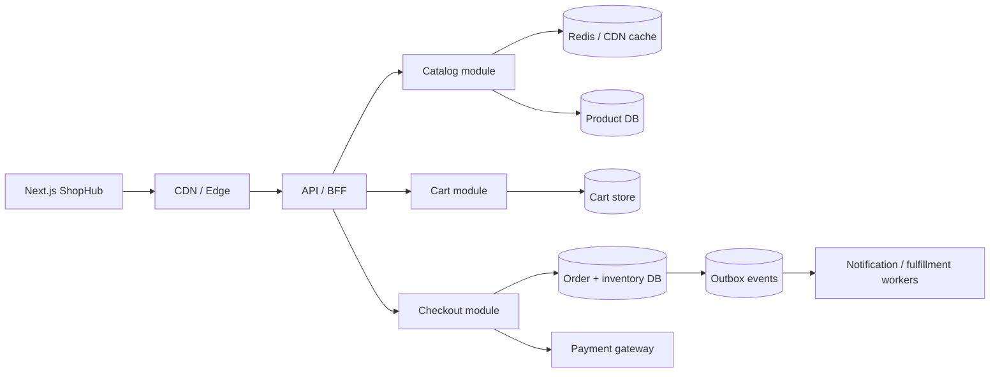
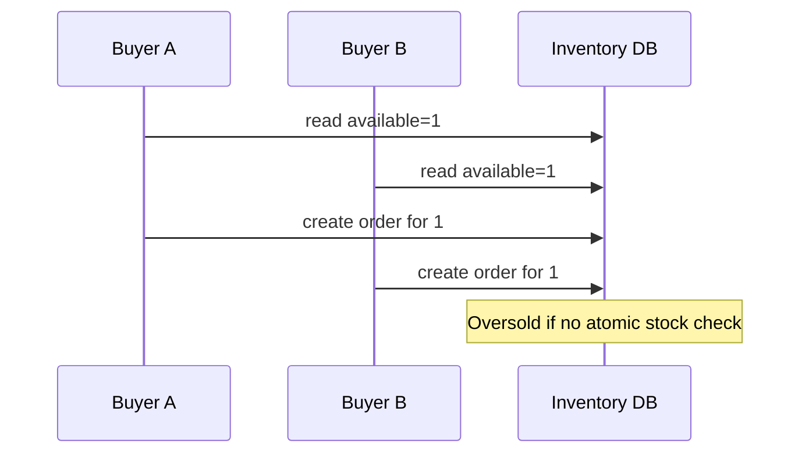
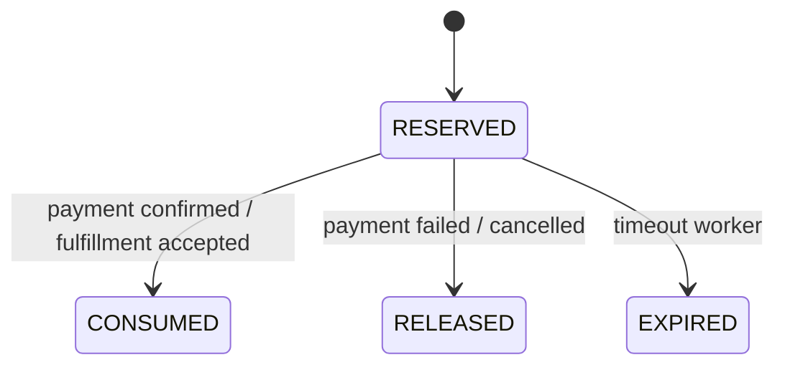
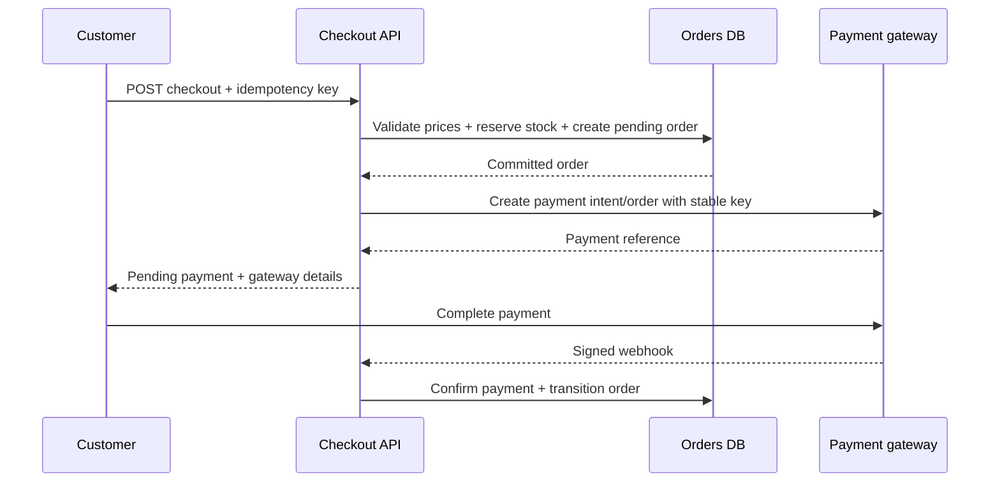
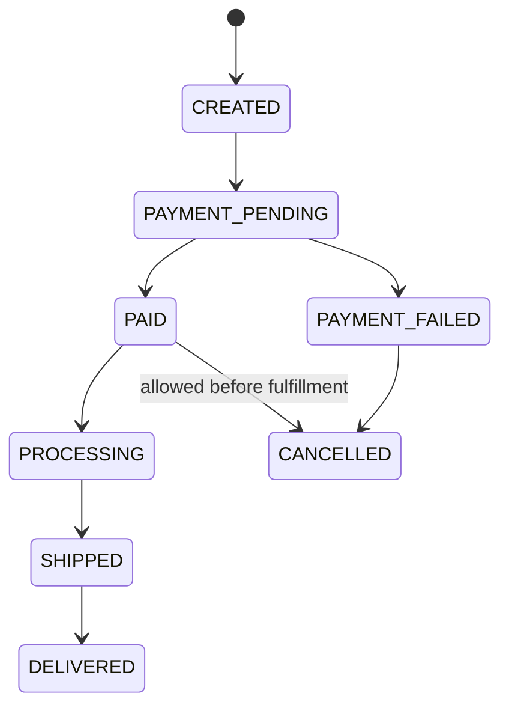
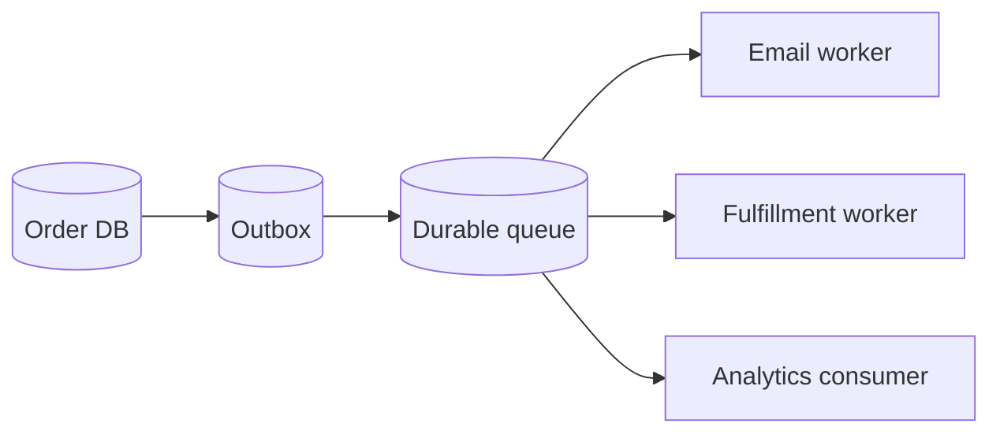

# Lesson 26 — E-commerce System ⭐⭐⭐⭐⭐

> **Goal:** Design a production-minded e-commerce platform with simple English, Mermaid diagrams, SQL and MongoDB examples, and practical ShopHub architecture. All traffic and performance numbers are illustrative assumptions.

## 01. Problem statement

Design an e-commerce platform like a simplified Amazon or ShopHub. Users browse products, search, manage carts, checkout, pay, track orders, and request refunds. The most important design challenge is preserving **inventory, order, and payment correctness** during concurrent requests, failures, and retries.

## 02. Clarify functional requirements

MVP: product listing/details, categories, search/filter, guest/authenticated cart, addresses, checkout, stock reservation, payment initiation and confirmation, order history, and order status. Later: coupons, returns/refunds, seller portal, reviews, recommendations, shipping integrations, and multi-warehouse fulfillment.

## 03. Nonfunctional requirements

Prioritize correct checkout and durable orders, fast product browsing, high availability, and secure payment handling. Example discussion targets: product p95 < 250 ms and checkout p95 < 1 s excluding external payment completion. These are illustrative SLOs, not measured guarantees. Specify consistency separately for catalog, stock, orders, and analytics.

## 04. Capacity estimation

Assume 1 million daily visitors, 20 product page views each = 20 million product reads/day (~231/s average). Assume 100,000 orders/day (~1.16/s average), with 10× peak traffic. Product reads heavily exceed order writes. Actual catalog and traffic distribution can be very skewed; account for hot products and sales spikes.

## 05. Architecture overview


A modular monolith can implement these modules first. Split into microservices only when scale, team boundaries, or independent operations justify it.

## 06. Service/module boundaries

Catalog owns product descriptions and images; pricing owns current offers and coupon rules; inventory owns sellable/reserved stock; cart owns shopping intent; checkout coordinates validation and reservation; orders own lifecycle; payments own gateway interaction and reconciliation; fulfillment owns shipment progress. Define one authoritative owner per business invariant.

## 07. Database choice

PostgreSQL offers relational constraints, transactional inventory/order updates, and strong SQL tooling. MongoDB/Mongoose is also workable with atomic document updates, unique indexes, and multi-document transactions when needed. ShopHub's existing MongoDB design can evolve incrementally; no need to rewrite solely for a system design interview.

## 08. Product schema

```sql
CREATE TABLE products (
  id BIGINT GENERATED ALWAYS AS IDENTITY PRIMARY KEY,
  sku TEXT NOT NULL UNIQUE,
  title TEXT NOT NULL,
  description TEXT,
  category_id BIGINT,
  status TEXT NOT NULL DEFAULT 'active',
  created_at TIMESTAMPTZ NOT NULL DEFAULT now()
);
CREATE TABLE product_variants (
  id BIGINT GENERATED ALWAYS AS IDENTITY PRIMARY KEY,
  product_id BIGINT NOT NULL REFERENCES products(id),
  sku TEXT NOT NULL UNIQUE,
  attributes JSONB NOT NULL DEFAULT '{}'::jsonb,
  price_minor BIGINT NOT NULL CHECK (price_minor >= 0),
  currency CHAR(3) NOT NULL
);
```
Use integer minor currency units or carefully managed decimals, not floating-point arithmetic for money.

## 09. Catalog read path

Use CDN for images, cached product cards, and read-optimized queries. Keep availability and price labels honest: cached catalog data may be stale. Recheck authoritative price, discount eligibility, and stock at checkout.

## 10. Search and filtering

Start with indexed database search for modest catalogs. At scale, feed Elasticsearch/OpenSearch or a managed search engine asynchronously. Search indexes can lag product updates; checkout must never trust a search document as authoritative inventory or pricing.

## 11. Pagination

Cursor pagination can outperform large OFFSET queries for stable sorted listings. Choose deterministic sort keys such as (created_at,id) and return a next cursor. Product search ranking may require engine-specific continuation tokens.

## 12. Product images

Store media in object storage and deliver via CDN. Save URLs/keys and image metadata in DB. Use signed upload URLs for admin/seller uploads and validate content type, size, and permissions. Avoid storing large binaries directly in product rows.

## 13. Cart requirements

Cart is a draft, not an order or inventory reservation by default. Store product variant IDs and quantities; calculate current prices and stock during checkout. Define guest cart expiration, authentication merge, maximum quantity, and behavior when a product becomes unavailable.

## 14. Guest cart + logged-in merge

ShopHub can keep a guest cart in a signed/secure cookie or local storage, then merge with the authenticated server cart. Decide whether duplicate variant quantities sum or take max; enforce limits and revalidate. Never trust a client-supplied price or discount as authoritative.

## 15. Cart schema

```sql
CREATE TABLE carts (
  id UUID PRIMARY KEY,
  user_id BIGINT,
  guest_token_hash TEXT,
  updated_at TIMESTAMPTZ NOT NULL DEFAULT now()
);
CREATE TABLE cart_items (
  cart_id UUID NOT NULL REFERENCES carts(id),
  variant_id BIGINT NOT NULL REFERENCES product_variants(id),
  quantity INTEGER NOT NULL CHECK (quantity > 0),
  PRIMARY KEY (cart_id, variant_id)
);
```
Choose expiration/cleanup for abandoned guest carts.

## 16. Cart operations and concurrency

Adding the same variant from two devices can race. Use atomic upserts or version checks rather than read-modify-write without locking. Keep quantity bounded and return a fresh cart version to clients. Cart conflicts are usually less critical than overselling but still affect UX.

## 17. Pricing authority

Server calculates item price, coupon discounts, shipping, tax, and final total from trusted records. Snapshot the charged amounts into order items because catalog prices may change later. Validate currency and rounding rules; keep a consistent money representation.

## 18. Discount and coupon rules

Coupons may have usage limits, expiry, per-user caps, product exclusions, and combinability. Enforce coupon redemption atomically with checkout/order creation where feasible. Two concurrent checkouts must not both consume the last limited-use coupon if only one redemption is permitted.

## 19. Inventory concepts

Separate **on-hand stock**, **reserved stock**, and **available-to-sell (ATS)**. Example: on-hand 10, reserved 3, ATS 7. A reservation temporarily protects units during checkout; release on expiry/payment failure. Returns/restocks require separate audited movements.

## 20. Overselling race


A stale product page can show stock=1 to both buyers; only authoritative atomic checkout logic prevents overselling.

## 21. Atomic stock decrement in SQL

```sql
UPDATE inventory
SET available = available - 1,
    reserved = reserved + 1
WHERE variant_id = $1 AND available >= 1
RETURNING variant_id, available, reserved;
```
If zero rows return, the item is out of stock. Put this in a transaction with reservation/order records. Avoid decrementing a value read earlier without a condition.

## 22. Inventory schema

```sql
CREATE TABLE inventory (
  variant_id BIGINT PRIMARY KEY REFERENCES product_variants(id),
  on_hand INTEGER NOT NULL CHECK (on_hand >= 0),
  reserved INTEGER NOT NULL DEFAULT 0 CHECK (reserved >= 0),
  available INTEGER NOT NULL CHECK (available >= 0),
  CHECK (on_hand = reserved + available)
);
CREATE TABLE stock_reservations (
  id UUID PRIMARY KEY,
  order_id UUID NOT NULL,
  variant_id BIGINT NOT NULL REFERENCES product_variants(id),
  quantity INTEGER NOT NULL CHECK (quantity > 0),
  status TEXT NOT NULL,
  expires_at TIMESTAMPTZ NOT NULL
);
```
The equality assumes all on-hand units are either available or reserved; damaged/in-transit categories need a richer ledger.

## 23. MongoDB conditional update

```js
const updated = await Inventory.findOneAndUpdate(
  { variantId, available: { $gte: quantity } },
  { $inc: { available: -quantity, reserved: quantity } },
  { new: true, session }
);
if (!updated) throw new Error('OUT_OF_STOCK');
```
A single-document update is atomic in MongoDB. For multiple items plus order/reservation documents, use a transaction or a carefully designed compensation workflow.

## 24. Stock reservation lifecycle


Expiry workers must claim reservations atomically and avoid releasing stock after successful consumption. Use unique reservation IDs and state guards.

## 25. Multi-item checkout transaction

For a cart with several variants, validate all items and reserve each in one transaction if they share a transactional DB. If any item is unavailable, roll back all reservations. Lock/order rows consistently to reduce deadlocks, and retry only safe transient transaction failures.

## 26. Checkout flow


Never claim paid solely because the browser redirects back to a success URL.

## 27. Order schema

```sql
CREATE TABLE orders (
  id UUID PRIMARY KEY,
  user_id BIGINT NOT NULL,
  checkout_key UUID NOT NULL,
  status TEXT NOT NULL,
  currency CHAR(3) NOT NULL,
  total_minor BIGINT NOT NULL CHECK (total_minor >= 0),
  created_at TIMESTAMPTZ NOT NULL DEFAULT now(),
  UNIQUE (user_id, checkout_key)
);
CREATE TABLE order_items (
  order_id UUID NOT NULL REFERENCES orders(id),
  variant_id BIGINT NOT NULL,
  quantity INTEGER NOT NULL CHECK (quantity > 0),
  unit_price_minor BIGINT NOT NULL CHECK (unit_price_minor >= 0),
  PRIMARY KEY (order_id, variant_id)
);
```
Snapshot shipping address, tax, discounts, and product name in production so history remains accurate.

## 28. Order state machine


Refunds/returns are separate workflows. Define allowed transitions and idempotent state updates; do not allow an old webhook to move DELIVERED back to PAYMENT_PENDING.

## 29. Payment integration

Razorpay/Stripe-style integrations create provider payment references and verify server-side signed webhooks. Keep provider secrets on the backend, never in Next.js client bundles. Verify amount/currency/order association and provider status before marking an order paid. Provider APIs differ; use current official docs when implementing.

## 30. Payment idempotency

If checkout times out after provider accepted a charge, a retry must reuse the same logical payment attempt/idempotency key where the provider supports it. Keep unique (userId, checkoutKey) on orders and unique provider payment IDs. Reconcile ambiguous operations rather than creating a new charge.

## 31. Webhook deduplication

```sql
CREATE TABLE payment_webhook_inbox (
  provider TEXT NOT NULL,
  event_id TEXT NOT NULL,
  received_at TIMESTAMPTZ NOT NULL DEFAULT now(),
  PRIMARY KEY (provider, event_id)
);
```
Verify signature first; then insert event ID and apply valid order transition in one DB transaction. On duplicate, acknowledge without repeating effects. Handle out-of-order events by checking authoritative payment state.

## 32. Payment success is not fulfillment

A successful payment does not guarantee inventory is still available if reservation expired. Design a clear policy: reserve sufficiently long, reconcile late payments, then fulfill or refund if stock cannot be guaranteed. Do not silently accept money for unavailable goods.

## 33. Transactional outbox

After order PAID commits, write an outbox event in the same transaction. A relay publishes to notification and fulfillment workers. Consumers deduplicate. This prevents the gap where order commits but email/shipping workflows never start.

## 34. Order event pipeline


Each consumer maintains its own processing state and retry policy.

## 35. Sagas for separate services

When inventory, payments, and shipping use separate databases/services, a single ACID transaction cannot cover them all. Use a saga with local transactions and compensations: reserve stock → authorize payment → create shipment; on failure, void/refund and release stock as allowed. Compensation is not guaranteed to be an exact inverse.

## 36. Shipping and fulfillment

Store shipment ID, carrier tracking reference, fulfillment status, and audit timestamps. Carrier webhooks may be duplicated/out of order. Keep fulfillment transitions monotonic where applicable and allow manual reconciliation for lost/delayed carrier events.

## 37. Returns and refunds

A return request has its own state machine: requested → approved → item received/inspected → refund initiated → refunded (or rejected). A refund request to the gateway may time out after succeeding; use stable refund IDs and reconciliation. Inventory restock occurs only after appropriate verification.

## 38. Caching strategy

Cache product catalog, categories, and noncritical recommendations with TTL/invalidation. Do not trust cache for final price, coupon eligibility, stock reservation, or payment authorization. A cached “In stock” badge can be stale; checkout is authoritative.

## 39. Hot product and flash sale

A popular variant creates contention on one inventory row/document. Approaches include bounded request queues, preallocated stock tokens, waiting rooms, or serialized reservation processing. Each adds complexity; verify no oversell, fairness, and expiry under failure before using in production.

## 40. Rate limiting and bot protection

Limit login, coupon guessing, cart abuse, checkout attempts, and inventory holds. Use shared limits across API instances. Protect against automated stock hoarding by expiring reservations, limiting quantity per user, and applying fraud controls. Rate limits must not accidentally block legitimate customers without recourse.

## 41. Read scaling

Use CDN for images, cache for catalog, read replicas for noncritical browsing, and pagination for listings. Primary/authoritative reads remain necessary for correctness-sensitive operations. Replication lag can make a product appear available after it sells out; avoid promising stock based on stale replicas.

## 42. Write scaling and partitioning

Before sharding, optimize queries/indexes, reduce lock time, separate read-heavy workloads, and measure. At larger scale, shard by tenant, seller, order ID, or region according to access patterns. Cross-shard inventory/order transactions complicate correctness.

## 43. Multi-region considerations

Local catalog reads improve latency, but global stock reservations need coordinated ownership. A single write region is simpler; active-active inventory across regions needs conflict prevention or stock allocation per region. Factor in shipping geography, tax rules, and data residency.

## 44. Security fundamentals

Use HTTPS, secure httpOnly session cookies, CSRF defenses for cookie-authenticated mutations, server-side authorization, input validation, and secrets management. Never trust cart totals from client. Protect admin/seller APIs and audit changes to price, stock, and refunds.

## 45. PCI and payment data

Use hosted checkout or tokenization to avoid handling raw card data. Never log/store card numbers or CVV. Payment security and PCI scope depend on integration; follow provider requirements. Signature verification and idempotency are mandatory parts of robust webhook design.

## 46. Observability

Track product p95/p99, cart merge errors, checkout conversion, reservation conflicts, out-of-stock rate, payment pending age, webhook duplicate rate, reconciliation backlog, order state transition failures, queue lag, and inventory ledger mismatches. Correlate checkoutKey, orderId, paymentId, and eventId.

## 47. Failure matrix

| Failure | Safe behavior |
|---|---|
| Redis cache down | Limited DB fallback |
| Inventory DB down | Do not promise reservation |
| Payment response lost | Reconcile with same payment attempt |
| Webhook duplicated | Dedup and no duplicate order transition |
| Email provider down | Order still persists; retry notification |
| Reservation expires | Atomic release unless consumed |
| Carrier API down | Retry shipment creation with stable ID |

## 48. Testing concurrent inventory

Start with stock=1, run 100 concurrent checkout reservation attempts, and verify **exactly one successful reservation** and nonnegative stock. Repeat with multiple SKUs, retries, and transaction aborts. Simulate a crash between reservation and payment to verify expiry/recovery.

## 49. Testing payments

Simulate successful charge with lost response, duplicate webhook, webhook before browser callback, provider 429/500, expired reservation, and refund timeout. Verify no duplicate charge or fulfillment and that ambiguous states are surfaced as pending rather than fabricated success.

## 50. ShopHub implementation roadmap

**Phase 1:** keep Next.js App Router + MongoDB, strengthen product variant/price model and guest cart merge. **Phase 2:** implement server-authoritative checkout with unique checkoutKey and atomic stock reservation. **Phase 3:** integrate Razorpay with verified webhooks, payment records, and reconciliation. **Phase 4:** outbox notifications, shipping/returns, analytics, monitoring. **Phase 5:** cache catalog and scale only after measuring.

## 51. ShopHub Next.js boundary

Client components handle cart UI, while server actions/route handlers validate identity, stock, and price. Server-only payment secrets stay outside browser bundles. A Next.js server action is not automatically a durable job processor or transaction manager; use DB transactions and workers for correctness.

## 52. Design trade-offs

| Choice | Benefit | Trade-off |
|---|---|---|
| Modular monolith | Simpler transactions/deployment | Shared scaling boundary |
| Microservices | Independent ownership/scale | Sagas, ops complexity |
| PostgreSQL | Strong relational constraints | Sharding effort at huge scale |
| MongoDB | Flexible product docs | Cross-document transaction design |
| Redis catalog cache | Faster reads | Staleness/invalidation |
| Stock reservation | Prevents oversell during payment | Expiry/recovery complexity |
| Async order events | Decouples notifications | Eventual downstream processing |

## 53. Common mistakes

Trusting cart price, decrementing stock after reading without atomic condition, not using unique checkout IDs, marking paid from browser callback, processing duplicate webhooks twice, releasing consumed reservations, confusing order status with payment status, using cached inventory as authoritative, treating payment gateway timeout as definite failure, ignoring refunds, and designing microservices before defining invariants.

## 54. Interview questions

**Q1:** Why separate cart and order? Draft vs committed business record. **Q2:** How prevent oversell? Atomic conditional reservation. **Q3:** What is ATS? Available-to-sell stock. **Q4:** Why reservation TTL? Release abandoned checkout holds. **Q5:** How handle two buyers/one item? One conditional update succeeds. **Q6:** Why idempotency key? Avoid duplicate orders/charges. **Q7:** Why server-side price? Client is untrusted. **Q8:** Why webhook? Authoritative async payment update. **Q9:** How handle duplicate webhook? Unique event ID. **Q10:** What is saga? Distributed local transactions + compensation. **Q11:** Why outbox? Reliable post-commit events. **Q12:** Why CDN? Fast images/catalog. **Q13:** What can be stale? Product cards/recommendations. **Q14:** What must be correct? Inventory/payment/order invariants. **Q15:** Flash sale? Hot-key contention and rate control. **Q16:** How merge guest cart? Defined quantity rule + validation. **Q17:** Why snapshot price? Historical order accuracy. **Q18:** Refund timeout? Stable refund ID/reconciliation. **Q19:** Multi-region inventory? Global coordination or stock allocation. **Q20:** How scale? Measure and optimize before sharding.

## 55. Exercises

1. Draw ShopHub's current and target architecture. 2. Calculate QPS for 10M product reads/day. 3. Design Product, Variant, Inventory, Order, and Payment schemas. 4. Implement MongoDB atomic stock decrement. 5. Simulate 100 buyers competing for one item. 6. Add unique checkoutKey and idempotent create-order. 7. Implement verified payment webhook inbox. 8. Design reservation expiry worker. 9. Add order outbox and notification worker. 10. Explain flash-sale scaling and consistency trade-offs in an interview.

## 56. Final checklist

- [ ] I can clarify catalog/cart/checkout/order requirements.
- [ ] I can estimate read/write QPS and identify hot paths.
- [ ] I can design product variants and authoritative pricing.
- [ ] I understand guest cart merge and cart concurrency.
- [ ] I can prevent overselling with atomic stock reservations.
- [ ] I can design checkout idempotency and payment reconciliation.
- [ ] I can explain webhook verification and deduplication.
- [ ] I know order, shipment, return, and refund state machines.
- [ ] I can use outbox/saga patterns when needed.
- [ ] I can apply the full design to ShopHub.

---

**Key takeaway:** Browsing can be cached and eventually consistent; inventory, checkout, payment, and order state need explicit authoritative correctness and safe retries.
