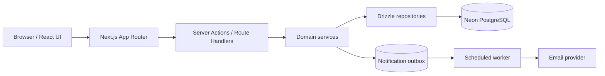
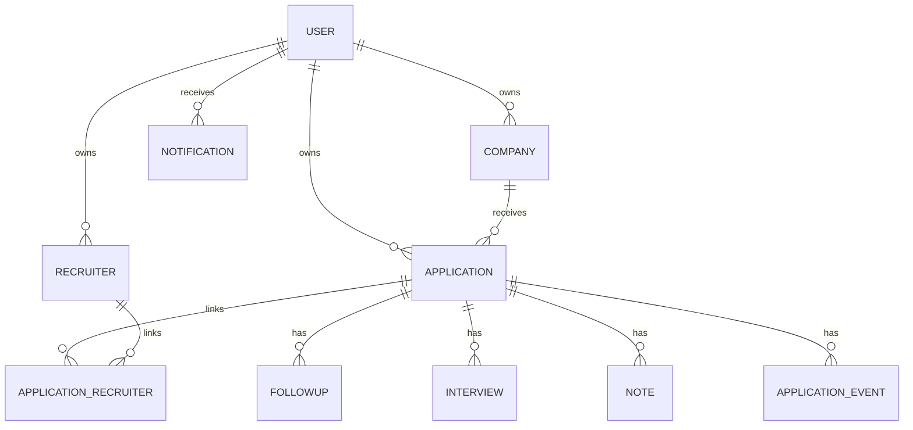
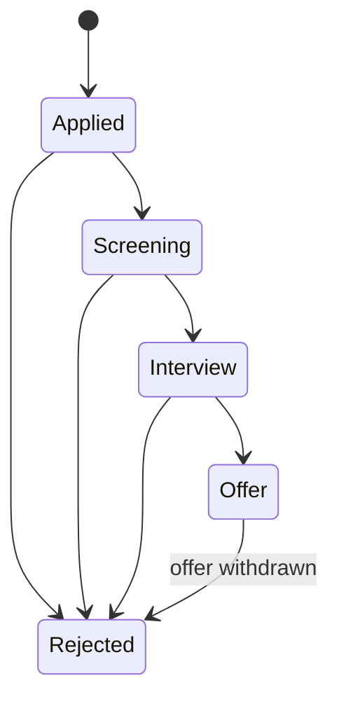
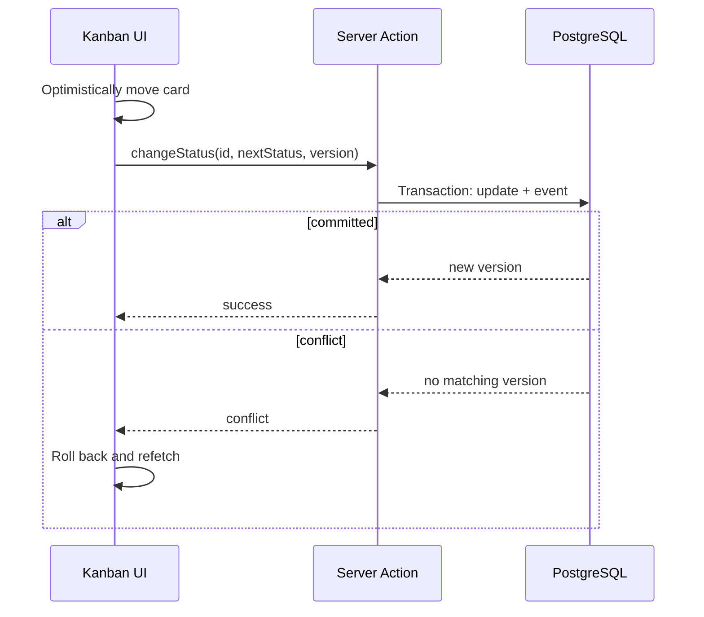
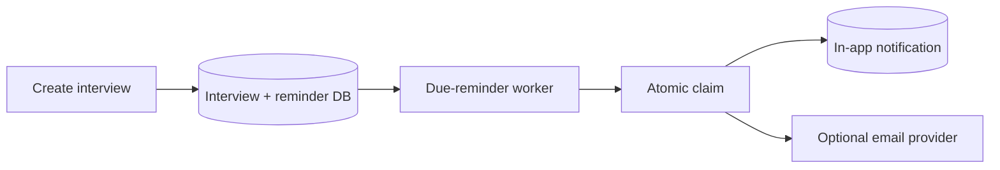

# Lesson 27 — CareerLoop System Design ⭐⭐⭐⭐⭐

> **Goal:** Design your real Job Application Tracker end to end with simple English, diagrams, SQL/Drizzle/Next.js examples, architecture trade-offs, reliability, security, and interview practice. This is a teaching design, not a claim that every feature is already implemented in the repository.

## 01. Goal and context

Design **CareerLoop**, a job application tracker built with Next.js App Router, TypeScript, Tailwind, shadcn/ui, Neon PostgreSQL and Drizzle ORM. Start single-user and free-tier friendly, but design clean ownership boundaries for future multi-user support. Core objects: users, companies, applications, recruiters, applicationRecruiters, followups, interviews, notes, applicationEvents, notifications.

## 02. Problem statement

Job seekers apply through LinkedIn, Naukri, company websites and recruiter DMs. Information gets scattered across tabs, messages and spreadsheets. CareerLoop centralizes applications, recruiter contacts, stage history, follow-ups, interview schedule and reminders in one searchable dashboard.

## 03. Functional requirements

Create/edit/delete companies and applications; assign stages (Applied → Screening → Interview → Offer → Rejected); link recruiters; record notes; schedule interviews/follow-ups; view Kanban and calendar; filter/search; show dashboard metrics and notifications. Optional later: resume versions, email integration, CSV import, attachments and multi-user teams.

## 04. Nonfunctional requirements

Data correctness and privacy matter more than extreme throughput. Aim for responsive CRUD, predictable pagination, auditability of status changes, safe reminders, and secure authorization. Example p95 < 400 ms for normal DB-backed list queries is an illustrative target, not a measured result. Free-tier sleep/limits may affect latency.

## 05. Scope and assumptions

MVP is single-user, with future multi-user migration. Do not overengineer into microservices. Expect hundreds or thousands of applications per user, not billions. One Next.js app plus one PostgreSQL database can handle early workloads; optimize queries/indexes based on measurements.

## 06. High-level architecture


Server actions are request entry points, not business rules or durable schedulers. Keep database access server-only.

## 07. Frontend architecture

Use server components for initial authenticated data fetching and client components for interactive Kanban drag/drop, filters, forms, calendar and theme toggling. Avoid making the entire app a client component just because one widget needs state. Use loading/error boundaries and optimistic updates only with rollback on failure.

## 08. Route structure

```text
app/
  (auth)/login/page.tsx
  (dashboard)/layout.tsx
  (dashboard)/page.tsx
  (dashboard)/applications/page.tsx
  (dashboard)/applications/[id]/page.tsx
  (dashboard)/kanban/page.tsx
  (dashboard)/calendar/page.tsx
  (dashboard)/companies/page.tsx
  (dashboard)/recruiters/page.tsx
  (dashboard)/notifications/page.tsx
  api/webhooks/.../route.ts
```
Route groups organize layouts without changing public URLs. Adapt structure to actual app features.

## 09. Domain entities

**User** owns records; **Company** describes an employer; **Application** tracks one job opportunity; **Recruiter** stores a contact; **ApplicationRecruiter** is a many-to-many join; **Followup** is a scheduled action; **Interview** has date/type/status; **Note** stores context; **ApplicationEvent** records immutable changes; **Notification** stores reminders.

## 10. ER diagram


Add user ownership keys to every tenant-scoped table even if the first release has only one user.

## 11. PostgreSQL schema example

```sql
CREATE TABLE applications (
  id UUID PRIMARY KEY,
  user_id UUID NOT NULL,
  company_id UUID NOT NULL,
  job_title TEXT NOT NULL,
  job_url TEXT,
  source TEXT NOT NULL,
  status TEXT NOT NULL CHECK (status IN ('applied','screening','interview','offer','rejected')),
  applied_at TIMESTAMPTZ,
  created_at TIMESTAMPTZ NOT NULL DEFAULT now(),
  updated_at TIMESTAMPTZ NOT NULL DEFAULT now(),
  version INTEGER NOT NULL DEFAULT 1
);
CREATE INDEX applications_user_status_updated_idx
  ON applications(user_id, status, updated_at DESC);
```
Add foreign keys to users/companies once matching tables are defined. `updated_at` must be maintained by application logic or a trigger.

## 12. Drizzle ORM example

```ts
import { pgTable, uuid, text, timestamp, integer, index } from 'drizzle-orm/pg-core';
export const applications = pgTable('applications', {
  id: uuid('id').primaryKey(),
  userId: uuid('user_id').notNull(),
  companyId: uuid('company_id').notNull(),
  jobTitle: text('job_title').notNull(),
  status: text('status').notNull(),
  updatedAt: timestamp('updated_at', { withTimezone: true }).notNull().defaultNow(),
  version: integer('version').notNull().default(1)
}, table => [index('applications_user_status_updated_idx').on(table.userId, table.status, table.updatedAt)]);
```
This is a focused teaching snippet; the real schema should include enums/check constraints, relations and migrations.

## 13. Status pipeline


Real workflows may skip stages or move backward; decide allowed transitions explicitly. A withdrawn application or accepted offer may deserve separate terminal states in a later version.

## 14. Status transitions and audit trail

When status changes, update `applications.status` and insert an `application_events` row **in the same DB transaction**. This preserves an authoritative current state plus historical timeline. Events should record actor, old/new status, timestamp and optional reason.

## 15. Transactional status update

```ts
await db.transaction(async tx => {
  const [updated] = await tx.update(applications)
    .set({ status: nextStatus, version: currentVersion + 1, updatedAt: new Date() })
    .where(and(eq(applications.id, applicationId), eq(applications.userId, userId), eq(applications.version, currentVersion)))
    .returning();
  if (!updated) throw new Error('Conflict or not found');
  await tx.insert(applicationEvents).values({
    applicationId, userId, oldStatus: previousStatus,
    newStatus: nextStatus, createdAt: new Date()
  });
});
```
Assumes imports/schema variables exist. Fetch previous state securely and verify transition rules; handle missing vs version conflict separately in a complete implementation.

## 16. Optimistic concurrency control

Two tabs may move the same application simultaneously. Include `version` and update only if the version matches. If zero rows change, return a conflict and refresh. Without this, a stale tab may overwrite a newer status silently. Optimistic concurrency is suitable for mostly low-contention user edits.

## 17. Kanban board architecture

Fetch applications grouped by stage. Drag/drop triggers a server mutation that validates ownership, allowed transition and version. Optimistically move the card for snappy UI; revert and show a clear error on failure. Avoid persisting entire board arrays on every drag.

## 18. Kanban flow



## 19. Applications list and filters

Support filters for status, source, company, applied date and search term. Apply filtering in SQL rather than loading every row to the browser. Use bounded page sizes, deterministic ordering, and indexes based on actual query plans. URL search params make filters shareable and refresh-safe.

## 20. Cursor pagination

For recent applications, sort by `(updated_at DESC, id DESC)` and pass both fields as a cursor. Cursor pagination avoids large OFFSET costs and gives stable continuation when new rows are inserted. Account for ties and updates that can move rows between pages.

## 21. Company management

Normalize companies so multiple applications can link to one employer. Avoid accidental duplicates by using a canonical name/domain suggestion, but do not enforce simplistic lowercase-name uniqueness (different legal entities can share names). Track notes, website and location as optional fields.

## 22. Recruiter contacts

Recruiter may relate to multiple applications and a company. Use `applicationRecruiters` join rows for many-to-many relations. Store email/LinkedIn profile only where user provides it; protect personal contact details and avoid exposing them in public pages or logs.

## 23. Notes model

Attach notes to applications (and optionally companies/recruiters) with author and timestamps. Validate length and sanitize/escape rendering. For rich text, use a safe renderer; never render arbitrary HTML directly from user input without sanitization.

## 24. Follow-ups

Each follow-up has a due timestamp, status, applicationId, userId and optional reminder policy. A follow-up can be pending, completed, cancelled or overdue. Completing it should be idempotent and must not send a reminder afterward.

## 25. Interviews

Store start time as a timezone-aware instant (`timestamptz`), along with user's preferred timezone for display and optional meeting timezone. Interview status might be scheduled, completed, rescheduled, cancelled. Rescheduling should supersede old reminders.

## 26. Calendar view

Query interviews and follow-ups in a visible date range, not all historical records. Convert display boundaries to the user's timezone carefully, then query UTC instants. A calendar event may represent a follow-up deadline or interview session; label types clearly.

## 27. Notifications architecture

Start with durable in-app notifications and optional email reminders. Store reminder intent when an interview/follow-up is created; a scheduled worker claims due reminders. A serverless request handler is not a reliable long-lived scheduler. Avoid in-memory `setTimeout` for future reminders.

## 28. Reminder flow


If reminder is rescheduled, compare interview version before delivery to avoid obsolete alerts.

## 29. Reminder idempotency

Use a unique key such as `(interviewId, interviewVersion, reminderOffset, channel)`. A worker may crash after sending but before recording success, so provider-level idempotency or reconciliation is needed to reduce duplicate email. In-app notifications can use a DB unique constraint.

## 30. Dashboard KPIs

Show total applications, counts by stage, interviews upcoming, follow-ups due, and recent activity. For modest data volumes, SQL `GROUP BY`/filtered counts are sufficient. Cache or preaggregate only after measuring. Be precise: application count is not the same as unique companies contacted.

## 31. Dashboard query example

```sql
SELECT status, COUNT(*) AS count
FROM applications
WHERE user_id = $1
GROUP BY status;
```
Ensure every tenant-scoped query filters by authenticated user. A missing `WHERE user_id` is a serious data-leak bug after multi-user launch.

## 32. Search architecture

Start with PostgreSQL indexes and `ILIKE` for small data, then add trigram/full-text search if necessary. Search across job title, company name, notes (subject to privacy), and recruiter name with explicit joins. Debounce UI input; paginate results.

## 33. Authentication and sessions

Use a supported authentication library or carefully implemented session management with secure httpOnly cookies. Protect server actions and route handlers, not just pages. Validate user identity on every mutation. In a single-user prototype, avoid hardcoded bypasses that would become dangerous later.

## 34. Authorization and tenant isolation

Even if the app currently has one user, model `user_id` ownership. Query/update/delete by both resource ID and authenticated user ID. Foreign keys alone do not enforce that an application and company belong to the same user; validate or add composite constraints. Consider PostgreSQL row-level security as an additional layer, not a replacement for correct app logic.

## 35. Security checklist

Validate all inputs with Zod or equivalent, use parameterized queries/Drizzle, authorize every operation, rate-limit login and public endpoints, secure cookies and CSRF-sensitive actions, prevent XSS in notes, keep secrets server-side, and avoid leaking recruiter emails in telemetry.

## 36. Next.js server action example

```ts
'use server';
import { z } from 'zod';
const inputSchema = z.object({
  applicationId: z.string().uuid(),
  nextStatus: z.enum(['applied','screening','interview','offer','rejected']),
  version: z.number().int().min(1)
});
export async function moveApplication(raw: unknown) {
  const input = inputSchema.parse(raw);
  const user = await requireAuthenticatedUser();
  await applicationService.changeStatus({ ...input, userId: user.id });
  revalidatePath('/kanban');
}
```
The helper functions/imports are illustrative; server actions are remotely invokable and must enforce auth/authorization.

## 37. Service and repository layers

Keep business rules in services such as `applicationService.changeStatus()`, `interviewService.reschedule()`, and `followupService.complete()`. Drizzle repository functions handle queries; React components only display and collect input. This improves testability and prevents duplicated validation across Kanban/list/details views.

## 38. Suggested folder structure

```text
src/
  app/(dashboard)/...
  components/applications/...
  components/kanban/...
  db/schema.ts
  db/relations.ts
  db/client.ts
  features/applications/service.ts
  features/applications/repository.ts
  features/applications/validators.ts
  features/interviews/...
  features/notifications/...
  lib/auth.ts
  lib/errors.ts
```
Choose one consistent feature-first or layer-first convention; do not create empty abstractions solely for architectural appearance.

## 39. Error handling

Map validation errors to useful form messages, missing/unauthorized resources to 404 where appropriate, version conflicts to 409, and database/provider failures to retriable errors. Log server-side with correlation IDs but avoid raw credentials or sensitive notes. Don't swallow errors in server actions.

## 40. Free-tier deployment

Deploy Next.js to Vercel and PostgreSQL to Neon free tiers subject to current limits. Use pooled DB connections/Neon serverless driver appropriately for runtime and Drizzle setup. Avoid opening a new DB pool per request. Scheduled reminders may require a supported cron/scheduler; verify platform scheduling reliability and quotas.

## 41. Connection pooling

Serverless environments can create many short-lived instances. Use provider-recommended pooled connections and understand differences between HTTP query APIs, WebSocket drivers and long-lived transactions. Do not assume all driver transports support the same transaction behavior; choose compatible Drizzle/Neon configuration.

## 42. Migrations and schema evolution

Use Drizzle Kit migrations committed to Git. Apply migrations before dependent code, backfill new required columns safely, and use expand/migrate/contract for breaking changes. Never run uncontrolled destructive schema changes on production data without backups.

## 43. Backups and recovery

Understand Neon backup/restore features and retention limits for the chosen plan. Test restore procedures, not just backup existence. Define acceptable recovery point/time targets for the tracker; manual exports can provide an additional safety net but must be protected.

## 44. Data integrity constraints

Use foreign keys, unique indexes and check constraints for invariants. Examples: unique user/company/application relationships as required, status enum/check, valid due dates, unique notification dedup keys. Application-level Zod validation improves UX but does not replace database constraints.

## 45. Indexes

Start with `applications(user_id,status,updated_at)`, `applications(user_id,created_at)`, `interviews(user_id,start_at)`, `followups(user_id,status,due_at)`, `notifications(user_id,read_at,created_at)`, and join-table foreign-key indexes. Verify real query plans with `EXPLAIN ANALYZE`; too many indexes slow writes.

## 46. Caching strategy

Most personal tracker reads are cheap enough without Redis. Use Next.js cache semantics carefully for user-specific data: never share cached private results across users. Revalidate affected paths/tags after mutations and ensure auth-aware cache keys where caching is used.

## 47. Realtime vs polling

For an MVP, refetch after mutations and optionally poll notifications. WebSockets/SSE are useful when external events or multiple devices require live updates, but they add connection and hosting complexity. Do not adopt Socket.IO solely to update a single user's Kanban after their own action.

## 48. Audit log and events

Store `application_events` as an append-only record of important status transitions, interview reschedules and follow-up completions. Include actor, entity ID, event type, previous/new values where appropriate, and timestamp. Avoid storing secrets or excessive personal data in immutable events.

## 49. Duplicate applications

Users may apply to the same company for multiple roles. A naive unique(companyId,userId) would incorrectly block legitimate records. Consider a soft duplicate warning based on company + normalized job URL/title + date, while allowing explicit confirmation.

## 50. Import/export

CSV import should validate headers, limit file size, preview duplicates, and perform batched writes. Export only authenticated user's records and escape CSV formula-injection prefixes when files may be opened in spreadsheet apps. Avoid exposing private recruiter data in public share links.

## 51. Observability

Measure page load, DB query latency, server action error rate, 409 conflicts, reminder processing lag, failed email sends, auth failures, and database connection saturation. Use structured logs with request IDs and privacy-aware redaction. A simple dashboard and error tracker are enough initially.

## 52. Failure scenarios

**Neon unavailable:** show retriable error; do not claim a status change succeeded. **Reminder worker asleep:** durable due jobs remain pending until worker resumes. **Email provider down:** in-app record still exists; retry email. **Two tabs edit:** version conflict prevents silent overwrite. **Vercel deployment interrupted:** DB transactions protect committed changes; clients can retry idempotent operations.

## 53. Testing strategy

Unit-test stage transitions, reminder calculation and validators. Integration-test Drizzle queries, ownership filters, status+event transactions, duplicate notifications, and concurrency conflicts against a test PostgreSQL database. End-to-end test Kanban drag/drop, calendar timezone, recruiter linking and guest-to-auth flows if added.

## 54. System design trade-offs

| Decision | Benefit | Cost |
|---|---|---|
| Modular Next.js monolith | Simple deployment and transactions | Shared scale boundary |
| Neon PostgreSQL | Relational integrity and SQL | Connection/runtime constraints |
| Drizzle ORM | Type-safe schema/query layer | Migrations still need discipline |
| Optimistic Kanban | Fast UI | Rollback/conflict handling |
| Durable reminder jobs | Survive restarts | Scheduler and worker setup |
| Append-only events | Auditable history | Storage and privacy considerations |
| Multi-user-ready ownership | Safer future migration | More constraints now |

## 55. Interview walkthrough

Start with user journeys: log an application, move Kanban stage, schedule interview, get reminder. Draw Next.js → service → PostgreSQL. Explain entity relationships and indexes, then status-change transaction, optimistic concurrency, auth/tenant isolation, scheduler reliability, and deployment trade-offs. Emphasize why a modular monolith is a rational choice at CareerLoop's scale.

## 56. Common mistakes

No userId filter, storing stage only in frontend, losing history on update, relying on in-memory timers for reminders, mixing UTC and local calendar dates, assuming server actions are private, trusting client-provided ownership, caching one user's data globally, creating duplicate follow-up emails on retries, and adding microservices without a clear need.

## 57. Interview Q&A

**Q1:** Why PostgreSQL? Relational integrity for linked entities. **Q2:** Why Drizzle? Typed schema/query workflow. **Q3:** Why modular monolith? Small scale/team and simpler operations. **Q4:** How avoid lost stage updates? Optimistic version check. **Q5:** How preserve history? Transactional event row. **Q6:** How secure data? Auth plus ownership filters. **Q7:** Are server actions secure automatically? No. **Q8:** Why cursor pagination? Efficient stable continuation. **Q9:** How schedule reminders? Durable due jobs/worker. **Q10:** How avoid duplicate emails? Stable dedup key and provider support. **Q11:** Why not Redis now? Low read scale. **Q12:** How handle time zones? Store instants, render in user zone. **Q13:** How merge recruiter contacts? Join table. **Q14:** What if DB down? Fail clearly, retry safely. **Q15:** How handle duplicate job applications? Warning, not blanket unique constraint. **Q16:** What to index? User+filter+sort columns. **Q17:** How test concurrency? Two simultaneous updates. **Q18:** How evolve schema? Drizzle migrations. **Q19:** How scale later? Measure, optimize, separate workers. **Q20:** What is key invariant? One user's data must never leak to another.

## 58. Hands-on exercises

1. Draw CareerLoop ER diagram from current Drizzle schema. 2. Add compound indexes for application list and due follow-ups. 3. Implement status change + applicationEvent transaction. 4. Add version-based concurrency and simulate two tabs. 5. Build cursor pagination. 6. Implement authenticated recruiter linking. 7. Create timezone-aware interview calendar queries. 8. Build a durable reminder table/worker. 9. Test duplicate reminder retries. 10. Explain the architecture in a 30-minute mock interview.

## 59. Final checklist

- [ ] I can explain CareerLoop's user journeys and requirements.
- [ ] I can draw the Next.js/Drizzle/Neon architecture and ER diagram.
- [ ] I understand stage state machine and audit events.
- [ ] I can prevent concurrent lost updates.
- [ ] I can build Kanban, list filters and cursor pagination.
- [ ] I can design recruiter, follow-up, interview and calendar modules.
- [ ] I can schedule durable, timezone-aware reminders.
- [ ] I can enforce user ownership in every query and mutation.
- [ ] I can explain free-tier deployment, pooling, migrations and backups.
- [ ] I can discuss scaling, failures, security and interview trade-offs.

---

**Key takeaway:** For CareerLoop, strong data ownership, simple modular boundaries, transactional status history, safe reminders, and clean UX matter more than premature distributed infrastructure.
