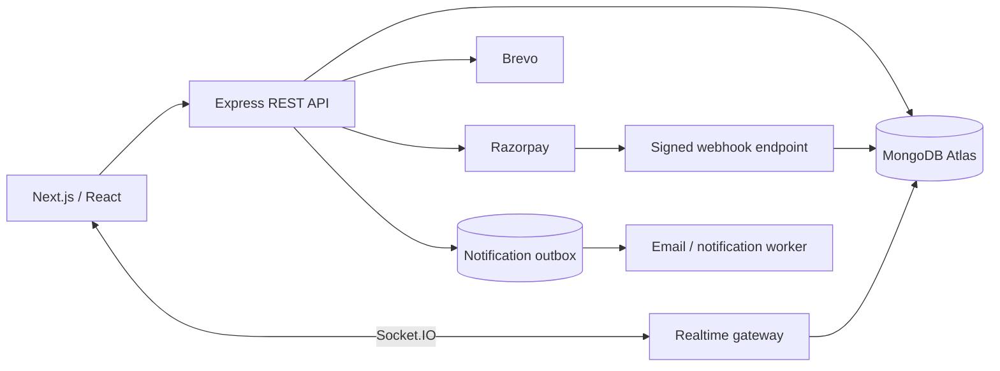
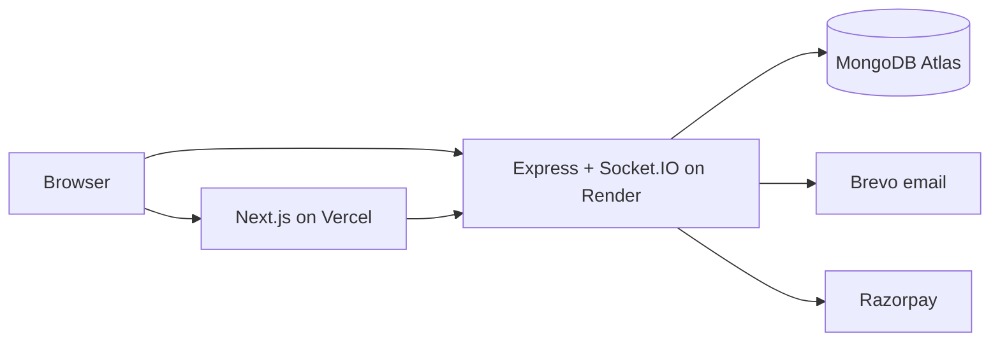
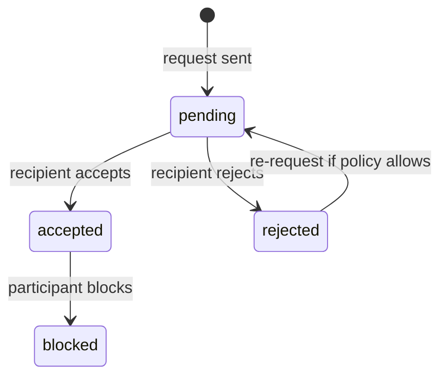
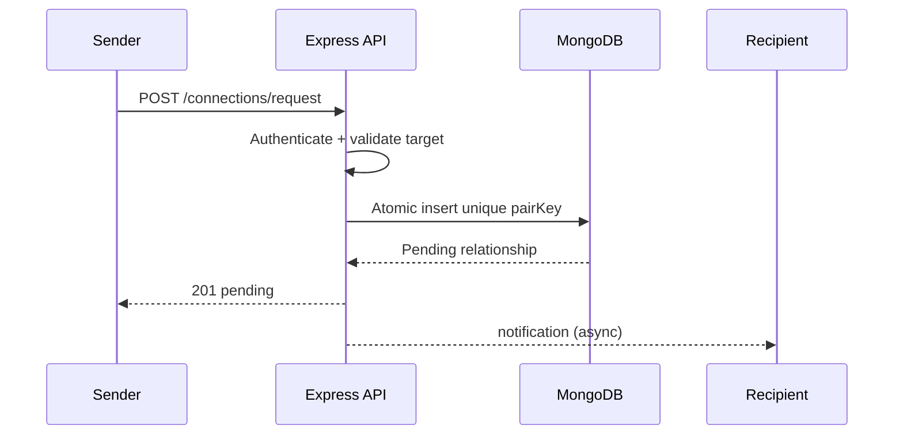
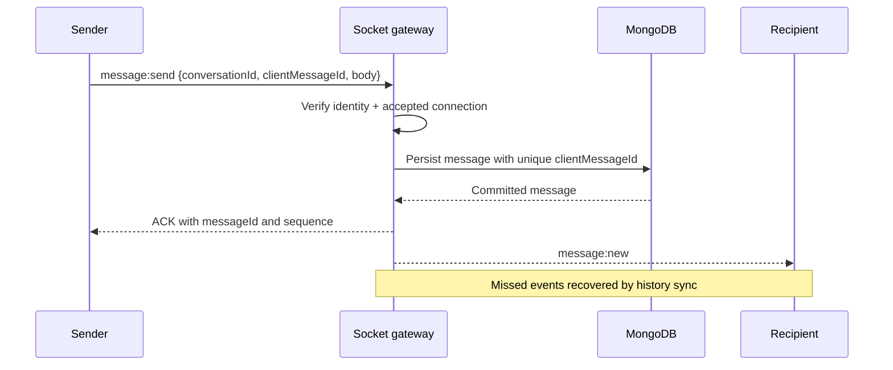
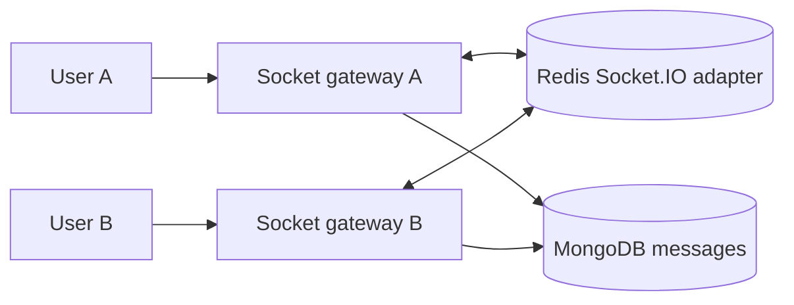
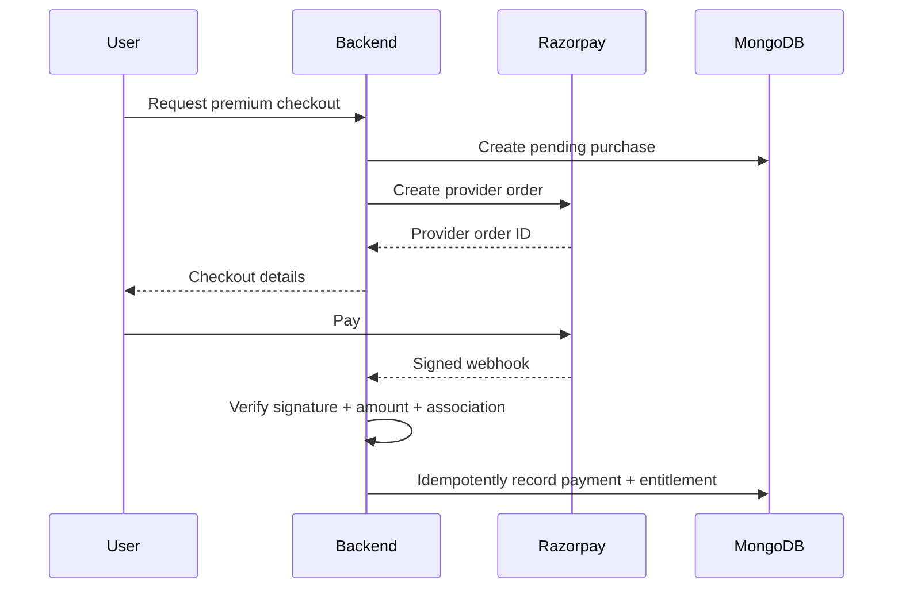

# Lesson 28 — CodeBuddy System Design ⭐⭐⭐⭐⭐

> **Goal:** Design your developer networking platform end to end in simple English with Mermaid diagrams, practical Node.js/Mongoose/Socket.IO examples, authentication, payment correctness, scaling and interview practice. Numeric capacity estimates are illustrative assumptions.

## 01. Learning goals and scope

Design **CodeBuddy**, a developer networking application with swipe/discovery feed, connection requests, accepted connections, 1:1 real-time chat, profile editing, email notifications, and premium subscriptions. Stack: Next.js frontend, Node.js/Express backend, MongoDB/Mongoose, Socket.IO, JWT httpOnly cookies, Brevo email, Razorpay, Vercel frontend and Render backend. This is a production-minded reference design, not a claim every enhancement already exists.

## 02. Clarify functional requirements

Users register/login, manage profiles and skills, discover developers, send interest/ignore decisions, accept/reject requests, see connections, chat only with authorized peers, and purchase premium plans. Later: block/report, search, recommendations, group chat, push, moderation and analytics. Specify what premium unlocks and whether an expired subscription removes existing connections.

## 03. Nonfunctional requirements

Protect private profiles and chats, avoid duplicate connection edges, preserve messages durably, provide low-latency live delivery, survive reconnects, and prevent duplicate payment entitlements. Example p95 feed < 400 ms and online chat delivery < 300 ms in one region are **illustrative goals**, not measured guarantees.

## 04. Capacity assumptions

Assume 100,000 registered users, 10,000 daily active users, 30 feed cards/user/day and 20 messages/user/day. That's ~300,000 feed impressions/day (~3.5/s average) and ~200,000 messages/day (~2.3/s average); peaks and hotspots can be much higher. Begin with one API and DB; add caching and distributed gateways when measurements justify it.

## 05. High-level architecture


In an MVP, API and gateway can run in one Node.js process. Keep responsibilities logically separate for testing and future scaling.

## 06. Component boundaries

**Auth:** sessions/tokens and authorization. **Profiles:** public developer details and privacy. **Discovery:** feed and swipe decisions. **Connections:** requests, acceptance, rejection and blocking. **Chat:** messages/history/live events. **Billing:** payment verification, subscription entitlements and reconciliation. **Notifications:** email and in-app events. A modular monolith is appropriate initially.

## 07. Deployment diagram


Render free/sleeping instances and cross-origin cookies may affect reliability; verify current hosting limits. Persistent Socket.IO connections need a hosting runtime that supports long-lived connections.

## 08. User schema

```js
const userSchema = new Schema({
  name: { type: String, required: true },
  email: { type: String, required: true, lowercase: true, trim: true },
  passwordHash: { type: String, required: true, select: false },
  bio: String,
  skills: [{ type: String }],
  photoUrl: String,
  premiumUntil: Date,
  isActive: { type: Boolean, default: true }
}, { timestamps: true });
userSchema.index({ email: 1 }, { unique: true });
```
Never store plaintext passwords. Validate email uniqueness and profile field length server-side.

## 09. Connection model

A relationship has two directional roles: requester and recipient. Store a normalized unordered pair key to prevent duplicate relationship documents between the same two users. Preserve requesterId/recipientId to represent who initiated the request. Status might be `pending`, `accepted`, `rejected`, `blocked`; decide whether ignored swipes are separate from connection records.

## 10. Connection schema

```js
const connectionSchema = new Schema({
  pairKey: { type: String, required: true, unique: true },
  requesterId: { type: Schema.Types.ObjectId, required: true, ref: 'User' },
  recipientId: { type: Schema.Types.ObjectId, required: true, ref: 'User' },
  status: { type: String, enum: ['pending','accepted','rejected','blocked'], required: true }
}, { timestamps: true });
connectionSchema.index({ recipientId: 1, status: 1, createdAt: -1 });
connectionSchema.index({ requesterId: 1, status: 1, createdAt: -1 });
```
Construct `pairKey` by sorting canonical ObjectId strings and joining with a separator. Reject self-requests.

## 11. Connection state machine


Explicitly define whether cancellation, unblocking and re-request are supported. State transitions must verify the acting user's role.

## 12. Concurrent connection requests

Alice requests Bob while Bob requests Alice. Without unique pair constraints, two pending records can appear. Enforce unique `pairKey`, catch duplicate-key errors, then resolve according to product policy: auto-accept reciprocal request or return the existing pending request. Do not use “check then insert” as the only concurrency control.

## 13. Swipe feed requirements

Show active developers excluding the current user, already connected/requested users, ignored profiles (according to policy), blocked accounts, and optionally users outside selected filters. A swipe decision should persist so the same person does not immediately reappear. Feed ranking can start simple: recent activity or profile completeness.

## 14. Feed query design

For modest scale, query eligible users with indexed filters and a bounded page size, excluding known relationships. Large `$nin` lists can become expensive as users accumulate swipes; consider a candidate pool, precomputed eligibility, or an indexed interactions collection at scale. Measure MongoDB explain plans.

## 15. Feed cursor pagination

Sort by a stable field pair such as `(createdAt,_id)` or ranking score with a deterministic tie-breaker. Use a cursor, not a large `skip`, for deep pagination. Personalized ranking may change while paging, so define acceptable repeats/misses and use a snapshot/version if strict stability matters.

## 16. Feed ranking

An MVP can sort by activity, shared skills, and completeness with transparent weights. Avoid using sensitive attributes or hidden discriminatory proxies. At scale, generate candidates asynchronously and rerank per request. Track feed impressions separately from swipes to understand conversion.

## 17. Request creation flow


If a notification fails, the connection request must remain correct and visible in the recipient's inbox.

## 18. Accept/reject authorization

Only the recipient of a pending request may accept or reject it. Use a conditional DB update such as `{_id, recipientId:authUserId, status:'pending'}` to prevent stale or unauthorized transitions. If no document matches, return a suitable 404/409 response rather than pretending success.

## 19. Mongoose conditional accept

```js
const updated = await Connection.findOneAndUpdate(
  { _id: requestId, recipientId: authUserId, status: 'pending' },
  { $set: { status: 'accepted' } },
  { new: true }
);
if (!updated) throw new Error('Not found, unauthorized, or already processed');
```
Use a centralized Express 5 error handler to map domain errors into HTTP status codes.

## 20. REST API contract

| Method | Endpoint | Purpose |
|---|---|---|
| POST | `/auth/signup` | Create account |
| POST | `/auth/login` | Start session |
| POST | `/auth/logout` | End session |
| GET | `/profile/me` | Own profile |
| PATCH | `/profile/me` | Edit profile |
| GET | `/feed?cursor=...` | Discover profiles |
| POST | `/connections/request` | Send request |
| PATCH | `/connections/:id/accept` | Accept request |
| PATCH | `/connections/:id/reject` | Reject request |
| GET | `/connections` | Accepted connections |
| GET | `/chats/:conversationId/messages` | History |
| POST | `/billing/orders` | Start payment |
| POST | `/billing/webhooks/razorpay` | Signed provider callback |

## 21. Authentication with JWT cookies

Use short-lived signed access tokens or a server-side session. For cross-site Vercel→Render requests, `SameSite=None; Secure; HttpOnly` may be required for cookies, but modern browser third-party cookie restrictions can still block them. Prefer a same-site custom-domain setup or a backend-for-frontend/proxy when possible. Configure CORS with explicit allowed origin and `credentials:true`.

## 22. Cookie and CSRF protection

HttpOnly prevents JavaScript reading the token but does **not** eliminate CSRF. Cookie-authenticated state-changing requests need appropriate CSRF defenses, origin checks and SameSite strategy. Rotate/revoke sessions where feasible, enforce HTTPS and never log JWTs.

## 23. Password security

Hash passwords with a suitable password hashing algorithm such as Argon2id or bcrypt with appropriate cost, use rate limits and generic login errors, and protect password reset tokens. JWT signing secret must be strong and stored only on the server. Consider account verification and brute-force protection.

## 24. Socket.IO authentication

Authenticate the socket handshake using a trusted cookie/session or token. Derive `socket.data.userId` from verified auth, never from an untrusted client-supplied ID. Verify that both chat participants have an accepted, unblocked connection before joining a room or sending a message.

## 25. Deterministic 1:1 room ID

CodeBuddy's sorted participant IDs can form a stable room key: `[a,b].sort().join('_')`. It is a routing convention, **not** an authorization mechanism. For persistence and future group chat, a Conversation document with unique `pairKey` and stable `_id` is preferable.

## 26. Conversation and message schema

```js
const conversationSchema = new Schema({
  pairKey: { type: String, required: true, unique: true },
  participantIds: [{ type: Schema.Types.ObjectId, ref: 'User' }],
  nextSequence: { type: Number, default: 0 }
}, { timestamps: true });
const messageSchema = new Schema({
  conversationId: { type: Schema.Types.ObjectId, required: true, ref: 'Conversation' },
  senderId: { type: Schema.Types.ObjectId, required: true, ref: 'User' },
  clientMessageId: { type: String, required: true },
  sequence: { type: Number, required: true },
  body: { type: String, required: true, maxlength: 5000 }
}, { timestamps: true });
messageSchema.index({ conversationId: 1, sequence: 1 }, { unique: true });
messageSchema.index({ conversationId: 1, senderId: 1, clientMessageId: 1 }, { unique: true });
```
Allocate sequences atomically with a clear transaction/commit strategy, as explained in Lesson 24.

## 27. Message send flow


Never ACK “persisted” before DB commit; a lost ACK must be retried with the same clientMessageId.

## 28. Chat delivery semantics

Differentiate queued locally, persisted on server, delivered to recipient device and read by human. Socket.IO ACK is application-defined; it does not prove human delivery. Use per-conversation ordering, stable IDs and reconnect sync. Presence/typing are ephemeral and may be approximate.

## 29. Socket.IO handler sketch

```js
io.on('connection', socket => {
  socket.join('user:' + socket.data.userId);
  socket.on('chat:join', async ({ conversationId }, ack) => {
    try {
      await assertChatParticipant(socket.data.userId, conversationId);
      await socket.join('conversation:' + conversationId);
      ack?.({ ok: true });
    } catch { ack?.({ ok: false, error: 'Forbidden' }); }
  });
  socket.on('message:send', async (payload, ack) => {
    try {
      const saved = await persistMessageOnce(socket.data.userId, payload);
      io.to('conversation:' + saved.conversationId).emit('message:new', saved);
      ack?.({ ok: true, id: saved.id, sequence: saved.sequence });
    } catch { ack?.({ ok: false, error: 'Send failed' }); }
  });
});
```
Teaching sketch assumes authenticated middleware and validated helper functions. Add size/rate limits and detailed error handling in production.

## 30. Reconnect and history sync

On reconnect, reauthenticate, rejoin authorized rooms and fetch messages after the last seen sequence. Merge by stable message ID to avoid duplicates when live events overlap with history. Socket.IO room broadcasts alone cannot guarantee replay of missed messages.

## 31. Presence and typing

Presence may require shared TTL-based state across gateways, especially with multiple tabs/devices. Typing events are throttled, short-lived and not stored permanently. A disconnect does not necessarily mean a user is offline if another device is connected.

## 32. Chat pagination

Use MongoDB index `{conversationId:1,sequence:1}` and query `sequence < cursor` sorted descending with a bounded limit. Authorize conversation membership before fetching. Avoid deep `skip` pagination for long histories.

## 33. Horizontal Socket.IO scaling

With multiple Node.js instances, use a compatible Redis adapter for cross-instance room broadcasts. Redis Pub/Sub is not durable; MongoDB remains the source of truth and history sync handles missed events. HTTP polling transport may require sticky sessions depending on deployment.

## 34. Cross-instance architecture



## 35. Email notification design

Use Brevo to send signup verification, connection request alerts or important account emails. Send after the authoritative DB write through a durable outbox/queue when reliability matters. Store provider IDs, bounded retries and suppression rules; do not send duplicate email on every retried connection request.

## 36. Notification event examples

```json
{
  "eventId": "evt_123",
  "type": "connection.requested",
  "recipientUserId": "user_b",
  "aggregateId": "connection_42",
  "createdAt": "2026-10-21T10:00:00Z"
}
```
Other events: `connection.accepted`, `chat.message_created`, `subscription.activated`. Use stable event IDs and user preferences.

## 37. Premium feature design

Define server-side entitlements: e.g. more daily requests, premium discovery filters, or special badges. Never rely on a client-side `isPremium` flag. Model plans, subscription/payment state, expiry, and audit history. An expired plan should consistently disable gated actions without deleting existing user content.

## 38. Razorpay payment flow


Browser callback alone is insufficient proof of payment. Follow Razorpay's current API and webhook documentation when implementing.

## 39. Payment data model

```js
const paymentSchema = new Schema({
  userId: { type: Schema.Types.ObjectId, required: true, ref: 'User' },
  providerOrderId: { type: String, required: true, unique: true },
  providerPaymentId: { type: String, unique: true, sparse: true },
  planId: { type: String, required: true },
  amountMinor: { type: Number, required: true },
  currency: { type: String, required: true },
  status: { type: String, enum: ['created','paid','failed','refunded'], required: true }
}, { timestamps: true });
```
For recurring subscriptions, use separate subscription and billing-event records. Define precise renewal/expiry semantics and reconcile provider state.

## 40. Webhook verification and idempotency

Verify webhook signature using the raw request body and provider secret before parsing/trusting payload. Persist unique webhook event IDs and apply valid payment state transitions once. Webhooks can arrive out of order or multiple times; reconcile ambiguous states with provider APIs rather than double-granting premium.

## 41. Entitlement expiry and renewal

Keep `premiumUntil` or a normalized subscription state. Check entitlement on every premium-only backend action. Concurrent renewals require atomic rules so a late event cannot shorten the subscription. Track refunds/chargebacks and define revocation policy.

## 42. Security threats

Threats include forged JWTs, CSRF on cookie requests, account enumeration, mass scraping of developer profiles, unauthorized chat room joins, IDOR in connections, spam requests, webhook spoofing, and leaked provider secrets. Mitigate with server-side authorization, secure cookies, input validation, rate limits, webhook signatures, and logging redaction.

## 43. Profile privacy and abuse controls

Allow users to hide or block profiles, report harassment and limit who can contact them. Respect visibility settings in feed, search and direct profile endpoints. Limit scraping and mass requests. Avoid exposing private email or contact information unless explicitly permitted.

## 44. Rate limiting

Apply per-IP and per-account limits to signup/login, swipe decisions, connection requests, chat sends and billing endpoints. Distributed API instances require shared rate-limit state. Design separate limits for free/premium tiers and prevent users bypassing quotas through concurrent requests.

## 45. MongoDB indexing

Recommended starting indexes: users(email unique), connections(pairKey unique), connections(recipientId,status,createdAt), connections(requesterId,status,createdAt), messages(conversationId,sequence unique), messages(conversationId,senderId,clientMessageId unique), payments(providerOrderId unique). Verify actual `explain()` plans and avoid unnecessary indexes.

## 46. Caching strategy

Cache public profile cards or feed candidates only where privacy and freshness rules permit. Do not cache private conversations across users. Premium entitlements and block decisions need authoritative checks or tightly controlled invalidation. Redis is optional until measured scale justifies it.

## 47. Database transactions

Use MongoDB atomic updates for single-document invariants. For changes across payment and entitlement records or message and sequence state, use a transaction where supported. Keep transactions short; design idempotent retries for transient errors and unknown commit outcomes.

## 48. Outbox for durable events

After a connection is accepted or a payment is confirmed, write an outbox event in the same transaction as the business state. A worker later sends Brevo emails or other notifications. Workers deduplicate event IDs because relays may republish after a crash.

## 49. Failure scenarios

**Render sleeps/restarts:** socket disconnects; clients reconnect and sync history. **MongoDB unavailable:** do not ACK chat messages as persisted. **Redis adapter down:** cross-instance broadcasts may fail; history sync repairs. **Brevo down:** retry notification without undoing accepted connection. **Razorpay timeout:** reconcile provider payment before charging/granting again. **Webhook duplicate:** deduplicate.

## 50. Observability

Track feed latency, swipe/request conversion, connection state transition conflicts, active sockets, reconnect rates, chat commit latency, missed sequence gaps, DB errors, email queue lag, payment webhook retries, premium activation failures, and auth/rate-limit violations. Use request IDs and avoid logging JWTs, chat bodies or secrets.

## 51. Testing strategy

Unit-test feed eligibility, normalized pair keys, state transitions, entitlement rules and validators. Integration-test unique indexes, connection races, chat idempotency and ownership checks. E2E-test login, swipe, accept, chat, reconnect, premium checkout and expired entitlement. Simulate duplicate webhooks and gateway crash after message commit.

## 52. Scaling roadmap

**Stage 1:** one Express+Socket.IO server, MongoDB Atlas, Vercel frontend, Render backend. **Stage 2:** optimize feed queries/indexes, add cursor pagination and durable chat sync. **Stage 3:** separate background workers, introduce Redis for shared rate limits and socket adapter if multi-instance. **Stage 4:** shard/partition or add specialized services only when actual load and team structure justify it.

## 53. Cost-aware choices

Keep a modular monolith, MongoDB indexes, object storage for profile images, and one notification worker before adding Kubernetes or multiple databases. Free-tier sleep, quotas and connection limits can affect chat UX; benchmark and plan an upgrade path rather than assuming always-on production behavior.

## 54. System design trade-offs

| Choice | Benefit | Trade-off |
|---|---|---|
| Modular Express backend | Simpler deployment | Shared scaling boundary |
| MongoDB/Mongoose | Flexible profiles/chat documents | Transaction/consistency design |
| Socket.IO | Rooms, ACK, reconnection | Adapter/sticky-session concerns |
| Redis adapter | Cross-instance broadcasts | Pub/Sub not durable |
| JWT httpOnly cookie | JS cannot read token | CSRF and cross-site cookie issues |
| Razorpay | Managed payments | Webhooks, reconciliation, provider dependence |
| Outbox | Reliable post-commit events | Worker and duplicate handling |

## 55. Interview walkthrough

Explain requirements and data entities first. Draw Next.js → Express → MongoDB + Socket.IO, then connection state machine, unique pair constraint, chat persistence/ordering and reconnect sync. Explain auth and room authorization, premium payment verification, and failure scenarios. Justify why CodeBuddy starts as a modular monolith and how it scales safely.

## 56. Common mistakes

Treating sorted room IDs as authorization; duplicate connection requests without unique pairKey; sending chat events before persistence; assuming Socket.IO ACK means delivered/read; trusting client `isPremium`; granting premium from browser callback; skipping webhook signature verification; missing CSRF protection for cookie auth; relying on Redis Pub/Sub for message durability; no reconnect sync; storing provider secrets in frontend.

## 57. Interview questions

**Q1:** Why MongoDB? Flexible user/chat docs and indexes. **Q2:** How avoid duplicate connections? Unique normalized pair key. **Q3:** Who can accept? Only pending recipient. **Q4:** How exclude swiped profiles? Interaction filters/indexes. **Q5:** Why cursor feed? Efficient deep pagination. **Q6:** Why Socket.IO? Real-time rooms and ACK. **Q7:** Is room ID permission? No. **Q8:** How ensure chat durability? DB commit before ACK. **Q9:** Why clientMessageId? Idempotent retries. **Q10:** How handle offline chat? Persist and sync history. **Q11:** Why Redis adapter? Multi-instance broadcasts. **Q12:** Is Pub/Sub durable? No. **Q13:** Why httpOnly? Reduce JS token access. **Q14:** Does httpOnly prevent CSRF? No. **Q15:** How verify premium? Signed webhook + authoritative DB. **Q16:** Duplicate payment webhook? Dedup and state guard. **Q17:** Why outbox? Prevent lost notification intent. **Q18:** How prevent spam? Auth + shared limits + blocking. **Q19:** What if Render restarts? Reconnect and resync. **Q20:** When microservices? Clear independent scale/team needs.

## 58. Hands-on exercises

1. Draw CodeBuddy's current and scaled architecture. 2. Create normalized pairKey and unique index. 3. Simulate Alice/Bob concurrent requests. 4. Add role-based acceptance authorization. 5. Implement cursor feed filtering. 6. Add clientMessageId and durable ACK. 7. Reconnect and sync missed messages. 8. Test multi-device socket rooms. 9. Verify Razorpay webhook and deduplicate payment events. 10. Add outbox for Brevo notifications and test provider failure.

## 59. Final revision checklist

- [ ] I can explain CodeBuddy's functional and nonfunctional requirements.
- [ ] I can draw its Next.js, Express, MongoDB and Socket.IO architecture.
- [ ] I understand unique connection pairs and state transitions.
- [ ] I can design a secure and scalable swipe feed.
- [ ] I can persist and order chat messages with safe retries.
- [ ] I can handle reconnects, offline users and multi-instance broadcasts.
- [ ] I understand cross-site JWT cookie and CSRF risks.
- [ ] I can verify payments and grant premium idempotently.
- [ ] I can design notifications, rate limits, and failure recovery.
- [ ] I can present CodeBuddy as a full system design interview case study.

---

**Core takeaway:** CodeBuddy is a networking app with distinct correctness boundaries: unique connection relationships, authorized durable chat, and server-verified premium entitlements. Scale only after those invariants are solid.
