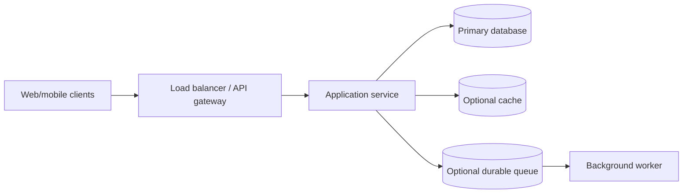
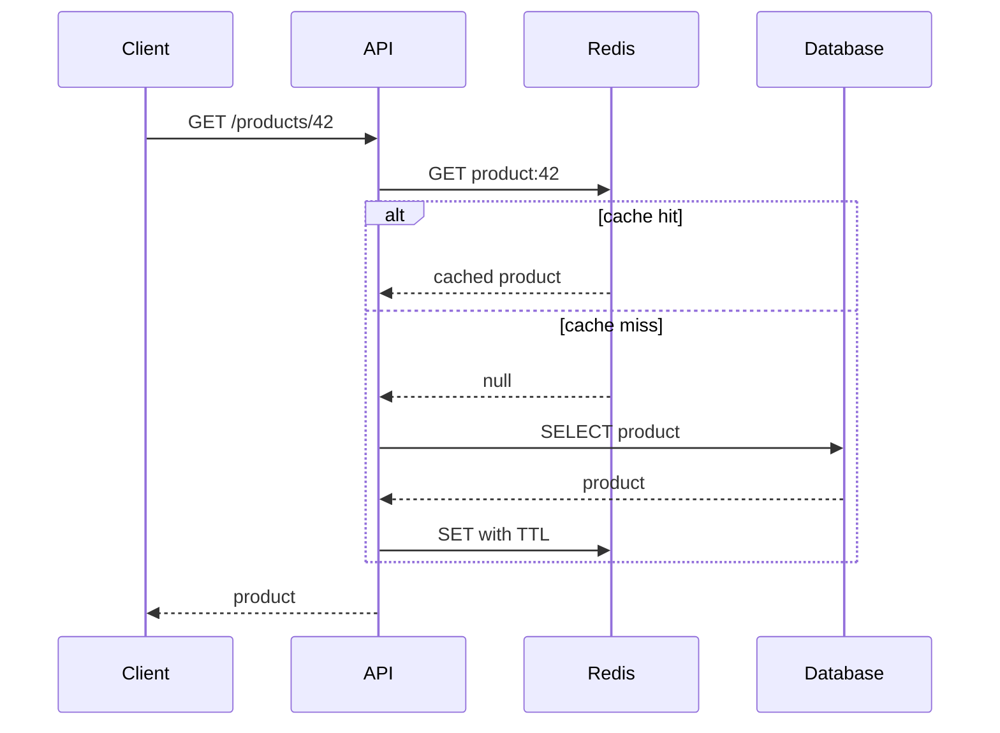
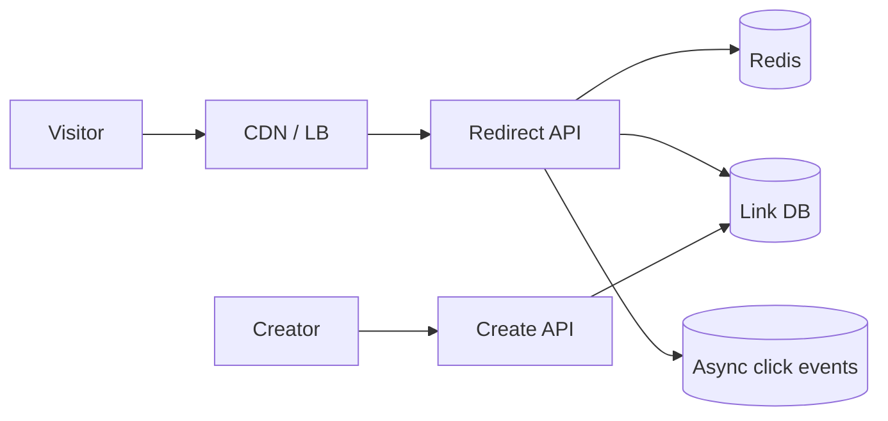
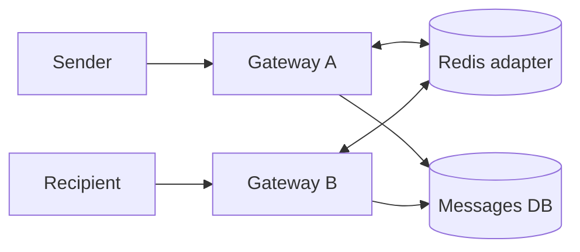
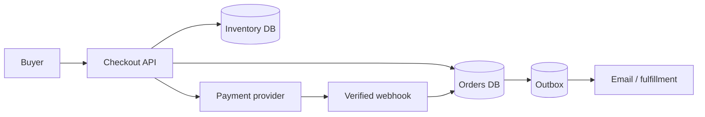

# Lesson 29 — Interview-Style System Design ⭐⭐⭐⭐⭐

> **Final lesson of the 29-lesson System Design curriculum.** A practical, simple-English guide to structuring HLD interviews, doing capacity estimates, defending trade-offs, handling failures, and practicing real designs. All numeric examples are illustrative assumptions, not production measurements.

## 01. What this lesson teaches

System design interviews test your **reasoning and communication**, not memorization of a perfect architecture. You should clarify the problem, make assumptions, estimate scale, choose sensible components, explain data and request flows, identify bottlenecks, and discuss failures and trade-offs. This lesson combines HLD and selective LLD using real CodeBuddy, ShopHub and CareerLoop examples.

## 02. What interviewers evaluate

They look for requirement discovery, prioritization, correct core invariants, capacity reasoning, clear APIs/data models, understanding of databases/caching/queues, reliability, security, trade-off judgment, and ability to respond to changing constraints. Interview standards vary by company and seniority; junior roles usually benefit more from sound fundamentals than exotic distributed systems.

## 03. Typical interview structure

A 45-minute practice plan: 0–5 minutes clarify requirements; 5–10 estimate and set assumptions; 10–22 draw high-level architecture; 22–32 deep dive into data model and critical path; 32–40 scaling/failure/trade-offs; 40–45 summarize and answer follow-ups. Adapt dynamically; don't mechanically follow the clock when interviewer asks for depth.

## 04. The repeatable framework

**C → R → E → A → D → S → F → T**: Clarify problem → Requirements → Estimates → APIs/data → Diagram → Scale → Failures/security → Trade-offs and summary. Use this as a memory aid, not a rigid script. Prioritize the hardest correctness constraint early.

## 05. Start with clarification questions

Ask who the users are, key operations, read/write ratio, expected DAU, data retention, latency/availability goals, region, offline behavior, consistency, privacy, and features excluded from scope. Don't ask 20 questions without proposing assumptions; state what you'll assume if numbers are unavailable.

## 06. Functional vs nonfunctional requirements

Functional = what users do (send chat, shorten URL, book inventory). Nonfunctional = how well it works (durability, p95 latency, availability, consistency, security, cost). Distinguish hard correctness guarantees from desirable performance. For example, “never double-charge” is a business invariant; “under 200 ms” is an SLO target.

## 07. Define scope explicitly

For a URL shortener, MVP might include create link and redirect, excluding analytics/custom aliases. For chat, start with 1:1 text, not calls and E2EE. For e-commerce, prioritize catalog, checkout, stock, payment; defer recommendations. Scope keeps the discussion focused and demonstrates product judgment.

## 08. Identify the critical invariant

Every design has something that must not break: **URL shortener:** one code maps to one target; **chat:** persisted messages must be recoverable; **e-commerce:** no oversell/double charge; **notification:** no lost notification intent after business commit; **CareerLoop:** one user's private data never leaks to another. State this invariant before choosing technology.

## 09. Capacity estimation formula

Average QPS = total requests per day ÷ 86,400. Peak QPS = average × assumed peak factor. Daily storage = events/day × average stored bytes. Bandwidth = requests/sec × average payload bytes. Concurrent connections ≈ arrival rate × average session duration (under stable conditions). State assumptions and order of magnitude; don't fake precision.

## 10. Worked estimation: chat

Assume 100,000 DAU × 40 messages/day = **4,000,000 messages/day**. Average writes ≈ 46.3/s; at 10× peak ≈ 463/s. If each message plus metadata/index overhead is approximately 1 KB, raw ≈ 4 GB/day ≈ 1.46 TB/year before replication, backups and media. This informs DB sizing, not a mandate to shard immediately.

## 11. Worked estimation: URL shortener

Assume 10 million redirects/day → ~116 average redirects/sec; 10× peak → ~1,157/s. Assume 100,000 new links/day and 300 bytes per stored link → ~30 MB/day raw link data before indexes/replicas. Reads dominate writes, so a CDN/cache and indexed key lookup matter more than complex write partitioning initially.

## 12. Worked estimation: CareerLoop

Assume 10,000 users, 100 application records each = 1 million applications total. At 2 KB/record, ~2 GB raw before indexes, related tables and backups. This is small for a well-indexed PostgreSQL deployment. Explain why a modular monolith and Neon/PostgreSQL are appropriate rather than introducing Kafka and sharding.

## 13. Back-of-envelope cheat sheet

| Metric | Formula | Why it matters |
|---|---|---|
| Average QPS | daily ops / 86,400 | Baseline throughput |
| Peak QPS | avg × peak factor | Capacity headroom |
| Daily data | records/day × bytes/record | Storage growth |
| Read/write ratio | reads ÷ writes | Cache and DB pressure |
| Cache hit rate | hits ÷ total cache lookups | DB offload |
| Concurrent sockets | active connected clients | Gateway memory/FDs |
| Replication storage | raw × copies | Cost and recovery |
Avoid confusing MB (decimal) with MiB (binary) in precise estimates.

## 14. Draw a simple architecture first


Begin with Client → API → DB. Add cache, queue, replicas, CDN, and partitioning only when a requirement justifies them. Describe arrows, not only boxes.

## 15. Explain each arrow

For every arrow, ask: synchronous or asynchronous? protocol? timeout? authentication? retries? failure behavior? Example: browser→API uses HTTPS; API→DB uses a pooled driver; API→queue may need outbox to avoid losing a committed event; worker→email provider may have ambiguous timeout and duplicate risk.

## 16. API design basics

Name core endpoints and show inputs/outputs. Prefer resource-oriented APIs for CRUD, such as `POST /applications`, `PATCH /applications/:id/status`, `GET /applications?cursor=...`. For real-time chat, use WebSocket/Socket.IO events. Explain authentication, pagination, error codes, idempotency keys and versioning where relevant.

## 17. Sample checkout API

```http
POST /api/checkout
Idempotency-Key: 0f50f8b3-... 
Content-Type: application/json

{"cartId":"cart_123","shippingAddressId":"addr_4"}
```
The server recomputes prices and inventory, creates a pending order and returns a stable order/payment reference. Never accept client-submitted final price as authoritative.

## 18. Data modeling questions

Identify entities, relationships, unique constraints, indexes, lifecycle and ownership. Ask which writes must be atomic and which reads can be stale. Examples: user→applications (1:N), application↔recruiters (M:N), conversation→messages (1:N), order→orderItems (1:N). Data modeling is not just choosing SQL versus NoSQL.

## 19. SQL vs NoSQL decision

Use SQL when relational constraints, joins, and multi-row transactions are central; use document stores when flexible documents and document-local access patterns are a strong fit. Both can support indexes, transactions and scale, with different operational trade-offs. Pick based on queries and invariants, not slogans like “NoSQL is always faster.”

## 20. Indexes and query patterns

Start from actual query: `WHERE user_id=? AND status=? ORDER BY updated_at DESC LIMIT 20`. A compound index `(user_id,status,updated_at DESC)` may help. Explain selectivity, covering queries, write overhead and why `EXPLAIN`/query plans are necessary. Don't invent indexes without query patterns.

## 21. Consistency choices

Strong consistency for payments, inventory reservation, unique usernames/short codes, and authorization. Eventual consistency may be acceptable for feed ranking, analytics, search indexes, unread badges and presence. Consistency is chosen per operation and business guarantee, not one blanket label for an entire system.

## 22. Caching deep dive

Cache read-heavy, repeatable data like product cards or short-link destinations. Define key, TTL, invalidation, cache miss, stampede mitigation, and behavior when Redis fails. Cache-aside: read cache → miss → DB → populate. Never use stale cache as authoritative stock/payment state.

## 23. Cache-aside diagram



## 24. Queues and asynchronous processing

Use durable queues for email, analytics, thumbnail processing, notifications and background work. A queue decouples user latency from slow dependencies and supports retries, but adds eventual consistency and operations. Plain Redis Pub/Sub is not a durable task queue. Explain at-least-once delivery and consumer deduplication.

## 25. Transactional outbox

When a business DB write and event publication must stay aligned, insert an outbox event in the same DB transaction. A relay publishes later. Relay crashes can cause duplicates, so consumers use stable event IDs. The outbox reduces lost events; it does not magically guarantee exactly-once external side effects.

## 26. Retries, idempotency, timeouts

A timeout means the caller doesn't know whether an operation succeeded. Retrying a non-idempotent payment can double-charge; retrying a chat send can duplicate messages. Use stable client/request IDs, unique constraints, bounded retries with jitter and reconciliation for ambiguous external effects.

## 27. Load balancing and horizontal scaling

Stateless API replicas behind a load balancer handle more traffic, but shared state must live in DB/cache/session store. Socket.IO long polling may need sticky sessions; WebSocket gateways may need a cross-instance adapter. Scaling app servers alone won't solve a hot DB row or external provider quota.

## 28. Database replication and partitioning

Read replicas can serve eventually consistent reads but introduce lag. Sharding distributes data by key but complicates cross-shard queries and transactions. First optimize indexes, queries, pooling, and caching. State a shard key only after describing access patterns and hot-key risks.

## 29. Availability vs durability

Availability means serving requests; durability means accepted data survives failures. A chat socket can be online while message persistence is unavailable—do not ACK as saved. Replicas, backups, retries and failover address different failure classes. Explain recovery point objective (RPO) and recovery time objective (RTO) when relevant.

## 30. Failure analysis framework

For each component, ask: what if it times out, returns 500, crashes after committing, is slow, or sends duplicate callbacks? What does the user see? What state is persisted? Can the operation be retried safely? Use a failure table rather than vague “we add retries.”

## 31. Failure table

| Failure | User-visible behavior | Recovery |
|---|---|---|
| Redis down | Slower reads | DB fallback + alert |
| DB down | Write fails/pending | Retry only safe operations |
| Worker crashes | Async event delayed | Durable queue redelivery |
| Payment response lost | Payment pending | Provider reconciliation |
| Socket disconnects | Live chat pauses | Reconnect + history sync |
| Duplicate webhook | No duplicate side effect | Unique event ID/state guard |

## 32. Security checklist

Authenticate users, authorize each resource, validate inputs, use TLS, protect secrets, rate-limit abuse, prevent IDOR, and design cookie/CSRF defenses. For chat, verify membership; for CareerLoop, filter by userId; for payments, verify provider signatures and amounts; for uploads, validate size/type and access.

## 33. Observability and SLOs

Monitor request rate, errors, p50/p95/p99 latency, DB query duration, connection pool saturation, cache hit rate, queue lag, retry counts, dead-letter queue, payment reconciliation, and user-facing outcomes. Distinguish an SLO target from a measured metric. Use traces with correlation IDs and redact secrets.

## 34. Cost and operational complexity

A system with 100 users rarely needs Kafka, Kubernetes, multi-region active-active databases, and 12 microservices. Explain the cost of extra moving parts: deployment, monitoring, data duplication, failure modes and on-call burden. Start with the simplest design satisfying constraints, then evolve it.

## 35. Deep-dive selection

After the overview, pick the most difficult aspect: URL shortener→unique code generation/cache; chat→ordering/offline delivery; e-commerce→inventory/payment; notifications→outbox/retries; CareerLoop→authorization/status history. A deep dive should show correctness, concurrency and failure recovery—not merely list technologies.

## 36. Mock interview 1: URL shortener

**Prompt:** Design a service that converts long URLs to short codes and redirects visitors. **Clarify:** custom aliases? expiry? analytics? **Estimate:** reads dominate writes. **API:** POST /links, GET /:code. **Storage:** unique code index and original URL. **Algorithm:** random Base62 with collision retry or distributed ID encoding. **Read path:** CDN/cache→DB. **Failure:** code collision, invalid URLs, abuse, expired links. **Trade-off:** 301 vs 302 depends on desired cache/analytics semantics.

## 37. Mock interview 1 architecture



## 38. Mock interview 2: real-time chat

**Prompt:** Design one-to-one chat for CodeBuddy. **Clarify:** offline delivery? ordering? read receipts? **Entities:** Conversation, Message, membership. **Flow:** authenticate socket → validate membership → persist message → ACK → broadcast. **Correctness:** clientMessageId dedup and per-conversation sequence. **Recovery:** cursor history sync. **Scale:** Redis Socket.IO adapter, but DB remains authoritative. **Failure:** crash after commit before broadcast.

## 39. Mock interview 2 architecture



## 40. Mock interview 3: e-commerce checkout

**Prompt:** Design ShopHub checkout for a flash sale. **Clarify:** inventory stock, payment provider, reservation timeout, refunds. **Flow:** server recalculates total → atomically reserve stock → create pending order → create payment intent → verify webhook → confirm order. **Correctness:** no oversell, unique checkoutKey, signed webhook dedup. **Failure:** paid after reservation expired requires refund/reconciliation policy. **Scale:** queue hot checkout work when necessary.

## 41. Mock interview 3 architecture



## 42. Mock interview 4: CareerLoop

**Prompt:** Design a job application tracker. **Clarify:** single-user vs SaaS, pipeline stages, calendar/reminders, privacy. **Stack:** Next.js App Router, Drizzle, Neon PostgreSQL. **Model:** User, Company, Application, Recruiter, Followup, Interview, Event. **Correctness:** user ownership and transactional status history. **UX:** optimistic Kanban with version conflict. **Reliability:** durable reminder jobs. **Trade-off:** modular monolith over microservices.

## 43. Mock interview 5: notification system

**Prompt:** Design email, push and in-app alerts. **Clarify:** priorities, user preferences, quiet hours, delivery receipts. **Flow:** domain transaction + outbox → durable queue → router → channel workers. **Correctness:** idempotent notification IDs; provider timeouts remain ambiguous. **Failure:** retries, backoff, DLQ. **Scale:** provider-specific quotas and worker concurrency.

## 44. How to handle changing requirements

Interviewers may add “now support 10× users”, “multi-region”, “offline chat”, or “stronger consistency”. First restate the new requirement and identify which component becomes the bottleneck. Explain a minimal incremental change, its cost, and migration strategy. Don't redraw the entire architecture without reason.

## 45. Follow-up: 10× traffic

Measure whether bottleneck is API CPU, database reads, hot writes, sockets, provider quota or network. Scale stateless replicas, cache read-heavy paths, optimize indexes, add worker concurrency where quota permits, then consider partitioning. A 10× increase in traffic does not imply 10× more databases by default.

## 46. Follow-up: multi-region

Ask whether reads or writes must be local, what consistency is required, and acceptable RPO/RTO. Regional CDN and replicas are easier than active-active global inventory/payment writes. Explain leader region, failover, data residency, replication lag and conflict resolution.

## 47. Follow-up: high availability

Identify single points of failure, use health checks and redundant stateless instances, database managed failover/backups, durable queues and retry budgets. Avoid claiming 100% availability. Discuss graceful degradation: browsing may work when recommendations fail, but checkout should not falsely succeed without inventory/payment correctness.

## 48. Communication technique

Speak in short cycles: **assumption → decision → reason → trade-off**. Example: “Because chat must recover after reconnect, I will persist messages before broadcasting. This adds a DB write to the critical path, but avoids losing accepted messages.” Draw one clean diagram and update it as requirements change.

## 49. Useful interview phrases

“I'll assume X unless you'd prefer Y.” “The critical invariant is...” “I would start with a single service because...” “This path is eventually consistent; this write requires atomicity.” “A timeout is ambiguous, so I use an idempotency key.” “At larger scale, I would measure this bottleneck before introducing a queue/shard.”

## 50. Common weak answers and fixes

**Weak:** “Use Redis for speed.” **Better:** “Cache product cards by variant ID for 60 seconds; checkout revalidates stock.” **Weak:** “Use Kafka for scale.” **Better:** “Introduce durable events for email after commit using an outbox.” **Weak:** “Use microservices.” **Better:** “Begin modular monolith; split billing when independent reliability/ownership demands it.”

## 51. Red flags to avoid

Skipping requirements, inventing precise QPS, drawing components without flows, trusting client price/identity, claiming exactly-once delivery, assuming timestamps guarantee order, ignoring duplicate webhooks, using Redis Pub/Sub as durable storage, failing to discuss data ownership, and proposing complex infrastructure without a concrete need.

## 52. HLD vs LLD in interviews

HLD covers components, data flows, storage, scaling and reliability. LLD covers class/module boundaries, interfaces, method contracts and design patterns. A system design interview may touch both; show enough LLD to prove implementability without getting stuck coding every class. Review Lessons 02, 06–08 for foundations.

## 53. TypeScript service boundary example

```ts
interface MessageRepository {
  saveOnce(input: {
    conversationId: string;
    senderId: string;
    clientMessageId: string;
    body: string;
  }): Promise<{ id: string; sequence: number }>;
}
class SendMessage {
  constructor(private repo: MessageRepository) {}
  async execute(input: Parameters<MessageRepository['saveOnce']>[0]) {
    // Authorization must be checked by a trusted service before save.
    return this.repo.saveOnce(input);
  }
}
```
Interfaces improve testability, but do not substitute for authorization, validation or DB unique constraints.

## 54. Self-evaluation rubric

Score each area 0–2: **requirements**, **estimates**, **architecture clarity**, **data model**, **correctness**, **scaling**, **failure recovery**, **security**, **trade-offs**, **communication**. Maximum 20. 0 = missing, 1 = partial, 2 = clear and defensible. The rubric is a practice tool, not a universal hiring score.

## 55. Interactive practice method

Set a 40–45 minute timer, choose a random prompt, and speak your design aloud while drawing on paper or Excalidraw. Record assumptions and trade-offs. Afterward compare against this lesson, score the rubric, and revise only the weakest two categories. Repeating the same prompt with improvements builds confidence faster than memorizing diagrams.

## 56. 7-day interview revision plan

**Day 1:** requirements + estimation, design URL shortener. **Day 2:** SQL/NoSQL, indexes, cache, pagination. **Day 3:** chat and WebSocket reliability. **Day 4:** e-commerce inventory/payment. **Day 5:** notification outbox/queues. **Day 6:** CareerLoop + CodeBuddy mock interviews. **Day 7:** full timed mock, review failure modes and trade-offs. Spend more time on weak areas.

## 57. Hands-on exercises

1. Design URL shortener in 20 minutes and estimate QPS. 2. Design CodeBuddy chat with offline sync and dedup. 3. Explain 100 concurrent buyers for one stock item. 4. Draw a notification outbox and DLQ. 5. Write 5 CareerLoop authorization test cases. 6. Compare PostgreSQL and MongoDB for two scenarios. 7. Explain Redis cache failure behavior. 8. Simulate lost payment response and safe retry. 9. Answer a 10× scale follow-up. 10. Complete a 45-minute recorded mock interview.

## 58. Final interview checklist

- [ ] I ask useful clarification questions and state assumptions.
- [ ] I separate functional and nonfunctional requirements.
- [ ] I identify the critical correctness invariant.
- [ ] I can estimate QPS, storage and peak traffic.
- [ ] I draw a simple architecture and explain every arrow.
- [ ] I define APIs, schemas, indexes and ownership.
- [ ] I choose consistency and caching per operation.
- [ ] I explain retries, idempotency, queues and outbox.
- [ ] I discuss failures, security, scaling and cost.
- [ ] I summarize decisions and trade-offs clearly.

## 59. Course wrap-up

You have moved from system design fundamentals through OOP/SOLID and architecture building blocks into full case studies: URL shortener, chat, notifications, e-commerce, CareerLoop and CodeBuddy. The next skill is repetition: turn each lesson into a 30–45 minute spoken design, practice capacity math, and explain **why** you chose every component. Completing lessons builds a foundation; interview readiness comes from applying them.

---

**Final takeaway:** The strongest design is not the most complicated one. It is the simplest design that satisfies the requirements, protects critical invariants, and can be explained and evolved under changing constraints.
